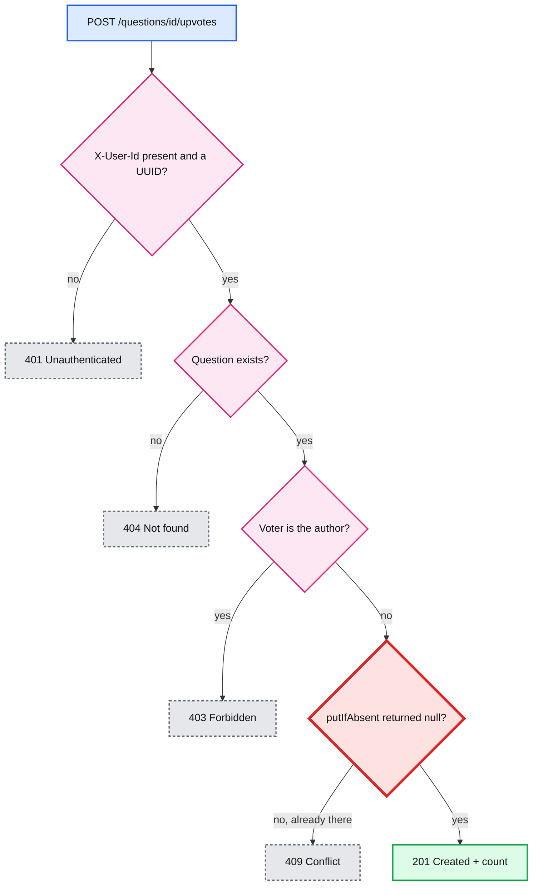
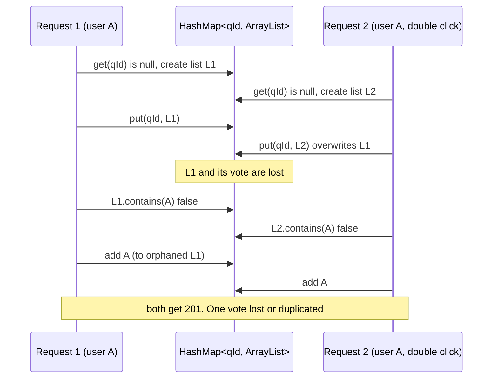
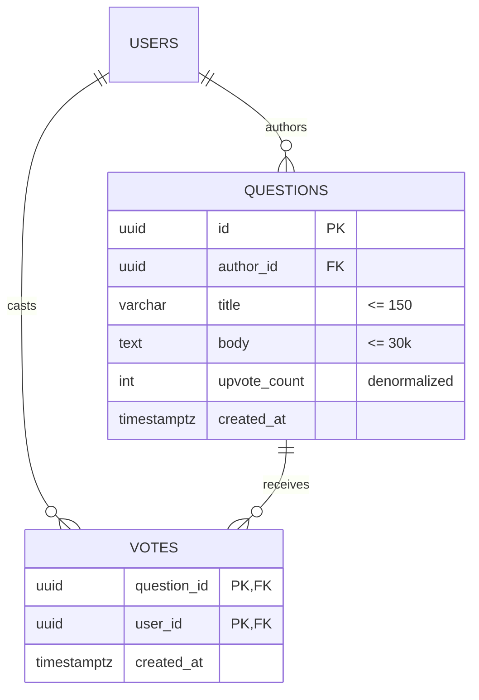
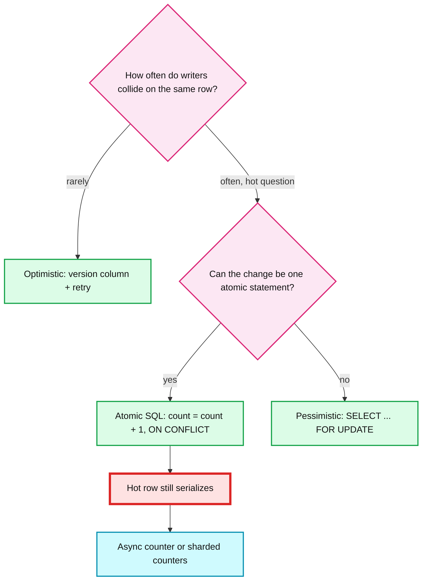
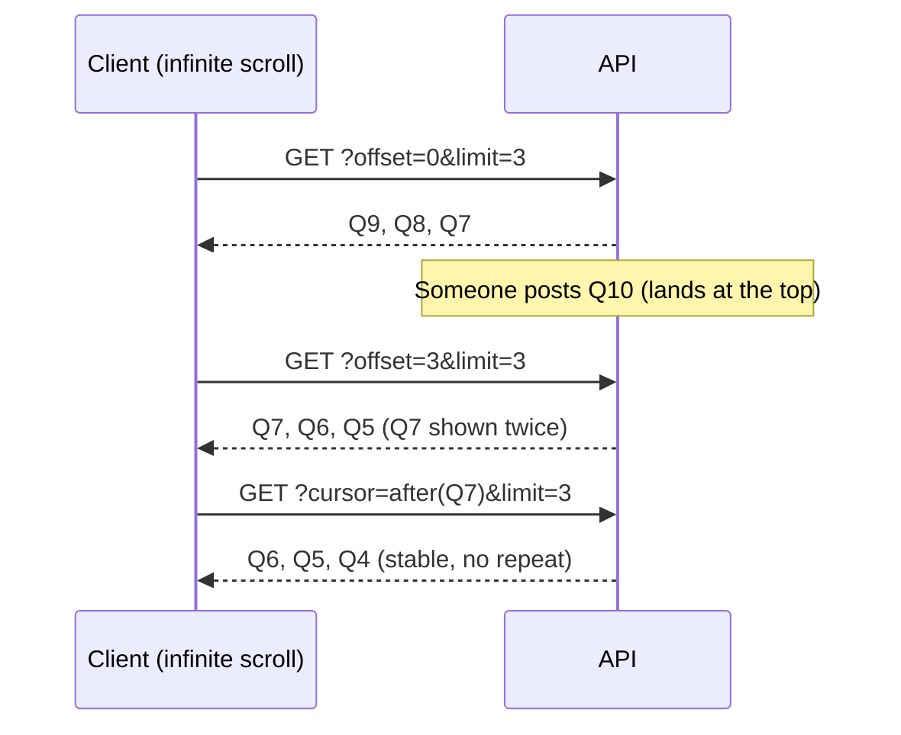
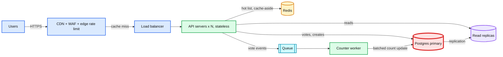

# Discussion Sheet: Q&A Bank (machine coding, minutes 45 to 90)

> One line: every probe on the grading list, with a spoken answer of 2 to 5 bullets,
> plus the code or SQL to sketch when they push.

Code references point at `reference-version/` unless marked `interview-version/`.

**Contents**

1. [Correctness of my code](#1-correctness-of-my-code)
2. [Votes: storage, duplicates, author rule](#2-votes-storage-duplicates-author-rule)
3. [Concurrency in memory](#3-concurrency-in-memory)
4. [Collections: HashMap vs synchronizedMap vs Hashtable vs ConcurrentHashMap](#4-collections-hashmap-vs-synchronizedmap-vs-hashtable-vs-concurrenthashmap)
5. [Votes in a real database](#5-votes-in-a-real-database)
6. [How do I know if a database handles it for me?](#6-how-do-i-know-if-a-database-handles-it-for-me)
7. [Optimistic vs pessimistic locking](#7-optimistic-vs-pessimistic-locking)
8. [API design: POST vs PUT for votes](#8-api-design-post-vs-put-for-votes)
9. [Pagination and infinite scroll](#9-pagination-and-infinite-scroll)
10. [HTTP status codes](#10-http-status-codes)
11. [Performance and scalability](#11-performance-and-scalability)
12. [Security](#12-security)
13. [What I would do differently](#13-what-i-would-do-differently)
14. [Product mindset: questions before coding](#14-product-mindset-questions-before-coding)
15. [Staff-bar checklist](#15-staff-bar-checklist)

---

## 1. Correctness of my code

**Say:**

- Three layers. Web maps HTTP. Service owns every rule. Repository owns storage. The service never imports an HTTP type, and the controller has no `if` about business rules.
- Invariants I protect: a question id is unique (random UUID v4), a user votes at most once per question, an author never votes on their own question, and the vote count always equals the number of stored votes.
- Thread safety: `Question` is an immutable record. Shared maps are `ConcurrentHashMap` / `ConcurrentSkipListMap`. The duplicate check is a single atomic call (`putIfAbsent`), not check-then-act.
- Error mapping lives in one `@RestControllerAdvice`. Every error is an RFC 9457 `ProblemDetail`.
- Tested at three levels: service rules, 100-thread races, and HTTP contracts with MockMvc.

**Known caveats I would volunteer (shows I read my own code):**

| Caveat | Where | Why it is acceptable for the MVP |
|---|---|---|
| Two maps in the question repo are written one after the other, not atomically | `InMemoryQuestionRepository.java:28-32` | `byId` is written first, so anything visible in the list is fetchable. No deletes, so no stale index entries. |
| The count returned by upvote may include other users' concurrent votes | `DefaultQuestionService.java:66` | It is "the count right after my vote", which is still a true value. |
| Upvote is not idempotent (409 on retry) | `QuestionController.java:67` | Matches the spec. Section 8 explains the PUT alternative. |
| `POST /questions` is not idempotent | `QuestionController.java:43` | A client retry after a timeout creates a duplicate question. Fix: `Idempotency-Key` header. |
| The service also checks `limit`, but throws `IllegalArgumentException`, which the catch-all maps to 500 | `DefaultQuestionService.java:46-48` | Unreachable over HTTP: the controller's `@Min/@Max` returns 400 first. For a second caller I'd add a typed `InvalidPageSizeException` mapped to 400. |
| `interview-version` returns a `nextCursor` when the last page is exactly full | `interview-version/.../QuestionServiceImpl.java:45` | Costs one extra empty request. The reference fetches `limit + 1` to avoid it. |

---

## 2. Votes: storage, duplicates, author rule



The red node is the only step that must be atomic. Everything before it reads immutable data.

**How do you store votes?**

- As their own records, not a counter on the question: `questionId -> (voterId -> Vote)`. This mirrors a `votes(question_id, user_id, created_at)` table with a unique key on the pair.
- The count is derived from the stored votes (`size()`), so it can never drift. A separate counter field would need to stay in sync with the set under concurrency, which is a second thing to get wrong.
- Separate from `Question`, so `Question` stays immutable and votes can grow independently.

**How do you avoid duplicate or double voting?**

- Identity comes from the authenticated caller, never from the request body. The zip draft took `userId` in the JSON body, so anyone could vote as anyone.
- `ConcurrentHashMap.putIfAbsent` (or `Set.add` in the interview version) is both the check and the insert in one atomic step. Returning "already there" becomes a 409.
- Double voting from a double-click or retry hits the same path, so it is safe. Section 8 covers making retries return success instead of 409.

**Author can't vote?**

- Checked in the service before the insert: `question.isAuthoredBy(voterId)` gives 403.
- This check-then-act is safe without a lock because `authorId` is immutable. A race only matters when the data you checked can change.

```java
// DefaultQuestionService.java:57-67
public int upvote(UUID questionId, UUID voterId) {
    Question question = findOrThrow(questionId);
    if (question.isAuthoredBy(voterId)) {
        throw new SelfVoteException(questionId);
    }
    if (!votes.addIfAbsent(new Vote(questionId, voterId, clock.instant()))) {
        throw new DuplicateVoteException(questionId, voterId);
    }
    return votes.countByQuestionId(questionId);
}
```

---

## 3. Concurrency in memory

**"Two users vote on the same question at the same time with a plain HashMap. What happens?"**



**Say:**

- Three distinct bugs, not one:
  1. **Racy bucket creation.** Two threads both see "no list yet", both create one, the second `put` wins and the first thread's votes go into an orphaned list.
  2. **Check-then-act.** Both threads run `contains()` before either runs `add()`, so a user votes twice.
  3. **Unsafe `ArrayList.add`.** `size++` is read-modify-write, so concurrent adds overwrite each other. A resize race can throw `ArrayIndexOutOfBoundsException`.
- Plus visibility: without a happens-before edge (lock, volatile, concurrent collection), one thread may never see another's write.
- A reader iterating the list while a writer adds gets `ConcurrentModificationException`.

**Measured, not claimed.** `RaceConditionDemo` (test sources) runs 100 threads adding 1,000 distinct voters each, with one reader iterating. Expected count is 100,000. One run on an M-series Mac:

```
round | naive count | lost  | writer exceptions | reader CMEs | safe count
    1 |       28172 | 71828 |                 0 |       69187 |     100000
    2 |       17733 | 82267 |                 0 |       65975 |     100000
    7 |       15475 | 84525 |                 1 |       59995 |     100000
   20 |       14752 | 85248 |                 1 |       58748 |     100000
```

Most of the loss comes from bug 3, the `ArrayList.add` race. `size++` collides, and `grow()` copies the array while other threads are still writing into the old one. Bug 1 (orphaned lists) only bites on the first few calls, so it loses a handful at most. The safe store kept all 100,000 in all 20 rounds.

Deterministic versions are unit tests in `NaiveVoteStoreRaceTest`:
- `checkThenActLetsTheSameUserVoteTwice`: a `CyclicBarrier` holds both requests between `contains()` and `add()`. Both return true.
- `concurrentSetAddHasNoGapBetweenCheckAndAct`: the same race against the real repo. Exactly one wins.
- `hashMapIteratorIsFailFast` / `concurrentHashMapIteratorIsWeaklyConsistent`.

**"Add locks for any modification of maps." How did you do it?**

Three options, from coarse to fine:

| Option | Code | Contention | Verdict |
|---|---|---|---|
| One global lock | `synchronized` on the service method | All votes on all questions serialize | Correct, simplest, bottleneck at ~1 core |
| Lock per question | `synchronized (locks.computeIfAbsent(qId, ...))` | Only votes on the same question serialize | Correct, more code, lock map grows forever |
| **No explicit locks, atomic per key (chosen)** | `computeIfAbsent(...).putIfAbsent(voterId, vote)` | CHM does a CAS on an empty bin, else locks only that one bin | Correct, least code, no lock to forget |

- I don't write `synchronized` at all. The concurrent collections own the locking, so no caller can forget it.
- If the interviewer insists on explicit locks, use a `ReentrantLock` per question, or `synchronized` on the question's set. Never lock on a `String` or a boxed value (interned and shared JVM-wide).

**"How do you prevent ConcurrentModificationException?"**

- CME comes from fail-fast iterators (`HashMap`, `ArrayList`) noticing `modCount` changed. Even a single thread can trigger it by modifying a collection inside its own for-each loop.
- Fixes: (a) concurrent collections, whose iterators are weakly consistent and never throw CME; (b) iterate over a snapshot (`List.copyOf`) or use `CopyOnWriteArrayList` for read-mostly data; (c) hold the same lock while iterating as while writing; (d) mutate via `Iterator.remove()` or `removeIf`.
- CME is best-effort detection, not a guarantee. Concurrent writes to a `HashMap` can silently corrupt it without any exception. Never treat "no CME" as "thread-safe".

**If they insist on an explicit lock** (6 lines, per-question lock, no global bottleneck):

```java
private final Map<UUID, Set<UUID>> voters = new HashMap<>();
private final Map<UUID, ReentrantLock> locks = new ConcurrentHashMap<>();

public boolean add(UUID questionId, UUID userId) {
    ReentrantLock lock = locks.computeIfAbsent(questionId, id -> new ReentrantLock());
    lock.lock();
    try {
        return voters.computeIfAbsent(questionId, id -> new HashSet<>()).add(userId);
    } finally {
        lock.unlock();
    }
}
```

Catch: the outer `voters` HashMap is still written under *different* locks for different questions, so it must be a `ConcurrentHashMap` too. That is why the lock-free version is shorter and safer.

**Proof it works:** `UpvoteConcurrencyTest` uses an `ExecutorService`, a `ready` latch and a `startGate` latch. 100 threads, same user: exactly 1 success and 99 `DuplicateVoteException`s. 100 different users: exactly 100. It passed 20 out of 20 loop runs.

---

## 4. Collections: HashMap vs synchronizedMap vs Hashtable vs ConcurrentHashMap

| | `HashMap` | `Collections.synchronizedMap(m)` | `Hashtable` | `ConcurrentHashMap` (Java 8+) |
|---|---|---|---|---|
| Thread-safe | No | Yes | Yes | Yes |
| Lock granularity | None | **One mutex for the whole map** | **Whole table** (`synchronized` methods) | **CAS for an empty bin, else `synchronized` on that bin's first node** |
| Concurrent reads | Unsafe with writers | Serialized | Serialized | Lock-free (volatile reads) |
| Concurrent writes | Corrupts | Serialized | Serialized | Parallel across bins |
| Iteration | Fail-fast (CME) | Fail-fast. **Caller must `synchronized (map)` around the loop** | Fail-fast (`Enumeration` is not) | Weakly consistent, never CME |
| Null key/value | Allowed | Same as the wrapped map | No | No |
| Atomic compound ops | No | `putIfAbsent`, `compute`, `merge` are synchronized. Your own `if (!containsKey) put` is not | Same as synchronizedMap | `putIfAbsent`, `computeIfAbsent`, `compute`, `merge` are atomic per key |
| Use today | Single thread | Rare: wrapping a non-hash map | Never (legacy) | Default for shared maps |

**Say it precisely (interviewers check this):**

- "ConcurrentHashMap locks only a portion of the map" is true, but the portion changed. **Java 7** used 16 `Segment`s, each a `ReentrantLock`. **Java 8+** removed segments. An insert into an empty bin is a single CAS with no lock. An insert into an occupied bin locks only that bin's head node. Reads take no lock. `concurrencyLevel` is now only a sizing hint.
- A bin that grows past 8 entries turns into a red-black tree, but only if the table has at least 64 slots (otherwise the table resizes instead), so a bad hash degrades to O(log n), not O(n).
- `size()` is computed from a `LongAdder`-style set of counter cells. It is cheap, but only an estimate while writes are in flight.
- Why no nulls: in a concurrent map, `get(k) == null` must mean "absent". Otherwise you would need `containsKey` plus `get`, which is a race.
- Compound actions: `computeIfAbsent` runs the lambda while holding the bin lock, so keep it short and never touch the same map inside it (`IllegalStateException: Recursive update`).
- Thread-safe map does not mean thread-safe values. `map.get(q).add(user)` on a plain `ArrayList` value is still a race. That is why the inner set is also concurrent.

```java
// Wrong even with ConcurrentHashMap: check-then-act across two calls
if (!votes.containsKey(user)) { votes.put(user, vote); }

// Right: one atomic call
boolean added = votes.putIfAbsent(user, vote) == null;

// Counters
counts.merge(questionId, 1, Integer::sum);       // atomic per key
AtomicLong / LongAdder                            // for a single hot counter
```

---

## 5. Votes in a real database



```sql
CREATE TABLE questions (
  id           UUID PRIMARY KEY,
  author_id    UUID NOT NULL REFERENCES users(id),
  title        VARCHAR(150) NOT NULL,
  body         TEXT NOT NULL,
  upvote_count INT  NOT NULL DEFAULT 0,
  created_at   TIMESTAMPTZ NOT NULL DEFAULT now()
);
-- Serves the newest-first list and cursor seeks
CREATE INDEX questions_recent ON questions (created_at DESC, id DESC);

CREATE TABLE votes (
  question_id UUID NOT NULL REFERENCES questions(id),
  user_id     UUID NOT NULL REFERENCES users(id),
  created_at  TIMESTAMPTZ NOT NULL DEFAULT now(),
  PRIMARY KEY (question_id, user_id)          -- the duplicate-vote guard
);
```

**The upvote, in one transaction (Postgres):**

```sql
BEGIN;
WITH inserted AS (
  INSERT INTO votes (question_id, user_id)
  VALUES ($1, $2)
  ON CONFLICT (question_id, user_id) DO NOTHING
  RETURNING 1
)
UPDATE questions
   SET upvote_count = upvote_count + 1
 WHERE id = $1 AND EXISTS (SELECT 1 FROM inserted)
RETURNING upvote_count;          -- 0 rows returned: duplicate, so 409
COMMIT;
```

**Say:**

- The **unique constraint** is the real guard. It holds even with 50 app servers, where a Java lock would not. `ON CONFLICT DO NOTHING` turns the race into "0 rows inserted" instead of an exception.
- `upvote_count = upvote_count + 1` is atomic. The `UPDATE` takes a row lock, and a concurrent updater waits and then re-reads the new value. No lost update at READ COMMITTED. Caveat: at Postgres REPEATABLE READ or SERIALIZABLE, the second updater instead fails with `could not serialize access due to concurrent update`, so the app must retry.
- The insert and the increment share one transaction, so the counter never drifts from the votes table. If either fails, both roll back.
- Author check: `author_id` never changes, so checking it before the insert is race-free. Or fold it into the SQL: `INSERT ... SELECT $1, $2 WHERE EXISTS (SELECT 1 FROM questions WHERE id = $1 AND author_id <> $2)`.
- Unknown question: the foreign key fails and we map it to 404. A cheaper option is to read the question first, which we need for the author check anyway.

**Why have a counter column at all if the count is derivable?**

- Read cost. The list page shows 20 counts. `COUNT(*)` per question is 20 index range scans, and a viral question with 1M votes scans 1M index entries on every page view.
- Reads outnumber votes by roughly 100 to 1 on a Q&A site. So pay once on write, read in O(1).
- It enables `ORDER BY upvote_count DESC` with an index for a "top questions" view.
- The cost: a **hot row**. Every vote on a viral question locks the same `questions` row, so votes on that question serialize (roughly 1 to 5k updates/s on one row in Postgres). Fixes, in order of effort:
  1. Keep the `votes` insert synchronous and update the counter asynchronously (queue or batch every N seconds). The counter becomes eventually consistent, which is fine for display.
  2. Sharded counters: N rows per question, increment a random one, `SUM` on read.
  3. Redis `INCR` in front, flushed to the database periodically.

---

## 6. How do I know if a database handles it for me?

**Say:** I check five properties in the docs, then I prove it with a concurrency test like `UpvoteConcurrencyTest` pointed at the real database.

| Question to ask of the DB | Why it matters for votes |
|---|---|
| **Atomic single-item writes?** Is `count = count + 1` (or `$inc`, `ADD`) atomic server-side? | Avoids read-modify-write in app code |
| **Unique constraints or conditional writes?** | Makes duplicate prevention the DB's job |
| **Multi-item ACID transactions?** | The vote row and the counter change together or not at all |
| **Default isolation level, and does it stop lost updates?** | Decides whether my read-then-write pattern is safe |
| **Compare-and-set / version checks?** | Enables optimistic locking |

**ACID in one line each:** Atomic (all or nothing), Consistent (constraints hold after commit), Isolated (concurrent transactions don't see each other's half-done work, to a degree set by the isolation level), Durable (committed means it survives a crash).

**Isolation levels and the lost update:**

```sql
-- Read-modify-write in application code (the dangerous pattern)
SELECT upvote_count FROM questions WHERE id = $1;      -- both txns read 5
UPDATE questions SET upvote_count = 6 WHERE id = $1;   -- both write 6: one vote lost
```

| Level | Dirty read | Non-repeatable read | Lost update in the pattern above |
|---|---|---|---|
| READ UNCOMMITTED | Possible | Possible | Happens |
| **READ COMMITTED** (Postgres, Oracle, SQL Server default) | No | Possible | **Happens** |
| **REPEATABLE READ** | No | No | **Postgres:** second txn fails with a serialization error, so retry. **MySQL InnoDB (default level):** still happens, because `UPDATE` reads the latest committed row |
| SERIALIZABLE | No | No | Prevented (one txn aborts, retry) |

The fix at any level: write `SET upvote_count = upvote_count + 1` (atomic) or use `SELECT ... FOR UPDATE`.

**Per database:**

| | Duplicate guard | Counter | Both atomically |
|---|---|---|---|
| **Postgres / MySQL** | `PRIMARY KEY (question_id, user_id)` + Postgres `ON CONFLICT DO NOTHING`. MySQL `INSERT ... ON DUPLICATE KEY UPDATE user_id = user_id` and check affected rows (avoid `INSERT IGNORE`: it also downgrades FK errors to warnings, so an unknown question looks like a duplicate) | `count = count + 1` | One transaction |
| **DynamoDB** | `PutItem` with `ConditionExpression: attribute_not_exists(userId)`. Fails with `ConditionalCheckFailedException` (inside a transaction: `TransactionCanceledException` with reason `ConditionalCheckFailed`) | `UpdateItem ... ADD upvotes :one` | `TransactWriteItems` (costs 2x write units) |
| **Redis** | `SADD q:{id}:voters userId` returns 1 if new, 0 if already there | `SCARD q:{id}:voters` (derived) | Each command is atomic (single-threaded). With a derived `SCARD` no compound step is needed. A counter conditional on `SADD` needs a Lua script (or `WATCH` + retry). `MULTI/EXEC` can't branch on a result |
| **MongoDB** | Unique compound index on `{questionId, userId}` | `$inc` | Multi-document transactions (replica set), or embed |

- Redis caveat: durability. With AOF `fsync everysec` you can lose about 1 second of votes on a crash. Fine as a cache or counter, not as the source of truth for votes.

---

## 7. Optimistic vs pessimistic locking



**Optimistic** (assume no conflict, detect it at write time):

```sql
UPDATE questions
   SET title = $title, version = version + 1
 WHERE id = $id AND version = $expectedVersion;   -- 0 rows: someone else won, re-read and retry
```

- JPA: a `@Version` field gives you this for free and throws `OptimisticLockException`.
- No locks held while the user thinks or while the app computes. Great for edits, and for the 99% of questions with no contention.
- Loses on a hot row. 1,000 voters per second on one question means most attempts fail and retry, wasting work and adding latency (a retry storm). Retry with a cap and jittered backoff.

**Pessimistic** (lock first, then work):

```sql
BEGIN;
SELECT upvote_count FROM questions WHERE id = $1 FOR UPDATE;  -- others block here
UPDATE questions SET upvote_count = $2 WHERE id = $1;
COMMIT;
```

- Wins under high contention or when redoing the work is expensive. Losers wait instead of failing.
- Costs: lock hold time, connection-pool exhaustion while threads wait, and deadlocks if two transactions lock rows in different orders (always lock in a fixed order, for example by id). Set `lock_timeout`.

**For votes specifically:** neither. Use a single atomic statement (the unique insert plus `count = count + 1`). The database takes the row lock for microseconds inside one statement, and app code holds nothing.

---

## 8. API design: POST vs PUT for votes

| | `POST /questions/{id}/upvotes` (built) | `PUT /questions/{id}/votes/me` (alternative) |
|---|---|---|
| Meaning | "Create a vote" | "Make my vote exist" |
| First call | 201 Created | 201 Created (or 200) |
| Repeat call | **409 Conflict** | **200 OK** (idempotent, no change) |
| Retry after network timeout | Client sees 409 and must treat it as success | Safe, same result |
| Undo | Needs a new endpoint | `DELETE` on the same URL, also idempotent |
| Downvote later | New endpoint | Body `{"value": -1}` on the same URL |

**Say:**

- I built POST because the spec says "upvote" and the interviewer wants to see duplicate detection surface as a clear 409.
- In production I would pick PUT plus DELETE. Votes are a set membership, and set membership is naturally idempotent. Mobile clients retry. Idempotency removes a whole class of "why did my vote fail" bugs.
- If we must keep POST, accept an `Idempotency-Key` header and return the original response on a repeat.
- Nit to pre-empt: a 201 with no `Location` implies the request URI is the new resource. With PUT `/votes/me` the URL *is* the vote, so that problem disappears.
- Same reasoning for `POST /questions`: today a retried create makes a duplicate question. `Idempotency-Key` fixes that too.

---

## 9. Pagination and infinite scroll



| | Limit / offset | Page number | Cursor (keyset), chosen |
|---|---|---|---|
| Request | `?offset=40&limit=20` | `?page=3&size=20` | `?cursor=opaque&limit=20` |
| SQL | `LIMIT 20 OFFSET 40` | Same as offset: `(page-1)*size` | `WHERE (created_at, id) < ($1, $2) ORDER BY created_at DESC, id DESC LIMIT 21` |
| Cost at deep pages | O(offset): the DB reads and discards every skipped row | Same | O(log n + limit): an index seek |
| Inserts while scrolling | Repeats items | Repeats items | Stable |
| Deletes while scrolling | Skips items | Skips items | Stable |
| Jump to page 50 | Yes | Yes | No |
| Total count / "page 3 of 80" | Easy (but `COUNT(*)` is costly) | Easy | Not natural |
| Fits | Admin tables, small data | Search results UI with page links | **Feeds, infinite scroll, APIs** |

**Say:**

- Infinite scroll means cursor. The user never jumps to page 50, and the feed changes constantly.
- The cursor is the sort key of the last item: `(createdAt, id)`. The id breaks ties so two questions created in the same millisecond are not skipped. The test `questionsWithIdenticalTimestampsAreAllListed` proves two equal timestamps don't collide in the index.
- Opaque Base64 (`CursorCodec.java`) tells clients they *shouldn't* build or edit it. Base64 is not security: anyone can decode it. Add an HMAC if tampering matters. Opacity lets us change the sort key later without breaking clients. A bad cursor gives 400.
- Known gap (keyset paging has it in databases too): `createdAt` is stamped before the save. If request A stamps t5 and stalls while B saves t6, a reader who already passed t5 never sees A's question. A clock that steps backwards does the same. Fine for a feed. Fix if needed: a sequence assigned at commit time.
- Fetch `limit + 1` rows. If you get the extra row, there is a next page. No `COUNT(*)` needed.
- In memory, `ConcurrentSkipListMap.tailMap(cursor, false)` is exactly the index seek. In SQL, the composite index `(created_at DESC, id DESC)` plus row-value comparison.
- Limit default 20, max 100, out of range gives 400. The cap protects the server from `?limit=1000000`.
- The list returns summaries without the body (up to 30k chars each). 100 full bodies could be about 3 MB per page.
- Proven by `cursorPaginationHasNoRepeatsOrGapsWithInsertBetweenPages`: it inserts a question between page 1 and page 2 and asserts the union is exactly the original 5, in order.

---

## 10. HTTP status codes

| Code | When in this API | Example |
|---|---|---|
| **200 OK** | GET list, GET by id | |
| **201 Created** | POST question (with `Location`), POST upvote (first time) | `Location: /api/v1/questions/{id}` |
| **400 Bad Request** | Bean Validation failure, malformed JSON, non-UUID path id, `limit` out of 1 to 100, bad cursor | `{"title":"Bad Request","errors":{"title":"size must be between 15 and 150"}}` |
| **401 Unauthorized** | Missing or malformed `X-User-Id` (interview version: missing only, a malformed one is a 400 type-conversion error) | Means "unauthenticated" despite the name |
| **403 Forbidden** | Author upvoting own question | Known user, not allowed |
| **404 Not Found** | Unknown question id | |
| **405 Method Not Allowed** | `DELETE /questions` | Spring handles it |
| **409 Conflict** | Duplicate upvote | Conflicts with current state |
| **415 Unsupported Media Type** | POST without `Content-Type: application/json` | Spring handles it |
| **429 Too Many Requests** | Rate limit (future) | With `Retry-After` |
| **500** | Bug. Generic body, details only in logs | Never leak stack traces |
| **503** | Dependency down, overloaded (future) | With `Retry-After` |

**401 vs 403:**
- 401: "I don't know who you are." No or invalid credentials. Retrying with credentials may work. Formally the response should carry a `WWW-Authenticate` header.
- 403: "I know who you are, and the answer is no." Retrying won't help. The author voting on their own question is the textbook case.
- Why I return 401 for a missing `X-User-Id` instead of 400: the header stands in for authentication. When JWT replaces it, a missing token is 401, so the contract clients code against does not change.
- Interview version nuance: Spring rejects a non-UUID header with 400 before my code runs. I'd say "malformed input is 400, missing credentials is 401" and point at the reference resolver, which makes both 401.

**409 vs 422:**
- 409 Conflict: the request is valid, but it clashes with the resource's current state. "You already voted" is state, so 409.
- 422 Unprocessable Content: the JSON parses but its content breaks semantic rules (title too short). Some teams use 422 for validation and keep 400 for unparseable input. The spec asks for 400, and Spring defaults to 400, so I use 400 for both and say I'd follow the team's convention.

**Error body:** RFC 9457 `ProblemDetail`, content type `application/problem+json`: `type`, `title`, `status`, `detail`, `instance`, plus an `errors` map for field validation. One shape for every error, so clients write one parser.

---

## 11. Performance and scalability



**Rough numbers (Stack Overflow scale, to anchor the talk):**

- 10M daily users x 20 page views = 200M reads a day. 200M / 86,400 s is about 2.3k QPS average. Peak at roughly 10x average gives about 25k QPS.
- 10k new questions a day is only 0.1 QPS. Votes dominate writes: 10M users x 1 vote a day is about 115 QPS average, about 1k QPS peak.
- Storage: 10k questions x 5 KB = 50 MB a day, about 18 GB a year. Votes: 10M a day x ~50 bytes = 500 MB a day, about 180 GB a year. Votes outgrow questions. Reads dominate, so caching and replicas matter most. The primary is red because every write and every hot-row vote lands there.

**Which metrics:**

- **RED per endpoint** (request-level): Rate (QPS), Errors (5xx and 4xx ratio), Duration (p50, p95, **p99**). Averages hide the slow tail. p99 is what your unhappiest 1% of users feel.
- **USE per resource** (system-level): Utilization, Saturation, Errors for CPU, memory, GC pause time, thread pool, **DB connection pool wait time**, disk I/O, network.
- **Load shape:** peak concurrent users, QPS by endpoint, payload size, data volume (row counts, table size, index size).
- **Dependencies:** DB query latency, cache hit ratio, retry counts, timeouts.
- **SLO and paging:** for example 99.9% of list requests under 200 ms. Page on error-budget burn rate (say, 2% of the monthly budget burned in 1 hour), not on raw CPU.

**How to find the slow part:**

1. Start from the symptom: which endpoint, which percentile, since when. Correlate with deploys and traffic.
2. **Distributed tracing** (OpenTelemetry) shows which span is slow: app code, DB, cache, or a downstream call.
3. **DB:** slow-query log (`log_min_duration_statement`), `pg_stat_statements` for the top queries by total time, then `EXPLAIN (ANALYZE, BUFFERS)` for a seq scan, missing index, or bad row estimates. Check lock waits (`pg_locks`).
4. **App:** logs with a request id, JFR or async-profiler flame graphs, GC logs.
5. Reproduce with a load test (k6, Gatling) before and after the fix.

**Causes and fixes:**

| Cause | Signal | Fix |
|---|---|---|
| Missing index, full scans, deep `OFFSET` | `EXPLAIN` shows seq scan, high DB CPU | Index `(created_at DESC, id DESC)`, cursor pagination |
| N+1 queries (count per question) | Many small queries per request | Counter column, or one batched `IN (...)` query |
| DB overloaded by reads | Primary CPU high, replicas idle | Read replicas (accept replica lag on lists) |
| Hot list re-read constantly | Same query thousands of times a second | Redis cache-aside for page 1, TTL 5 to 30 s |
| Hot row on a viral question | Lock waits on one row | Async or sharded counters (section 5) |
| Servers far from users | High latency, normal server time | CDN for static assets and cacheable GETs, multi-region read replicas |
| Network saturation, big payloads | High bytes out | Summaries in lists, gzip, pagination caps |
| Dependency retries | Retry counts spike with errors | Timeouts, capped jittered backoff, circuit breaker, retry budgets |
| Abuse or bots | Skewed traffic per IP or user | Rate limiting (token bucket, 429), WAF |
| Too few servers | CPU saturated everywhere | Horizontal scale (stateless API), autoscale |
| Data outgrows one primary | Write QPS or storage near limits | Shard by `question_id` (votes live with their question). Last resort. |

- Cache-aside on the hot list: read Redis; on a miss read the DB and set with a TTL. Accept that vote counts lag by the TTL. Invalidate on create if freshness matters.
- Sharding by `question_id` keeps a question and its votes together, so upvote stays a single-shard transaction. The cost: "newest across all questions" becomes a scatter-gather. Defer until a single primary with replicas can't keep up, which for this workload is far away.

---

## 12. Security

**Authentication: username and password**

- Store only a slow, salted hash. **argon2id** (OWASP minimum: 19 MiB memory, 2 iterations, 1 lane) or **bcrypt** (cost 10 to 12, tuned to about 100 ms per hash on your hardware). Never SHA-256 or MD5: GPUs try billions of fast hashes per second.
- The salt is per user and stored inside the hash string. bcrypt only reads the first 72 bytes of input.
- Spring: `PasswordEncoderFactories.createDelegatingPasswordEncoder()` stores `{bcrypt}...` or `{argon2}...`, so you can upgrade algorithms on next login.
- Login: rate limit and lock out per account and per IP. Return the same error for "no such user" and "wrong password".

**JWT**

- `header.payload.signature`, Base64url. **Signed, not encrypted**: anyone can read the payload, so put no secrets in it.
- Verify the signature, `exp`, `iss`, `aud`. Pin the algorithm (reject `alg: none`). Prefer asymmetric (RS256 or ES256) so services verify with a public key and only the auth service can sign.
- Short-lived access token (5 to 15 minutes) plus a long-lived refresh token (days). Store the refresh token in an `HttpOnly; Secure; SameSite` cookie, rotate it on every use, and keep it in a DB so it can be revoked. A short access lifetime limits the damage, since JWTs can't be revoked easily.
- **The seam in this code:** `CurrentUserArgumentResolver` is the only *application* class that changes: read the verified token's `sub` and return it as the UUID. No controller or service changes. Around it you add `spring-boot-starter-oauth2-resource-server`, issuer/JWK properties, and a `SecurityFilterChain` that permits the public GETs (Boot secures everything once Security is on). The 401 then comes from Spring Security's bearer-token entry point, with a proper `WWW-Authenticate` header.

**SQL injection**

```java
// Vulnerable: attacker sends title = "x'; DROP TABLE votes; --"
jdbc.queryForList("SELECT * FROM questions WHERE title = '" + title + "'");

// Safe: the value is bound as a parameter, never spliced into SQL text (server-side prepare on Postgres;
// MySQL Connector/J escapes client-side by default, still safe)
jdbc.queryForList("SELECT * FROM questions WHERE title = ?", title);

// JPA: named parameters, never string-built JPQL
@Query("select q from QuestionEntity q where q.authorId = :authorId")
List<QuestionEntity> findByAuthor(@Param("authorId") UUID authorId);
```

- Parameters cannot cover identifiers (`ORDER BY <column>`). Map user input to a whitelist enum.
- Defense in depth: the app's DB user gets only `SELECT, INSERT, UPDATE` on its own tables. No DDL, no superuser.

**XSS (the big one for a Q&A site: users post content others read)**

- Stored XSS: a question body containing `<script>` runs in every reader's browser.
- Encode output for its context (React escapes by default). If you render Markdown or HTML, sanitize server-side with an allow-list (OWASP Java HTML Sanitizer).
- `Content-Security-Policy: default-src 'self'; script-src 'self'` blocks inline scripts even if one slips through.
- `HttpOnly` cookies so a script can't read the session. The API returns `application/json` with `X-Content-Type-Options: nosniff`.

**CSRF**

- The attack: a malicious site makes your browser send a request, and the browser auto-attaches your cookies.
- Bearer-token APIs are less exposed: the token sits in an `Authorization` header that JS sets explicitly, and browsers never attach it cross-site. (The trade-off: a token in `localStorage` is readable by XSS.)
- Cookie sessions: `SameSite=Lax` or `Strict`, plus a CSRF token (synchronizer or double-submit), plus checking the `Origin` header. Spring Security enables CSRF protection by default. The resource-server (bearer token) setup skips it for token requests.
- Never change state on GET.

**DDoS and abuse**

- Volumetric (L3 and L4) floods: absorbed at the edge (CDN, AWS Shield, Cloudflare). Your servers never see them.
- L7 (HTTP floods, expensive queries): WAF rules, rate limits per IP, user, and token at the gateway (token bucket, 429 with `Retry-After`), bot detection.
- In the app: cap request sizes (body max 30k, `limit` max 100), set timeouts everywhere, autoscale with a ceiling so an attack can't run up the bill.

**Infrastructure**

- **TLS** 1.2+ (prefer 1.3) at the edge and between services (mTLS in a service mesh). HSTS header.
- **Firewalls / security groups:** only the load balancer is public. The DB accepts connections only from the app subnet. No public IPs on data stores.
- **IAM least privilege:** per-service roles, short-lived credentials, no long-lived keys in code, secrets in a secrets manager, audit logs on.

---

## 13. What I would do differently

**1. Persistence is a one-class swap (Dependency Inversion pays off here).**

`DefaultQuestionService` depends on the `QuestionRepository` and `VoteRepository` interfaces, not on the in-memory classes. A Postgres version is a new class:

```java
@Repository
@Primary // or @Profile("postgres") to switch by config
public class JdbcVoteRepository implements VoteRepository {
    private final JdbcTemplate jdbc;

    public JdbcVoteRepository(JdbcTemplate jdbc) {
        this.jdbc = jdbc;
    }

    @Override
    @Transactional
    public boolean addIfAbsent(Vote vote) {
        int inserted = jdbc.update("""
                INSERT INTO votes (question_id, user_id, created_at) VALUES (?, ?, ?)
                ON CONFLICT (question_id, user_id) DO NOTHING""",
                vote.questionId(), vote.voterId(), Timestamp.from(vote.createdAt()));
        if (inserted == 1) {
            jdbc.update("UPDATE questions SET upvote_count = upvote_count + 1 WHERE id = ?", vote.questionId());
        }
        return inserted == 1;
    }

    @Override
    public int countByQuestionId(UUID questionId) {
        return jdbc.queryForObject("SELECT upvote_count FROM questions WHERE id = ?", Integer.class, questionId);
    }
}
```

The service, the controller and all the service tests stay unchanged. Parameterize `UpvoteConcurrencyTest` over the repository (today it hard-wires the in-memory one) and run it against Postgres in Testcontainers to prove the DB enforces the rule.

- Note the transaction now lives in the repository, because the service is storage-agnostic. If one business operation spans two repositories, put `@Transactional` on the service method instead.
- Migration to the DB: Flyway migration creates tables, deploy behind a config flag, roll back by flipping the flag. In-memory data is throwaway, so there is no backfill.

**2. Undo a vote:** `DELETE /questions/{id}/votes/me` gives 204, idempotent. `votes.remove(voterId)` in memory, `DELETE ... RETURNING` plus a decrement in SQL.

**3. Downvotes:** add `value SMALLINT CHECK (value IN (-1, 1))`. Switching direction is an upsert: `ON CONFLICT DO UPDATE SET value = EXCLUDED.value`, and the score changes by the delta (+2 or -2). Stack Overflow charges the voter reputation for downvoting answers to discourage abuse.

**4. Answers:** `answers(id, question_id, author_id, body, created_at)`, plus `accepted_answer_id` on the question. Votes become polymorphic (`target_type, target_id`) or one table per target type. I'd pick separate tables for simpler foreign keys.

**5. Search:** start with Postgres full-text search (`tsvector` column + GIN index). Move to OpenSearch fed by change data capture (Debezium to Kafka) only when relevance tuning or scale demands it.

**6. Smaller things:**

- `Idempotency-Key` on both POSTs.
- Sort by top or hot: index on `upvote_count`, and compute a hot score asynchronously.
- Split `VoteService` from `QuestionService` once votes cover answers too.
- Observability: Micrometer timers per endpoint, a counter for duplicate votes (a spike means a client bug or an abuse script), Actuator health checks.
- Reputation gates: Stack Overflow requires 15 reputation to upvote. That is a strong anti-spam lever.

**What I deliberately did not build (Staff signal: say what you refused):** no database, no auth server, no caching, no answers, no edit or delete. The interfaces leave a seam for each, and none was needed to meet the three endpoints.

---

## 14. Product mindset: questions before coding

Ask these in the first 3 minutes. Note the assumption you make if they say "your call".

| Question | My default assumption |
|---|---|
| Who is the caller, and how is the user identified? | `X-User-Id` header, JWT later |
| Can anyone read without logging in? | Yes, reads are public (like Stack Overflow) |
| Title and body rules? Markdown? Tags? | Title 15 to 150 chars, body 1 to 30k, plain text, no tags |
| Can a vote be undone? Downvotes? | Not in MVP, but design for it |
| Can the author vote? Can the same user vote twice? | No and no |
| Sort order for the list: newest, top, hot? | Newest first |
| Does the list need the full body? | No, summaries |
| Expected scale and read/write ratio? | Read-heavy, ~100:1 |
| Must vote counts be exact and instant? | Exact for the voter, eventual for everyone else is fine |
| Edit or delete questions? Moderation, spam? | Out of scope, mention rate limits |
| Is there a pre-built project skeleton? Can I use an IDE and the internet? | Ask. It changes the first 5 minutes. |

What it signals: you scope before you build, you think about the user and the abuse cases, and you make the trade-offs explicit.

---

## 15. Staff-bar checklist

Grade any answer in this round against these (from `CLAUDE.md` section 7):

| Staff signal | Where I show it |
|---|---|
| Simplest design, and what I refused to build | Section 13, "deliberately did not build" |
| Failure modes and blast radius | Section 1 caveats, section 5 hot row, section 3 measured race |
| Migration with a rollback path | Section 13, item 1 (flag-switched repository, Flyway) |
| Operability: what pages at 3am, the SLO | Section 11, SLO and burn-rate paging |
| Cost in dollars and eng-time | Section 5 (counter column vs `COUNT(*)`), DynamoDB transactions cost 2x, sharding deferred |
| Explicit trade-offs | Sections 7, 8, 9 tables |
