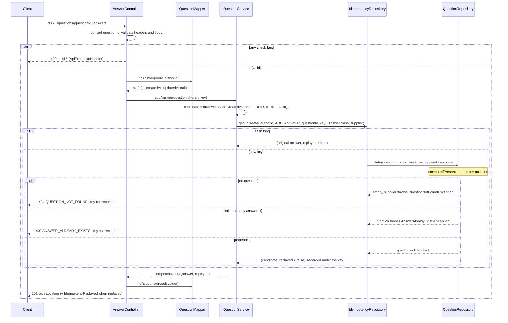
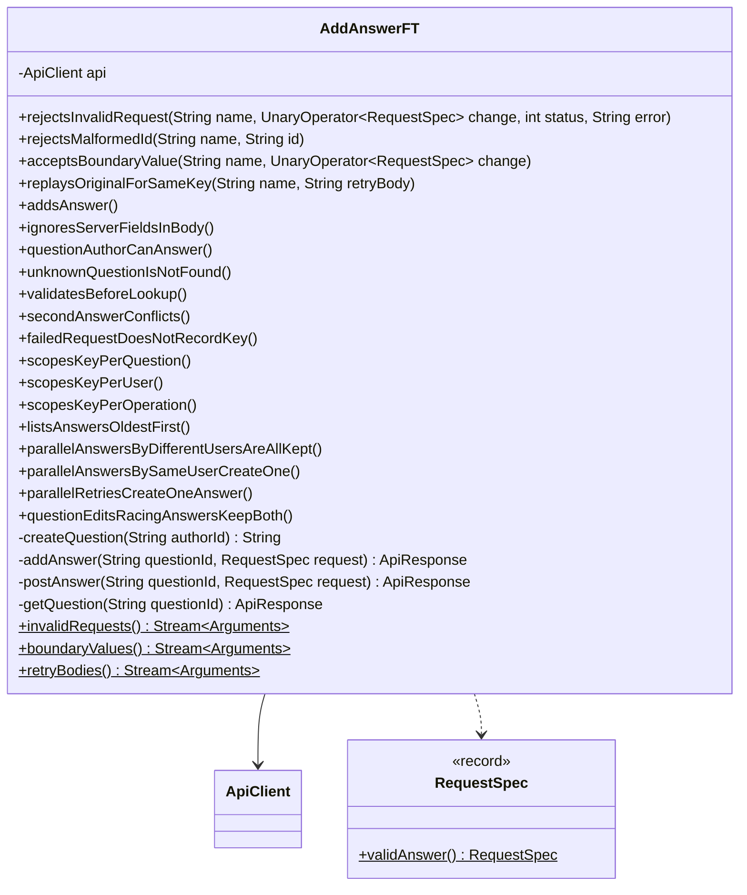

# Add Answer API

Status: **Agreed** (2026-10-24). See Decisions.

A user answers a question. The caller comes from `X-User-Id` and becomes the answer's `authorId`. The question's author may answer too. Each user can post one answer per question and changes it with Update answer (UpdateAnswer.md). Answers are stored inside their question, oldest first. Retrying with the same idempotency key returns the original answer. Builds on CreateQuestion.md, GetQuestion.md, and UpdateQuestion.md.

## Contract

### Request

```
POST /questions/3f1c9a52-8a7e-4f0b-9d0e-2b6c1f6a7e11/answers
X-User-Id: user-7
Idempotency-Key: 5d7a2c90-1e4b-4f8a-b3c6-9e0d2a4f7b18
Content-Type: application/json

{
  "content": "Use compute() or merge(). Both run atomically per key."
}
```

| Field | Rules |
|---|---|
| `questionId` path segment | Same as GetQuestion's `id`: a UUID, any case. |
| `X-User-Id` header | Same rules as create. Becomes the answer's `authorId`. |
| `Idempotency-Key` header | Same rules as create. New value per answer, same value on retry. |
| `content` | Same rules as the question's `content`: required, not blank, max 5000 chars. |

Answers have no tags. Unknown body fields, `tags` included, are ignored, so a client can't set `id`, `authorId`, `createdAt`, or `updatedAt`.

### Response

```
201 Created
Location: /questions/3f1c9a52-8a7e-4f0b-9d0e-2b6c1f6a7e11/answers/9b2e4d71-0c3a-4f5e-8b6d-1a7c2e9f4b30

{
  "id": "9b2e4d71-0c3a-4f5e-8b6d-1a7c2e9f4b30",
  "authorId": "user-7",
  "content": "Use compute() or merge(). Both run atomically per key.",
  "createdAt": "2026-10-24T06:20:02.481Z",
  "updatedAt": null,
  "upvotes": 0,
  "downvotes": 0
}
```

- `AnswerResponse`. The same record is each element of GET question's `answers`, so it has no `questionId`. The URL and `Location` already carry it (Decision 1).
- `updatedAt` follows the question's rule: `null` until the first real edit. The question's own `updatedAt` doesn't change (UpdateQuestion.md, "Shared with answer edits").
- `upvotes` (Upvote.md) and `downvotes` (Downvote.md) are `0` for a new answer.
- A replay returns the original status, `Location`, and body, plus `Idempotent-Replayed: true`, as in create. The body is the stored snapshot, counts included: votes cast since don't show (Upvote.md's replay rule).

### Errors

Body: `{ "error": "<CODE>", "message": "<detail>" }`. Check order: every 400 and 415, then the key (a replay returns the original 201), then 404, then 409.

| Case | Status | `error` |
|---|---|---|
| `questionId` isn't a UUID | 400 | `VALIDATION_FAILED` |
| Missing `X-User-Id` or `Idempotency-Key` | 400 | `MISSING_HEADER` |
| A header or `content` breaks its rules | 400 | `VALIDATION_FAILED` |
| Body not valid JSON | 400 | `MALFORMED_REQUEST` |
| `Content-Type` not JSON | 415 | `UNSUPPORTED_MEDIA_TYPE` |
| No question has that id | 404 | `QUESTION_NOT_FOUND` |
| The caller already answered this question, under another key | 409 | `ANSWER_ALREADY_EXISTS` |
| Unexpected | 500 | `INTERNAL_ERROR` |

- 400 bad id and 404: as in GetQuestion.md (`questionId must be a UUID`, `Question <id> not found`).
- 409 message: `Question <questionId> already has answer <answerId> by this user`. It names the existing answer, so the client knows where to PUT. Both ids are server-generated, so they're safe to echo.

## Idempotency

- CreateQuestion.md's "Every write" mechanism and store (Decision 5). The stored key is `(userId, ADD_ANSWER, questionId, key)`, where `userId` is the caller and so the answer's `authorId`. Reusing a key on another question adds an answer there, and a key the user used for another operation (creating this question, say) is a separate entry. Neither replays this one.
- Same key again: the original answer, counts included, 201, `Idempotent-Replayed: true`. The new `content` isn't compared. So a client retrying a timed-out add never gets a 409 for its own answer.
- 400 and 415 never reach the service. 404 and 409 are thrown inside the supplier, so they record nothing either.
- A replay after the answer was edited returns the creation-time snapshot, exactly as UpdateQuestion.md's "Create replay after an update". UpdateAnswer.md tests it.
- Keys live as long as the app: one entry per answer.

## Design

### External and internal models

| External (`web` and `model`, JSON) | Internal (`domain`) |
|---|---|
| `AnswerRequest` + `X-User-Id` | `Answer` (draft) |
| `{questionId}` path segment | `UUID` |
| `X-User-Id` + `{questionId}` + `Idempotency-Key` | `IdempotencyKey` (`ADD_ANSWER`, target the question id) |
| `AnswerResponse` | `Answer` |

- `Answer` is the only internal model for an answer. It lives in `Question.answers`, so it holds no `questionId`.
- `AnswerRequest` holds only `content`. UpdateAnswer reuses it, as POST and PUT question share `QuestionRequest`.
- The mapping goes in `QuestionMapper`, not a new `AnswerMapper`:
  - `toAnswer(body, authorId)`: `id`, `createdAt`, and `updatedAt` are ignored and stay `null`. The service sets the first two with `withIdAndCreatedAt`.
  - `toResponse(Answer)`: copies every field. MapStruct also uses it for each element of `QuestionResponse.answers`, keeping the order. Upvote.md adds `upvotes`, and Downvote.md `downvotes`, as the sizes of `answer.votes()`'s two sets.
  - Why: answers are part of the question aggregate, and `toResponse(Question)` needs the answer mapping anyway. A separate `AnswerMapper` would come in through `uses`, which the Spring component model injects into a field. `Mappers.getMapper(QuestionMapper.class)` in the existing unit test would then hold `null` for it.
- `AnswerController` is new, because `/questions/{questionId}/answers` is its own resource. The service methods go in `QuestionService`, not a service of their own: answers live inside their question, so one service owns the whole question, and every answer change goes through `QuestionRepository.update`.

### Classes



```mermaid
classDiagram
    direction TB

    namespace web {
        class AnswerController {
            -QuestionService service
            -QuestionMapper mapper
            +add(UUID questionId, String authorId, String idempotencyKey, AnswerRequest body) ResponseEntity~AnswerResponse~
        }
    }

    namespace mapper {
        class QuestionMapper {
            <<interface, MapStruct>>
            +toAnswer(AnswerRequest body, String authorId) Answer
            +toResponse(Answer answer) AnswerResponse
        }
    }

    namespace handler {
        class ApiExceptionHandler {
            +handleAnswerAlreadyExists(AnswerAlreadyExistsException e) ResponseEntity~ErrorResponse~
        }
    }

    namespace model {
        class AnswerRequest {
            <<record>>
            +String content
        }
        class AnswerResponse {
            <<record>>
            +UUID id
            +String authorId
            +String content
            +Instant createdAt
            +Instant updatedAt
        }
        class QuestionResponse {
            <<record>>
            +List~AnswerResponse~ answers
        }
    }

    namespace service {
        class QuestionService {
            +addAnswer(UUID questionId, Answer draft, String idempotencyKey) IdempotentResult~Answer~
        }
    }

    namespace exception {
        class AnswerAlreadyExistsException {
            <<exception>>
            -UUID questionId
            -UUID answerId
            +AnswerAlreadyExistsException(UUID questionId, UUID answerId)
            +questionId() UUID
            +answerId() UUID
        }
    }

    namespace domain {
        class Question {
            <<record>>
            +List~Answer~ answers
            +answerBy(String authorId) Optional~Answer~
            +withAnswer(Answer answer) Question
        }
        class Answer {
            <<record>>
            +UUID id
            +String authorId
            +String content
            +Instant createdAt
            +Instant updatedAt
            +withIdAndCreatedAt(UUID id, Instant createdAt) Answer
        }
        class IdempotencyKey {
            <<record>>
        }
        class IdempotentResult~T~ {
            <<record>>
        }
    }

    namespace repository {
        class QuestionRepository {
            <<interface>>
        }
        class IdempotencyRepository {
            <<interface>>
        }
    }

    AnswerController --> QuestionService
    AnswerController --> QuestionMapper
    QuestionMapper ..> AnswerRequest
    QuestionMapper ..> Answer
    QuestionMapper ..> AnswerResponse
    QuestionResponse o-- AnswerResponse
    ApiExceptionHandler ..> AnswerAlreadyExistsException
    QuestionService --> QuestionRepository
    QuestionService --> IdempotencyRepository
    QuestionService ..> IdempotencyKey
    QuestionService ..> IdempotentResult
    QuestionService ..> AnswerAlreadyExistsException : throws
    QuestionService ..> QuestionNotFoundException : throws
    Question o-- Answer
```

- Only new or changed members are shown. A class without members is reused unchanged. See CreateQuestion.md, GetQuestion.md, and UpdateQuestion.md for the rest.
- `AnswerController` maps `/questions/{questionId}/answers`. `add` is a `@PostMapping` with JSON `consumes`. It takes `@PathVariable UUID questionId`, the two headers with create's constraints (reusing `ApiConstants`' header constants), and `@Valid @RequestBody AnswerRequest`. It returns 201 with `Location: /questions/{questionId}/answers/{id}`, plus the replay header on a replay. The `Location` uses the parsed `questionId`, so it's lower case whatever case the request used.
- `QuestionService.addAnswer(questionId, draft, key)`:
  1. `candidate = draft.withIdAndCreatedAt(randomUUID(), clock.instant())`.
  2. The supplier calls `questions.update(questionId, q -> ...)`. The function throws `AnswerAlreadyExistsException(questionId, existing.id())` if `q.answerBy(candidate.authorId())` is present, and otherwise returns `q.withAnswer(candidate)`. An empty result throws `QuestionNotFoundException(questionId)`. Otherwise the supplier returns `candidate`.
  3. Return `idempotency.getOrCreate(new IdempotencyKey(draft.authorId(), ADD_ANSWER, questionId, key), Answer.class, supplier)`. Its `replayed` flag drives the replay header.
- `Question.answers` is the last component. The compact constructor turns `null` into `[]` and stores `List.copyOf`, and `withIdAndCreatedAt` and `withEdit` copy it from `this`. `answerBy(authorId)` returns that user's answer (exact match) or empty. `withAnswer(answer)` returns a copy with `answer` appended and every other field, `updatedAt` included, from `this`. The one-answer rule stays in the service's change function, so the domain doesn't throw a service exception.
- `AnswerAlreadyExistsException` follows `NotQuestionOwnerException`: `exception` package, unchecked, no HTTP status. `ApiExceptionHandler.handleAnswerAlreadyExists` maps it to 409 `ANSWER_ALREADY_EXISTS`.
- Idempotency reuses CreateQuestion.md's single store: `getOrCreate(key, Answer.class, supplier)`. No new store, bean, or config.

### Flow



### Concurrency

- **Rule check inside the atomic step.** The one-answer check and the append run in the same `computeIfPresent` call, so two adds by one user under different keys can't both pass. A check before the call would race. The loser's function throws, which leaves the entry unchanged.
- **Build from `q`.** The append copies `q.answers` plus the candidate, and copies every other field from `q`. Parallel adds, question edits, answer edits, and votes each apply to the previous result, so none is lost.
- **Idempotency around it.** `getOrCreate` is `computeIfAbsent` on `(caller, ADD_ANSWER, questionId, key)`, and its supplier calls `questions.update(...)`. With the same key, the supplier runs once and the others wait, then replay. A supplier that throws (404, 409) records nothing. The store flags the replay (`replayed` is false only when this call's supplier ran), as for every write.
- **Same user, parallel first answers:** one is created. The others get a replay (same key) or a 409 (different key).
- **Lock order.** Every write holds an idempotency bin, then a question bin: create (`putIfAbsent`), add, and both updates (`computeIfPresent`). A vote does too: it's a `computeIfPresent` on its question (Upvote.md, Downvote.md). GET takes no lock. Nothing takes a question bin and then an idempotency bin, so there's no lock-order inversion and no deadlock. No function writes to its own map.
- **Order:** the list is in apply order. `createdAt` is read before the atomic step, so adds racing in the same instant can be microseconds out of `createdAt` order (Decision 3).
- **Readers** don't lock. They see the old or the new `Question`, never a half-appended list.
- **Cost:** adds, edits, and votes on one question run one at a time, and each add copies the list. Different questions don't block each other.

## Unit tests

New test classes for the new classes and for `QuestionService`'s answer methods, plus cases in the classes from CreateQuestion.md.

| Class | Style | Covers |
|---|---|---|
| `Answer` (new) | Plain JUnit | `withIdAndCreatedAt` sets those two and leaves `authorId`, `content`, and `updatedAt` (`null`) unchanged. |
| `Question` | Plain JUnit | `answers`: `null` becomes `[]`, the list is immutable, and later changes to the caller's list don't leak in. `withAnswer` appends last and keeps the earlier answers and every question field, `updatedAt` included. The original is unchanged. `answerBy`: found, empty, and case-sensitive. `withEdit` keeps `answers` (promised in UpdateQuestion.md). |
| `AnswerRequest` (new) | Plain JUnit with a `Validator` | The `content` rows of `QuestionRequestTest`. |
| `QuestionMapper` | Plain JUnit | `toAnswer` copies `content` and `authorId` and leaves `id`, `createdAt`, and `updatedAt` `null`. `toResponse(Answer)` copies every field. `toResponse(Question)` maps two answers in order. `toQuestion` gives `answers = []`. |
| `QuestionService`, answers (new `QuestionServiceAnswersTest`) | Plain JUnit, `Clock.fixed(T1)`, real in-memory repositories, a question saved directly | New key: an answer with a random UUID, `createdAt = T1`, `updatedAt` `null`, stored last, `replayed` false; the question's `updatedAt` is unchanged. Same key: `replayed` true, same instance, new content ignored, nothing appended. Same user and key on two questions: two answers. The key the user created the question with: a new answer, `replayed` false. Two users, same key: two answers. Same user, new key: `AnswerAlreadyExistsException` naming the first answer, and the stored question is the same instance. Unknown question: `QuestionNotFoundException`. `update` throws once (a `QuestionRepository` stub): the exception propagates, the key isn't recorded, and a retry with it adds the answer. The question's author can answer. |
| `QuestionService`, answer concurrency | Same | 50 users at once: 50 answers stored. One user, 50 keys: 1 created, 49 `AnswerAlreadyExistsException`. One user, one key: 1 created, 49 replays of the same instance. 25 `QuestionService.update` calls racing 25 adds: the question shows one of the edits and all 25 answers (promised in UpdateQuestion.md). |
| `IdempotencyRepositoryImpl` | Plain JUnit | No new cases. CreateQuestion.md's cover every operation, including keys that differ only in `operation` or `targetId`. |
| `AnswerController` (new) | `@WebMvcTest(AnswerController.class)`, `QuestionService` as a `@MockitoBean`, real mapper | 201 with `Location` and body. `Idempotent-Replayed` only when `replayed()` is true. The service gets the path id, a draft with the body's `content` and `authorId` equal to `X-User-Id`, and the key (checked with an `ArgumentCaptor`). Server fields and `tags` in the body are ignored. An upper-case `questionId` is parsed, and `Location` is lower case. |
| `AnswerController`, errors | Same slice, parameterized | `ApiExceptionHandler` through this endpoint. The `rejectsInvalidRequest` rows, plus a missing body, give their status and `error`, the message names the header or field, and the service is never called. A malformed `questionId` gives 400 `questionId must be a UUID`. `QuestionNotFoundException` gives 404 and `AnswerAlreadyExistsException` gives 409 `ANSWER_ALREADY_EXISTS`, each with the exact message and no `Location`. |
| `ApiExceptionHandler` | `@WebMvcTest(QuestionController.class)`, as before | `AnswerAlreadyExistsException`, thrown from create, gives 409 `ANSWER_ALREADY_EXISTS` with both ids in the message. |

- **Concurrency tests** use a `CountDownLatch`, the same as create's.
- **No dedicated test:** `AnswerResponse` and `AnswerAlreadyExistsException`. The tests above cover them.

## Functional tests

### How they run

The same as CreateQuestion.md: `mvn verify` starts the app on `ft.port` (default 8081), and Failsafe runs `AddAnswerFT`. It uses CreateQuestion.md's build setup unchanged.

### Classes



- Only new members are shown. `ApiClient` and `ApiResponse` are reused unchanged, including `put` from UpdateQuestion.md.
- `RequestSpec.validAnswer()` builds a fresh random `X-User-Id` and `Idempotency-Key`, a JSON `Content-Type`, and a body with fresh random `content`.
- `createQuestion(authorId)` posts `validCreate()` with that `X-User-Id`, asserts 201, and returns the id. `addAnswer(questionId, request)` posts to `/questions/{questionId}/answers`, asserts 201, and returns the response. `postAnswer` is the same without the assertion, for the error cases. `getQuestion` asserts 200.
- Test data is created only through the API, with a fresh user and key per test, and read back through `GET /questions/{id}`.

### Cases

**`rejectsInvalidRequest`**: create a question, then POST `change(validAnswer())` to its answers. Expect this status and `error`, and GET question still shows `answers: []`. These are CreateQuestionFT's rows without the tag rows. Each `;` separates rows.

| Change | Status | `error` |
|---|---|---|
| Remove `X-User-Id`; remove `Idempotency-Key` | 400 | `MISSING_HEADER` |
| Either header `"   "`; either header 65 chars | 400 | `VALIDATION_FAILED` |
| No `content`; `content` `"   "`; `content` 5001 chars | 400 | `VALIDATION_FAILED` |
| Body `{not json` | 400 | `MALFORMED_REQUEST` |
| `Content-Type: text/plain` | 415 | `UNSUPPORTED_MEDIA_TYPE` |

**`rejectsMalformedId`**: POST `validAnswer()` to `/questions/<id>/answers`. Expect 400 `VALIDATION_FAILED` with `questionId must be a UUID`. The rows are `GetQuestionFT#malformedIds`.

**`acceptsBoundaryValue`**: `X-User-Id` 64 chars; `Idempotency-Key` 64 chars; `content` 5000 chars. Expect 201.

**`replaysOriginalForSameKey`**: add, then retry with the same user and key and the same body, or different `content`. The retry gets 201 with the original `id`, `content`, `createdAt`, and `Location`, plus `Idempotent-Replayed: true`. GET question shows one answer.

**Single tests**

| Test | Expect |
|---|---|
| `addsAnswer` | 201. UUID `id`, `authorId` equal to `X-User-Id`, same `content`, `createdAt` between the times just before and after the call, `updatedAt` `null`. `Location` is `/questions/{questionId}/answers/{id}`. No replay header. GET question lists it, and the question's `updatedAt` stays `null`. |
| `ignoresServerFieldsInBody` | The body also sends `id`, `authorId`, `createdAt`, `updatedAt`, and `tags`. 201 with server values and no `tags`. |
| `questionAuthorCanAnswer` | The question's author answers: 201. |
| `unknownQuestionIsNotFound` | A random question id: 404 `QUESTION_NOT_FOUND`, message `Question <id> not found`. |
| `validatesBeforeLookup` | A random question id and blank `content`: 400, not 404. |
| `secondAnswerConflicts` | Same user, new key: 409 `ANSWER_ALREADY_EXISTS`, message `Question <questionId> already has answer <firstId> by this user`, and no `Location`. GET shows only the first. |
| `failedRequestDoesNotRecordKey` | 400 with key K, then a valid add with K: 201, not a replay. |
| `scopesKeyPerQuestion` | Same user and key on two questions: two 201s, different ids, neither a replay. |
| `scopesKeyPerUser` | Two users, same key, one question: two answers. |
| `scopesKeyPerOperation` | A user creates a question with key K, then answers it with K: both 201, neither a replay, and the answer has its own id. |
| `listsAnswersOldestFirst` | Three users answer one after another. GET question lists them in that order (promised in GetQuestion.md). |
| `parallelAnswersByDifferentUsersAreAllKept` | 50 users answer one question in parallel: all 201, 50 distinct ids, and GET question shows all 50. |
| `parallelAnswersBySameUserCreateOne` | One user sends 50 parallel requests with different keys: exactly one 201 and 49 409s. GET shows one answer, the 201's. |
| `parallelRetriesCreateOneAnswer` | One user, one key, 50 parallel requests: one id, one response without the replay header, 49 replays. GET shows one answer. |
| `questionEditsRacingAnswersKeepBoth` | In parallel, the author sends 25 PUTs (content `edit-i`) and 25 other users answer. Every PUT gets 200 and every add 201. The final GET has one of the edits as `content` and all 25 answers. |

## Changes to the existing design

No existing doc is edited here. This design needs:

| Where | Change | Effect on existing endpoints |
|---|---|---|
| `Question` | Add `List<Answer> answers` as the last component. The compact constructor turns `null` into `[]` and stores `List.copyOf`. `withIdAndCreatedAt` and `withEdit` copy it. Add `answerBy` and `withAnswer`. | Create stores `answers = []`. |
| `QuestionResponse` | Add `List<AnswerResponse> answers`. | Create (201 and replay), GET, and PUT question bodies gain `answers`. A create replay keeps `[]`. |
| `QuestionMapper` | `toQuestion`: add `@Mapping(target = "answers", ignore = true)` and `@Mapping(target = "withAnswer", ignore = true)`, or `unmappedTargetPolicy = ERROR` fails the build. MapStruct reads `Question.withAnswer(Answer)` as a fluent setter for a `withAnswer` property. Add `toAnswer` and `toResponse(Answer)`. | None. |
| Idempotency | Add uses CreateQuestion.md's shared store (Decision 11) with `ADD_ANSWER`. No new store, bean, or config. | None. |
| `ApiExceptionHandler` | Add `handleAnswerAlreadyExists(AnswerAlreadyExistsException)`, which gives 409 `ANSWER_ALREADY_EXISTS`. | None. |
| GetQuestion.md response example | The nested answer gains `"updatedAt": null`. | Doc only. |
| FT helpers | Add `RequestSpec.validAnswer()`. | None. |
| `QuestionMapperTest`, `QuestionServiceTest`, `CreateQuestionFT.createsQuestion` | Expect `answers` to be `[]`. | Test only. |

## Decisions

Agreed on 2026-10-24. Every open question took its draft default, except Decision 5.

1. `AnswerResponse` has no `questionId`. The URL and `Location` already carry it.
2. The 409 message names the existing answer. There's no `Location` on a 409.
3. Answers are listed in apply order.
4. Create's Decisions 2, 3, 4, 6, 7, and 8 and GetQuestion's Decisions 3 and 5 apply unchanged.
5. `Idempotency-Key` is required on every write; the stored key is `(userId, operation, targetId, key)` (user, 2026-10-24). Here it's `(userId, ADD_ANSWER, questionId, key)`, in the one store every write shares.
