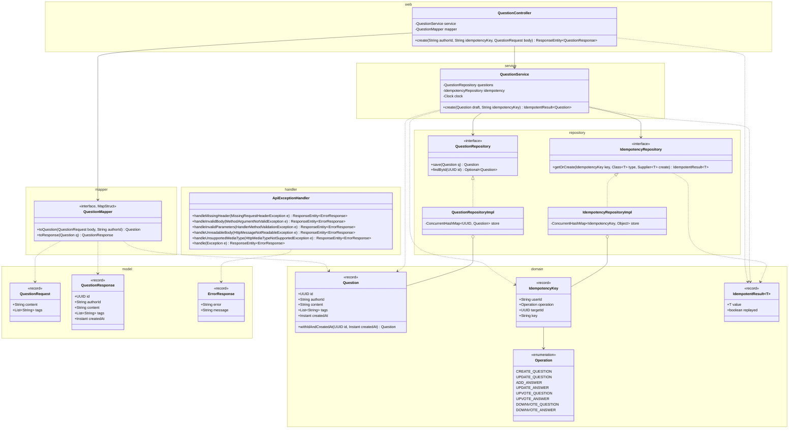
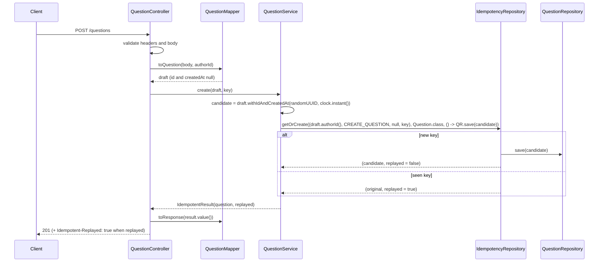
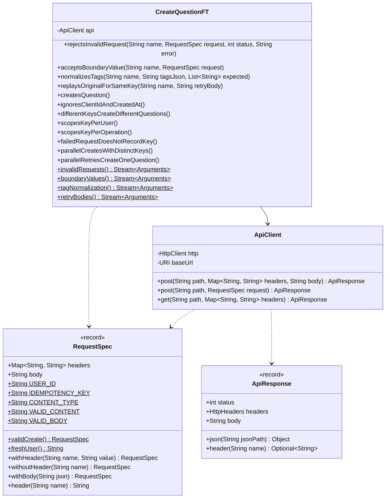

# Create Question API

Status: **Agreed** (2026-10-24) and implemented, Decision 11 included. See Decisions.

A user posts a question with optional tags. The user id comes from a header, the content and tags from the body. The server assigns a UUID, records the request time, and stores the question in memory. Retrying with the same idempotency key returns the original question instead of creating a duplicate.

## Contract

### Request

```
POST /questions
X-User-Id: user-42
Idempotency-Key: 8e0f3c1a-5b2d-4c7e-9a61-0d4f2b9e7c35
Content-Type: application/json

{
  "content": "How do I make a ConcurrentHashMap value update atomic?",
  "tags": ["Java", "concurrency"]
}
```

| Field | Rules |
|---|---|
| `X-User-Id` header | Required, not blank, max 64 chars. Identifies the caller, who becomes the question's `authorId`. |
| `Idempotency-Key` header | Required, not blank, max 64 chars. New value per question, same value on retry. |
| `content` | Required, not blank, max 5000 chars |
| `tags` | Optional, defaults to `[]`. Max 5 entries. Each is 1 to 35 chars of letters, digits, `+`, `#`, `.`, `-`. Stored lowercase, duplicates removed, first-seen order kept. |

Unknown body fields are ignored, so a client can't set `id` or `createdAt`.

### Response

```
201 Created
Location: /questions/3f1c9a52-8a7e-4f0b-9d0e-2b6c1f6a7e11

{
  "id": "3f1c9a52-8a7e-4f0b-9d0e-2b6c1f6a7e11",
  "authorId": "user-42",
  "content": "How do I make a ConcurrentHashMap value update atomic?",
  "tags": ["java", "concurrency"],
  "createdAt": "2026-10-24T06:12:45.123Z",
  "updatedAt": null,
  "upvotes": 0,
  "downvotes": 0,
  "answers": []
}
```

- `updatedAt` (UpdateQuestion.md), `upvotes` (Upvote.md), `downvotes` (Downvote.md), and `answers` (AddAnswer.md) are part of the shared `QuestionResponse`. A new question has `null`, `0`, `0`, and `[]`.
- A replay (a create whose key this user already used for a create) returns the original status, `Location`, and body, plus `Idempotent-Replayed: true`. The body is the stored snapshot, counts included: votes cast since don't show (Upvote.md's replay rule).

### Errors

Body: `{ "error": "<CODE>", "message": "<detail>" }`

| Case | Status | `error` |
|---|---|---|
| Missing `X-User-Id` or `Idempotency-Key` | 400 | `MISSING_HEADER` |
| A header, `content`, or `tags` breaks its rules | 400 | `VALIDATION_FAILED` |
| Body not valid JSON, or `tags` not an array | 400 | `MALFORMED_REQUEST` |
| `Content-Type` not JSON (with an `Accept: application/json` header) | 415 | `UNSUPPORTED_MEDIA_TYPE` |
| Unknown route | 404 | `NOT_FOUND` |
| Wrong HTTP method (with an `Allow` header) | 405 | `METHOD_NOT_ALLOWED` |
| Unexpected | 500 | `INTERNAL_ERROR` |

- `MISSING_HEADER`: `Required header '<name>' is missing`.
- `VALIDATION_FAILED` lists every violation as `<field or header>: <reason>`, sorted and joined with `; `. For example: `X-User-Id: size must be between 0 and 64; content: must not be blank; tags[0]: must match "[A-Za-z0-9+#.-]{1,35}"`.
- `MALFORMED_REQUEST`: `Request body is missing or is not valid JSON of the expected shape`. `UNSUPPORTED_MEDIA_TYPE`: `Content-Type must be application/json`.
- 404 and 405 keep Spring's detail as the message. 500 is always `An unexpected error occurred`.

## Idempotency

### Every write

Every write API takes the same required `Idempotency-Key` and shares one store. The other write docs refer here.

| Operation | Endpoint | `targetId` | Stored value | Replay status |
|---|---|---|---|---|
| `CREATE_QUESTION` | `POST /questions` | `null` | `Question` | 201 |
| `UPDATE_QUESTION` | `PUT /questions/{id}` | question id | `Question` | 200 |
| `ADD_ANSWER` | `POST /questions/{questionId}/answers` | question id | `Answer` | 201 |
| `UPDATE_ANSWER` | `PUT /questions/{questionId}/answers/{answerId}` | answer id | `Answer` | 200 |
| `UPVOTE_QUESTION` | `POST /questions/{questionId}/upvotes` | question id | `VoteResult` | 201 |
| `UPVOTE_ANSWER` | `POST /questions/{questionId}/answers/{answerId}/upvotes` | answer id | `VoteResult` | 201 |
| `DOWNVOTE_QUESTION` | `POST /questions/{questionId}/downvotes` | question id | `VoteResult` | 201 |
| `DOWNVOTE_ANSWER` | `POST /questions/{questionId}/answers/{answerId}/downvotes` | answer id | `VoteResult` | 201 |

- Header rules, the same on every write: required, not blank, max 64 chars. Missing gives 400 `MISSING_HEADER`; blank or too long gives 400 `VALIDATION_FAILED`.
- The stored key is `IdempotencyKey(userId, operation, targetId, key)`. A key used for another operation, or on another target, is a separate entry, so it never replays the wrong result. Answer ids are globally unique UUIDs, so `UPDATE_ANSWER`, `UPVOTE_ANSWER`, and `DOWNVOTE_ANSWER` need no question id.
- Same user, operation, target, and key: the stored snapshot of the first outcome, with its status, its body (and `Location` for create and add), plus `Idempotent-Replayed: true`. The new body isn't compared.
- Replay rule: a replay returns what the write produced. Create, add, and the PUTs store the question or answer with its votes, so their replays show the counts as stored. A vote's replay returns its stored count (Upvote.md, Downvote.md).
- Requests that fail (400, 415, 404, 403, 409) record nothing.
- Check order: every 400 and 415, then the key, then the API's own 404, 403, or 409.

### Create

- The stored key is `(userId, CREATE_QUESTION, null, key)`. Create has no target, so the key is scoped per user only.
- Same key again: respond with whatever was done the first time, which is the original question, counts included, with `Idempotent-Replayed: true`. The new request's content and tags are not compared. Status stays 201, so clients handle both the same way.
- Requests rejected with 400 or 415 never reach the service, so they don't record the key.
- The IETF `Idempotency-Key` header draft suggests 422 when a key comes back with a different payload. We don't do that; the first outcome always wins. Its 409 ("original still in progress") isn't needed either, because a concurrent duplicate waits for the original (see Concurrency).
- Keys live as long as the app does. That's one entry per successful write, so one per question here.

## Design

### External and internal models

| External (`web` and `model`, JSON) | Internal (`domain`) |
|---|---|
| `QuestionRequest` + `X-User-Id` | `Question` |
| `X-User-Id` + `Idempotency-Key` | `IdempotencyKey` (`CREATE_QUESTION`, no target) |
| `QuestionResponse` | `Question` |

- `Question` is the only internal model. There's no separate command object.
- `QuestionMapper` translates between the external DTOs and `Question`. It's a MapStruct interface, so the implementation is generated at compile time and fields with the same name map automatically. Only a field that differs needs an `@Mapping`.
  - `toQuestion(body, authorId)`: `id`, `createdAt`, `updatedAt`, and `answers` are marked `@Mapping(ignore = true)`, because the server owns them. So is `withAnswer`: MapStruct reads `Question.withAnswer(Answer)` as a fluent setter for a `withAnswer` property. The draft has a `null` `id`, `createdAt`, and `updatedAt`, and `answers = []`. The service fills in `id` and `createdAt` with `withIdAndCreatedAt(...)` before anything is stored.
  - `toResponse(question)`: copies every field. `upvotes` and `downvotes` are the sizes of `question.votes()`'s two sets (Upvote.md, Downvote.md).
- `unmappedTargetPolicy = ERROR`: a target field with no matching source fails the build instead of quietly staying `null`. Source fields with no target are dropped, so internal-only fields never leak into the response.
- The mapper only copies. Business rules (id, timestamp, tag normalization) stay out of it.
- Not chosen: Jackson `convertValue` (no new dependency, but it maps at runtime and fails silently on mismatches), and hand-written mappers (the boilerplate this is meant to avoid).
- Build: add the `mapstruct` dependency, and `mapstruct-processor` to the compiler plugin's `annotationProcessorPaths`.

### Classes



- Package root `com.practice.qabank`.
- The diagram shows create's members. `Question` and `QuestionResponse` also carry `updatedAt` (UpdateQuestion.md) and `answers` (AddAnswer.md). `Question` also carries `votes`, and `QuestionResponse` its `upvotes` and `downvotes` (Upvote.md, Downvote.md). `QuestionRequest` is shared with PUT question.
- `Clock` comes from a `ClockConfig` bean (`Clock.systemUTC()`), so unit tests can pin time with `Clock.fixed(...)`.
- `Question`'s compact constructor normalizes tags (lowercase, dedupe, `null` to `[]`) and stores an immutable `List.copyOf`. That way every `Question` holds the rule, whoever builds it. A `null` tag element throws `NullPointerException`; validation rejects it before that.
- `withIdAndCreatedAt` returns a copy with the server-owned fields set. The service never stores a `Question` without them. It throws on a `null` `id` or `createdAt`, and copies everything else, `updatedAt` included, from `this`.
- `ApiExceptionHandler` has one `@ExceptionHandler` method per exception type, plus the catch-all `handle(Exception)`:
  - No `@Validated` on the controllers. Spring 6.2's built-in method validation checks the constrained headers and the `@Valid` body together and raises `HandlerMethodValidationException`, so `handleInvalidParameters` produces every `VALIDATION_FAILED`. It names a header by its HTTP name. `handleInvalidBody` (`MethodArgumentNotValidException`) is a fallback with the same message format.
  - `handleUnsupportedMediaType` copies the exception's headers, so the 415 carries `Accept`.
  - The catch-all keeps the status and headers of Spring's own 4xx errors (404, 405 with `Allow`), with the status name as `error`. Anything else is a logged 500.
- `Operation` holds all eight writes (see Idempotency). `targetId` is `null` for create; record `equals` and `hashCode` handle `null`.
- `IdempotentResult<T>` lives in `domain`, not `repository`: services return it and controllers read it, and `web` depends on `domain` but never on `repository`.
- One store for every write. `IdempotencyRepositoryImpl.getOrCreate(key, type, create)`:
  - Runs `computeIfAbsent`. The mapping function sets a call-local flag, then runs `create`.
  - Returns `IdempotentResult(type.cast(stored), !flag)`, so `replayed` is false only when this call's supplier ran.
  - One map holds `Question`, `Answer`, and `VoteResult` values, so `type.cast` turns a mismatch into a loud `ClassCastException`, never a silently wrong type. Each operation always stores one type, so it shouldn't happen.
  - Not chosen: one store per value type (generic `<K, V>` beans). More wiring, and no gain once the key holds the operation.
- Layer rules: DTOs live in `model` and only the mapper touches them. The service takes a `Question` and returns it in an `IdempotentResult`. Repositories only store and fetch.

### Flow



### Concurrency

- `getOrCreate` is `ConcurrentHashMap.computeIfAbsent`. Check and create happen in one atomic step per key, so two simultaneous retries can't both create a question. The second caller blocks and then gets the first one's result.
- The save into the question map happens inside `computeIfAbsent`. That way a question is stored before any replay can return it, and a failed save records no key.
- The mapping function only writes to the other map, which `ConcurrentHashMap` allows, and it's short.
- `getOrCreate` reports the replay with its call-local flag. There's no instance comparison, so the same check works for updates, which have no fresh candidate, including a no-op that returns the unchanged instance.
- Lock order, the same for every write, votes included: an idempotency bin, then a question bin (Upvote.md). GETs take no lock, so there's no inversion.
- `QuestionRepository.save` uses `putIfAbsent` and throws on an existing id, so it can never silently overwrite.
- `Question` is immutable, including its tag list, so it's safe to share across threads and across both maps.

## Unit tests

- **Layout:** one `<Class>Test` per class that has behavior, in the same package under `src/test/java`.
- **When they run:** Surefire runs them in `mvn test`.
- **When they're written:** with each class, test first.
- **Style:** inputs that vary use `@ParameterizedTest` with a `@MethodSource`, the same as the FTs.

| Class | Style | Covers |
|---|---|---|
| `Question` | Plain JUnit | Tag normalization, parameterized: `null` becomes `[]`, lowercased, deduplicated, order kept. The tag list is immutable and doesn't change when the caller's list changes later. `withIdAndCreatedAt` sets those two fields and leaves the others unchanged. |
| `QuestionRequest` | Plain JUnit with a Bean Validation `Validator` | Each `content` and `tags` rule, parameterized. An invalid value gives a violation on the right field; a boundary value gives none. |
| `QuestionMapper` | Plain JUnit, `Mappers.getMapper(QuestionMapper.class)` | `toQuestion` copies `content`, `tags`, and `authorId`, and leaves `id` and `createdAt` `null`. `toResponse` copies every field. |
| `QuestionService` | Plain JUnit, `Clock.fixed(...)`, real in-memory repositories | New key: created, with a random UUID, `createdAt` equal to the fixed clock, stored, and `replayed` false. Same key: `replayed` true, same question returned, new content and tags ignored, nothing new stored. Same key from two users: two questions. The same user and key already stored under another operation: still created, `replayed` false. Save fails (a `QuestionRepository` stub that throws): the exception propagates, the key isn't recorded, and a retry creates the question. |
| `QuestionRepositoryImpl` | Plain JUnit | `save` then `findById` returns it. Saving an existing id throws. 50 concurrent saves are all stored. |
| `IdempotencyRepositoryImpl` | Plain JUnit | The first call runs the supplier and returns `replayed` false. A repeat returns the stored value with `replayed` true, without running it. Keys that differ in one field only are independent, parameterized: `userId`, `operation`, `targetId` (including `null` against a UUID), `key`. A `null` `targetId` replays like any other key. `Answer` values share the store. A throwing supplier records nothing, and a retry runs it. Reading a stored `Question` with another `type` throws `ClassCastException`. 50 threads on one key run the supplier exactly once; all get the same value, and exactly one gets `replayed` false. |
| `QuestionController` | `@WebMvcTest`, `QuestionService` as a `@MockitoBean`, real mapper | 201 with `Location` and body. `Idempotent-Replayed` appears only when `replayed()` is true. The service receives a `Question` built from the body and `X-User-Id`, plus the `Idempotency-Key` (checked with an `ArgumentCaptor`). |
| `ApiExceptionHandler` | `@WebMvcTest` (same slice), parameterized | Each invalid input, plus a missing body, maps to the right status and `error`, the message names the header or field, and the service is never called. The rows run for both POST and PUT question. A `RuntimeException` from the service gives 500 `INTERNAL_ERROR` with no stack trace. An unknown path gives 404 `NOT_FOUND`, and `DELETE /questions` gives 405 `METHOD_NOT_ALLOWED` with `Allow`. This runs in the MVC slice because Spring creates these exceptions; building them by hand would test a fake. |

- **Concurrency tests** hold all threads behind a `CountDownLatch` and release them together, so the calls really overlap.
- **`findById` is on `QuestionRepository`** so the repository and service tests can check what was stored. `GET /questions/{id}` uses it too.
- **No dedicated test:** `QuestionResponse`, `ErrorResponse`, `IdempotentResult`, `IdempotencyKey`, `Operation`, and `ClockConfig` have no behavior of their own, so a test would only exercise the JDK or Spring. The tests above cover them.

## Functional tests

Black-box tests that send real HTTP requests to a running app. They don't use a Spring context and don't import production classes.

### How they run

`mvn verify`:

1. `pre-integration-test`: `spring-boot:start` launches the app as a separate process on `ft.port` (default 8081) and waits until it's ready.
2. `integration-test`: Failsafe runs `**/*FT.java` against `http://localhost:${ft.port}`.
3. `post-integration-test`: `spring-boot:stop`, which finds the app through JMX on `ft.jmxPort` (default 9001).
4. `verify`: fails the build if any FT failed. The app is still stopped first.

`mvn test` runs unit tests only, because Surefire doesn't pick up `*FT`. So unit tests stay green while the FTs are red.

FT classes carry `@Tag("api")` or `@Tag("journey")`, and `-Dft.groups` picks one, for example `mvn verify -Dft.groups=api` (UserJourneys.md, Build and tags).

To use other ports, for example to run two builds side by side, run `mvn verify -Dft.port=8082 -Dft.jmxPort=9002`.

To run the FTs against an app you started yourself (for example with `mvn spring-boot:run`, then running an FT from IntelliJ), set the system property `qabank.baseUrl`. The default is `http://localhost:8080`.

Build setup in `pom.xml`:

- Properties `ft.port` (8081) and `ft.jmxPort` (9001).
- `maven-failsafe-plugin` includes `**/*FT.java` and sets `qabank.baseUrl=http://localhost:${ft.port}`.
- `spring-boot-maven-plugin` has `start` and `stop` executions with `jmxPort=${ft.jmxPort}`, and `start` passes `--server.port=${ft.port}`.

### Classes



- `ApiClient` wraps the JDK `java.net.http.HttpClient`, pinned to HTTP/1.1 so it never tries an h2c upgrade against Tomcat, and reads `qabank.baseUrl`. Every FT reuses it.
- `ApiResponse.json(...)` uses JsonPath, which already comes with `spring-boot-starter-test`. So the FTs need no new dependencies.
- `RequestSpec.validCreate()` builds a valid request with a fresh random user id (`freshUser()`) and key. The app keeps its state between tests and between runs, so this keeps tests independent. Each parameterized row starts from it and changes one thing. The other FTs share its header-name constants.

### Cases

Input variations are JUnit 5 `@ParameterizedTest(name = "{0}")` tests fed by a `@MethodSource`, so each row shows up by name in the report. `junit-jupiter-params` already comes with `spring-boot-starter-test`.

**`rejectsInvalidRequest`**: one change from a valid request, then expect this status and `error`.

| Change | Status | `error` |
|---|---|---|
| Remove `X-User-Id` | 400 | `MISSING_HEADER` |
| Remove `Idempotency-Key` | 400 | `MISSING_HEADER` |
| `X-User-Id` is `"   "` | 400 | `VALIDATION_FAILED` |
| `X-User-Id` is 65 chars | 400 | `VALIDATION_FAILED` |
| `Idempotency-Key` is `"   "` | 400 | `VALIDATION_FAILED` |
| `Idempotency-Key` is 65 chars | 400 | `VALIDATION_FAILED` |
| No `content` | 400 | `VALIDATION_FAILED` |
| `content` is `"   "` | 400 | `VALIDATION_FAILED` |
| `content` is 5001 chars | 400 | `VALIDATION_FAILED` |
| 6 tags | 400 | `VALIDATION_FAILED` |
| Tag `""` | 400 | `VALIDATION_FAILED` |
| Tag `null` | 400 | `VALIDATION_FAILED` |
| Tag `"spring boot"` (space) | 400 | `VALIDATION_FAILED` |
| Tag is 36 chars | 400 | `VALIDATION_FAILED` |
| Body `{not json` | 400 | `MALFORMED_REQUEST` |
| `"tags": "java"` (not an array) | 400 | `MALFORMED_REQUEST` |
| `Content-Type: text/plain` | 415 | `UNSUPPORTED_MEDIA_TYPE` |

**`acceptsBoundaryValue`**: one change from a valid request, then expect 201.

| Change |
|---|
| `X-User-Id` is 64 chars |
| `Idempotency-Key` is 64 chars |
| `content` is 5000 chars |
| 5 tags |
| Tag is 1 char |
| Tag is 35 chars |

**`normalizesTags`**: send these tags, then expect these in the response.

| Sent | Returned |
|---|---|
| no `tags` field | `[]` |
| `[]` | `[]` |
| `["Java", "java", "Concurrency"]` | `["java", "concurrency"]` |
| `["C#", "c#", "C++"]` | `["c#", "c++"]` |

**`replaysOriginalForSameKey`**: create a question, then retry with the same user and key and the body below. The retry gets 201 with the original `id`, `content`, `tags`, `createdAt`, and `Location`, plus `Idempotent-Replayed: true`. The first response has no replay header.

| Retry body |
|---|
| Same as the first |
| Different `content` |
| Different `tags` |

**Single tests**

| Test | Expect |
|---|---|
| `createsQuestion` | 201. UUID `id`; same `authorId`, `content`, `tags`; `createdAt` between the times just before and after the call; `Location` ends with `id`; no replay header. |
| `ignoresClientIdAndCreatedAt` | The body also sends `id` and `createdAt`. 201 with server-generated values. |
| `differentKeysCreateDifferentQuestions` | Same user and content, two keys: different ids (no content deduplication). |
| `scopesKeyPerUser` | Two users, same key: different ids. |
| `scopesKeyPerOperation` | One user creates question Q with key K1 and PUTs Q with key K2, then creates with K2: 201, a new id, no replay header. It uses PUT question. |
| `failedRequestDoesNotRecordKey` | 400 with key K, then a valid request with K: 201, not a replay. |
| `parallelCreatesWithDistinctKeys` | 50 parallel requests: 50 distinct ids. |
| `parallelRetriesCreateOneQuestion` | 50 parallel requests with the same user, key, and content: 1 distinct id, 49 replays. |

- Create has no target (`targetId` is `null`), so there's no per-target test.
- These FTs can't see whether a question was stored. `GetQuestionFT.returnsCreatedQuestion` checks that.

## Decisions

Agreed on 2026-10-24. Every open question took its draft default, except Decision 11.

1. Body: a single `content` field.
2. `X-User-Id`: any non-blank string, up to 64 chars.
3. Missing `X-User-Id`: 400 `MISSING_HEADER`.
4. Size limits: 64 chars for the user id and the key, 5000 for content.
5. `Location`: kept. `GET /questions/{id}` resolves it (GetQuestion.md).
6. `Idempotency-Key`: required. Any non-blank string, up to 64 chars.
7. Keys are kept for as long as the app runs.
8. A known key with an invalid body gets 400, because validation runs before the service.
9. Tags: optional, at most 5. Each is 1 to 35 chars of letters, digits, `+`, `#`, `.`, `-`.
10. Unknown route: 404 `NOT_FOUND`. Wrong method: 405 `METHOD_NOT_ALLOWED`. Neither becomes a 500 (GetQuestion Decision 4).
11. `Idempotency-Key` is required on every write; the stored key is `(userId, operation, targetId, key)` (user, 2026-10-24). One store holds every write's result, and the store flags a replay instead of the service comparing instances. Implemented.
