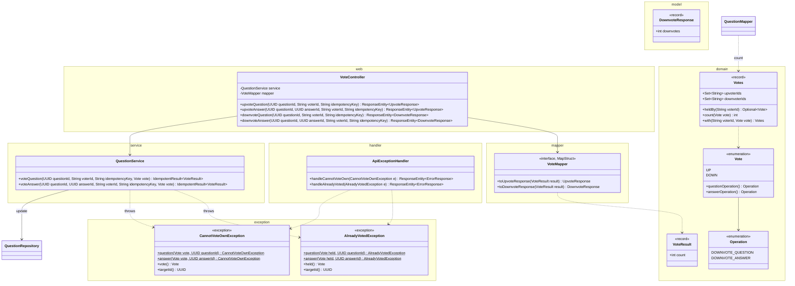
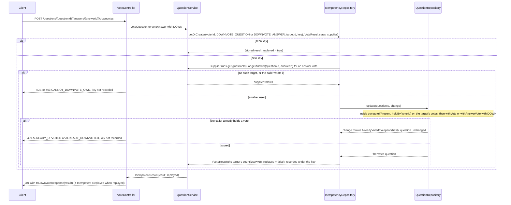
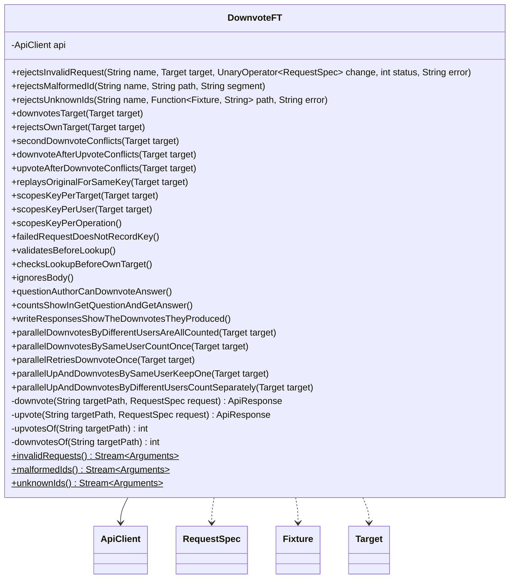

# Downvote API

Status: **Agreed** (2026-10-24). Votes moved into `Question` and `Answer` on 2026-10-25 (Decisions 5 and 6, Settled question 2). See Decisions and Settled questions.

A user downvotes a question or an answer. Downvotes are counted apart from upvotes, and a user holds at most one vote, up or down, on a given question or answer. Everything else is as in Upvote.md: no voting on your own, once per user per target, required `X-User-Id` and `Idempotency-Key`, the same replay rule and check order. Builds on Upvote.md and CreateQuestion.md (Decision 11), and changes Upvote's design (see Changes to the existing design).

## Contract

### Request

```
POST /questions/3f1c9a52-8a7e-4f0b-9d0e-2b6c1f6a7e11/downvotes
X-User-Id: user-7
Idempotency-Key: 4b8e1d27-3f6a-4c90-9e25-7d1a0b6c3f48
```

- An answer is downvoted at `POST /questions/{questionId}/answers/{answerId}/downvotes`. Path ids, headers, and the ignored body: as in Upvote.md.
- `X-User-Id` must not be the target's `authorId`, and must not already hold a vote, up or down, on the target. A question's author may downvote other users' answers on it.

### Response

```
201 Created

{ "downvotes": 3 }
```

`DownvoteResponse`: the target's downvote count, including this vote. No `Location`. A replay returns the stored body plus `Idempotent-Replayed: true`. All as in Upvote.md.

### Counts on reads

`QuestionResponse` and `AnswerResponse` gain `downvotes` right after `upvotes`, on every response that has `upvotes`: GET question (each nested answer too), GET answer, and the create, add, and PUT responses.

```
{ "id": "3f1c...", ..., "updatedAt": null, "upvotes": 5, "downvotes": 1, "answers": [ { ..., "upvotes": 2, "downvotes": 3 } ] }
```

- Always present, `0` when nobody has downvoted. It's the size of the target's downvoter set in the record the response is built from, like `upvotes` (Upvote.md Settled question 1).
- No net score (requirement). A client that wants one computes `upvotes - downvotes`.

### Errors

Body and check order as in Upvote.md: every 400, then the key (a replay returns the original 201), then 404 (question, then answer), then 403, then 409. No 415.

| Case | Status | `error` |
|---|---|---|
| Bad id, missing or invalid header | 400 | As in Upvote.md |
| No such question, or no such answer on it | 404 | `QUESTION_NOT_FOUND`, `ANSWER_NOT_FOUND` |
| `X-User-Id` is the target's `authorId` | 403 | `CANNOT_DOWNVOTE_OWN` |
| The caller already downvoted the target, under another key | 409 | `ALREADY_DOWNVOTED` |
| The caller already upvoted the target | 409 | `ALREADY_UPVOTED` |
| Any other method on a downvotes URL (with `Allow: POST`) | 405 | `METHOD_NOT_ALLOWED` |
| Unexpected | 500 | `INTERNAL_ERROR` |

- 403 message: `You can't downvote your own question <questionId>` or `You can't downvote your own answer <answerId>`.
- A 409 names the vote the caller holds, with the same code and message on either endpoint: `You already upvoted question <questionId>`, `You already downvoted answer <answerId>`, and so on. The client learns which vote it holds.
- **The upvote endpoints gain a 409:** `ALREADY_DOWNVOTED` when the caller holds a downvote. This changes Upvote.md's agreed contract.
- Switching sides is rejected with that 409 (Open question 1). The 403 and 409 order never matters, as in Upvote.md.

## Idempotency

As in Upvote.md, in CreateQuestion.md's shared store (its Decision 11):

| Operation | Endpoint | `targetId` | Stored value | Replay status |
|---|---|---|---|---|
| `DOWNVOTE_QUESTION` | `POST /questions/{questionId}/downvotes` | question id | `VoteResult` | 201 |
| `DOWNVOTE_ANSWER` | `POST /questions/{questionId}/answers/{answerId}/downvotes` | answer id | `VoteResult` | 201 |

- Same key: the stored `VoteResult`, 201, `Idempotent-Replayed: true`. A new key after a vote: the 409 naming the held vote. Failures record nothing. All as in Upvote.md.
- An upvote and a downvote are separate operations, so a key never replays across them. A downvote under the key of the caller's upvote on that target runs, and gets 409 `ALREADY_UPVOTED`, not the upvote's 201.
- `UPVOTE_QUESTION` and `UPVOTE_ANSWER` now store a `VoteResult` too (`UpvoteResult`, renamed).

## Design

### External and internal models

| External (`web` and `model`, JSON) | Internal |
|---|---|
| `X-User-Id` + target id + `Idempotency-Key` | `IdempotencyKey` (`DOWNVOTE_QUESTION` or `DOWNVOTE_ANSWER`) |
| Which endpoint: upvotes or downvotes | `domain.Vote` (`UP`, `DOWN`) |
| `UpvoteResponse`, `DownvoteResponse` | `domain.VoteResult(int count)` |
| `upvotes`, `downvotes` in `QuestionResponse` and `AnswerResponse` | `votes().count(vote)` on the `Question` or `Answer`: the size of `upvoterIds` or `downvoterIds` |

- `Vote` is the one internal model for a direction. Each value names its two operations (`UP`: `UPVOTE_QUESTION`, `UPVOTE_ANSWER`; `DOWN`: the `DOWNVOTE_` pair), so the service has no switch.
- `VoteResult(int count)` is the target's count in the vote's direction. `VoteMapper.toUpvoteResponse` maps `count` to `upvotes`, and `toDownvoteResponse` maps it to `downvotes`. They're two named methods because both take a `VoteResult`.
- `Votes` holds one set of voter ids per direction, `upvoterIds` and `downvoterIds`, and a voter is in at most one (Upvote.md, Classes).
  - The mapper has `@Mapping(target = "downvotes", expression = "java(question.votes().count(Vote.DOWN))")`, and `upvotes` passes `Vote.UP`. The same for answers. `@Mapper(imports = Vote.class)`.

### Classes



- Only new, renamed, or changed members are shown; the rest are as in Upvote.md. `QuestionResponse` and `AnswerResponse` gain `int downvotes`. `Operation` keeps its six values and adds two.
- **One pair of service methods and one controller for both directions.** The two directions share every step and both 409s, so parallel `Downvote*` classes would copy the supplier and the held-vote branch. Upvote's classes are renamed instead (Open question 3). Since 2026-10-25 the methods sit in `QuestionService`.
- **`VoteController`** is `UpvoteController`, renamed, plus `downvoteQuestion` (`@PostMapping("/downvotes")`) and `downvoteAnswer` (`@PostMapping("/answers/{answerId}/downvotes")`). Each handler is one service call with its `Vote`, then `toUpvoteResponse` or `toDownvoteResponse`, 201, and the replay header.
- **`QuestionService.voteQuestion` and `voteAnswer`** (`UpvoteService`'s, renamed, then in `VoteService` until 2026-10-25) take the direction as a parameter:

  | Step | `voteQuestion(questionId, voterId, key, vote)` | `voteAnswer(questionId, answerId, voterId, key, vote)` |
  |---|---|---|
  | Key | `(voterId, vote.questionOperation(), questionId, key)` | `(voterId, vote.answerOperation(), answerId, key)` |
  | Supplier 1 and 2: find as in Upvote.md, then self-vote | `throw CannotVoteOwnException.question(vote, questionId)` | `throw CannotVoteOwnException.answer(vote, answerId)` |
  | 3: vote, inside `questions.update` | If `q.votes().heldBy(voterId)` holds a vote, `throw AlreadyVotedException.question(held, questionId)`, else `q.withVote(voterId, vote)` | The same on the answer's votes, with `.answer` and `q.withAnswerVote(answerId, voterId, vote)` |
  | 4: count | `new VoteResult(voted.votes().count(vote))` | The voted answer's `votes().count(vote)` |
- **`Votes`** (Upvote.md, Classes): `heldBy` checks both sets, so one check covers both directions. The compact constructor rejects a voter in both sets.
- **Exceptions:** `CannotVoteOwnException` and `AlreadyVotedException` replace Upvote's two, with the same shape (final, unchecked, private constructor, factories that build the Errors messages, `targetId()`), plus the direction: `vote()` is the vote tried, `held()` the vote held. `ApiExceptionHandler.handleCannotVoteOwn` gives 403 `CANNOT_UPVOTE_OWN` or `CANNOT_DOWNVOTE_OWN` by `e.vote()`. `handleAlreadyVoted` gives 409 `ALREADY_UPVOTED` or `ALREADY_DOWNVOTED` by `e.held()`. Error codes stay in `handler`.

### Flow

After validation (400s as in Upvote.md):



Reads: Upvote.md's read flow: two set sizes per target (`UP`, then `DOWN`).

### Concurrency

"Never both" needs one atomic step, per target and voter, that sees both directions. Upvote's voter set does it for one direction only.

| Option | Exclusivity | Simplicity | Count read |
|---|---|---|---|
| Upvote's set, plus a second set for downvotes | Broken: an upvote checks the down set while a downvote checks the up set, both pass, and the voter is in both | — | O(1) `size()` |
| (a) Per target, a `ConcurrentHashMap<String, Vote>` with `putIfAbsent(voterId, vote)` | One atomic call: one key per voter, the direction is the value | No new class or lock, the same shape and lock profile as Upvote's set. It returns the held vote, which picks the 409 | A scan, O(voters), per direction |
| (b) Per target, a `TargetVotes` with two sets and a `synchronized` add that checks both | A monitor around check and add | A new class and a monitor. Votes on one target run one at a time | O(1) `size()`, no lock |
| (c) (a), plus a `LongAdder` per direction | As (a) | A second write per vote that lags the map. Upvote.md rejected counters | O(1) |
| (c') One map keyed by `(targetId, voterId)`, or an immutable per-target record swapped with `compute` | Atomic | The key: a scan of every vote in the app per count. The record: copies O(voters) per vote | O(all votes), or O(1) |
| **(d) Inside the question: a `Votes` record with two sets, swapped in `QuestionRepository.update`** | The question's bin is held around check and add, so the check sees both sets | No store or lock of its own. Each vote copies the question and the voter set, O(answers + voters) | O(1) `size()` |

- **Chosen: (d)** (changed 2026-10-25, user; it was (a)). Votes mean nothing apart from their question, so they live in it, like answers. The question's `computeIfPresent` is the monitor (b) needed, so two plain sets are enough. The cost is per vote: votes on one question run one at a time and copy it. That's fine at this app's scale (Open question 2).
- **Once per user, either direction.** `heldBy` and `withVote` run in one `computeIfPresent` on the question's bin: exactly one call per target and voter stores its vote, and every other call, in either direction, gets the held vote back and a 409. The 404 and self-vote checks outside this step are safe, as in Upvote.md.
- **One lock per question.** As in Upvote.md: votes queue with answer adds and edits on that question's bin, each built from the latest copy. Different questions don't block each other.
- **Counts derive from the votes,** so they can't drift. Each is a set size, read from the question the vote produced, so the 201 includes this vote and every one applied before it. Memory: one entry per voter, never removed.
- **Races:** Upvote.md's three hold per direction. Across directions:

  | Race | Result |
  |---|---|
  | One user, 25 upvotes and 25 downvotes, own keys | One change stores, in either direction: one 201 and 49 409s naming that vote. Counts are 1 and 0, or 0 and 1 |
  | 25 users upvote while 25 others downvote | All 201: `upvotes` 25, `downvotes` 25 |

- **Lock order:** an idempotency bin, then the question's bin (during `update`), as in Upvote.md: no cycle, no deadlock. An upvote and a downvote under one key are separate idempotency entries, so both suppliers run and the question's `heldBy` check decides.

## Unit tests

As in Upvote.md: plain JUnit with real in-memory repositories, `CountDownLatch` for concurrency, and `@ParameterizedTest` with `@MethodSource`, now also over `Vote`. Renamed test classes keep Upvote's cases.

| Class | Style | Covers |
|---|---|---|
| `Votes` (`VotesTest`) | Plain JUnit, parameterized over `Vote` and `(held, tried)` pairs | Upvote.md's cases for both sets. `with` for a voter holding either vote throws, so nobody switches sides. A voter in both sets is rejected. |
| `QuestionService`, votes (`QuestionServiceVotesTest`, was `VoteServiceTest`) | Plain JUnit, real repositories, a question with two answers (one by the question's author), parameterized by method and `Vote` | Upvote.md's cases per `Vote`, plus: a vote leaves the other direction at 0. One user upvotes a question and downvotes its answer: both apply. The same user and `Vote` under a new key: `AlreadyVotedException`, `held()` that vote. The opposite `Vote`: `held()` the first vote, counts unchanged. The author: `CannotVoteOwnException` with `vote()` and `targetId()`. An upvote's key reused for a downvote on that target: `AlreadyVotedException` holding `UP`, not a replay. |
| `QuestionService`, votes, concurrency | Same | Upvote.md's races per `Vote`. One user, 25 `UP` and 25 `DOWN` keys: one result, and 49 `AlreadyVotedException` whose `held()` is the winner's vote. |
| `VoteController` (was `UpvoteController`) | `@WebMvcTest(VoteController.class)`, `@Import(VoteMapperImpl.class)`, `QuestionService` as a `@MockitoBean`, parameterized by the four endpoints | Upvote.md's cases on every endpoint. The service gets the endpoint's `Vote`. The body is exactly `{"upvotes": n}` or `{"downvotes": n}`. |
| `VoteController`, errors | Same slice, parameterized | Upvote.md's rows on every endpoint. `CannotVoteOwnException` with `UP` or `DOWN`: 403 `CANNOT_UPVOTE_OWN` or `CANNOT_DOWNVOTE_OWN`. `AlreadyVotedException` holding `UP` or `DOWN`: 409 `ALREADY_UPVOTED` or `ALREADY_DOWNVOTED`, whichever endpoint threw it. Exact messages. GET on a downvotes URL: 405, `Allow: POST`. |
| `QuestionMapper` | Plain JUnit, `Mappers.getMapper`, records built with `Votes` of a different size per target and `Vote` | The question and each nested answer get their own `upvotes` and `downvotes`, never swapped. `VoteMapper`'s `toUpvoteResponse` and `toDownvoteResponse` copy `count` (`VoteMapperTest`). |
| `QuestionController`, `AnswerController` | Existing slices, `QuestionService` as a `@MockitoBean` | The service returns records with different up and down counts: every response, replays included, shows both counts in the right fields. |

- **No dedicated test:** `Vote`, `VoteResult`, `DownvoteResponse`, and the new `Operation` values have no behavior of their own. The `QuestionServiceVotesTest` key cases pin `Vote`'s operations, and the controller error tests pin the messages.

## Functional tests

### How they run

The same as CreateQuestion.md: `mvn verify` starts the app on `ft.port` (default 8081), and Failsafe runs `DownvoteFT`. No build changes.

### Classes



- `Target` and `Fixture` are UpvoteFT's, shared at package level, and `Fixture.create(api)` is UpvoteFT's `fixture()`. The downvotes path is the target path plus `/downvotes`.
- `RequestSpec.validVote(userId)` is UpvoteFT's `validUpvote`, renamed: `X-User-Id`, a fresh key, no `Content-Type`, no body.
- `upvotesOf` and `downvotesOf` GET the target, assert 200, and read that field. The three sources build UpvoteFT's rows on the downvotes paths. "Per target" tests run for both endpoints through `@EnumSource`. Fresh users and keys per test.

### Cases

**`rejectsInvalidRequest`**, **`rejectsMalformedId`**, **`rejectsUnknownIds`**: UpvoteFT's rows, on the downvotes paths. Afterwards both counts stay 0 everywhere.

**Single tests**

| Test | Expect |
|---|---|
| `downvotesTarget` (per target) | Another user: 201, body exactly `{"downvotes": 1}`, no `Location`, no replay header. A second user: `{"downvotes": 2}`. `downvotesOf` is 2 and `upvotesOf` 0. |
| `rejectsOwnTarget` (per target) | The target's author: 403 `CANNOT_DOWNVOTE_OWN`, and the message holds the target's id. Both counts 0. |
| `secondDownvoteConflicts` (per target) | Same user, new key K2: 409 `ALREADY_DOWNVOTED`. Retrying with K2: 409 again, no replay header. `downvotesOf` is 1. |
| `downvoteAfterUpvoteConflicts`, `upvoteAfterDownvoteConflicts` (per target) | U upvotes, then downvotes under a new key: 409 `ALREADY_UPVOTED`, message `You already upvoted ...` with the target's id, up 1, down 0. The mirror: 409 `ALREADY_DOWNVOTED`, up 0, down 1. |
| `replaysOriginalForSameKey` (per target) | U downvotes with K (`downvotes` 1), then V downvotes. U retries with K: 201, `{"downvotes": 1}`, `Idempotent-Replayed: true`. `downvotesOf` is 2. |
| `scopesKeyPerTarget`, `scopesKeyPerUser` (per target) | As in UpvoteFT, with downvotes. |
| `scopesKeyPerOperation` | U upvotes Q with K, then downvotes Q with K: 409 `ALREADY_UPVOTED`, not a replay of `{"upvotes": 1}`. |
| `failedRequestDoesNotRecordKey`, `validatesBeforeLookup`, `checksLookupBeforeOwnTarget`, `ignoresBody`, `questionAuthorCanDownvoteAnswer` | As in UpvoteFT, on the downvotes paths. |
| `countsShowInGetQuestionAndGetAnswer` | A new question with answers A and B shows 0 and 0 everywhere. U1 and U2 downvote the question and U3 upvotes it. U1, U2, and U3 downvote A, and U4 upvotes A. GET question: up 1 and down 2, A's entry 1 and 3, B's 0 and 0. GET answer A: 1 and 3. U3 holds an upvote on the question and a downvote on its answer. |
| `writeResponsesShowTheDownvotesTheyProduced` | UpvoteFT's `writeResponsesShowTheCountsTheyProduced` with downvotes: the create and add replays are the original bodies, `downvotes` 0, and both PUTs show 2. |
| `parallelDownvotesByDifferentUsersAreAllCounted` (per target) | 50 users in parallel: all 201, every `downvotes` between 1 and 50, `downvotesOf` 50. |
| `parallelDownvotesBySameUserCountOnce` (per target) | One user, 50 keys, in parallel: exactly one 201 and 49 409 `ALREADY_DOWNVOTED`. `downvotesOf` is 1. |
| `parallelRetriesDownvoteOnce` (per target) | One user, one key, 50 parallel requests: all 201 with `downvotes` 1, one without the replay header and 49 replays. `downvotesOf` is 1. |
| `parallelUpAndDownvotesBySameUserKeepOne` (per target) | On each of 10 new fixtures, one user sends 25 upvotes and 25 downvotes in parallel, each under its own key. Exactly one 201. If it's an upvote, the other 49 are 409 `ALREADY_UPVOTED` and the counts are up 1, down 0. Otherwise they're 409 `ALREADY_DOWNVOTED`, and up 0, down 1. |
| `parallelUpAndDownvotesByDifferentUsersCountSeparately` (per target) | 25 users upvote and 25 others downvote, in parallel: all 201, `upvotesOf` 25, `downvotesOf` 25. |

## Changes to the existing design

No existing doc or code is edited here. Applying this design to Upvote.md's agreed design needs:

| Where | Change | Effect on existing endpoints |
|---|---|---|
| `domain` | Add `Operation.DOWNVOTE_QUESTION` and `DOWNVOTE_ANSWER`, and the `Vote` enum. **Rename** `UpvoteResult` to `VoteResult`, and its `int upvotes` to `int count`. | None. The store is in memory. |
| `VoteRepository` | `add(targetId, voterId) boolean` becomes `add(targetId, voterId, vote) Optional<Vote>` (the held vote, if any). `count(targetId)` becomes `count(targetId, vote)`. | None. |
| `VoteRepositoryImpl` | `ConcurrentHashMap<UUID, Set<String>>` becomes `ConcurrentHashMap<UUID, ConcurrentHashMap<String, Vote>>`. `add` is `putIfAbsent`, and `count` scans (Concurrency). | Counts read O(voters) instead of O(1). |
| `service.UpvoteService` | **Rename** to `VoteService`. `upvoteQuestion` and `upvoteAnswer` become `voteQuestion` and `voteAnswer` with a `Vote`. `count(targetId)` becomes `count(targetId, vote)`. Step 3 throws with the held vote. | Upvote endpoints can give 409 `ALREADY_DOWNVOTED`. |
| `CannotUpvoteOwnException`, `AlreadyUpvotedException` | **Rename** to `CannotVoteOwnException` and `AlreadyVotedException`. The factories take the `Vote` tried or held, exposed as `vote()` or `held()`. | None: upvotes keep their codes and messages. |
| `web.UpvoteController` | **Rename** to `VoteController`. The upvote handlers pass `UP`. Add the two downvote handlers and `DownvoteResponse(int downvotes)`. `UpvoteResponse` is unchanged. | None for upvotes. |
| `mapper.VoteCounts`, `QuestionMapper` | `int of(UUID targetId)` becomes `int of(UUID targetId, Vote vote)`. The mapper adds the `downvotes` expressions, passes `Vote.UP` in the `upvotes` ones, and adds `imports = Vote.class`. `toResponse(UpvoteResult)` becomes `toUpvoteResponse(VoteResult)`, and `toDownvoteResponse(VoteResult)` is added. | Only the new field. |
| `QuestionResponse`, `AnswerResponse` | Add `int downvotes` right after `upvotes`. | Every question and answer body, nested answers and replays included, gains `downvotes`. |
| `QuestionController`, `AnswerController` | Take `VoteService` instead of `UpvoteService`, and keep `votes = voteService::count`. | Only the new field. |
| `ApiExceptionHandler` | `handleCannotUpvoteOwn` and `handleAlreadyUpvoted` become `handleCannotVoteOwn` (403, code by `vote()`) and `handleAlreadyVoted` (409, code by `held()`). | Adds `CANNOT_DOWNVOTE_OWN` and `ALREADY_DOWNVOTED`. |
| Unit tests | `VoteRepositoryImplTest` is rewritten for the new API. **Rename** `UpvoteServiceTest` and `UpvoteControllerTest` to `VoteServiceTest` and `VoteControllerTest`, parameterized by `Vote` or endpoint. `QuestionMapperTest`: a two-argument `VoteCounts`, `downvotes` in `new AnswerResponse(...)` and `new QuestionResponse(...)`, and `toUpvoteResponse`. `QuestionControllerTest`, `AnswerControllerTest`, and `ApiExceptionHandlerTest` mock `VoteService` instead of `UpvoteService`, and `AnswerControllerTest`'s `aMapWithSize(6)` becomes 7. | Test only. |
| FT helpers and `UpvoteFT` | **Rename** `RequestSpec.validUpvote` to `validVote`. `Target` and `Fixture` move to package level if `UpvoteFT` nests them, and `fixture()` becomes `Fixture.create(api)`. UpvoteFT's cases still hold; DownvoteFT covers the cross 409s both ways. `CreateQuestionFT.createsQuestion` and `AddAnswerFT.addsAnswer` also expect `downvotes` 0. | Test only. |
| Upvote.md | The renames above, in Classes, Flow, and Unit tests. Errors, Idempotency ("New key after a vote"), and Decision 3 gain 409 `ALREADY_DOWNVOTED`. Design, Concurrency, and Decisions 5 to 7 describe the voter-to-`Vote` map and the two-argument `VoteCounts`. Settled question 3 points here: separate counts replace its score idea. | Doc only. |
| CreateQuestion.md | "Every write" gets the two `DOWNVOTE_` rows, `UPVOTE_*` store `VoteResult`, and the `Operation` class gains both values. | Doc only. |
| Response examples in CreateQuestion.md, GetQuestion.md, AddAnswer.md, GetAnswer.md, UpdateQuestion.md, UpdateAnswer.md, Upvote.md | Add `"downvotes": 0` after `upvotes`. | Doc only. |
| README.md, `curl.sh` | Add "Downvote a question or an answer" and sample calls. | Doc only. |

- The whole-body comparisons in `GetQuestionFT`, `GetAnswerFT`, `UpdateQuestionFT`, and `UpdateAnswerFT` keep passing: nothing votes there, so both sides show 0.
- `IdempotencyRepositoryImpl`, `QuestionRepository`, `Question`, and `Answer` don't change.

## Decisions

Agreed on 2026-10-24 (user). 1, 2, and 4 come from the user's requirements.

1. A user downvotes a question or an answer at most once, and never their own. A user holds an upvote or a downvote on a target, never both.
2. `POST /questions/{questionId}/downvotes` and `POST /questions/{questionId}/answers/{answerId}/downvotes`, with no body. 201 with `{ "downvotes": n }` and no `Location`.
3. 403 `CANNOT_DOWNVOTE_OWN`. A 409 names the held vote, `ALREADY_UPVOTED` or `ALREADY_DOWNVOTED`, on either endpoint. Check order as in Upvote.md.
4. Downvotes are counted apart from upvotes: `downvotes` sits next to `upvotes` on every question and answer response, with no net score.
5. Votes live inside the question or answer they're on, as a `Votes` record with a set of voter ids per direction. A vote is one `QuestionRepository.update` that checks both sets. Counts are set sizes (changed 2026-10-25, user).
6. One pair of vote methods, in `QuestionService`, and one `VoteController` take a `Vote`. Upvote's classes are renamed (changed 2026-10-25, user: they were in `VoteService`).
7. Idempotency uses the shared store with `DOWNVOTE_QUESTION` and `DOWNVOTE_ANSWER`, storing a `VoteResult` snapshot.
8. Upvote.md's Decisions 4 and 8 and its Settled questions 1, 4, 5, and 6 apply to downvotes as well.

## Settled questions

Agreed on 2026-10-24: every question took its draft default. The numbering is kept, so "Open question N" elsewhere in this doc means item N here.

1. **Switching or removing a vote.** Draft: out of scope. Switching gets the 409 naming the held vote, and `DELETE` on either votes URL gets 405. Each would later be one change inside `QuestionRepository.update` that moves or removes the voter, with its own `Operation`.
2. **Storage.** Option (d): votes inside the question, counts as set sizes (changed 2026-10-25, user; it was option (a), a separate store with counts by scan). Revisit if one question's votes ever get hot enough that copying it per vote matters.
3. **Shared classes.** Draft: one `VoteService` (now `QuestionService`'s vote methods), `VoteController`, `VoteResult`, `CannotVoteOwnException`, and `AlreadyVotedException`, renaming Upvote's. Alternative: parallel `Downvote*` classes and no renames, at the cost of two copies of the supplier and the held-vote branch, and two services in each read controller.
4. **Cross-direction 409.** Draft: name the held vote, so a downvote after an upvote gets `ALREADY_UPVOTED`. Alternative: one `ALREADY_VOTED` for every second vote, which changes Upvote's agreed code.
5. **Vote response body.** Draft: only the endpoint's own count. Alternative: both counts on both endpoints, which changes Upvote's agreed `{ "upvotes": n }`.
