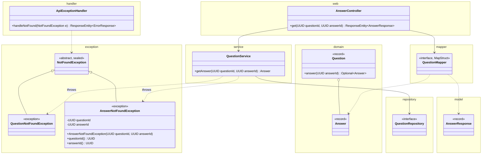
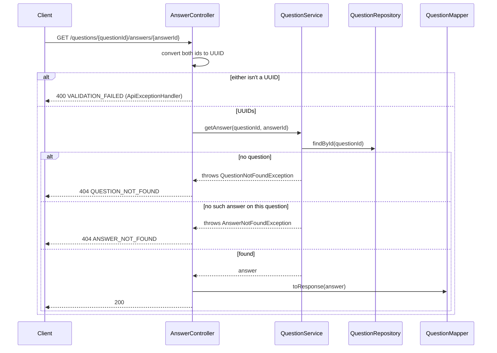
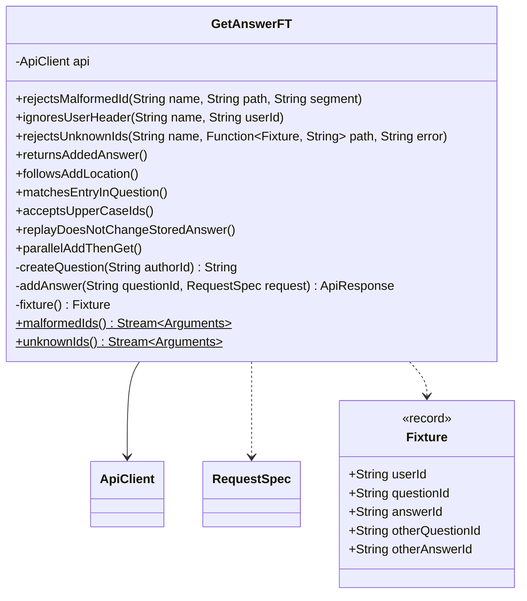

# Get Answer API

Status: **Agreed** (2026-10-24). See Decisions.

Anyone can fetch one answer by its question id and answer id. Reads are public, as in GetQuestion. The body is the same as Add answer's response, and this is the URL its `Location` points to. Builds on GetQuestion.md and AddAnswer.md.

## Contract

### Request

```
GET /questions/3f1c9a52-8a7e-4f0b-9d0e-2b6c1f6a7e11/answers/9b2e4d71-0c3a-4f5e-8b6d-1a7c2e9f4b30
```

| Field | Rules |
|---|---|
| `questionId`, `answerId` path segments | Required. Each is a UUID, upper or lower case. |
| `X-User-Id` header | Optional, ignored, and not validated, as in GetQuestion. |

### Response

```
200 OK

{
  "id": "9b2e4d71-0c3a-4f5e-8b6d-1a7c2e9f4b30",
  "authorId": "user-7",
  "content": "Use compute() or merge(). Both run atomically per key.",
  "createdAt": "2026-10-24T06:20:02.481Z",
  "updatedAt": null,
  "upvotes": 0,
  "downvotes": 0
}
```

- The same `AnswerResponse` as Add answer's 201 body and each entry of GET question's `answers`, built by the same `toResponse(Answer)`.
- No `Location` or `Idempotent-Replayed` header. Ids come back lower case.

### Errors

Body: `{ "error": "<CODE>", "message": "<detail>" }`. Check order: 400, then the question, then the answer.

| Case | Status | `error` |
|---|---|---|
| `questionId` or `answerId` isn't a UUID | 400 | `VALIDATION_FAILED` |
| No question has that `questionId` | 404 | `QUESTION_NOT_FOUND` |
| The question has no answer with that `answerId`, including an answer that belongs to another question | 404 | `ANSWER_NOT_FOUND` |
| Unexpected | 500 | `INTERNAL_ERROR` |

- 400 message: `questionId must be a UUID` or `answerId must be a UUID`, from GetQuestion's handler unchanged.
- `ANSWER_NOT_FOUND` message: `Answer <answerId> not found on question <questionId>`. Both ids are parsed, so they're safe to echo.
- An answer is found only under its own question. The URL names a child of that question; serving it under any other question would give one answer many URLs.

## Design

### External and internal models

| External (`web` and `model`, JSON) | Internal (`domain`) |
|---|---|
| `{questionId}`, `{answerId}` path segments | `UUID` (no model) |
| `AnswerResponse` | `Answer` |

- No new models and no request DTO. `QuestionMapper.toResponse(Answer)` is reused. Since Upvote.md it maps the answer's `upvotes` from its own `votes`, and since Downvote.md its `downvotes`.

### Classes



- Only new or changed members are shown. `ApiExceptionHandler.handleNotFound(NotFoundException)` is drawn because its switch gains a case. See GetQuestion.md and AddAnswer.md for the rest.
- `AnswerController.get` is a `@GetMapping("/{answerId}")` taking both ids as `@PathVariable UUID`. It returns `ResponseEntity.ok(mapper.toResponse(service.getAnswer(questionId, answerId)))`.
- `QuestionService.getAnswer` runs `get(questionId)`, which throws `QuestionNotFoundException(questionId)`, then `question.answer(answerId)` or throws `AnswerNotFoundException(questionId, answerId)`. It uses neither the idempotency store nor the clock.
- `Question.answer(answerId)` scans `answers`. That's fine at MVP sizes (GetQuestion Decision 5).
- `AnswerNotFoundException` extends `NotFoundException`, whose `permits` now lists it, as GetQuestion.md planned. It holds both ids.
- `ApiExceptionHandler`: the exhaustive switch in `handleNotFound(NotFoundException)` maps `AnswerNotFoundException` to `ANSWER_NOT_FOUND`. Without that case the build fails. The bad-id 400 handler is reused as is.
- Not chosen: looking the answer up by its id alone and ignoring `questionId`. That needs a second index, and it makes every answer reachable under every question.

### Flow



### Concurrency

- No lock. `findById` is `ConcurrentHashMap.get`, and `Question` and its `answers` list are immutable. The answer comes from one snapshot of its question, so the question check and the answer lookup can't disagree.
- Read-after-write: Add answer appends inside `computeIfPresent` before it returns 201, so a GET sent after the 201 finds the answer.
- An answer edit stores a new `Question`. A concurrent GET sees the old answer or the new one, never a mix.
- GET never touches the idempotency store, so a replay doesn't change what GET returns.
- `upvotes` and `downvotes` come from the same immutable answer, so they match its content (Upvote.md, Downvote.md).

## Unit tests

These add cases to the test classes in CreateQuestion.md and AddAnswer.md. There are no new test classes.

| Class | Style | Covers |
|---|---|---|
| `Question` | Plain JUnit | `answer(id)` finds one of several answers. An unknown id gives empty. |
| `QuestionService`, answers | Plain JUnit, real in-memory repositories (same fixture as add) | `getAnswer` after `addAnswer` returns the stored answer. Unknown question: `QuestionNotFoundException`. Unknown answer id, and another question's answer id: `AnswerNotFoundException` holding both ids. |
| `AnswerController` | `@WebMvcTest(AnswerController.class)`, `QuestionService` as a `@MockitoBean`, real mapper | 200 with every field of the service's `Answer` and no `Location`. Works without `X-User-Id`. Lower- and upper-case ids pass the same `UUID`s to the service (parameterized). |
| `AnswerController`, errors | Same slice, parameterized | A malformed `questionId` or `answerId` (each `malformedIds` row in each segment) gives 400 `VALIDATION_FAILED` with `<name> must be a UUID`, and the service is never called. `AnswerNotFoundException` gives 404 `ANSWER_NOT_FOUND` with both ids in the message. |
| `ApiExceptionHandler` | `@WebMvcTest(QuestionController.class)`, as before | `AnswerNotFoundException`, thrown from create, gives 404 `ANSWER_NOT_FOUND` with the exact message. |

- **No dedicated test:** `AnswerNotFoundException` is only a constructor and getters.

## Functional tests

### How they run

The same as CreateQuestion.md: `mvn verify` starts the app on `ft.port` (default 8081), and Failsafe runs `GetAnswerFT`. It uses CreateQuestion.md's build setup unchanged.

### Classes



- `ApiClient`, `ApiResponse`, and `RequestSpec` are reused unchanged. `createQuestion` and `addAnswer` are the same helpers as in AddAnswerFT.
- `fixture()` creates two questions, and one fresh user answers both. The other ids are that user's answer on the second question.
- Test data is created only through the API, with a fresh user and key per test.

### Cases

**`rejectsMalformedId`**: `malformedIds()` builds its rows from `GetQuestionFT.malformedIds()`, using each one twice: as `questionId` with a random `answerId`, and as `answerId` with a random `questionId`. Expect 400 `VALIDATION_FAILED` with `<segment> must be a UUID`.

**`ignoresUserHeader`**: add an answer, then GET it with this `X-User-Id`. Expect 200 and the 201 body. The rows are `GetQuestionFT#userHeaders`.

**`rejectsUnknownIds`**: build a fixture, then GET this path. Expect 404 with this `error` and the exact message: `Question <questionId> not found`, or `Answer <answerId> not found on question <questionId>`.

| Path | `error` |
|---|---|
| Random question id, the fixture's answer id | `QUESTION_NOT_FOUND` |
| The fixture's question, a random answer id | `ANSWER_NOT_FOUND` |
| The fixture's question, the other question's answer id | `ANSWER_NOT_FOUND` |

**Single tests**

| Test | Expect |
|---|---|
| `returnsAddedAnswer` | Add, then GET: 200, and the body equals the 201 body. No `Location` or `Idempotent-Replayed` header. |
| `followsAddLocation` | GET the add response's `Location` exactly as returned: 200, same `id`. |
| `matchesEntryInQuestion` | Two users answer. Each GET answer equals its entry in GET question's `answers`. |
| `acceptsUpperCaseIds` | Both ids in upper case: 200, and the body `id` is lower case. |
| `replayDoesNotChangeStoredAnswer` | Add, replay with the same user and key but different `content`, then GET: the original `content`. |
| `parallelAddThenGet` | 50 users each answer one question and GET their answer right after the 201. All 50 GETs return 200 with their own `id` and `content`. |

## Changes to the existing design

No existing doc is edited here. This design needs:

| Where | Change | Effect on existing endpoints |
|---|---|---|
| `NotFoundException` (GetQuestion.md) | `permits` gains `AnswerNotFoundException`. | None. |
| `ApiExceptionHandler` | The `handleNotFound` switch gains `ANSWER_NOT_FOUND`. | None. |
| `Question` (AddAnswer.md) | Add `answer(UUID answerId)`. | None. |
| `AnswerController`, `AnswerService` (AddAnswer.md) | Add `get`. | None. |

## Decisions

Agreed on 2026-10-24. Every open question took its draft default.

1. There's no `GET /questions/{id}/answers` list endpoint. Answers come inline in GET question.
2. No `questionId` in the body (AddAnswer Decision 1).
3. GetQuestion's Decisions 1 to 4 apply unchanged, so `DELETE` on an answer gets 405.
