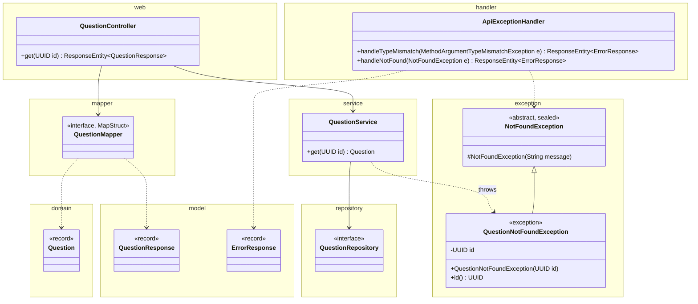
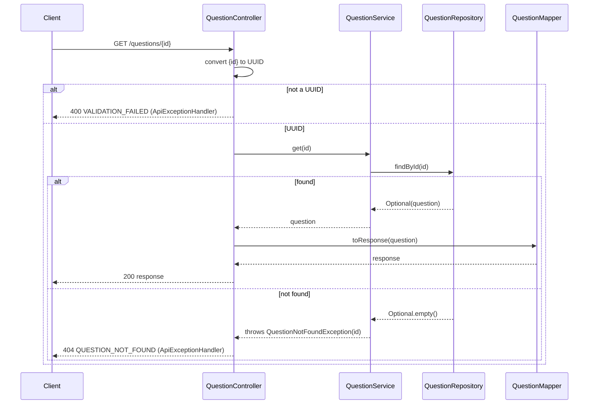
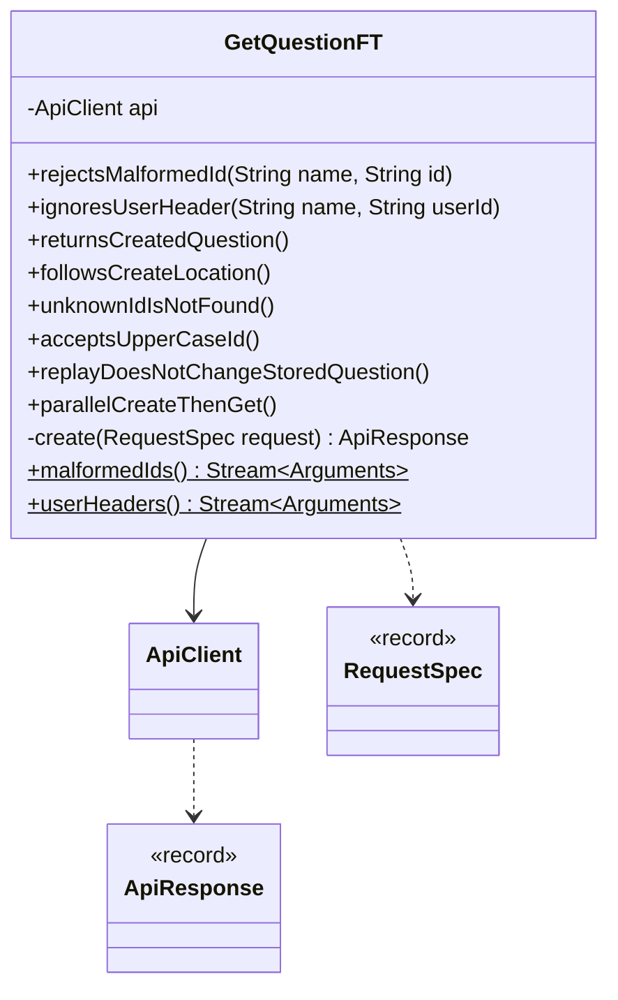

# Get Question API

Status: **Agreed** (2026-10-24). See Decisions.

Anyone can fetch one question by id. No user header is needed because reads are public. The body is the same as create's response. This is the URL that create's `Location` header points to.

## Contract

### Request

```
GET /questions/3f1c9a52-8a7e-4f0b-9d0e-2b6c1f6a7e11
```

| Field | Rules |
|---|---|
| `id` path segment | Required. A UUID, upper or lower case. |
| `X-User-Id` header | Optional and ignored, because reads are public. It isn't validated either. |

### Response

```
200 OK

{
  "id": "3f1c9a52-8a7e-4f0b-9d0e-2b6c1f6a7e11",
  "authorId": "user-42",
  "content": "How do I make a ConcurrentHashMap value update atomic?",
  "tags": ["java", "concurrency"],
  "createdAt": "2026-10-24T06:12:45.123Z",
  "updatedAt": null,
  "upvotes": 0,
  "downvotes": 0,
  "answers": [
    {
      "id": "9b2e4d71-0c3a-4f5e-8b6d-1a7c2e9f4b30",
      "authorId": "user-7",
      "content": "Use compute() or merge(). Both run atomically per key.",
      "createdAt": "2026-10-24T06:20:02.481Z",
      "updatedAt": null,
      "upvotes": 0,
      "downvotes": 0
    }
  ]
}
```

- Same `QuestionResponse` as create's 201 body, and built by the same `toResponse`.
- `answers` holds every answer, oldest first, and is `[]` when there are none. Each one is an `AnswerResponse`. GET doesn't sort: it returns the stored order, and AddAnswer stores answers oldest first. AddAnswer.md defines `Answer` and `AnswerResponse`.
- No `Location` or `Idempotent-Replayed` header.
- `id` always comes back lower case, even when the request used upper case.

### Errors

Body: `{ "error": "<CODE>", "message": "<detail>" }`

| Case | Status | `error` |
|---|---|---|
| `id` isn't a UUID | 400 | `VALIDATION_FAILED` |
| No question has that `id` | 404 | `QUESTION_NOT_FOUND` |
| Unexpected | 500 | `INTERNAL_ERROR` |

- The 400 message is `<parameter> must be a <type>`, for example `id must be a UUID`. It doesn't echo the raw input.
- The 404 message is `Question <id> not found`. The id has already been parsed, so it's safe to echo.
- Both are reusable. The answer endpoints get the same 400, plus `ANSWER_NOT_FOUND` next to `QUESTION_NOT_FOUND` (see Classes).

## Design

### External and internal models

| External (`web` and `model`, JSON) | Internal (`domain`) |
|---|---|
| `{id}` path segment | `UUID` (no model) |
| `QuestionResponse` | `Question` |

- No new models and no request DTO. `QuestionMapper.toResponse` is reused. Since Upvote.md it maps the question's and each answer's `upvotes` from their own `votes`, and since Downvote.md their `downvotes`.
- MapStruct maps `Question.answers` (`List<Answer>`) to `QuestionResponse.answers` (`List<AnswerResponse>`) automatically, keeping the list order.

### Classes



- The diagram shows only new members. A class drawn without members has no changes in this design; that includes the reused `QuestionMapper.toResponse` (which Upvote.md gives the counts) and `QuestionRepository.findById`. See CreateQuestion.md for the rest, and AddAnswer.md for `Question.answers`, `Answer`, and `AnswerResponse`.
- `QuestionController.get` handles `@GetMapping` on `/questions/{id}` and takes `@PathVariable UUID id`. Spring parses the segment with `UUID.fromString`. If that fails, Spring throws `MethodArgumentTypeMismatchException` before `get` runs. Otherwise `get` returns `ResponseEntity.ok(mapper.toResponse(service.get(id)))`.
- `QuestionService.get` returns `questions.findById(id).orElseThrow(() -> new QuestionNotFoundException(id))`. It doesn't use the idempotency repository or the clock.
- `NotFoundException` is the base for every "this resource doesn't exist" error:
  - It's in the `exception` package, abstract, and extends `RuntimeException`, so it's unchecked.
  - It's `sealed` and permits `QuestionNotFoundException` and, for the answer endpoints, `AnswerNotFoundException` (GetAnswer.md).
  - It carries no HTTP status and no `error` code, so the service stays free of web code.
- `QuestionNotFoundException`:
  - It's in the `exception` package and extends `NotFoundException`.
  - It holds the `UUID id` that was looked up. Its message is `Question <id> not found`.
  - Any service method that needs an existing question and doesn't find it throws this. UpdateQuestion and the answer endpoints reuse it when the question is missing.
- `ApiExceptionHandler` gets two new `@ExceptionHandler` methods:
  - `handleTypeMismatch(MethodArgumentTypeMismatchException)` maps to 400 `VALIDATION_FAILED`. The message is `e.getName()` plus `must be` and a phrase for the required type: `a` and its simple name (`a UUID`), or `an integer` for `int` and `Integer` (ListQuestions.md). So `/questions/{questionId}/answers/{answerId}` reuses it as is.
  - `handleNotFound(NotFoundException)` maps to 404. A `switch` over the sealed subtypes picks the `error`: `QuestionNotFoundException` gives `QUESTION_NOT_FOUND`, and `AnswerNotFoundException` gives `ANSWER_NOT_FOUND`. The switch is exhaustive, so a new subtype without a code fails the build.
  - Both need their own handler, or the catch-all `Exception` handler returns 500.
- Not chosen:
  - The service returning `Optional<Question>` and the controller picking 404. Every caller would repeat that check, and Update needs the same check.
  - `@ResponseStatus` on the exception, or an `error` code stored on it, because both put API details into the service layer.
  - One handler method per not-found exception, because each would repeat the 404 body-building.

### Flow



### Concurrency

- GET takes no lock. `findById` is `ConcurrentHashMap.get`, which never blocks and sees every `put` that has completed.
- `upvotes` and `downvotes` come from the same immutable question, so they match its content (Upvote.md, Downvote.md).
- `Question` is immutable, including its `List.copyOf` tags. So a reader never sees a half-built question, and the stored instance is returned without a copy.
- Read-after-write: create stores the question inside `computeIfAbsent` before it returns 201. So a GET sent after the 201 always finds it.
- A GET can't race an in-flight create of the same question. The id is generated by the server, so the client only learns it from the 201.
- GET never touches `IdempotencyRepository`. A replay returns the stored question and never saves again, so GET keeps returning the original.
- UpdateQuestion and AddAnswer change a question by storing a new `Question` object in its place. A concurrent GET sees either the old object or the new one, never a mix, so `answers` is never half-appended.

## Unit tests

These add cases to the test classes in CreateQuestion.md. There are no new test classes.

| Class | Style | Covers |
|---|---|---|
| `QuestionService` | Plain JUnit, real in-memory repositories (same fixture as create) | `get` after `create` returns the stored question. An unknown id throws `QuestionNotFoundException`, and its `id()` is that id. |
| `QuestionRepositoryImpl` | Plain JUnit | `findById` on an unknown id returns empty. 50 threads each save a question and then immediately `findById` its id: every one is found. |
| `QuestionController` | `@WebMvcTest`, `QuestionService` as a `@MockitoBean`, real mapper | 200, with every field of the service's `Question` in the body and no `Location` header. A `Question` with two answers returns both, in the same order. Works without `X-User-Id`. The id form is parameterized: lower case and upper case pass the same `UUID` to the service. |
| `ApiExceptionHandler` | `@WebMvcTest` (same slice), parameterized | Each malformed id (the same list as the FT) gives 400 `VALIDATION_FAILED` with the message `id must be a UUID`, and the service is never called. A `QuestionNotFoundException` from the service gives 404 `QUESTION_NOT_FOUND` with the id in the message. |

- **Concurrency test** uses a `CountDownLatch`, the same as create's.
- **No dedicated test:** `NotFoundException` and `QuestionNotFoundException` are only constructors and a getter, and the service and handler tests cover them. `toResponse` is already covered by `QuestionMapperTest`. AddAnswer.md adds the mapper cases for answers.

## Functional tests

### How they run

The same as CreateQuestion.md: `mvn verify` starts the app on `ft.port` (default 8081) and Failsafe runs `GetQuestionFT`. It uses CreateQuestion.md's build setup unchanged.

### Classes



- `ApiClient`, `ApiResponse`, and `RequestSpec` are reused unchanged. `ApiClient.get` already exists.
- `malformedIds()` and `userHeaders()` are shared: the other FTs use them through a fully qualified `@MethodSource`, or build on them.
- Test data is created only through `POST /questions`. `create(...)` posts the given `RequestSpec`, asserts 201, and returns the response.
- Every test starts from `RequestSpec.validCreate()`, so each one gets a fresh random user id and key.

### Cases

**`rejectsMalformedId`**: GET `/questions/<id>`, then expect 400 `VALIDATION_FAILED` with the message `id must be a UUID`.

| `id` | Why it fails |
|---|---|
| `not-a-uuid` | Words |
| `12345` | Digits only, no dashes |
| `3f1c9a52-8a7e-4f0b-9d0e-2b6c1f6a7e11a` | 37 chars |
| `zzzzzzzz-zzzz-zzzz-zzzz-zzzzzzzzzzzz` | Right shape, but not hex |
| `3f1c9a528a7e4f0b9d0e2b6c1f6a7e11` | 32 hex chars, no dashes |

Lenient forms such as `1-1-1-1-1` are left out because the JDK parses them (see Decision 3).

**`ignoresUserHeader`**: create a question, then GET it with this `X-User-Id`. Expect 200 and the created body.

| `X-User-Id` |
|---|
| Absent |
| A different user |
| `"   "` |
| 65 chars |

**Single tests**

| Test | Expect |
|---|---|
| `returnsCreatedQuestion` | Create, then GET by `id`: 200, `id`, `authorId`, `content`, `tags`, and `createdAt` equal the create body, and `answers` is `[]`. No `Location` or `Idempotent-Replayed` header. |
| `followsCreateLocation` | GET the create response's `Location` exactly as returned: 200, same `id`. |
| `unknownIdIsNotFound` | GET a random UUID: 404 `QUESTION_NOT_FOUND`, and the message contains the id. |
| `acceptsUpperCaseId` | GET with the id in upper case: 200, and the body `id` is the lower-case id that was created. |
| `replayDoesNotChangeStoredQuestion` | Create, replay with the same user and key but different `content`, then GET: 200 with the original `content`. |
| `parallelCreateThenGet` | 50 threads, each with its own user and key, create a question and GET it right after the 201. All 50 GETs return 200 with their own `id` and `content`. |

These FTs only create data through `POST /questions`, so they don't add answers. The AddAnswer FTs check that GET returns answers oldest first.

## Effect on CreateQuestion.md

This design implies:

- Create's Decision 5 (keep `Location`) holds, because GET now resolves it.
- `ApiExceptionHandler` gets the two mappings above.
- CreateQuestion.md's FT note points to `GetQuestionFT.returnsCreatedQuestion`, which checks that a created question was stored. The create FTs don't change.
- Create's 201 body includes `"answers": []`, because both endpoints share `QuestionResponse`.

## Decisions

Agreed on 2026-10-24. Every open question took its draft default.

1. `X-User-Id` on GET is optional and ignored.
2. An `id` that isn't a UUID gets 400 `VALIDATION_FAILED`.
3. Lenient UUIDs (`1-1-1-1-1`, a 35-char form) are accepted. They parse to a different UUID and get 404.
4. Unknown route: 404 `NOT_FOUND`. Wrong method: 405 `METHOD_NOT_ALLOWED`. Create's handler already does this.
5. `answers`: all of them inline, with no limit.
