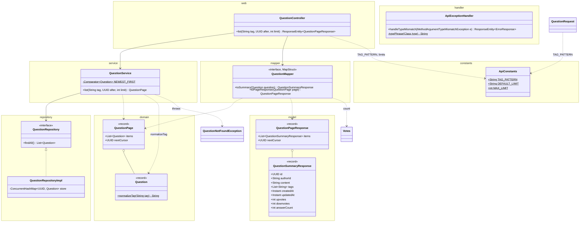
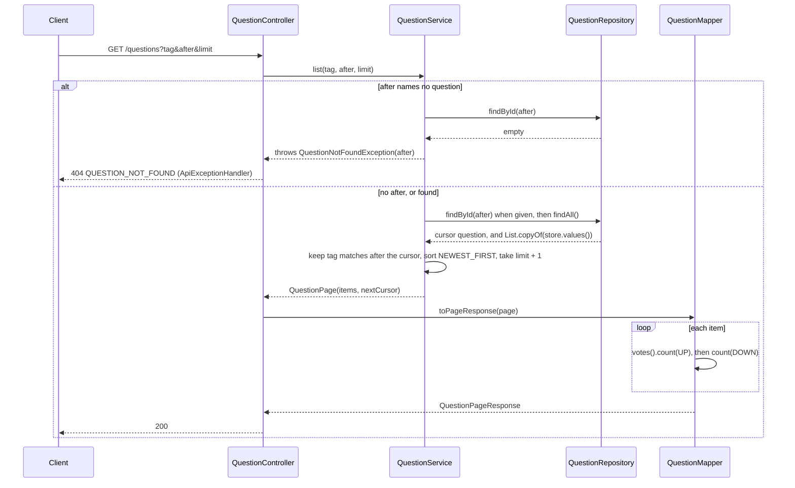
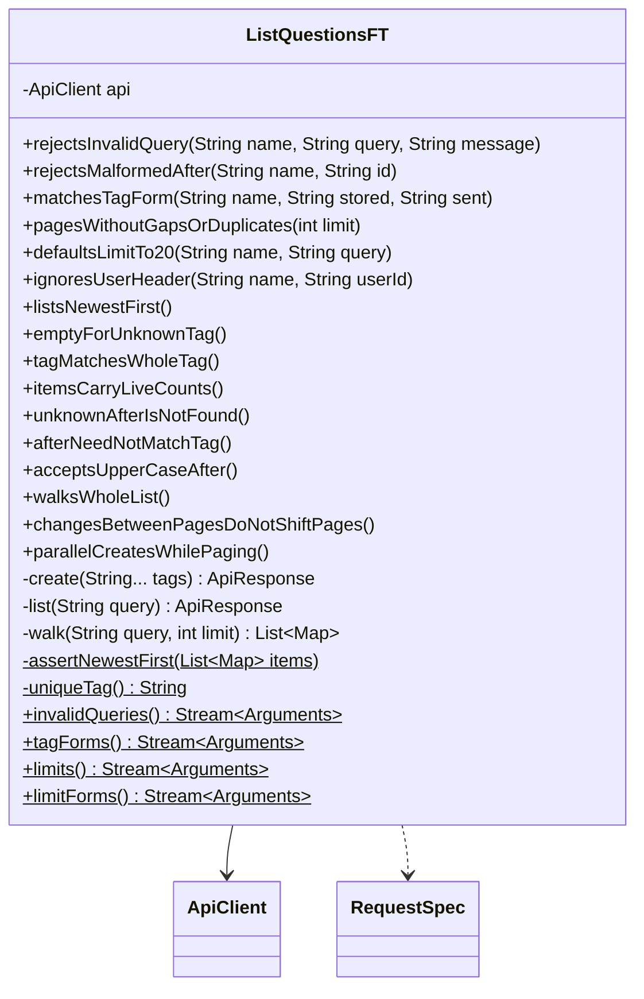

# List Questions API

Status: **Agreed** (2026-10-24). See Decisions and Settled questions.

Anyone lists questions, newest first, a page at a time, optionally narrowed to one tag. This covers the prompt's "List questions, each with a UUID" and the "create + list work" grading line. Reads are public, as in GetQuestion.md. Items are summaries: the question and its counts, without its answers. It assumes Downvote.md has been applied (`downvotes`, `Vote`), and since 2026-10-25 each `Question` holds its own `Votes` (Upvote.md). Today `GET /questions` gets 405.

## Contract

### Request

```
GET /questions?tag=java&limit=2&after=3f1c9a52-8a7e-4f0b-9d0e-2b6c1f6a7e11
```

| Parameter | Rules |
|---|---|
| `tag` | Optional. One tag, under create's tag rule (CreateQuestion.md): 1 to 35 letters, digits, `+`, `#`, `.`, `-`. Lowercased like stored tags, so `Java` finds `java`. Matches whole tags only. Unlike `limit=` and `after=`, `tag=` is a 400: the empty string breaks the tag rule. |
| `limit` | Optional, default 20, from 1 to 100. `limit=` counts as absent. |
| `after` | Optional. A question id, normally the previous page's `nextCursor`. The page starts right after that question in the order. The question doesn't need to carry `tag`. Ids parse as in GetQuestion.md (any case, and its Decision 3). `after=` counts as absent. |
| `X-User-Id` | Optional and ignored, as in GetQuestion.md. |

- Clients URL-encode `tag`: in a URL, `#` starts a fragment and `+` in a query means a space. So `c#` is sent as `tag=c%23` and `c++` as `tag=c%2B%2B`. An unencoded `c++` arrives as `c  ` and gets a 400.
- Unknown parameters (`sort`, `offset`) are ignored, as unknown body fields are in create.
- Nothing is written, so there's no idempotency.

### Response

```
200 OK

{
  "items": [
    {
      "id": "7d2a0c4e-1b5f-4e8a-9c3d-6f0b2a8e4d17",
      "authorId": "user-9",
      "content": "When does ConcurrentHashMap.values() see a concurrent put?",
      "tags": ["java", "concurrency"],
      "createdAt": "2026-10-24T06:10:02.517Z",
      "updatedAt": null,
      "upvotes": 3,
      "downvotes": 0,
      "answerCount": 1
    },
    { "id": "c81f5e30-6a2d-4b7c-8e19-0d3f4a5b6c72", ..., "answerCount": 0 }
  ],
  "nextCursor": "c81f5e30-6a2d-4b7c-8e19-0d3f4a5b6c72"
}
```

- The body is a `QuestionPageResponse`. Each item is a `QuestionSummaryResponse`, which has `QuestionResponse`'s fields with `answerCount` in place of `answers`. `upvotes` and `downvotes` are the sizes of the question's voter sets, as on GET (Upvote.md). Answers stay on GET question.
- **Order:** newest `createdAt` first. Questions with the same `createdAt` are ordered by `id`, descending, so the order is total. Edits, votes, and answers never move a question.
- **`nextCursor`:** the last item's id when more questions follow (as of this read), or `null` on the last page. The client sends it back as `after`. It's always present.
- No matches, or nothing after `after`: 200 with `{ "items": [], "nextCursor": null }`.
- No `Location` or `Idempotent-Replayed` header. A page is at most 100 items whose `content` is at most 5000 chars, so about 0.5 MB.

### Errors

The body is as in CreateQuestion.md. Check order: conversion of `after` and `limit` (only the first failure is reported, in `(tag, after, limit)` order), then the constraints (every violation, sorted, joined by `; `), then the cursor lookup. There's no 415.

| Case | Status | `error` | Message |
|---|---|---|---|
| `after` isn't a UUID | 400 | `VALIDATION_FAILED` | `after must be a UUID` |
| `limit` isn't an `int` (`abc`, `1.5`, `99999999999`) | 400 | `VALIDATION_FAILED` | `limit must be an integer` |
| `limit` below 1 or above 100 | 400 | `VALIDATION_FAILED` | `limit: must be greater than or equal to 1`, or `limit: must be less than or equal to 100` |
| `tag` breaks the tag rule (empty, a space, 36 chars) | 400 | `VALIDATION_FAILED` | `tag: must match "[A-Za-z0-9+#.-]{1,35}"` |
| `after` names no question | 404 | `QUESTION_NOT_FOUND` | `Question <after> not found` (Open question 1) |
| PUT, PATCH, or DELETE on `/questions` (with `Allow` listing GET and POST) | 405 | `METHOD_NOT_ALLOWED` | Spring's detail, as in CreateQuestion.md |
| Unexpected | 500 | `INTERNAL_ERROR` | As in CreateQuestion.md |

- There's no delete API, so a 404 on `after` means the client made up the id. A real `nextCursor` always resolves.
- `limit must be an integer` needs the `handleTypeMismatch` fix (see Changes to the existing design). Today it would read `limit must be a int`.

## Design

### External and internal models

| External (`web` and `model`, JSON) | Internal |
|---|---|
| `tag`, `after`, `limit` query parameters | `String`, `UUID`, `int` method arguments (no model, no command object) |
| `QuestionPageResponse(items, nextCursor)` | `domain.QuestionPage(List<Question> items, UUID nextCursor)` |
| `QuestionSummaryResponse` | `Question` |
| `upvotes`, `downvotes` | `question.votes().count(Vote.UP)` and `count(Vote.DOWN)`, as in Upvote.md |
| `answerCount` | `question.answers().size()` |

The item shape:

| Option | Payload | Code |
|---|---|---|
| **`QuestionSummaryResponse`** | Bounded: 9 fields per item, 2 count scans per item | One record and one mapper method with three expressions |
| `QuestionResponse` reused | Every answer of every item inline. Answers have no limit (GetQuestion Decision 5), and each answer adds 2 count scans | None |
| `QuestionResponse` with `answers` set to `null` | Bounded | A field that means "none" on one endpoint and "not loaded" on another |

**Chosen: `QuestionSummaryResponse`.** It's the simplest of the three that keeps a page bounded. Its fields, in order: `id`, `authorId`, `content`, `tags`, `createdAt`, `updatedAt`, `upvotes`, `downvotes`, `answerCount`.

### Classes



- The diagram shows only new or changed members. Everything else is as in CreateQuestion.md, GetQuestion.md, and Downvote.md.
- **`QuestionController.list`** (`@GetMapping`) takes `@RequestParam(required = false) @Pattern(regexp = ApiConstants.TAG_PATTERN) String tag`, `@RequestParam(required = false) UUID after`, and `@RequestParam(defaultValue = "20") @Min(1) @Max(100) int limit`. It returns `ResponseEntity.ok(mapper.toPageResponse(service.list(tag, after, limit)))`.
  - There's no `@Validated`: built-in method validation feeds `handleInvalidParameters`, as in CreateQuestion.md. Its `parameterName` fallback uses the Java names, which match the query names, so it doesn't change.
- **`QuestionService.list(tag, after, limit)`:**

  | Step | Does |
  |---|---|
  | 1. Guard | `limit < 1` throws `IllegalArgumentException`. The controller never passes one. |
  | 2. Cursor | When `after` is given, `get(after)`, so an unknown id throws `QuestionNotFoundException(after)` before any list read. |
  | 3. Filter | `questions.findAll()`. When `tag` is given, keep questions whose `tags()` contain `Question.normalizeTag(tag)`. When there's a cursor, keep those with `NEWEST_FIRST.compare(q, cursor) > 0`. |
  | 4. Sort and cut | `sorted(NEWEST_FIRST)`, then `limit(limit + 1)`. |
  | 5. Page | More than `limit` left: `QuestionPage(first limit, the last of those's id)`. Otherwise `QuestionPage(all, null)`. The extra item tells the service whether a next page exists, so a client never has to fetch an empty last page. |

- **`NEWEST_FIRST`** is `Comparator.comparing(Question::createdAt).thenComparing(Question::id).reversed()`, private to the service, its only user. One comparator sorts the page and places the cursor, so they can't disagree. `UUID.compareTo` is a total order; it isn't the string order, but no client needs the tie-break's order.
- **`QuestionRepository.findAll()`** returns `List.copyOf(store.values())`: an unmodifiable, unsorted snapshot. Sorting is the service's rule; repositories only store and fetch (CreateQuestion.md).
- **`QuestionMapper.toSummary`** maps `upvotes` with `expression = "java(question.votes().count(Vote.UP))"`, `downvotes` the same with `Vote.DOWN`, and `answerCount` with `"java(question.answers().size())"`. **`toPageResponse`** maps `items` through `toSummary` and copies `nextCursor`. `unmappedTargetPolicy = ERROR` still holds, and the unused source `answers` is dropped.
- **`Question.normalizeTag(tag)`** is `requireNonNull`, then `toLowerCase(Locale.ROOT)`, pulled out of `normalizeTags`. Stored tags and the filter share one rule.
- **`ApiConstants.TAG_PATTERN`** is `"[A-Za-z0-9+#.-]{1,35}"`, moved out of `tags`' `@Pattern`. Create, update, and the filter share one rule.
- **`ApiExceptionHandler.typePhrase(type)`** gives `an integer` for `int` or `Integer`, `a valid value` when there's no type, and otherwise `a <SimpleName>`. The message becomes `<name> must be <phrase>`, so `id must be a UUID` is unchanged.
- Not chosen: paging in the repository (`findPage(tag, after, limit)`), which moves the order rule into storage; a `ListQuery` command object, which only repeats the three arguments; a generic `Page<T>`, which would have one user.

### Flow

After conversion and validation (the 400s in Errors):



### Concurrency

The storage choice:

| Option | Read cost | Write cost | Agrees with GET | Code |
|---|---|---|---|---|
| **(a) Sort on read:** `findAll()` snapshot, then the service filters, sorts, and pages | O(n) copy plus O(m log m) sort (m = tag matches) | Nothing added | Yes. It's one map, so once GET has returned a question, every list read that starts later includes it | One repository method |
| (b) Sorted index: a `ConcurrentSkipListMap` keyed by `(createdAt, id)` beside the map | O(log n + limit) without `tag`. With `tag`, it scans until `limit` match | A second write in `save`, after the map's | No. Between the two writes, GET shows a question that the list misses. A failure between them splits them for good (the reason Upvote.md rejected counters) | A key record, the second write, and still a tag scan |

- **Chosen: (a).** It's correct with no second structure. At this app's scale (10,000 questions is a few ms per request) the sort doesn't matter. A top-k heap would make it O(n log k), but it isn't needed. Open question 7 covers switching.
- **The guarantee:** in one walk, every question stored before its first request (and still matching `tag`) appears exactly once, in order, and no question appears twice. Offset paging can't promise this: a create shifts every later page by one.
- **No lock, weakly consistent.** The cursor `findById` and `findAll` are plain `ConcurrentHashMap` reads, and list writes nothing, so the lock order in CreateQuestion.md and Downvote.md stands. `List.copyOf(store.values())` sees every question stored before it started exactly once, maybe some stored during it, and never throws `ConcurrentModificationException`.
- **Immutable items.** Each entry is one immutable `Question`: across an edit, the old instance or the new one, never a mix. `answerCount` and the tag match come from that instance.
- **Fixed positions.** `(createdAt, id)` never changes, and there's no delete. So a cursor always resolves to the same position.
- **Counts from the snapshot.** As on GET, each item's counts come from the same immutable instance as its content and `answerCount`.
- **Races:**

  | Race | Result |
  |---|---|
  | A create finishes between two page requests | Its `createdAt` is later than every listed question's, so it sorts ahead of page 1. Later pages don't shift or repeat, and a new walk shows it first. |
  | A create is in flight during a page read (`createdAt` read before the snapshot, stored after) | That walk may skip it if it sorts ahead of the cursor, but never shows it twice. GET finds it after its 201, and a new walk shows it. Option (b) has the same window, because `createdAt` is read before any insert. A wall clock stepping back has the same effect. |
  | An edit during a walk | The question keeps its position and shows the old or the new version. With `tag`, an edit that adds or drops the tag can add or drop the question on pages not read yet. |
  | Votes or answers during a walk | The counts and `answerCount` come from the snapshot's instance, and the position doesn't change. |
  | Parallel creates with the same `createdAt` | Distinct ids break the tie, so every page boundary is exact. |

## Unit tests

As in Downvote.md: plain JUnit with real in-memory repositories, a `CountDownLatch` for concurrency, and `@ParameterizedTest` with `@MethodSource`. These add cases to existing test classes; there are no new test classes. `QuestionPage`, `QuestionSummaryResponse`, and `QuestionPageResponse` have no behavior and get no test of their own. `NEWEST_FIRST` is private, and the service's order cases pin it.

| Class | Style | Covers |
|---|---|---|
| `Question` | Plain JUnit, parameterized | `normalizeTag`: `Java` gives `java`, `C#` gives `c#`, `.NET` gives `.net`, `c++` is unchanged, and `null` throws `NullPointerException`. The existing `normalizeTags` cases still pass. |
| `QuestionRepositoryImpl` | Plain JUnit | `findAll` is `[]` when the repository is empty. It holds each saved question once, and the new instance after `update`. The list is unmodifiable and doesn't change after later saves. |
| `QuestionRepositoryImpl`, concurrency | Plain JUnit | 50 threads save while another calls `findAll` repeatedly. Every snapshot has distinct ids and holds every question whose `save` returned before the call. |
| `QuestionService` | Plain JUnit, real repositories, questions saved with chosen `createdAt` and ids | **Order:** newest first, and the same `createdAt` by `id` descending. **Paging,** parameterized over `(count, limit)` = (0, 1), (1, 1), (5, 1), (5, 2), (5, 5), (5, 6), (21, 20): walking from `after = null` yields every question once, in order. Each page but the last has `limit` items and `nextCursor` = its last id. The last page has `null`. **`after`** is exclusive. **Tag,** parameterized over `java`, `Java`, `JAVA`: the same matches. An unmatched tag gives `[]`. An `after` without the tag still places the page. **Errors:** an unknown `after` throws `QuestionNotFoundException` with that id, and `limit` 0 throws `IllegalArgumentException`. An edited question keeps its position. |
| `QuestionService`, concurrency | Plain JUnit, `Clock.fixed`, `CountDownLatch` | 50 threads create while a pager walks with `limit` 3. Under a fixed clock, the new questions tie on `createdAt` and land anywhere in the order, the hardest case. No id appears twice, and every question saved before the walk appears. |
| `QuestionMapper` | Plain JUnit, `Mappers.getMapper`, questions built with `Votes` of different sizes | `toSummary` copies the six plain fields, counts `upvotes` and `downvotes` without swapping them, and gives `answerCount` 0 or 2. `toPageResponse` keeps the order, gives each item its own counts, and copies `nextCursor`, `null` included. |
| `QuestionController` | `@WebMvcTest`, `QuestionService` as a `@MockitoBean`, real mapper | 200. The top level is exactly `items` and `nextCursor` (`null` is shown), each item has exactly 9 fields, and there's no `Location`. Parameterized query to service arguments: none gives `(null, null, 20)`, `limit=` gives 20, `tag=Java` passes through as is (the service normalizes), an upper-case `after` gives the same UUID, and `limit=1` and `limit=100` pass. Works without `X-User-Id`. |
| `ApiExceptionHandler` | `@WebMvcTest` (same slice), parameterized | The FT's `rejectsInvalidQuery` rows give 400 with the exact message, and the service is never called. MockMvc decodes `%XX` in a query but leaves a `+` as it is, so `tag=c++` is sent as Tomcat decodes it, `tag=c%20%20`. A `QuestionNotFoundException` from `list` gives 404. `wrongMethodStays405` moves to `DELETE /questions` (see Changes to the existing design). The UUID messages are unchanged. |

## Functional tests

### How they run

As in CreateQuestion.md: `mvn verify` starts the app on `ft.port`, and Failsafe runs `ListQuestionsFT`. No build changes.

Every FT class shares that one app, so the full list holds every other test's questions (and earlier runs' too, against a long-lived app). To stay deterministic:

- **Exact assertions run under a unique tag.** Each test tags its questions with `uniqueTag()` (`ft-` plus 24 random hex chars) and lists with `tag`, so only its own questions match.
- **Untagged assertions are relative:** the list is sorted, no id appears twice, and the test's own questions appear in the expected relative order.
- **The expected order comes from the create responses:** `createdAt` descending, then `UUID.fromString(id)` descending. In practice that's the reverse of creation order.

### Classes



- No helper changes: `ApiClient.get`, `RequestSpec.validCreate().withBody(...)`, `validAnswer`, `validUpdate`, and `validVote` are reused. `rejectsMalformedAfter` and `ignoresUserHeader` reuse `GetQuestionFT#malformedIds` and `#userHeaders` through a fully qualified `@MethodSource`.
- `create(tags...)` posts fresh content with those tags as a fresh user, and asserts 201. `list(query)` GETs `/questions?<query>` with no headers.
- `walk(query, limit)` follows `nextCursor` as `after` until it's `null`. On each page it asserts 200, at most `limit` items, and a `nextCursor` that is the last id or `null`. `assertNewestFirst` checks that `(createdAt, id)` strictly decreases, which also rules out duplicates.

### Cases

**`rejectsInvalidQuery`**: GET `/questions?<query>` (sent exactly as shown), then expect 400 `VALIDATION_FAILED` with this message.

| Query | Message |
|---|---|
| `limit=0`, `limit=-1` | `limit: must be greater than or equal to 1` |
| `limit=101` | `limit: must be less than or equal to 100` |
| `limit=abc`, `limit=1.5`, `limit=99999999999` | `limit must be an integer` |
| `tag=`, `tag=spring%20boot`, `tag=c++` (a `+` is a space), a 36-char tag | `tag: must match "[A-Za-z0-9+#.-]{1,35}"` |
| `limit=0&tag=a%20b` | Both messages above, sorted and joined with `; ` |
| `after=not-a-uuid&limit=0` | `after must be a UUID` (conversion fails first, so the `limit` rule isn't reached) |

**`rejectsMalformedAfter`**: GetQuestionFT's malformed ids as `after` give 400 `after must be a UUID`.

**`matchesTagForm`**: create a question tagged `stored` and `java`, then list `tag=<sent>`. Expect exactly that question, with `stored` lowercased in its `tags`. `<u>` is a fresh `uniqueTag()` per row.

| `stored` | `sent` |
|---|---|
| `<u>` | `<u>` upper-cased |
| `<u>c#` | `<u>` upper-cased + `C%23` |
| `<u>c++` | `<u>` upper-cased + `C%2B%2B` |
| `<u>.net` | `<u>` upper-cased + `.NET` |
| `<u>` padded to 35 chars (the longest tag) | The same, upper-cased |

**`pagesWithoutGapsOrDuplicates`**: create 7 questions with tag T, then `walk("tag=T", limit)`. The concatenated ids are the expected 7, once each, and every page is full except the last. `limit` 1 gives 7 pages, 3 gives 3, 3, and 1, 7 gives one exactly full page with `nextCursor` `null`, and 100 gives one page.

**`defaultsLimitTo20`** (no `limit`, and `limit=`): 21 questions with tag T. The first page has 20 items and `nextCursor` = the 20th id. The next page has 1 item and `nextCursor` `null`.

**`ignoresUserHeader`**: each GetQuestionFT `userHeaders` row gives the same 200 body as with no header.

**Single tests**

| Test | Expect |
|---|---|
| `listsNewestFirst` | Q1, Q2, Q3 with tag T. `tag=T`: 200, `items` Q3, Q2, Q1, and `nextCursor` `null`. Each item has exactly the 9 fields, equal to its create body without `answers`, with `answerCount` 0. No `Location` or `Idempotent-Replayed` header. |
| `emptyForUnknownTag` | A fresh tag: 200, body exactly `{"items": [], "nextCursor": null}`. |
| `tagMatchesWholeTag` | Q1 tagged `<u>`, Q2 tagged `<u>x`: `tag=<u>` gives only Q1. |
| `itemsCarryLiveCounts` | Q1 and Q2 with tag T. Two users answer Q1, two upvote it, and one downvotes it. One user downvotes Q2, and Q2's author edits it, keeping T. List: Q2 shows up 0, down 1, `answerCount` 0, the new content, and a non-null `updatedAt`. Q1 shows up 2, down 1, `answerCount` 2. Each item equals its GET question body with `answerCount` in place of `answers`. |
| `unknownAfterIsNotFound` | A random UUID as `after`: 404 `QUESTION_NOT_FOUND`, and the message holds the id. |
| `afterNeedNotMatchTag` | Q1 (T), X (no T), then Q2 (T). `tag=T&after=<X>` gives only Q1. |
| `acceptsUpperCaseAfter` | `after` in upper case gives the same page as in lower case. |
| `walksWholeList` | Q1, Q2, Q3 with `VALID_BODY`'s tags. `walk("", 100)` to the end: `assertNewestFirst` passes, and Q3, Q2, Q1 appear in that relative order. |
| `changesBetweenPagesDoNotShiftPages` | Q1 to Q5 with tag T. Page 1 (`limit=2`) is Q5, Q4. Then: create Q6 and Q7 with T, edit Q3 keeping T, upvote Q2, and answer Q1. Page 2 is Q3 (new content) and Q2 (`upvotes` 1). Page 3 is Q1 (`answerCount` 1) with `nextCursor` `null`. A new walk gives Q7, then Q6 down to Q1. Offset paging would have repeated Q5 and Q4 on page 2. |
| `parallelCreatesWhilePaging` | 20 questions with tag T. Then, released together: 50 creates with T (own users and keys) and 5 walkers on `tag=T` with `limit=3`. All creates get 201. Each walk passes `assertNewestFirst`, holds all 20 earlier questions in order, and holds only ids from the 70. A walk afterwards gives exactly the 70. |

## Changes to the existing design

No existing doc or code is edited here. Applying this design needs:

| Where | Change | Effect on existing endpoints |
|---|---|---|
| `domain` | `Question` pulls out `public static String normalizeTag(String tag)`, and `normalizeTags` calls it. Add `QuestionPage(List<Question> items, UUID nextCursor)`, with `List.copyOf` in its compact constructor. | None. |
| `QuestionRepository`, `QuestionRepositoryImpl`, `QuestionService` | Add `List<Question> findAll()` (`List.copyOf(store.values())`), and `list(tag, after, limit)` with `NEWEST_FIRST`. | None. |
| `model.QuestionRequest` | Move the tag regex to `public static final String TAG_PATTERN`. `tags`' `@Pattern` uses it. | None: the same rule and message. |
| `web.QuestionController` | Add `list` and the limit constants (`DEFAULT_LIMIT = "20"`, `MAX_LIMIT = 100`). | `GET /questions` gives 200 instead of 405. Other methods on `/questions` still get 405, now with `Allow` listing GET and POST. |
| `model`, `mapper` | Add `QuestionSummaryResponse` and `QuestionPageResponse`. `QuestionMapper` adds `toSummary` and `toPageResponse`. | None. |
| `ApiExceptionHandler.handleTypeMismatch` | The message is `<name> must be <typePhrase(type)>` (see Classes). | UUID messages are unchanged. A bad `limit` reads `limit must be an integer`, not `limit must be a int` (or `a Integer` for an `Integer` parameter). |
| `ApiExceptionHandlerTest.wrongMethodStays405` | `get("/questions")` becomes `delete("/questions")`, still expecting 405 `METHOD_NOT_ALLOWED`, with `Allow` containing `GET` and `POST`. With `list` mapped, the old request gets 200 (the mocked service returns `null`, and so does the mapper). | Test only. |
| Other tests | The two test doubles that implement `QuestionRepository` gain `findAll`: `QuestionServiceTest`'s `FailingQuestionRepository` returns `List.of()`, and `AnswerServiceTest`'s `FailingOnceQuestionRepository` delegates. Nothing else breaks. A search of `src/test` and `curl.sh` finds no other `GET /questions`. Every UUID message assertion (`... must be a UUID`) still holds. `QuestionControllerTest`, `QuestionMapperTest`, `QuestionServiceTest`, `QuestionRepositoryImplTest`, and `QuestionTest` only gain cases. | Test only. |
| CreateQuestion.md | In its `ApiExceptionHandler` unit test row, the 405 example becomes `DELETE /questions`. | Doc only. |
| GetQuestion.md | The `handleTypeMismatch` bullet ("the required type's simple name") becomes the type phrase. | Doc only. |
| README.md, `curl.sh` | Add the `GET /questions` row ("List questions, newest first, a page at a time, optionally by tag: 200"). Add steps that list everything and list `?tag=java&limit=1`, following `nextCursor`. | Doc only. |

- If List lands before Downvote: drop `downvotes`, use `votes.of(id)` for `upvotes`, and use `UpvoteService` in the flow.

## Decisions

Agreed on 2026-10-24 (user).

1. `GET /questions` is public: no header is read, and there's no idempotency. 200 with `{ "items": [...], "nextCursor": ... }`.
2. Items are `QuestionSummaryResponse`: `QuestionResponse`'s fields with `answerCount` in place of `answers`, and counts from the item's own votes (changed 2026-10-25, user: they were read live).
3. The order is newest `createdAt` first, with ties by `id` descending. It's a total order that edits, votes, and answers don't change.
4. `limit` is 1 to 100, default 20. `after=<questionId>` is exclusive. `nextCursor` is the last item's id when more follow, otherwise `null`.
5. One optional `tag`, under create's tag rule, lowercased like stored tags, matching whole tags.
6. Sort on read over a `findAll()` snapshot of the question map, with no index.
7. 400 `VALIDATION_FAILED` for bad parameters (conversion, then constraints), then 404 `QUESTION_NOT_FOUND` for an unknown `after`. A non-numeric `limit` says `an integer`.
8. GetQuestion's Decisions 1, 3, and 4 and Create's Decision 10 apply unchanged.

## Settled questions

Agreed on 2026-10-24: every question took its draft default. The numbering is kept, so "Open question N" elsewhere in this doc means item N here.

1. **Unknown `after`.** Draft: 404 `QUESTION_NOT_FOUND`, which reuses `get(after)` and the handler. Alternative: 400 `VALIDATION_FAILED` (`after: no such question`), because the list exists and it's the input that's wrong. That needs a new exception and handler case.
2. **Cursor form.** Draft: `after=<questionId>`. It's readable, Spring converts and checks it like a path id, and it costs one `findById`. Alternative: an opaque base64 `(createdAt, id)`. It needs no lookup and survives a future delete, but it adds encoding, a malformed-cursor error, and opaque values in tests. Switch if a delete API is added.
3. **Sort by votes.** Draft: out of scope. The list is newest first only, and `sort` is ignored. Every request would sort by each question's counts. A vote also moves a question, so a cursor would have to carry the count, and pages could repeat or skip questions.
4. **`limit` above 100.** Draft: 400. Alternative: clamp it to 100, which hides a client bug.
5. **More filters** (several tags, `authorId`). Draft: one `tag`. Each would be one more predicate in step 3.
6. **Total count.** Draft: none. The filter already counts the matches, but a `total` changes between pages and ties the API to full scans.
7. **Storage.** Draft: sort on read. Alternative: the sorted index (option b), if list latency ever matters at much larger sizes. `findAll` would then become a page query on the repository.
8. **`content` in items.** Draft: all of it (at most 5000 chars; there's no title). Alternative: an excerpt, such as the first 200 chars.
