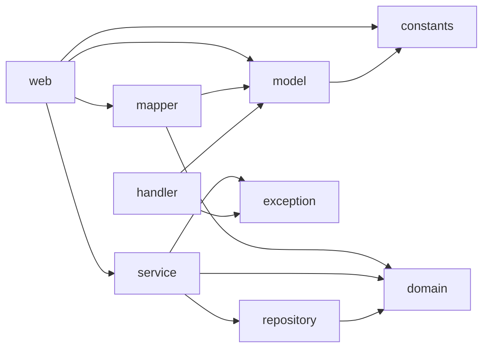
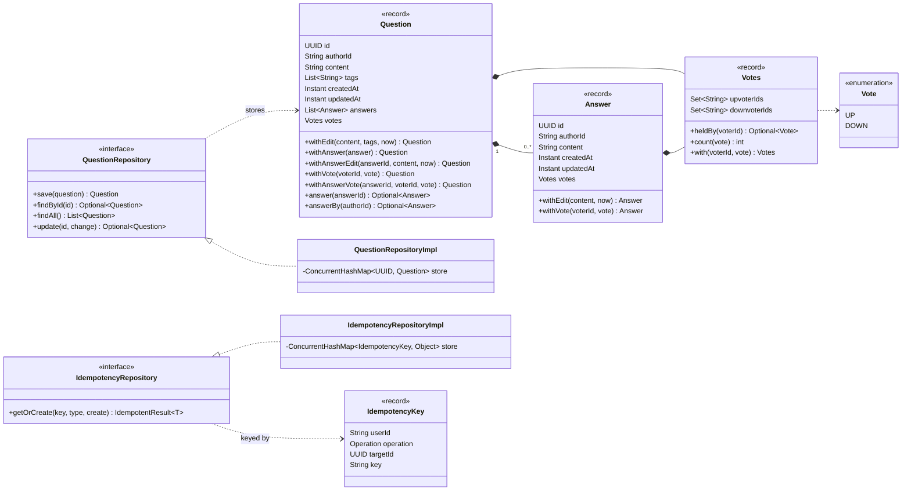
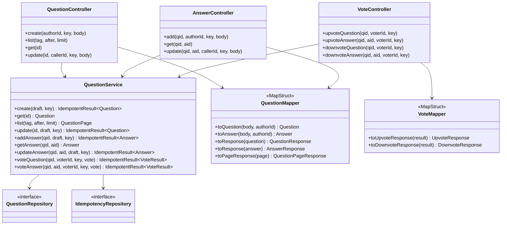
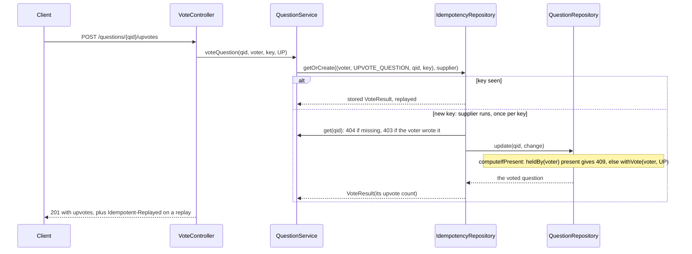

# Q&A Bank: overview

This doc holds the shared rules, packages, classes, storage, errors and test rules for every Q&A Bank API. Each API doc has its own contract, flow and tests, and refers here for the rest.

## APIs

Built in this order:

| # | API | Endpoint | Doc |
|---|---|---|---|
| 1 | Create question | `POST /questions` | [CreateQuestion.md](CreateQuestion.md) |
| 2 | Get question | `GET /questions/{id}` | [GetQuestion.md](GetQuestion.md) |
| 3 | Update question | `PUT /questions/{id}` | [UpdateQuestion.md](UpdateQuestion.md) |
| 4 | Add answer | `POST /questions/{qid}/answers` | [AddAnswer.md](AddAnswer.md) |
| 5 | Get answer | `GET /questions/{qid}/answers/{aid}` | [GetAnswer.md](GetAnswer.md) |
| 6 | Update answer | `PUT /questions/{qid}/answers/{aid}` | [UpdateAnswer.md](UpdateAnswer.md) |
| 7 | Upvote a question or an answer | `POST /questions/{qid}[/answers/{aid}]/upvotes` | [Upvote.md](Upvote.md) |
| 8 | Downvote a question or an answer | `POST /questions/{qid}[/answers/{aid}]/downvotes` | [Downvote.md](Downvote.md) |
| 9 | List questions | `GET /questions?tag=&after=&limit=` | [ListQuestions.md](ListQuestions.md) |

- Journey FTs that chain these APIs are designed in [UserJourneys.md](UserJourneys.md).
- Everything builds on Create, which brings the shared header rules, the idempotency store and `ApiExceptionHandler`.
- Downvote changed Upvote's design: one vote per user per target, up or down.

## Conventions

- **One aggregate.** A question is one document: its answers and every vote on it and on its answers live inside `Question`. `QuestionService` owns the whole document, and every change to it is one `QuestionRepository.update`.
- **Layers.** Controllers (`web`) see DTOs (`model`). Services, repositories and the domain never see HTTP. `QuestionMapper` and `VoteMapper` (MapStruct) convert. Repositories are an interface plus one `Impl`; services are plain classes.
- **Reads** (get, list) are public: `X-User-Id` isn't read.
- **Writes** need `X-User-Id` (the caller) and `Idempotency-Key`. Both are required, not blank, and at most 64 characters.
- **Ownership.** Only the author edits a question or an answer. Nobody votes on their own question or answer. One answer per user per question. One vote per user per target, up or down. Voter and author ids match exactly, case included.
- **Check order** on writes: every 400 and 415, then the key (a replay), then 404, then 403, then 409.
- **Idempotency.** One store for every write, keyed by `(userId, operation, targetId, key)`. A replay returns the stored result: the same status, `Location` and body, plus `Idempotent-Replayed: true`. Counts are part of the stored result, so a create replay shows the counts it had when created. Failures record nothing. Details: [CreateQuestion.md](CreateQuestion.md#every-write).
- **Validation.** Field, header and query rules are Bean Validation and fail as `VALIDATION_FAILED`. Business rules live in `QuestionService`, each with its own code.
- **Atomic rules.** Rules that depend on state that changes (one answer, one vote per user) run inside the atomic update. Owner and self-vote checks run before it: `authorId` never changes and there's no delete, so an earlier read stays right.
- **Time.** `ClockConfig` provides the `Clock`. Edits read it inside the atomic update, so `updatedAt` follows apply order. Votes never move `updatedAt`.
- **Limits** (`ApiConstants`): content up to 5000 characters, up to 5 tags matching `[A-Za-z0-9+#.-]{1,35}`, list `limit` 1 to 100 (default 20).

## Packages

Under `com.practice.qabank`. Only `web`, `model`, `mapper` and `handler` know HTTP or DTOs.

| Package | Classes |
|---|---|
| `web` | `QuestionController`, `AnswerController`, `VoteController` |
| `model` | `QuestionRequest`, `AnswerRequest`, `QuestionResponse`, `QuestionSummaryResponse`, `QuestionPageResponse`, `AnswerResponse`, `UpvoteResponse`, `DownvoteResponse`, `ErrorResponse` |
| `mapper` | `QuestionMapper`, `VoteMapper` |
| `service` | `QuestionService` |
| `domain` | `Question`, `Answer`, `Votes`, `Vote`, `VoteResult`, `QuestionPage`, `IdempotencyKey`, `IdempotentResult`, `Operation` |
| `repository` | `QuestionRepository`, `QuestionRepositoryImpl`, `IdempotencyRepository`, `IdempotencyRepositoryImpl` |
| `exception` | `NotFoundException` (sealed: `QuestionNotFoundException`, `AnswerNotFoundException`), `NotOwnerException` (sealed: `NotQuestionOwnerException`, `NotAnswerOwnerException`), `CannotVoteOwnException`, `AlreadyVotedException`, `AnswerAlreadyExistsException` |
| `handler` | `ApiExceptionHandler` |
| `constants` | `ApiConstants` |
| `config` | `ClockConfig` |

## Shared classes

The final shape once every API is built. Some parameters are left out to keep each method on one line.

### Domain and storage

- Records are immutable. Every change returns a copy, and a no-op returns the same instance.
- `Votes` holds the never-both rule: its constructor rejects a voter in both sets, and `with` rejects a voter who already holds a vote. Counts are the set sizes.

### Request path

- The mapper reads `upvotes` and `downvotes` from each record's own `Votes`, so it needs nothing but the record.
- `ApiExceptionHandler` turns every exception into `{ "error", "message" }` (see Errors).

### A write, using a vote as the example

Every write has this shape: the key first, read-only checks next, then one atomic change of the question. Answer adds and edits replace `withVote` with `withAnswer` or `withAnswerEdit`.

## Storage

| Store | Shape | Atomic step | Prevents |
|---|---|---|---|
| questions | `ConcurrentHashMap<UUID, Question>` | `putIfAbsent` on create; `computeIfPresent` for every edit, answer and vote | Lost updates, double answers, double votes, and an upvote plus a downvote from one user. Changes to one question apply one after another, each on the latest copy. |
| idempotency | `ConcurrentHashMap<IdempotencyKey, Object>` | `computeIfAbsent` | A retry running the write twice. |

- `findAll` and `findById` take no lock. Questions are immutable, so a read sees a whole question, never half an edit.
- A vote copies its question, its answers list and one voter set: O(answers + voters) per vote. Fine at this app's in-memory scale.
- Votes on one question queue behind each other and behind its answer adds and edits. Different questions never block each other.

## Errors

Every error returns `ErrorResponse { error, message }`.

| Status | `error` | When | Raised as | APIs |
|---|---|---|---|---|
| 400 | `MISSING_HEADER` | `X-User-Id` or `Idempotency-Key` missing | `MissingRequestHeaderException` (Spring) | Writes |
| 400 | `VALIDATION_FAILED` | A field, header or query rule fails, or a path id or query value can't be converted | `MethodArgumentNotValidException`, `HandlerMethodValidationException`, `MethodArgumentTypeMismatchException` (Spring) | All |
| 400 | `MALFORMED_REQUEST` | Body missing, not JSON, or the wrong shape | `HttpMessageNotReadableException` (Spring) | Create, updates, add answer |
| 415 | `UNSUPPORTED_MEDIA_TYPE` | Body not `application/json` | `HttpMediaTypeNotSupportedException` (Spring) | Create, updates, add answer |
| 403 | `NOT_QUESTION_OWNER`, `NOT_ANSWER_OWNER` | An edit by someone other than the author | `NotOwnerException` subclasses | Update question, update answer |
| 403 | `CANNOT_UPVOTE_OWN`, `CANNOT_DOWNVOTE_OWN` | A vote on your own question or answer | `CannotVoteOwnException` | Votes |
| 404 | `QUESTION_NOT_FOUND`, `ANSWER_NOT_FOUND` | No such question, or no such answer on that question | `NotFoundException` subclasses | All but create; list only for an unknown `after` |
| 409 | `ANSWER_ALREADY_EXISTS` | A second answer by one user | `AnswerAlreadyExistsException` | Add answer |
| 409 | `ALREADY_UPVOTED`, `ALREADY_DOWNVOTED` | A second vote by one user; the code names the vote already held | `AlreadyVotedException` | Votes |
| 4xx | Spring's status name, such as `NOT_FOUND`, `METHOD_NOT_ALLOWED` | Unknown path or wrong method | Spring's own errors | All |
| 500 | `INTERNAL_ERROR` | Anything else; logged, message hidden | Any other exception | All |

`NotFoundException` and `NotOwnerException` are sealed, and the handler maps them with exhaustive switches, so a new subclass without a code fails the build.

## Tests

| Kind | Runs with | Covers |
|---|---|---|
| Domain and mapper | Plain JUnit, `Mappers.getMapper` | `Question`, `Answer`, `Votes` methods; every mapped field and count |
| Service | Plain JUnit, the real in-memory repositories, a fixed `Clock` | `QuestionServiceTest`, `QuestionServiceAnswersTest`, `QuestionServiceVotesTest`: rules, replays, failures and races |
| Repository | Plain JUnit | `QuestionRepositoryImpl`, `IdempotencyRepositoryImpl`, including races |
| Web | `@WebMvcTest` slices with `QuestionService` as a `@MockitoBean` | Status codes, headers, bodies and every `ApiExceptionHandler` mapping |
| Per-API FTs | Real HTTP against the app `mvn verify` starts on port 8081, `@Tag("api")` | One class per API: validation, happy path, idempotency, ownership, concurrency |
| Journey FTs | The same, `@Tag("journey")` | Stories that chain several APIs ([UserJourneys.md](UserJourneys.md)) |

- **Parameterized** with `@ParameterizedTest` and `@MethodSource` or `@EnumSource` wherever cases differ only in input and expected result.
- **Races** release every task together through a `CountDownLatch` start gate: 50 threads in unit tests.
- **Gates:** `mvn test` for unit tests; `mvn verify -Dft.groups=api` for the quick FT gate; `mvn verify` for everything. Use `-Dft.groups`, never `-Dgroups`, which silently skips the unit tests.
- **Naming:** camelCase sentences, such as `sameKeyReplaysTheStoredResult`.
