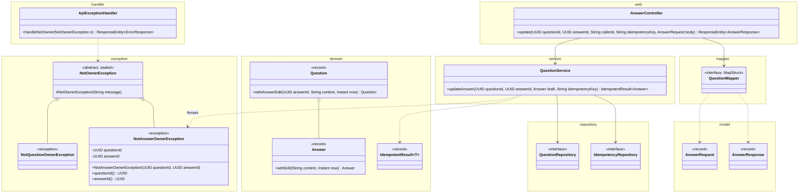
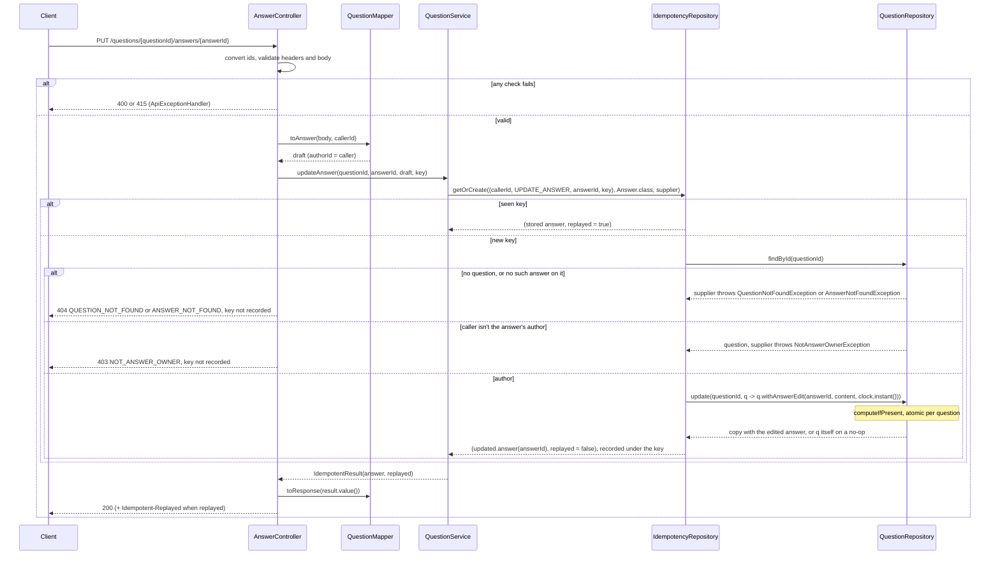
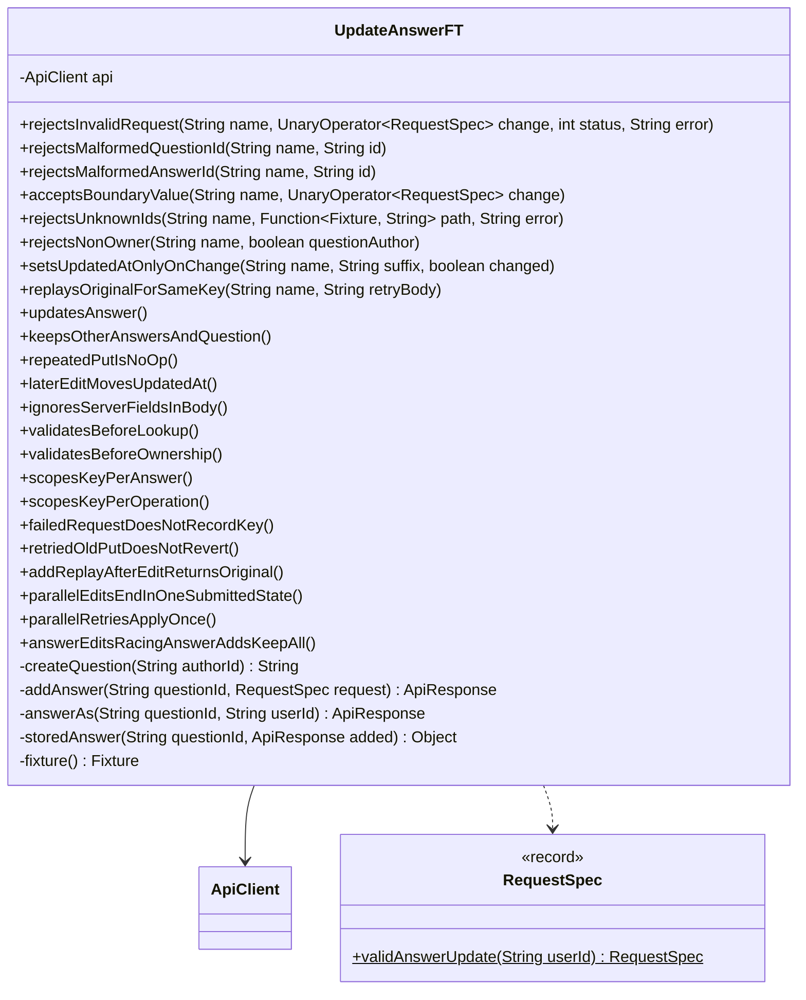

# Update Answer API

Status: **Agreed** (2026-10-24). See Decisions.

An answer's author replaces its `content`. The caller comes from `X-User-Id` and must be the answer's `authorId`, so the question's author can't edit someone else's answer. The server records when the answer last changed. Retrying with the same idempotency key returns the first result, so a late retry can't undo a newer edit. This follows UpdateQuestion.md's "Shared with answer edits" rules and builds on AddAnswer.md and GetAnswer.md.

## Contract

### Request

```
PUT /questions/3f1c9a52-8a7e-4f0b-9d0e-2b6c1f6a7e11/answers/9b2e4d71-0c3a-4f5e-8b6d-1a7c2e9f4b30
X-User-Id: user-7
Idempotency-Key: e4a19c37-2f6b-4d80-a5c2-7b3e9f1d0a58
Content-Type: application/json

{
  "content": "Use compute() or merge(). Both run atomically per key, so no explicit lock is needed."
}
```

| Field | Rules |
|---|---|
| `questionId`, `answerId` path segments | Same as GetAnswer. |
| `X-User-Id` header | Same rules as create. Must equal the answer's `authorId` (exact, case-sensitive). |
| `Idempotency-Key` header | Same rules as create. New value per edit, same value on retry. |
| `content` | Same rules as Add answer. Replaces the current content. |

Unknown body fields are ignored, so a client can't change `id`, `authorId`, `createdAt`, or `updatedAt`.

### Response

```
200 OK

{
  "id": "9b2e4d71-0c3a-4f5e-8b6d-1a7c2e9f4b30",
  "authorId": "user-7",
  "content": "Use compute() or merge(). Both run atomically per key, so no explicit lock is needed.",
  "createdAt": "2026-10-24T06:20:02.481Z",
  "updatedAt": "2026-10-24T06:31:10.204Z",
  "upvotes": 0,
  "downvotes": 0
}
```

- The same `AnswerResponse` as Add and GET answer.
- No-op: if `content` already matches exactly (it isn't trimmed), nothing is written. 200 with the current answer, `updatedAt` unchanged.
- The question's `content`, `tags`, and `updatedAt`, and its other answers, don't change.
- No `Location`. A replay (this user's key already used to update this answer) returns the original 200 body, plus `Idempotent-Replayed: true`. The body is the stored snapshot, counts included: votes cast since don't show (Upvote.md's replay rule).

### Errors

Body: `{ "error": "<CODE>", "message": "<detail>" }`. Check order: every 400 and 415, then the key (a replay returns the original 200), then 404 (question, then answer), then 403.

| Case | Status | `error` |
|---|---|---|
| `questionId` or `answerId` isn't a UUID | 400 | `VALIDATION_FAILED` |
| Missing `X-User-Id` or `Idempotency-Key` | 400 | `MISSING_HEADER` |
| A header or `content` breaks its rules | 400 | `VALIDATION_FAILED` |
| Body not valid JSON | 400 | `MALFORMED_REQUEST` |
| `Content-Type` not JSON | 415 | `UNSUPPORTED_MEDIA_TYPE` |
| No question has that `questionId` | 404 | `QUESTION_NOT_FOUND` |
| The question has no answer with that `answerId` | 404 | `ANSWER_NOT_FOUND` |
| `X-User-Id` isn't the answer's `authorId`, even if it's the question's author | 403 | `NOT_ANSWER_OWNER` |
| Unexpected | 500 | `INTERNAL_ERROR` |

- Same reasoning as UpdateQuestion: the replay before 404 and 403 is safe because the key is scoped by user and answer, 404 comes before 403, the 403 reveals that the answer exists (fine, because GET is public), and a non-owner with a bad body gets 400.
- Messages: 400 and 404 as in GetAnswer.md. 403 is `Only the author can update answer <answerId>`.

## Idempotency

The same as UpdateQuestion.md, with operation `UPDATE_ANSWER` (Decision 4):

- The stored key is `(userId, UPDATE_ANSWER, answerId, key)`. Answer ids are globally unique UUIDs, so the question id isn't needed. The same key on another answer, or used for another operation (the add that created this answer, say), is a separate entry.
- Same key again: the stored snapshot of the first outcome, counts included, 200 with its body, plus `Idempotent-Replayed: true`. The new `content` isn't compared.
- The key holds no question id, so the same key under a wrong `questionId` is still that replay, not a 404. Only the answer's author can hold such an entry, and the body is their own answer.
- Failed requests (400, 415, 404, 403) record nothing.
- **A delayed retry can't revert.** An older PUT retried after a newer edit carries its original key, so it's a replay. `If-Match` is needed only for two *different* edits racing, which stays last write wins (Decision 1). A genuinely new edit needs a new key.
- The same body under a new key is an ordinary PUT: a no-op returns 200 with the current answer and no replay header.
- **Add replay after an edit** returns the creation-time snapshot (old `content`, `updatedAt: null`), while GET answer returns the current answer. The reason and cost are those of UpdateQuestion.md's "Create replay after an update": the store keeps the `Answer` instance from creation under the add key, and an edit puts a new `Question` into the question map and its `Answer` under its own `UPDATE_ANSWER` key.

## Design

### External and internal models

| External (`web` and `model`, JSON) | Internal (`domain`) |
|---|---|
| `AnswerRequest` + `X-User-Id` | `Answer` (draft) |
| `{questionId}`, `{answerId}` path segments | `UUID` |
| `X-User-Id` + `{answerId}` + `Idempotency-Key` | `IdempotencyKey` (`UPDATE_ANSWER`, target the answer id) |
| `AnswerResponse` | `Answer` |

- The draft comes from `toAnswer(body, callerId)`, as in Add answer, so `draft.authorId()` is the caller. The path ids go to the service as their own arguments.
- `AnswerRequest` is reused, as POST and PUT question share `QuestionRequest`.
- The edit rules are domain logic:
  - `Answer.withEdit(content, now)` returns `this` if `content` is equal. Otherwise it returns a copy with the new `content` and `updatedAt = now`, and `id`, `authorId`, and `createdAt` copied.
  - `Question.withAnswerEdit(answerId, content, now)` applies `withEdit` to that answer. It returns `this` on a no-op or when there's no such answer. Otherwise it returns a copy whose `answers` is a copy of the list with only that entry replaced, in the same position. The question's own fields, `updatedAt` included, and the other answers come from `this`.

### Classes



- Only new or changed members are shown. `QuestionNotFoundException` and `AnswerNotFoundException` are reused as in GetAnswer.md. `IdempotencyRepository` and `IdempotentResult` are CreateQuestion.md's. See AddAnswer.md and UpdateQuestion.md for the rest.
- `AnswerController.update` is a `@PutMapping("/{answerId}")` with JSON `consumes`. It takes both ids as `@PathVariable UUID`, `X-User-Id` and `Idempotency-Key` with create's constraints, and `@Valid @RequestBody AnswerRequest`. It calls `service.updateAnswer(questionId, answerId, mapper.toAnswer(body, callerId), key)` and returns 200 with `mapper.toResponse(result.value())`, plus `Idempotent-Replayed: true` when `result.replayed()`.
- `QuestionService.updateAnswer(questionId, answerId, draft, key)` returns `idempotency.getOrCreate(new IdempotencyKey(draft.authorId(), UPDATE_ANSWER, answerId, key), Answer.class, supplier)`. The supplier:
  1. `getAnswer(questionId, answerId)` (GetAnswer.md): `get(questionId)`, which throws `QuestionNotFoundException`.
  2. In the same call, `answer(answerId)` on that question, or throw `AnswerNotFoundException`.
  3. If that answer's `authorId` isn't `draft.authorId()`, throw `NotAnswerOwnerException(questionId, answerId)`.
  4. `questions.update(questionId, q -> q.withAnswerEdit(answerId, draft.content(), clock.instant()))`. If that's empty, throw `QuestionNotFoundException`.
  5. Return `updated.answer(answerId)`, or throw `AnswerNotFoundException`. Steps 4 and 5 are defensive, because there's no delete API.
- 403 mapping: `NotQuestionOwnerException` and `NotAnswerOwnerException` share a sealed `NotOwnerException`, and one `handleNotOwner(NotOwnerException)` maps both. An exhaustive switch picks `NOT_QUESTION_OWNER` or `NOT_ANSWER_OWNER`. This is GetQuestion's `NotFoundException` pattern, for the same reasons: one 403 body builder, and a new subtype without a code fails the build (Decision 2).

### Flow



### Concurrency

- **Same rules as UpdateQuestion.md:** one atomic `computeIfPresent` per question, a change built from `q`, the clock read inside the function, and the mapping-function rules. The ownership check outside `computeIfPresent` is safe because an answer's `authorId` never changes.
- **Idempotency around it.** `getOrCreate` is `computeIfAbsent` on `(caller, UPDATE_ANSWER, answerId, key)`. Its supplier runs the lookups, the ownership check, and `questions.update`. With the same key, the supplier runs once and the others wait, then replay. A supplier that throws (404, 403) records nothing.
- **Only the target answer changes.** `withAnswerEdit` copies `q.answers`, replaces one entry, and copies the question's fields from `q`. Answer adds, other answer edits, question edits, and votes running at the same time are all kept, in apply order.
- **Concurrent edits by the answer's author: last write wins,** in apply order, and the result is always one whole submitted edit. Optimistic concurrency is Decision 1. This is for edits under different keys; a retry under its original key is a replay.
- **No-op returns the same `Question` instance,** so parallel identical PUTs under different keys change nothing and get identical responses. Under one key, one applies and the rest are replays.
- **Locks.** An edit takes an idempotency bin, then a question bin, as every write does. GET takes no lock. Nothing takes a question bin first, so there's no lock-order inversion. Edits to different answers on one question run one at a time; different questions don't block each other.
- **Readers** don't lock and see the old or the new `Question`.

## Unit tests

These add cases to the test classes in CreateQuestion.md and AddAnswer.md. There are no new test classes.

| Class | Style | Covers |
|---|---|---|
| `Answer` | Plain JUnit, parameterized | `withEdit` with new content, or a trailing space added: a copy with that `content` and `updatedAt = now`, and `id`, `authorId`, and `createdAt` unchanged. With the same content: the same instance. |
| `Question` | Plain JUnit | `withAnswerEdit` on a question with three answers changes only the target, in the same position. The other answers are the same instances, and the question's `content`, `tags`, and `updatedAt` are unchanged. A no-op or an unknown answer id returns the same instance. |
| `QuestionService`, answers | Plain JUnit, `Clock.fixed(T1)`, real in-memory repositories, a question with answers saved directly | Edit by the answer's author, parameterized as change or no-op: returned with `replayed` false and stored, with `updatedAt` equal to T1 or unchanged, and the question's `updatedAt` unchanged. Same key again, with different content or after a newer edit under another key: `replayed` true, the first result, and the stored answer keeps the newer state. Same key under another `questionId`: still the replay. Same key on another answer, and the key the answer was added with: applied, `replayed` false. Unknown question: `QuestionNotFoundException`. Unknown answer, or another question's answer: `AnswerNotFoundException`. Another user, the question's author, or the answer author's id in another case: `NotAnswerOwnerException`, and the stored question is the same instance. Rejections record no key: for the unknown question, save one under that id with the answer, and a retry with the key applies. Add, edit, then add again with the same key: the replay returns the original content. 25 edits by the author racing 25 adds by others: all 25 answers kept, and the edited content is one of the edits. The same race made deterministic: a repository stub adds another user's answer between the lookup and the atomic edit, and both are kept. 50 threads, one key, one edit: `replayed` false once, 49 replays. |
| `AnswerController` | `@WebMvcTest(AnswerController.class)`, `QuestionService` as a `@MockitoBean`, real mapper | PUT gives 200 with the service's answer and no `Location`. `Idempotent-Replayed: true` appears only when `replayed()` is true. The service gets both path ids, a draft with the body's `content` and `authorId` equal to `X-User-Id`, and the key (checked with an `ArgumentCaptor`). Server fields in the body are ignored. |
| `AnswerController`, errors | Same slice, parameterized | AddAnswer's invalid-input rows, sent as a PUT, give their status and `error`, and the service is never called. A malformed `questionId` or `answerId` gives 400 with `<name> must be a UUID`. Thrown from `updateAnswer`, `QuestionNotFoundException` and `AnswerNotFoundException` give 404 and `NotAnswerOwnerException` gives 403 `NOT_ANSWER_OWNER`, each with the exact message and no replay header. |
| `ApiExceptionHandler` | `@WebMvcTest(QuestionController.class)`, as before | `NotAnswerOwnerException`, thrown from create, gives 403 `NOT_ANSWER_OWNER` with the answer id in the message. `NotQuestionOwnerException` from PUT question still gives 403 `NOT_QUESTION_OWNER`. |

- **Concurrency test** uses a `CountDownLatch`, the same as create's.
- **No dedicated test:** `NotOwnerException` and `NotAnswerOwnerException` are only constructors and getters.
- **`IdempotencyRepositoryImpl`:** no new cases. CreateQuestion.md's cover every operation.

## Functional tests

### How they run

The same as CreateQuestion.md: `mvn verify` starts the app on `ft.port` (default 8081), and Failsafe runs `UpdateAnswerFT`. It uses CreateQuestion.md's build setup unchanged.

### Classes



- Only new members are shown. `ApiClient.put` comes from UpdateQuestion.md. The `@MethodSource` factories match the parameterized tests, as in UpdateQuestionFT.
- `RequestSpec.validAnswerUpdate(userId)` builds `X-User-Id: userId`, a fresh random `Idempotency-Key`, a JSON `Content-Type`, and a body with fresh random `content`.
- `createQuestion`, `addAnswer`, and `fixture()` are the same as in AddAnswerFT and GetAnswerFT. `answerAs(questionId, userId)` adds `validAnswer()` as that user.
- Test data is created only through the API, with a fresh user and key per test. It's read back through GET question: `storedAnswer` returns the answer's entry in `answers`, which is the same `AnswerResponse` that GET answer returns.

### Cases

**`rejectsInvalidRequest`**: user U answers, then PUTs `change(validAnswerUpdate(U))`. Expect this status and `error`, and the stored answer is still the added one. The rows are AddAnswerFT's.

| Change | Status | `error` |
|---|---|---|
| Remove `X-User-Id`; remove `Idempotency-Key` | 400 | `MISSING_HEADER` |
| Either header `"   "`; either header 65 chars | 400 | `VALIDATION_FAILED` |
| No `content`; `content` `"   "`; `content` 5001 chars | 400 | `VALIDATION_FAILED` |
| Body `{not json` | 400 | `MALFORMED_REQUEST` |
| `Content-Type: text/plain` | 415 | `UNSUPPORTED_MEDIA_TYPE` |

**`rejectsMalformedQuestionId`**, **`rejectsMalformedAnswerId`**: PUT `validAnswerUpdate(freshUser)` with a `GetQuestionFT#malformedIds` row (fully qualified `@MethodSource`) in that segment and a random UUID in the other. Expect 400 `VALIDATION_FAILED` with `questionId must be a UUID` or `answerId must be a UUID`.

**`acceptsBoundaryValue`**: `X-User-Id` 64 chars (that user answers first); `Idempotency-Key` 64 chars; `content` 5000 chars. Expect 200.

**`rejectsUnknownIds`**: build a fixture, then PUT this path as the fixture's user, who wrote both answers. Expect 404 with this `error` and the path's question id in the message, and neither answer changes.

| Path | `error` |
|---|---|
| Random question id, the fixture's answer id | `QUESTION_NOT_FOUND` |
| The fixture's question, a random answer id | `ANSWER_NOT_FOUND` |
| The fixture's question, the other question's answer id | `ANSWER_NOT_FOUND` |

**`rejectsNonOwner`**: user U answers, then edits with key K. PUT with K as another fresh user, or as the question's author. Expect 403 `NOT_ANSWER_OWNER` with `Only the author can update answer <answerId>`, not a replay, and the stored answer is U's edit.

**`setsUpdatedAtOnlyOnChange`**: the answer was added with content `A`. PUT `A` plus this suffix. A no-op returns 200 with a body equal to the add's 201 body, `updatedAt` still `null`. A change returns 200 with `updatedAt` between the times just before and after the call.

| Suffix | Result |
|---|---|
| none | No-op |
| `"!"` | Change |
| `" "` (not trimmed) | Change |

**`replaysOriginalForSameKey`**: PUT, then retry with the same user and key and the same body, or different `content`. The retry gets 200 with the first response's body, plus `Idempotent-Replayed: true`. The first response has no replay header. The stored answer is the first edit.

**Single tests**

| Test | Expect |
|---|---|
| `updatesAnswer` | 200. Same `id`, `authorId`, and `createdAt`; new `content`; `updatedAt` between the times just before and after the call. The stored answer equals the body. |
| `keepsOtherAnswersAndQuestion` | Users A, B, and C answer, then B edits. GET question: the same order, A's and C's entries unchanged, and the question's `content`, `tags`, and `updatedAt` unchanged. |
| `repeatedPutIsNoOp` | The same edit twice, under two keys: both 200, with identical bodies, including `updatedAt`, and no replay header. |
| `laterEditMovesUpdatedAt` | Two different edits: the second `updatedAt` is later than the first. |
| `ignoresServerFieldsInBody` | The body also sends `id`, `authorId` (another user), `createdAt`, and `updatedAt`. 200, and those fields keep their server values. |
| `validatesBeforeLookup` | A random question id and blank `content`: 400 `VALIDATION_FAILED`, not 404. |
| `validatesBeforeOwnership` | Another user and blank `content`: 400 `VALIDATION_FAILED`, not 403. |
| `scopesKeyPerAnswer` | One user answers two questions, then edits both answers with one key: both 200 and applied, neither a replay. |
| `scopesKeyPerOperation` | Add with key K, then PUT that answer with K: 200, applied, no replay header. |
| `failedRequestDoesNotRecordKey` | 400 with key K, then a valid PUT with K: 200, applied, not a replay. |
| `retriedOldPutDoesNotRevert` | Edit A with K1, then edit B with K2, then retry A with K1: 200 with A's original body and `Idempotent-Replayed: true`. The stored answer is B. |
| `addReplayAfterEditReturnsOriginal` | Add with key K, edit, then POST again with K: 201, `Idempotent-Replayed: true`, the original `content`, and `updatedAt` `null`. The stored answer is the edit. |
| `parallelEditsEndInOneSubmittedState` | The author sends 50 parallel PUTs, each with its own key, with content `edit-i`. All get 200. The final stored answer equals exactly one of the 50 response bodies, and no response has a later `updatedAt` than the final one. |
| `parallelRetriesApplyOnce` | 50 parallel PUTs with the same key and body: all 200 with identical bodies, one without the replay header, 49 replays. |
| `answerEditsRacingAnswerAddsKeepAll` | User U answers. In parallel, U sends 25 PUTs (content `edit-i`) and 25 other users answer. Every PUT gets 200 and every add 201. GET question has all 26 answers, with U's first, and U's `content` is one of the edits. |

## Changes to the existing design

No existing doc is edited here. This design needs:

| Where | Change | Effect on existing endpoints |
|---|---|---|
| `NotQuestionOwnerException` (UpdateQuestion.md) | Extends the new sealed `NotOwnerException`. | None. |
| `ApiExceptionHandler` | `handleNotOwner(NotOwnerException)`'s switch gives `NOT_QUESTION_OWNER` or `NOT_ANSWER_OWNER`. | PUT question keeps the same 403. |
| `Answer`, `Question` (AddAnswer.md) | Add `Answer.withEdit` and `Question.withAnswerEdit`. | None. |
| `AnswerController`, `AnswerService` (AddAnswer.md) | Add `update`. | None. |
| Idempotency (CreateQuestion.md) | Uses the shared store with `UPDATE_ANSWER`. No store changes. | None. |
| FT helpers | Add `RequestSpec.validAnswerUpdate(userId)`, which includes a fresh `Idempotency-Key`. | None. |

UpdateQuestion.md's "Shared with answer edits" table is followed as written.

## Decisions

Agreed on 2026-10-24. Every open question took its draft default, except Decision 4.

1. Concurrent edits by the answer's author: last write wins. This covers different edits; a retry under its original key is a replay (Decision 4).
2. 403 mapping: a sealed `NotOwnerException` shared with `NotQuestionOwnerException`.
3. Create's Decisions 2, 3, 4, 6, 7, and 8 and GetQuestion's Decision 3 apply unchanged.
4. `Idempotency-Key` is required on every write, PUT included; the stored key is `(userId, operation, targetId, key)` (user, 2026-10-24). Here it's `(userId, UPDATE_ANSWER, answerId, key)`, so a retried older PUT is a replay and can't revert a newer edit.
