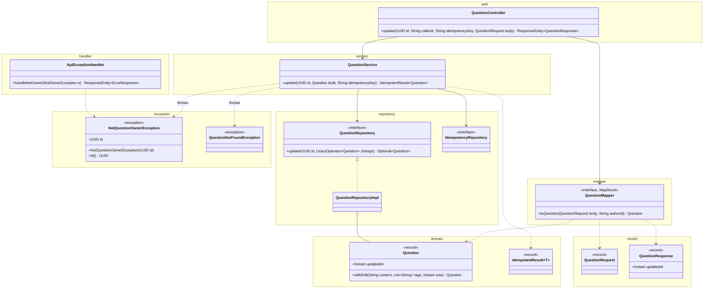
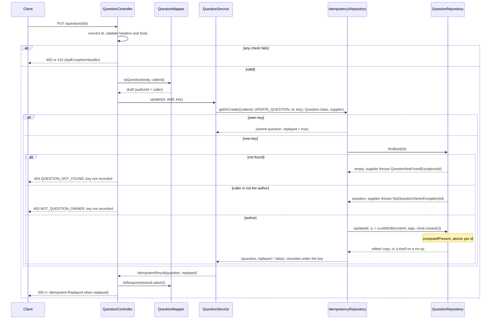
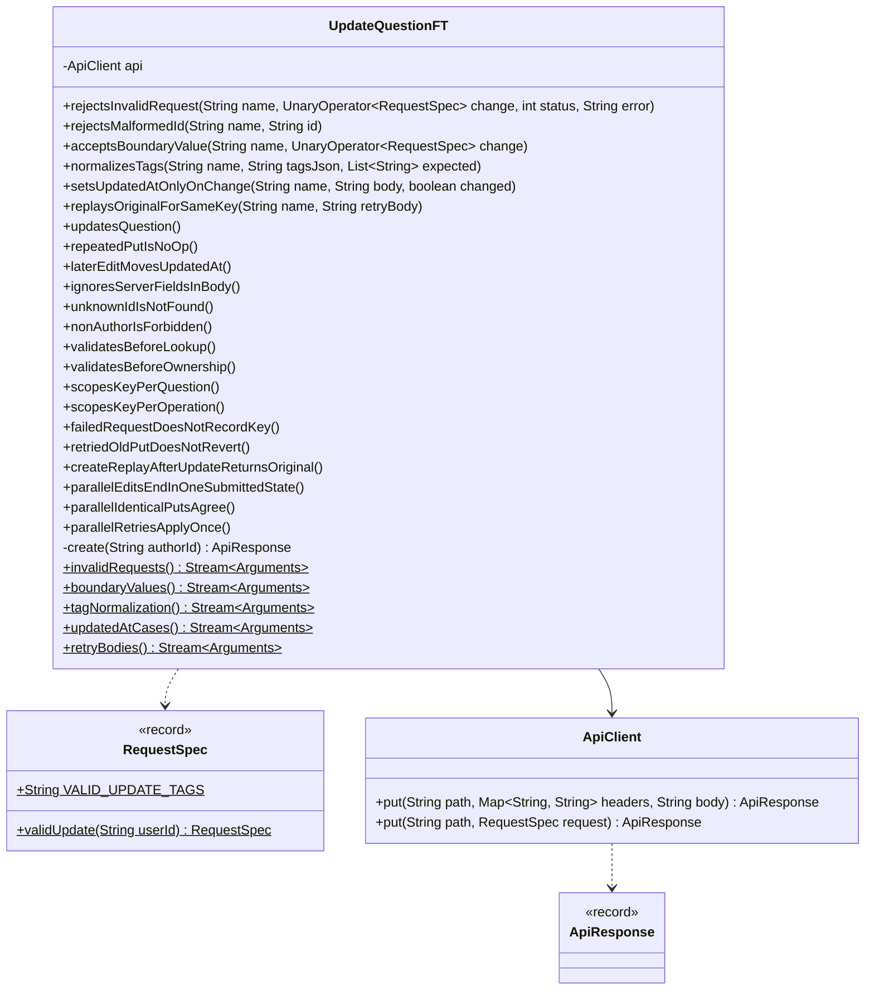

# Update Question API

Status: **Agreed** (2026-10-24). See Decisions.

The author replaces a question's `content` and `tags`. The caller comes from `X-User-Id` and must be the question's `authorId`. The server records when the question last changed. Retrying with the same idempotency key returns the first result, so a late retry can't undo a newer edit. Builds on CreateQuestion.md and GetQuestion.md.

## Contract

### Request

```
PUT /questions/3f1c9a52-8a7e-4f0b-9d0e-2b6c1f6a7e11
X-User-Id: user-42
Idempotency-Key: b71e3f02-6c4d-4a9e-8f15-3d2c7a9e0b64
Content-Type: application/json

{
  "content": "How do I make a ConcurrentHashMap value update atomic without locks?",
  "tags": ["Java", "concurrency", "ConcurrentHashMap"]
}
```

| Field | Rules |
|---|---|
| `id` path segment | Same as GetQuestion: a UUID, any case. |
| `X-User-Id` header | Same rules as create. Must equal the question's `authorId` (exact, case-sensitive). |
| `Idempotency-Key` header | Same rules as create. New value per edit, same value on retry. |
| `content` | Same rules as create. Replaces the current content. |
| `tags` | Same rules and normalization as create. Replaces the current tags, so leaving it out clears them. |

Unknown body fields are ignored, so a client can't change `id`, `authorId`, `createdAt`, or `updatedAt`.

### Response

```
200 OK

{
  "id": "3f1c9a52-8a7e-4f0b-9d0e-2b6c1f6a7e11",
  "authorId": "user-42",
  "content": "How do I make a ConcurrentHashMap value update atomic without locks?",
  "tags": ["java", "concurrency", "concurrenthashmap"],
  "createdAt": "2026-10-24T06:12:45.123Z",
  "updatedAt": "2026-10-24T06:20:03.456Z",
  "upvotes": 0,
  "downvotes": 0,
  "answers": []
}
```

- Same shape as create and GET (built by `toResponse`), now with `updatedAt`. `answers` is unchanged by the edit.
- `updatedAt` is `null` until the first real change.
- No-op: if `content` and the normalized `tags` already match, nothing is written. 200 with the current question, `updatedAt` unchanged.
- No `Location`. A replay (this user's key already used to update this question) returns the original 200 body, plus `Idempotent-Replayed: true`. The body is the stored snapshot, counts included: votes cast since don't show (Upvote.md's replay rule).

### Errors

Body: `{ "error": "<CODE>", "message": "<detail>" }`. Check order: every 400 and 415, then the key (a replay returns the original 200), then 404, then 403.

| Case | Status | `error` |
|---|---|---|
| `id` isn't a UUID | 400 | `VALIDATION_FAILED` |
| Missing `X-User-Id` or `Idempotency-Key` | 400 | `MISSING_HEADER` |
| A header, `content`, or `tags` breaks its rules | 400 | `VALIDATION_FAILED` |
| Body not valid JSON, or `tags` not an array | 400 | `MALFORMED_REQUEST` |
| `Content-Type` not JSON | 415 | `UNSUPPORTED_MEDIA_TYPE` |
| No question has that `id` | 404 | `QUESTION_NOT_FOUND` |
| `X-User-Id` isn't the question's `authorId` | 403 | `NOT_QUESTION_OWNER` |
| Unexpected | 500 | `INTERNAL_ERROR` |

- Every 400 and the 415 come from Spring binding and validation, before the service runs. Their order among themselves is Spring's, as in create.
- Replay before 404 and 403 is safe: the key is scoped by user and question, so an entry exists only after this user's successful edit of this question.
- 404 before 403: the author can only be checked on a question that exists. The 403 reveals that the id exists, which is fine because GET is public.
- So a non-author with a bad body gets 400, not 403.
- Messages: 400 bad id and 404 as in GetQuestion.md. 403 is `Only the author can update question <id>`.

## Idempotency

CreateQuestion.md's "Every write" mechanism and store (Decision 7). Here:

- The stored key is `(userId, UPDATE_QUESTION, id, key)`. The same key on another question, or used for another operation (the create, say), is a separate entry.
- Same key again: the stored snapshot of the first outcome, counts included, 200 with its body, plus `Idempotent-Replayed: true`. The new body isn't compared, and the question may have changed since.
- A no-op is recorded too. Its replay returns the question as it was then.
- Failed requests (400, 415, 404, 403) record nothing.
- **A delayed retry can't revert.** An older PUT retried after a newer edit carries its original key, so it's a replay and changes nothing. A genuinely new edit needs a new key.
- `If-Match` is still needed only for two *different* edits racing, which stays last write wins (Decision 3).
- The same body under a new key is an ordinary PUT: a no-op returns 200 with the current question and no replay header.
- Keys live as long as the app: one entry per successful PUT, each holding a `Question` snapshot. Fine for an in-memory MVP.

### Create replay after an update

- `IdempotencyRepositoryImpl` stores the `Question` instance from creation time under the create key. An update puts a new instance into the question map and under its own `UPDATE_QUESTION` key, never into the create entry. Stored snapshots are immutable, so they never change.
- So a create replay returns the creation-time 201 body (old `content` and `tags`, `updatedAt: null`, and no later answers or votes, Upvote.md), while GET returns the current question.
- **Recommended: keep this.** It's what create promises ("respond with whatever was done the first time"). It needs no code, and the replay's `Location` leads to the current state.
- Not chosen: store the id and look up the current question on replay. The replay would change after each edit, and a deleted question would need its own rule.
- Cost: an edited question keeps its old copy in the idempotency map. That's fine for an in-memory MVP.

## Design

### External and internal models

| External (`web` and `model`, JSON) | Internal (`domain`) |
|---|---|
| `QuestionRequest` + `X-User-Id` | `Question` (draft) |
| `{id}` path segment | `UUID` |
| `X-User-Id` + `{id}` + `Idempotency-Key` | `IdempotencyKey` (`UPDATE_QUESTION`, target the question id) |
| `QuestionResponse` | `Question` |

- `Question` stays the only internal model. The draft comes from the existing `toQuestion(body, authorId)`, called with the `X-User-Id` value. So `draft.authorId()` is the caller, as in create. `id`, `createdAt`, and `updatedAt` stay `null` in the draft. The path id goes to the service as its own argument.
- Body: reuse create's record, renamed `QuestionRequest`, so the rules live in one place. Not chosen: a separate `UpdateQuestionRequest`, which copies the same annotations and can drift. That's only worth it if the bodies diverge (PATCH, say).
- The edit rule is domain logic, in `Question.withEdit(content, tags, now)`:
  - It builds the edited copy first, so tags are compared after normalization.
  - It returns `this` if `content` and `tags` equal the current ones. Otherwise it returns the copy with `updatedAt = now`.
  - Everything else (`id`, `authorId`, `createdAt`, and later `answers`) is copied from `this`.

### Classes



- Only new or changed members are shown. A class without members is reused unchanged. See CreateQuestion.md and GetQuestion.md for the rest. `QuestionRequest` is `CreateQuestionRequest` renamed. `IdempotencyRepository`, `IdempotentResult`, `IdempotencyKey`, and `Operation` are CreateQuestion.md's.
- `QuestionController.update` handles `@PutMapping` on `/questions/{id}`. It takes `@PathVariable UUID id`, `X-User-Id` and `Idempotency-Key` with create's constraints, and `@Valid @RequestBody QuestionRequest`. It calls `service.update(id, mapper.toQuestion(body, callerId), key)` and returns 200 with `mapper.toResponse(result.value())`, plus `Idempotent-Replayed: true` when `result.replayed()`.
- `QuestionService.update(id, draft, key)` returns `idempotency.getOrCreate(new IdempotencyKey(draft.authorId(), UPDATE_QUESTION, id, key), Question.class, supplier)`. The supplier:
  1. `get(id)`: `findById(id)`, or throw `QuestionNotFoundException(id)` (from GetQuestion.md).
  2. If `current.authorId()` isn't `draft.authorId()`, throw `NotQuestionOwnerException(id)`.
  3. `questions.update(id, q -> q.withEdit(draft.content(), draft.tags(), clock.instant()))`. If that's empty, the question was removed in between: throw `QuestionNotFoundException(id)`. There's no delete API yet, so this is defensive. Otherwise return the result.
- `NotQuestionOwnerException` follows `QuestionNotFoundException`: `exception` package, unchecked, holds the `UUID id`, no HTTP status. It extends the sealed `NotOwnerException` (UpdateAnswer.md). Only `ApiExceptionHandler.handleNotOwner` turns it into 403 `NOT_QUESTION_OWNER`.
- `QuestionRepository.update(id, change)` is `ConcurrentHashMap.computeIfPresent`:
  - It returns the stored result, or empty when the id is missing (then `change` isn't called).
  - It throws if `change` returns `null` or a different `id`. Throwing inside `computeIfPresent` leaves the entry as it was.
  - It's generic. Every change to a stored question goes through it: edit now, add or edit answers later.

### Flow



### Concurrency

- **Atomic read-modify-write.** `update` is `computeIfPresent`, so read, change, and write are one step per id. Changes to one question run one after another, each on the previous result. Different questions don't block each other.
- **Idempotency around it.** `getOrCreate` is `computeIfAbsent` on `(caller, UPDATE_QUESTION, id, key)`. Its supplier runs the lookup, the ownership check, and `questions.update`. With the same key, the supplier runs once and the others wait, then replay. A supplier that throws (404, 403) records nothing.
- **Lock order.** An idempotency bin, then a question bin, as for every write. GET takes no lock. Nothing takes a question bin first, so there's no inversion. The supplier never calls `getOrCreate`.
- **Build from `q`.** The change function builds from `q`, the value `computeIfPresent` hands it, never from the `findById` result used for the ownership check, which can be stale. An edit replaces only `content`, `tags`, and `updatedAt` and copies the rest from `q`. So an answer added concurrently is never lost.
- **Mapping-function rules.** Keep it short and pure: no I/O, and no writes to the question map. A same-map write from inside throws `IllegalStateException: Recursive update` or can deadlock. Never return `null`, because that removes the question. The repository guards against `null`. Reading the clock is fine.
- **Clock inside the function.** `updatedAt` then follows the order in which the changes were applied, so a slower edit can't leave an older `updatedAt` on top.
- **Ownership check outside `computeIfPresent`.** This is safe only because `authorId` never changes after create, since no change function touches it. If it ever could change, the check moves into the function. The same holds for an answer's `authorId`.
- **Concurrent edits by the author: last write wins**, in apply order. The result is always one whole submitted edit, never content from one and tags from another. Optimistic concurrency is Decision 3. This is for edits under different keys; a retry under its original key is a replay.
- **No-op returns the same instance**, so parallel identical PUTs under different keys make one write and get identical responses. Under one key, one applies and the rest are replays.
- **Readers** (`findById`, GET) don't lock. `Question` is immutable, so they see the old or the new instance, never a mix.

### Shared with answer edits

Answer edits (`PUT /questions/{questionId}/answers/{answerId}`) are designed separately and are meant to mirror these rules:

| Rule | As applied here |
|---|---|
| Idempotency | Required `Idempotency-Key`. The stored key is `(userId, UPDATE_QUESTION, questionId, key)`, or `(userId, UPDATE_ANSWER, answerId, key)`. A replay returns the first outcome's 200 body with `Idempotent-Replayed: true`. Checked after the 400s, before the 404 and 403. Failures record nothing. |
| Ownership | `X-User-Id` must equal the target's `authorId`, exact match. Checked after the 400s, the key, and the 404, before any write. 403 otherwise. |
| `updatedAt` | `null` until the first real change to the target's own fields. A no-op leaves it. Adding an answer doesn't change the question's `updatedAt`: it tracks edits to the question itself, not activity. An answer would need its own `updatedAt` for this. |
| No-op | Compare after normalization. Return the current instance, so nothing is written. |
| Concurrency | One `getOrCreate`, whose supplier makes the 404 and 403 checks and one `QuestionRepository.update(questionId, change)` call. The function copies `q` and replaces only the target's fields. |

## Changes to the create design

CreateQuestion.md uses the `QuestionRequest` name and shows the full response. The rest of this design's changes to create are listed here:

| Where | Change | Effect on create |
|---|---|---|
| `Question` | Add `Instant updatedAt` after `createdAt`, and add `withEdit(...)`. `withIdAndCreatedAt` copies `updatedAt` from `this`, which is `null` in a draft. | Stored with `updatedAt = null`. |
| `QuestionResponse` | Add `Instant updatedAt`. | The 201 body, replays, and GET gain `"updatedAt": null`. |
| `CreateQuestionRequest` | Rename to `QuestionRequest`, and its test too. | None. |
| `QuestionMapper` | `toQuestion`: add `@Mapping(target = "updatedAt", ignore = true)`. Without it, `unmappedTargetPolicy = ERROR` fails the build. `toResponse` maps `updatedAt` by name. | None. |
| `QuestionRepository` | Add `update(UUID id, UnaryOperator<Question> change) Optional<Question>`. | None. `save` stays insert-only. |
| Idempotency | Update uses CreateQuestion.md's shared store (Decision 11) with `UPDATE_QUESTION`. | None. |
| `QuestionController`, `QuestionService` | Add `update`. | None. |
| `ApiExceptionHandler` | `handleNotOwner(NotOwnerException)` gives 403 `NOT_QUESTION_OWNER` for `NotQuestionOwnerException`. The bad-id 400 and the 404 come from GetQuestion.md. | None. |
| FT helpers | Add both `ApiClient.put` overloads, `RequestSpec.validUpdate(userId)`, which includes a fresh `Idempotency-Key`, and `RequestSpec.VALID_UPDATE_TAGS`. | None. |
| `QuestionMapperTest`, `CreateQuestionFT.createsQuestion` | Also expect `updatedAt` to be `null`. | Test only. |
| `CreateQuestionFT` | Add `scopesKeyPerOperation`, which needs PUT. | Test only. |

## Unit tests

These add cases to the test classes in CreateQuestion.md. There are no new test classes.

| Class | Style | Covers |
|---|---|---|
| `Question` | Plain JUnit, parameterized | `withEdit` rows on one question. New content, new tags, reordered tags, tags cleared: a copy with the new `content` and normalized `tags`, `updatedAt = now`, and `id`, `authorId`, `createdAt` unchanged. Same content and tags, or tags that differ only by case or duplicates: the same instance. On a draft, `withIdAndCreatedAt` leaves `updatedAt` `null`. |
| `QuestionRequest` | Plain JUnit with a `Validator` | Renamed from `CreateQuestionRequestTest`. The rules are the same, so there are no new rows. |
| `QuestionMapper` | Plain JUnit | `toQuestion` leaves `updatedAt` `null`. `toResponse` copies `updatedAt`, both `null` and set. |
| `QuestionService` | Plain JUnit, `Clock.fixed(T1)`, real in-memory repositories, a question saved directly with `createdAt = T0` | Edit by the author, parameterized as change or no-op: returned with `replayed` false and stored, with `updatedAt` equal to T1 or unchanged. Same key again, with a different body or after a newer edit under another key: `replayed` true, the first result, and the stored question keeps the newer state. Same key on another question, and the key the question was created with: applied, `replayed` false. Unknown id: `QuestionNotFoundException`. Another user, or the author's id in another case: `NotQuestionOwnerException`. After either rejection, the stored question is the same instance and the key isn't recorded: for the unknown id, save a question under it, and a retry with the key applies. Create, edit, then create again with the same key: the replay returns the original content. |
| `QuestionService`, concurrency | Same | 50 threads, one key, one edit: one write, `replayed` false once, 49 replays of the same instance. |
| `QuestionRepositoryImpl` | Plain JUnit | `update` applies the change, then stores and returns the result. Unknown id: empty, the function isn't called, nothing is stored. A change returning `null` or a different `id` (parameterized): throws, and the entry is unchanged. A change that throws: the exception propagates, and the entry is unchanged. 50 threads each append one char to `content` through `update`: it grew by exactly 50, so no update was lost. |
| `QuestionController` | `@WebMvcTest`, `QuestionService` as a `@MockitoBean`, real mapper | PUT gives 200 with the service's question in the body and no `Location`. `Idempotent-Replayed: true` appears only when `replayed()` is true. The service gets the path id, a draft with the body's `content` and `tags` and `authorId` equal to `X-User-Id`, and the key (checked with an `ArgumentCaptor`). |
| `ApiExceptionHandler` | `@WebMvcTest` (same slice), parameterized | The PUT rows from `rejectsInvalidRequest` give their status and `error`, and the service is never called. Thrown from `update`, `QuestionNotFoundException` gives 404 `QUESTION_NOT_FOUND` and `NotQuestionOwnerException` gives 403 `NOT_QUESTION_OWNER`, each with the exact message and no replay header. |

- **Concurrency test** uses a `CountDownLatch`, the same as create's.
- **No dedicated test:** `NotQuestionOwnerException` is only a constructor and a getter.
- **`IdempotencyRepositoryImpl`:** no new cases. CreateQuestion.md's cover every operation.
- **With `answers`,** AddAnswer.md adds two tests: `QuestionTest.withEditKeepsAnswersAndVotes` (Upvote.md added the votes), and `QuestionServiceAnswersTest.questionEditsRacingAnswerAddsKeepBoth` (an edit racing an answer add keeps both).

## Functional tests

### How they run

The same as CreateQuestion.md: `mvn verify` starts the app on `ft.port` (default 8081), and Failsafe runs `UpdateQuestionFT`. It uses CreateQuestion.md's build setup unchanged.

### Classes



- Only new members are shown.
- `ApiClient.put` mirrors `post`, including the `RequestSpec` overload.
- `RequestSpec.validUpdate(userId)` builds `X-User-Id: userId`, a fresh random `Idempotency-Key`, a JSON `Content-Type`, a fresh random `content`, and `VALID_UPDATE_TAGS` (`["java", "concurrency", "atomic"]`).
- `create(authorId)` posts `validCreate()` with that `X-User-Id`, content `C`, and tags `["java", "concurrency"]`. It asserts 201 and returns the response. Each test calls it with a fresh random user id, so each test owns its question and key.
- Test data is created only through `POST /questions` and read back only through `GET /questions/{id}`.

### Cases

**`rejectsInvalidRequest`**: create as user U, then PUT `change(validUpdate(U))`. Expect this status and `error`, and a GET still shows the created question.

| Change | Status | `error` |
|---|---|---|
| Remove `X-User-Id` | 400 | `MISSING_HEADER` |
| Remove `Idempotency-Key` | 400 | `MISSING_HEADER` |
| `X-User-Id` is `"   "` | 400 | `VALIDATION_FAILED` |
| `X-User-Id` is 65 chars | 400 | `VALIDATION_FAILED` |
| `Idempotency-Key` is `"   "` | 400 | `VALIDATION_FAILED` |
| `Idempotency-Key` is 65 chars | 400 | `VALIDATION_FAILED` |
| No `content` | 400 | `VALIDATION_FAILED` |
| `content` is `"   "` | 400 | `VALIDATION_FAILED` |
| `content` is 5001 chars | 400 | `VALIDATION_FAILED` |
| 6 tags | 400 | `VALIDATION_FAILED` |
| Tag `""` | 400 | `VALIDATION_FAILED` |
| Tag `null` | 400 | `VALIDATION_FAILED` |
| Tag `"spring boot"` (space) | 400 | `VALIDATION_FAILED` |
| Tag is 36 chars | 400 | `VALIDATION_FAILED` |
| Body `{not json` | 400 | `MALFORMED_REQUEST` |
| `"tags": "java"` (not an array) | 400 | `MALFORMED_REQUEST` |
| `Content-Type: text/plain` | 415 | `UNSUPPORTED_MEDIA_TYPE` |

**`rejectsMalformedId`**: PUT `validUpdate(freshUser)` to `/questions/<id>`, then expect 400 `VALIDATION_FAILED` with `id must be a UUID`. The rows are `GetQuestionFT#malformedIds`, shared through a fully qualified `@MethodSource`. Lenient forms such as `1-2-3-4-5` stay out, because the JDK parses them (GetQuestion Decision 3).

**`acceptsBoundaryValue`**: build `change(validUpdate(freshUser))`, create the question as that spec's `X-User-Id`, then PUT the spec. Expect 200.

| Change |
|---|
| `X-User-Id` is 64 chars |
| `Idempotency-Key` is 64 chars |
| `content` is 5000 chars |
| 5 tags |
| Tag is 1 char |
| Tag is 35 chars |

**`normalizesTags`**: PUT with these tags. The response and a GET both show the returned tags.

| Sent | Returned |
|---|---|
| no `tags` field | `[]` (the created tags are cleared) |
| `[]` | `[]` |
| `["Java", "java", "Concurrency"]` | `["java", "concurrency"]` |
| `["C#", "c#", "C++"]` | `["c#", "c++"]` |

**`setsUpdatedAtOnlyOnChange`**: the question was created with content `C` and tags `["java", "concurrency"]`. PUT this body. A no-op returns 200 with a body equal to the create body, with `updatedAt` still `null`. A change returns 200 with `updatedAt` between the times just before and after the call.

| `content` | `tags` | Result |
|---|---|---|
| `C` | `["java", "concurrency"]` | No-op |
| `C` | `["JAVA", "Java", "concurrency"]` | No-op |
| `C` + `"!"` | `["java", "concurrency"]` | Change |
| `C` | `["java"]` | Change |
| `C` | `["concurrency", "java"]` (reordered) | Change |
| `C` | no `tags` field | Change |

**`replaysOriginalForSameKey`**: PUT, then retry with the same user and key and the body below. The retry gets 200 with the first response's body, plus `Idempotent-Replayed: true`. The first response has no replay header. GET shows the first edit.

| Retry body |
|---|
| Same as the first |
| Different `content` |
| Different `tags` |

**Single tests**

| Test | Expect |
|---|---|
| `updatesQuestion` | 200. Same `id`, `authorId`, and `createdAt`; new `content`; normalized `tags`; `updatedAt` between the times just before and after the call. GET returns the same body. |
| `repeatedPutIsNoOp` | The same edit twice, under two keys: both 200, with identical bodies, including `updatedAt`, and no replay header. |
| `laterEditMovesUpdatedAt` | Two different edits: the second `updatedAt` is later than the first. |
| `ignoresServerFieldsInBody` | The body also sends `id`, `authorId` (another user), `createdAt`, and `updatedAt`. 200, and those fields keep their server values. |
| `unknownIdIsNotFound` | PUT to a random UUID: 404 `QUESTION_NOT_FOUND`. |
| `nonAuthorIsForbidden` | The author edits with key K. Another fresh user PUTs with K: 403 `NOT_QUESTION_OWNER`, not a replay. GET shows the author's edit. |
| `validatesBeforeLookup` | A random UUID and blank `content`: 400 `VALIDATION_FAILED`, not 404. |
| `validatesBeforeOwnership` | Another user and blank `content`: 400 `VALIDATION_FAILED`, not 403. |
| `scopesKeyPerQuestion` | One user, one key, PUTs to two of the user's questions: both 200 and applied, neither a replay. |
| `scopesKeyPerOperation` | Create with key K, then PUT that question with K: 200, applied, no replay header. |
| `failedRequestDoesNotRecordKey` | 400 with key K, then a valid PUT with K: 200, applied, not a replay. |
| `retriedOldPutDoesNotRevert` | Edit A with K1, then edit B with K2, then retry A with K1: 200 with A's original body and `Idempotent-Replayed: true`. GET shows B. |
| `createReplayAfterUpdateReturnsOriginal` | Create with key K, edit, then POST again with K: 201, `Idempotent-Replayed: true`, the original `content` and `tags`, and `updatedAt` `null`. GET shows the edit. |
| `parallelEditsEndInOneSubmittedState` | The author sends 50 parallel PUTs, each with its own key, where request i has content `edit-i` and tags `["tag-i"]`. All get 200. The final GET equals exactly one of the 50 response bodies, so content and tags come from the same request. No response has a later `updatedAt` than the final one. |
| `parallelIdenticalPutsAgree` | 50 parallel identical PUTs, each with its own key: all 200, with identical bodies (one write, 49 no-ops), and no replay header. |
| `parallelRetriesApplyOnce` | 50 parallel PUTs with the same key and body: all 200 with identical bodies, one without the replay header, 49 replays. |

## Decisions

Agreed on 2026-10-24. Every open question took its draft default, except Decision 7.

1. PUT. Leaving out `tags` clears them.
2. `updatedAt` is `null` until the first real edit.
3. Concurrent edits by the author: last write wins. This covers different edits; a retry under its original key is a replay (Decision 7).
4. A create replay after an edit returns the creation-time snapshot.
5. One `QuestionRequest` is shared by POST and PUT.
6. Create's Decisions 2, 3, 4, 6, 7, 8, and 9 and GetQuestion's Decision 3 apply unchanged.
7. `Idempotency-Key` is required on every write, PUT included; the stored key is `(userId, operation, targetId, key)` (user, 2026-10-24). Here it's `(userId, UPDATE_QUESTION, id, key)`, so a retried older PUT is a replay and can't revert a newer edit.
