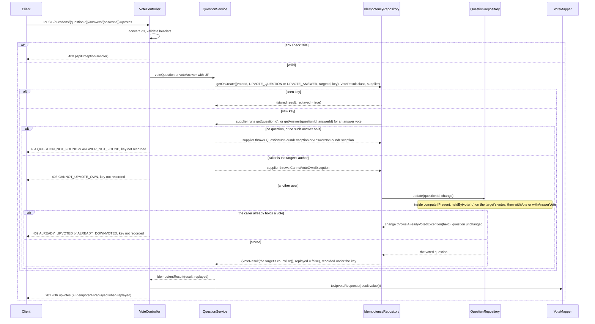
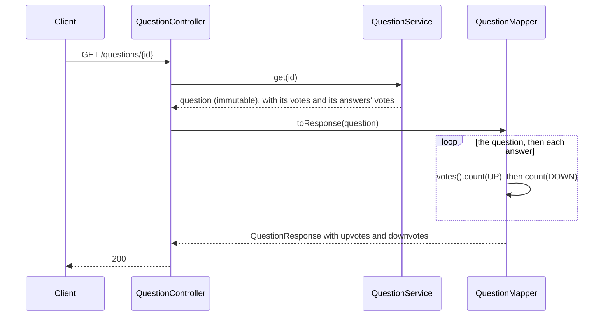
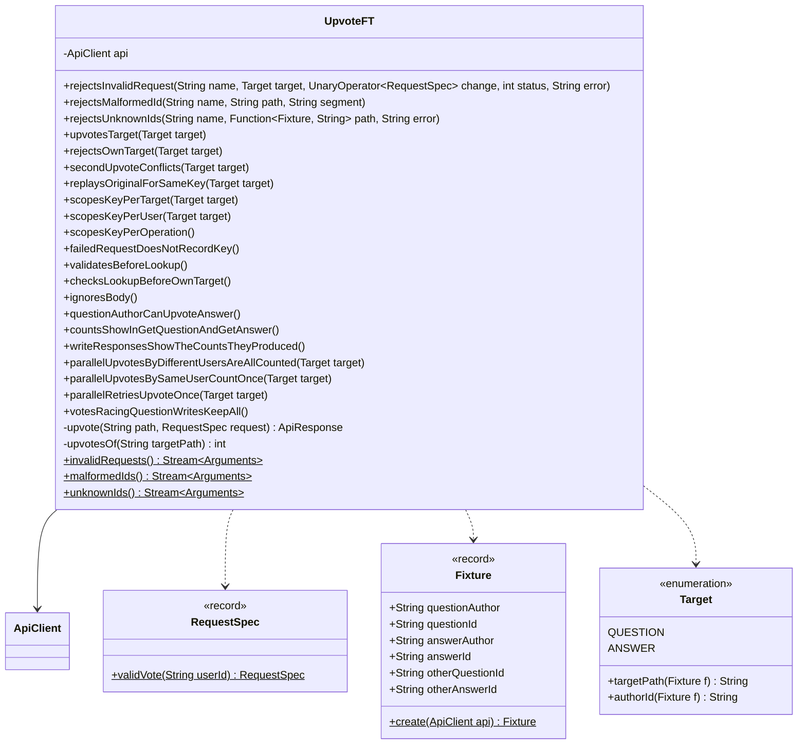

# Upvote API

Status: **Agreed** (2026-10-24), updated for Downvote.md. Votes moved into `Question` and `Answer` on 2026-10-25 (Decisions 5 and 7, Settled question 1).

A user upvotes a question or an answer. The caller comes from `X-User-Id`. A user can't upvote their own question or answer, and can upvote a given one only once. Votes live inside the question or answer they're on, and the counts appear on every question and answer response. Retrying with the same idempotency key returns the first result. Covers the README's "Upvote a question" and its "concurrency on the votes map". Builds on CreateQuestion.md, GetQuestion.md, AddAnswer.md, and GetAnswer.md. Downvote.md extends it: a user holds at most one vote, up or down, on a target, and the classes here are shared with downvotes and renamed.

## Contract

### Request

```
POST /questions/3f1c9a52-8a7e-4f0b-9d0e-2b6c1f6a7e11/upvotes
X-User-Id: user-7
Idempotency-Key: 0c6e2f4a-9b1d-4e37-8a5c-2d7f1b3e9a64

POST /questions/3f1c9a52-8a7e-4f0b-9d0e-2b6c1f6a7e11/answers/9b2e4d71-0c3a-4f5e-8b6d-1a7c2e9f4b30/upvotes
X-User-Id: user-42
Idempotency-Key: 7a3d9e15-6c2b-4f80-b4e1-5f9a0c2d8e37
```

| Field | Rules |
|---|---|
| `questionId`, `answerId` path segments | Same as GetAnswer: UUIDs, any case. |
| `X-User-Id` header | Same rules as create. The voter. Must not be the target's `authorId` (exact, case-sensitive). |
| `Idempotency-Key` header | Same rules as create. A new value per vote, the same value on a retry. |
| Body | None. A body or `Content-Type`, if sent, is ignored (Open question 5). |

In the second example, `user-42` wrote the question and upvotes `user-7`'s answer. That's allowed: the rule only blocks a vote on something the caller wrote.

### Response

```
201 Created

{ "upvotes": 5 }
```

- `UpvoteResponse`. `upvotes` is the target's count right after this vote: this vote and every vote applied before it.
- No `Location`: there's no GET for a single vote.
- A replay follows Idempotency's replay rule, plus `Idempotent-Replayed: true`.

### Counts on reads

`QuestionResponse` and `AnswerResponse` gain `upvotes`. That covers GET question (each nested answer too), GET answer, and the create, add, and PUT responses. The `...` fields are as in GetQuestion.md.

```
GET /questions/3f1c9a52-8a7e-4f0b-9d0e-2b6c1f6a7e11

200 OK

{
  "id": "3f1c9a52-8a7e-4f0b-9d0e-2b6c1f6a7e11",
  "authorId": "user-42",
  ...
  "updatedAt": null,
  "upvotes": 5,
  "downvotes": 0,
  "answers": [
    {
      "id": "9b2e4d71-0c3a-4f5e-8b6d-1a7c2e9f4b30",
      "authorId": "user-7",
      ...
      "updatedAt": null,
      "upvotes": 2,
      "downvotes": 0
    }
  ]
}
```

- `upvotes` is always present, `0` when nobody has voted. It comes right after `updatedAt`, followed by Downvote.md's `downvotes`; `QuestionResponse` ends with `answers`.
- It's the size of the target's upvoter set in the question or answer the response is built from. Replays follow Idempotency's replay rule (Open question 1).

### Errors

Body: `{ "error": "<CODE>", "message": "<detail>" }`. Check order: every 400, then the key (a replay returns the original 201), then 404 (question, then answer), then 403, then 409. There's no body, so there's no 415.

| Case | Status | `error` |
|---|---|---|
| `questionId` or `answerId` isn't a UUID | 400 | `VALIDATION_FAILED` |
| Missing `X-User-Id` or `Idempotency-Key` | 400 | `MISSING_HEADER` |
| A header breaks its rules | 400 | `VALIDATION_FAILED` |
| No question has that `questionId` | 404 | `QUESTION_NOT_FOUND` |
| The question has no answer with that `answerId`, including an answer that belongs to another question | 404 | `ANSWER_NOT_FOUND` |
| `X-User-Id` is the target's `authorId` | 403 | `CANNOT_UPVOTE_OWN` |
| The caller already upvoted the target under another key | 409 | `ALREADY_UPVOTED` |
| The caller already downvoted the target (Downvote.md) | 409 | `ALREADY_DOWNVOTED` |
| Any other method on an upvotes URL (with `Allow: POST`) | 405 | `METHOD_NOT_ALLOWED` |
| Unexpected | 500 | `INTERNAL_ERROR` |

- 400 and 404 messages: as in GetQuestion.md and GetAnswer.md.
- 403 message: `You can't upvote your own question <questionId>` or `You can't upvote your own answer <answerId>`. 403 because it's a rule about who the caller is, like `NOT_QUESTION_OWNER`: a retry can never succeed.
- 409 message: `You already upvoted question <questionId>` or `You already upvoted answer <answerId>`, or `You already downvoted ...` when the caller holds a downvote. 409 because it conflicts with stored state: the vote already exists. The code and message name the vote held.
- The order of 403 and 409 never matters in practice: an author can never hold a vote on their own target.

## Idempotency

CreateQuestion.md's "Every write" mechanism and store (its Decision 11).

| Operation | Endpoint | `targetId` | Stored value | Replay status |
|---|---|---|---|---|
| `UPVOTE_QUESTION` | `POST /questions/{questionId}/upvotes` | question id | `VoteResult` | 201 |
| `UPVOTE_ANSWER` | `POST /questions/{questionId}/answers/{answerId}/upvotes` | answer id | `VoteResult` | 201 |

- **Replay rule:** a replay returns what the write produced. Create, add, and the PUTs store the question or answer with its votes, so their replays show the counts as they were at that write. An upvote produces its count, so its replay returns the stored `VoteResult` (Open question 1).
- **Stored key:** `(voterId, UPVOTE_QUESTION, questionId, key)` or `(voterId, UPVOTE_ANSWER, answerId, key)`. Answer ids are globally unique, so the answer key holds no question id, as for `UPDATE_ANSWER`. A used key retried under a wrong `questionId` therefore replays instead of giving a 404. Only that voter can hold the entry, and the body is only their count.
- **Same key:** 201 with the stored `VoteResult` and `Idempotent-Replayed: true`. A client retrying a timed-out vote never gets a 409 for its own vote.
- **New key after a vote:** 409 `ALREADY_UPVOTED`, or `ALREADY_DOWNVOTED` after a downvote (Downvote.md).
- **Failures** (400, 404, 403, 409) record nothing. A 409 under key K2 is still a 409 when retried with K2.
- **Separate entries:** the same key on another target, or used for another operation (this question's `ADD_ANSWER` or `DOWNVOTE_QUESTION`, say), never replays this vote.
- **Why a key when the voter sets already dedupe:** without one, a retried vote gets a 409, and the client can't tell its own vote from an earlier one. Also, every write takes a key.
- Keys live as long as the app does: one entry per successful vote.

## Design

### External and internal models

| External (`web` and `model`, JSON) | Internal |
|---|---|
| `{questionId}`, `{answerId}` path segments | `UUID` |
| `X-User-Id` | Voter id, a `String`, with no model |
| `X-User-Id` + target id + `Idempotency-Key` | `IdempotencyKey` (`UPVOTE_QUESTION` or `UPVOTE_ANSWER`) |
| The upvotes endpoints | `domain.Vote.UP` (Downvote.md) |
| `UpvoteResponse` | `domain.VoteResult` |
| `QuestionResponse.upvotes`, `AnswerResponse.upvotes` | `votes().count(UP)` on the `Question` or `Answer`: the size of its `upvoterIds` |

- No request DTO: there's no body.
- `VoteResult(int count)` (`UpvoteResult` until Downvote.md) lives in `domain`, next to `IdempotentResult`. It's the idempotency store's value and the service's result. `VoteMapper.toUpvoteResponse(VoteResult)` maps `count` to `UpvoteResponse.upvotes`.
- `Question` and `Answer` stay the only internal models. Each holds a `domain.Votes`: its voters, one set per direction (see Classes). The counts map straight from it:
  - `toResponse(Question question)` has `@Mapping(target = "upvotes", expression = "java(question.votes().count(Vote.UP))")`, and `downvotes` the same with `Vote.DOWN` (`@Mapper(imports = Vote.class)`). MapStruct maps each nested answer with `toResponse(Answer answer)` (`expression = "java(answer.votes().count(Vote.UP))"`), so each gets its own counts.
  - `unmappedTargetPolicy = ERROR` fails the build if `upvotes` has no mapping.
  - `expression`, not `@AfterMapping`: the responses are records, so there's no setter for an after-mapping method to call.
  - `toQuestion` and `toAnswer` ignore `votes`: it's server-owned, and the compact constructors turn `null` into `Votes.NONE`.
  - `QuestionController` and `AnswerController` need only `QuestionService` and `QuestionMapper`. `web` and `mapper` still never touch `repository`.
- Not chosen:
  - A separate vote store, read at mapping time through a `@Context VoteCounts` (the design until 2026-10-25). It was a second store whose data means nothing apart from its question, and counts were read apart from the snapshot they were shown with.
  - A `Question`-plus-counts view model from the services: a second internal model, needing a map of answer counts.

### Classes



```mermaid
classDiagram
    direction TB

    namespace web {
        class VoteController {
            -QuestionService service
            -VoteMapper mapper
            +upvoteQuestion(UUID questionId, String voterId, String idempotencyKey) ResponseEntity~UpvoteResponse~
            +upvoteAnswer(UUID questionId, UUID answerId, String voterId, String idempotencyKey) ResponseEntity~UpvoteResponse~
        }
    }

    namespace mapper {
        class QuestionMapper {
            <<interface, MapStruct>>
            +toResponse(Question question) QuestionResponse
            +toResponse(Answer answer) AnswerResponse
        }
        class VoteMapper {
            <<interface, MapStruct>>
            +toUpvoteResponse(VoteResult result) UpvoteResponse
        }
    }

    namespace handler {
        class ApiExceptionHandler {
            +handleCannotVoteOwn(CannotVoteOwnException e) ResponseEntity~ErrorResponse~
            +handleAlreadyVoted(AlreadyVotedException e) ResponseEntity~ErrorResponse~
        }
    }

    namespace model {
        class UpvoteResponse {
            <<record>>
            +int upvotes
        }
        class QuestionResponse {
            <<record>>
            +int upvotes
        }
        class AnswerResponse {
            <<record>>
            +int upvotes
        }
    }

    namespace service {
        class QuestionService {
            +voteQuestion(UUID questionId, String voterId, String idempotencyKey, Vote vote) IdempotentResult~VoteResult~
            +voteAnswer(UUID questionId, UUID answerId, String voterId, String idempotencyKey, Vote vote) IdempotentResult~VoteResult~
        }
    }

    namespace exception {
        class CannotVoteOwnException {
            <<exception>>
            -Vote vote
            -UUID targetId
            -CannotVoteOwnException(String message, Vote vote, UUID targetId)
            +question(Vote vote, UUID questionId)$ CannotVoteOwnException
            +answer(Vote vote, UUID answerId)$ CannotVoteOwnException
            +vote() Vote
            +targetId() UUID
        }
        class AlreadyVotedException {
            <<exception>>
            -Vote held
            -UUID targetId
            -AlreadyVotedException(String message, Vote held, UUID targetId)
            +question(Vote held, UUID questionId)$ AlreadyVotedException
            +answer(Vote held, UUID answerId)$ AlreadyVotedException
            +held() Vote
            +targetId() UUID
        }
    }

    namespace domain {
        class Question {
            <<record>>
            +Votes votes
            +withVote(String voterId, Vote vote) Question
            +withAnswerVote(UUID answerId, String voterId, Vote vote) Question
        }
        class Answer {
            <<record>>
            +Votes votes
            +withVote(String voterId, Vote vote) Answer
        }
        class Votes {
            <<record>>
            +Set~String~ upvoterIds
            +Set~String~ downvoterIds
            +Votes NONE$
            +heldBy(String voterId) Optional~Vote~
            +count(Vote vote) int
            +with(String voterId, Vote vote) Votes
        }
        class VoteResult {
            <<record>>
            +int count
        }
        class Vote {
            <<enumeration>>
            UP
            DOWN
        }
        class Operation {
            <<enumeration>>
            UPVOTE_QUESTION
            UPVOTE_ANSWER
        }
    }

    VoteController --> QuestionService
    VoteController --> VoteMapper
    QuestionMapper ..> Votes : count
    VoteMapper ..> VoteResult
    VoteMapper ..> UpvoteResponse
    QuestionResponse o-- AnswerResponse
    ApiExceptionHandler ..> CannotVoteOwnException
    ApiExceptionHandler ..> AlreadyVotedException
    QuestionService --> QuestionRepository : update
    QuestionService --> IdempotencyRepository
    QuestionService ..> IdempotentResult
    QuestionService ..> VoteResult
    QuestionService ..> QuestionNotFoundException : throws
    QuestionService ..> AnswerNotFoundException : throws
    QuestionService ..> CannotVoteOwnException : throws
    QuestionService ..> AlreadyVotedException : throws
    Question *-- Answer
    Question *-- Votes
    Answer *-- Votes
    Votes ..> Vote
    Vote --> Operation
```

- Only new or changed classes and members are shown, under Downvote.md's names; it adds the downvote members. `Votes` already holds both directions. Classes that appear only in arrows are reused unchanged. `Operation` keeps its four values and adds two. See the other docs for the rest.
- **`VoteController`** (`UpvoteController` until Downvote.md) mirrors `AnswerController`: `@RestController`, `@RequestMapping("/questions/{questionId}")`.
  - `upvoteQuestion` is `@PostMapping("/upvotes")` and `upvoteAnswer` is `@PostMapping("/answers/{answerId}/upvotes")`. Both take the ids as `@PathVariable UUID`, plus `X-User-Id` and `Idempotency-Key` with create's constraints, using `ApiConstants`' header constants. No `consumes`, no `@RequestBody`.
  - Both call `QuestionService` with `Vote.UP` and return `ResponseEntity.status(CREATED)` with `mapper.toUpvoteResponse(result.value())`, plus `Idempotent-Replayed: true` when `result.replayed()`.
- **`QuestionService.voteQuestion` and `voteAnswer`** (in `VoteService` until 2026-10-25) never read the `Clock`: votes carry no time. Each returns `idempotency.getOrCreate(new IdempotencyKey(...), VoteResult.class, supplier)`. For an upvote, `vote` is `UP`:

  | Step | `voteQuestion(questionId, voterId, key, UP)` | `voteAnswer(questionId, answerId, voterId, key, UP)` |
  |---|---|---|
  | Key | `(voterId, UPVOTE_QUESTION, questionId, key)`, from `vote.questionOperation()` | `(voterId, UPVOTE_ANSWER, answerId, key)`, from `vote.answerOperation()` |
  | Supplier 1: find | `get(questionId)`, which throws `QuestionNotFoundException` | `getAnswer(questionId, answerId)`, which throws `QuestionNotFoundException`, or `AnswerNotFoundException(questionId, answerId)` when the answer isn't on that question |
  | 2: self-vote | If the question's `authorId` equals `voterId`, `throw CannotVoteOwnException.question(UP, questionId)` | If the answer's `authorId` equals `voterId`, `throw CannotVoteOwnException.answer(UP, answerId)` |
  | 3: vote | `questions.update(questionId, q -> ...)`: if `q.votes().heldBy(voterId)` holds a vote, `throw AlreadyVotedException.question(held, questionId)`, else `q.withVote(voterId, UP)`. Empty throws `QuestionNotFoundException` | The same on `q.answer(answerId)`'s votes, with `.answer` and `q.withAnswerVote(answerId, voterId, UP)` |
  | 4: count | `new VoteResult(voted.votes().count(UP))`, from the question `update` returned | The voted answer's `votes().count(UP)`. A missing answer throws `AnswerNotFoundException` (defensive) |

  - Finding through `get` and `getAnswer` keeps one owner per lookup rule. Every vote goes through `QuestionRepository.update`, like answer adds and edits.
- **`Votes`** is a `domain` record of `Set<String> upvoterIds` and `Set<String> downvoterIds`. `Question` and `Answer` each hold one, and turn `null` into `Votes.NONE`.
  - The compact constructor copies both sets with `Set.copyOf`, and throws `IllegalArgumentException` if a voter is in both. So the never-both rule (Downvote.md) holds whoever builds it.
  - `heldBy(voterId)` gives `UP`, `DOWN`, or empty, matching exactly. `count(vote)` is that set's size.
  - `with(voterId, vote)` returns a copy with the voter added. It throws `IllegalStateException` if the voter already holds a vote: callers check `heldBy` first and turn that into a 409.
  - `Question.withVote` and `Answer.withVote` replace `votes` with `votes.with(...)`. `Question.withAnswerVote` replaces that answer in place, or returns `this` when there's none. No `updatedAt` moves: a vote isn't an edit.
  - Not chosen: the two sets as fields on both records. The never-both check and `heldBy` would be written twice.
- **Exceptions:** `CannotVoteOwnException` and `AlreadyVotedException` (`CannotUpvoteOwnException` and `AlreadyUpvotedException` until Downvote.md) are, like `AnswerAlreadyExistsException`, `final`, unchecked, in `exception`, and carry no HTTP status.
  - Each has a private constructor `(String message, Vote vote, UUID targetId)`, two static factories, `question(Vote, UUID questionId)` and `answer(Vote, UUID answerId)`, that build the Errors messages, and two accessors: `vote()` (the vote tried) or `held()` (the vote held), and `targetId()`.
  - Not chosen: per-target subclasses under a sealed parent (the `NotOwnerException` pattern). The error code depends on the vote, not the target, so the handler's switch would give both subclasses the same code, and `ApiExceptionHandler` reads only the vote and `getMessage()`.
  - Not chosen: joining the sealed `NotOwnerException`. That means "the caller isn't the author", and a self-vote is the reverse.
  - Not chosen: a sealed `ConflictException` over both 409s. It changes `AnswerAlreadyExistsException` for one more case.
- **`ApiExceptionHandler`:** `handleCannotVoteOwn` gives 403 `CANNOT_UPVOTE_OWN` for `e.vote()` `UP`, and `handleAlreadyVoted` gives 409 `ALREADY_UPVOTED` or `ALREADY_DOWNVOTED` by `e.held()`, each with `e.getMessage()`. The bad-id 400 and both 404s are reused as they are.

### Flow



Reads, for example GET question:



### Concurrency

- **Once per user, atomically.** The `heldBy` check and `withVote` run inside `QuestionRepository.update`, which is `computeIfPresent` on the question's bin. So exactly one call per target and voter stores its vote, up or down, and the rest get the held vote back and a 409.
  - Not chosen: checking `heldBy` on the `get` snapshot, then updating. Two racing votes would both pass the check.
- **One lock per question.** Votes on a question and its answers queue on that question's bin with answer adds and edits and question edits. Each change is built from the latest copy, so none is lost. Different questions don't block each other.
- **Cost:** each vote copies the question, its answers list, and the target's voter set: O(answers + voters) per vote. That's fine at this app's scale.
- **Count is a set size**, read from the question this vote produced. It includes this vote and every vote applied before it, and no later one. It's derived from the voters, so it can't drift from them.
  - Not chosen: an `int` count beside the sets. It copies what the sets already say.
- **Votes inside `Question`** (changed 2026-10-25, user). Not chosen: a separate vote store, the first design. Votes on one target ran in parallel without copying the question, but it was a second store whose data means nothing apart from its question.
- **Checks outside the atomic change are safe.** No change function touches `authorId`, so the self-vote check on the `get` or `getAnswer` snapshot can't go stale. There's no delete API, so a target found once is still there in `update`, and the empty-result throws are defensive. If delete or an author change is ever added, these checks move inside the change.
- **The three races** (the supplier runs inside `getOrCreate`, as in Flow):

  | Race | Result |
  |---|---|
  | 50 users at once | 50 changes on one question's bin, one after another: 50 201s, count 50 |
  | One user, 50 keys | 50 suppliers, and one change stores: one 201 and 49 409s, count 1 |
  | One user, one key, 50 requests | One supplier runs, and the other 49 wait and replay its `VoteResult`: count 1 |

  Downvote.md adds the races across directions.

- **Lock order:** the idempotency bin is held for the whole supplier. Inside it, the vote path takes the question's bin in `QuestionRepository.update`, as answer adds and edits do. So it holds at most two bins at once. The change never calls `getOrCreate` or writes the question map itself: no cycle, no deadlock. The supplier writes only to another map, which `ConcurrentHashMap` allows, as in create's save.
- **Readers** don't lock. GET reads one immutable question, so its content and counts come from the same snapshot. A GET after a 201 sees that vote, because `update` finished first.
- **Memory:** one entry per voter in the target's set, never removed, like idempotency keys.

## Unit tests

New test classes for the new classes, plus cases in existing ones. Concurrency tests use a `CountDownLatch`, the same as create's. Downvote.md runs the service and controller cases for both `Vote`s.

| Class | Style | Covers |
|---|---|---|
| `Votes` (`VotesTest`) | Plain JUnit | `null` sets become `NONE`. The sets are immutable copies. A voter in both sets is rejected. `heldBy` gives `UP`, `DOWN`, or empty, matching exactly: `USER-7` isn't `user-7`. `count` is each set's size. `with` adds to that set only and leaves the original as it was. `with` for a voter holding either vote throws `IllegalStateException`. |
| `Question`, `Answer` | Plain JUnit | `null` votes become `NONE`. `withVote` adds the voter and keeps every other field, `updatedAt` included. `withAnswerVote` changes only the target answer, in place, and returns `this` for an unknown answer. Edits and `withAnswer` keep the votes. |
| `QuestionService`, votes (`QuestionServiceVotesTest`, was `VoteServiceTest`) | Plain JUnit, real in-memory repositories, a question with two answers saved directly (one by the question's author), parameterized over both methods where a case applies | The cases below. Counts are read back from the stored question. |
| `QuestionService`, votes, concurrency | Same, parameterized by method | 50 users at once: 50 results with `replayed` false, count 50. One user, 50 keys: one result and 49 `AlreadyVotedException`. One user, one key: one `replayed` false and 49 replays of the same instance, count 1. 16 question votes, 16 answer votes, and 16 answer adds on one question at once: all land. |
| `VoteController` (was `UpvoteController`) | `@WebMvcTest(VoteController.class)`, `@Import(VoteMapperImpl.class)`, `QuestionService` as a `@MockitoBean`, parameterized by endpoint | 201, body `{"upvotes": n}` only (`aMapWithSize(1)`), and no `Location`. `Idempotent-Replayed` only when `replayed()` is true. The service gets the path ids, `X-User-Id`, the key, and `UP`. Upper-case ids parse to the same `UUID`s. A JSON body, or `Content-Type: text/plain`, is ignored and still gives 201. |
| `VoteController`, errors | Same slice, parameterized | `ApiExceptionHandler` through this endpoint. Missing, blank, or 65-char headers give 400 naming the header, and the service is never called. A malformed `questionId` or `answerId` gives 400 `<name> must be a UUID`. From the service: both not-found exceptions give 404 with their codes, `CannotVoteOwnException.question` and `.answer` with `UP` give 403 `CANNOT_UPVOTE_OWN`, and `AlreadyVotedException.question` and `.answer` give 409 `ALREADY_UPVOTED` holding `UP`, or `ALREADY_DOWNVOTED` holding `DOWN`, each with the exact message. GET on an upvotes URL gives 405 with `Allow: POST`. |
| `QuestionMapper` | Plain JUnit, `Mappers.getMapper`, records built with `Votes` of different sizes | `toResponse(Question)` shows the question's `upvotes` and each nested answer's own count, in order. `toResponse(Answer)` shows the answer's. `toQuestion` and `toAnswer` leave `votes` as `NONE`. `VoteMapper.toUpvoteResponse(VoteResult)` copies `count` (`VoteMapperTest`). |
| `QuestionController`, `AnswerController` | Existing slices, `QuestionService` as a `@MockitoBean` | The service returns records with votes: GET question shows the question's and each answer's `upvotes`, and GET answer shows its own. Create, add, and both PUTs, replays included, show the returned record's counts. |

- **No dedicated test:** `VoteResult`, `UpvoteResponse`, and the new `Operation` values have no behavior of their own. The exceptions' factories are pinned by the `VoteController` error tests (exact messages) and the `QuestionServiceVotesTest` cases (`vote()`, `held()`, `targetId()`).
- **`IdempotencyRepositoryImpl`:** no new cases. CreateQuestion.md's cover every operation.

`QuestionServiceVotesTest` cases, with `UP` (Downvote.md runs each with `DOWN` too):

- **Applied:** another user gets `VoteResult(1)`, `replayed` false, and a second user gets 2. The stored question keeps every field but its votes. The question's author on another user's answer. One user and key on a question and one of its answers, or on two questions: both. A user's `ADD_ANSWER` key reused to upvote that question: `replayed` false. Question and answer counts are independent.
- **Replayed:** the same key again, even after another user voted: `replayed` true, the same instance, count unchanged. An answer vote's key retried under a wrong `questionId`.
- **Rejected, count unchanged:** same user, new key: `AlreadyVotedException` with `held()` `UP`, and a retry with that key throws again. The target's author, including the question's author on their own answer: `CannotVoteOwnException` with `vote()` `UP` and `targetId()` the target's id, count 0. Unknown question: `QuestionNotFoundException`. Unknown answer, or another question's answer: `AnswerNotFoundException`, and that key then applies on the right question.
- **Failure:** a `QuestionRepository` stub whose `update` throws once: the exception propagates, the question and key are unchanged, and a retry applies.

## Functional tests

### How they run

The same as CreateQuestion.md: `mvn verify` starts the app on `ft.port` (default 8081), and Failsafe runs `UpvoteFT`. It uses CreateQuestion.md's build setup unchanged.

### Classes



- Only new members are shown. `ApiClient` and `ApiResponse` are reused unchanged. `ApiClient.post` already sends an empty body when `body` is `null`.
- `RequestSpec.validVote(userId)` (`validUpvote` until Downvote.md) builds `X-User-Id: userId` and a fresh `Idempotency-Key`, with no `Content-Type` and no body.
- `Target` and `Fixture` are package-level, shared with DownvoteFT. `Fixture.create(api)` (UpvoteFT's `fixture()` until Downvote.md) creates a question by a fresh author. A second fresh user answers it, and also answers another question by a third user (`otherAnswerId`), as in GetAnswerFT.
- `Target.targetPath` is `/questions/{questionId}` or `/questions/{questionId}/answers/{answerId}`. The upvotes path is that plus `/upvotes`. `upvotesOf(targetPath)` GETs the target, asserts 200, and reads `$.upvotes`.
- Tests that take a `Target` run once per endpoint through `@EnumSource`. Test data is created only through the API, with a fresh user and key per test.

### Cases

**`rejectsInvalidRequest`**: for each target, build a fixture, then POST `change(validVote(freshUser))` to its upvotes path. Expect this status and `error`, and `upvotesOf` stays 0. `;` separates rows.

| Change | Status | `error` |
|---|---|---|
| Remove `X-User-Id`; remove `Idempotency-Key` | 400 | `MISSING_HEADER` |
| Either header `"   "`; either header 65 chars | 400 | `VALIDATION_FAILED` |

**`rejectsMalformedId`**: each `GetQuestionFT#malformedIds` row is used three times: as `questionId` on the question endpoint, and as `questionId` or `answerId` on the answer endpoint, with a random UUID for the other. Expect 400 `VALIDATION_FAILED`, `<segment> must be a UUID`.

**`rejectsUnknownIds`**: build a fixture, then POST `validVote(freshUser)` to this path. Expect 404 with this `error` and the ids in the message, and every count in the fixture stays 0.

| Path | `error` |
|---|---|
| Question endpoint, random question id | `QUESTION_NOT_FOUND` |
| Answer endpoint, random question id, the fixture's answer id | `QUESTION_NOT_FOUND` |
| Answer endpoint, the fixture's question, random answer id | `ANSWER_NOT_FOUND` |
| Answer endpoint, the fixture's question, the other question's answer id | `ANSWER_NOT_FOUND` |

**Single tests** (those marked "per target" run for both endpoints)

| Test | Expect |
|---|---|
| `upvotesTarget` (per target) | Another user: 201, body exactly `{"upvotes": 1}`, no `Location`, no replay header. A second user: `{"upvotes": 2}`. `upvotesOf` is 2. |
| `rejectsOwnTarget` (per target) | The target's author: 403 `CANNOT_UPVOTE_OWN`, and the message holds the target's id. `upvotesOf` is 0. |
| `secondUpvoteConflicts` (per target) | Same user, new key K2: 409 `ALREADY_UPVOTED`. Retrying with K2: 409 again, with no replay header. `upvotesOf` is 1. |
| `replaysOriginalForSameKey` (per target) | U votes with K (`upvotes` 1), then V votes. U retries with K: 201, `{"upvotes": 1}`, `Idempotent-Replayed: true`. `upvotesOf` is 2. |
| `scopesKeyPerTarget` (per target) | One user and one key on two questions, or on two answers: two 201s, neither a replay, each count 1. |
| `scopesKeyPerUser` (per target) | Two users, the same key, one target: two votes, count 2. |
| `scopesKeyPerOperation` | U answers question Q with key K, then upvotes Q with K: 201, `upvotes` 1, no replay header. |
| `failedRequestDoesNotRecordKey` | U upvotes the other question's answer under the fixture's question with K: 404 `ANSWER_NOT_FOUND`. Then U upvotes it under its own question with K: 201, not a replay. |
| `validatesBeforeLookup` | A random question id and a blank `X-User-Id`: 400, not 404. |
| `checksLookupBeforeOwnTarget` | The answer's author upvotes their answer under the other question: 404 `ANSWER_NOT_FOUND`, not 403. |
| `ignoresBody` | A JSON body with `Content-Type: application/json`, or `Content-Type: text/plain`: 201. |
| `questionAuthorCanUpvoteAnswer` | The question's author upvotes another user's answer on their question: 201, count 1. |
| `countsShowInGetQuestionAndGetAnswer` | A new question with answers A and B shows 0 everywhere. U1 and U2 upvote the question, and U1, U2, and U3 upvote A, so the same users vote on a question and its answer. GET question: `upvotes` 2, A's entry 3, B's 0. GET answer A: 3. |
| `writeResponsesShowTheCountsTheyProduced` | Create Q with key K1 and add answer A with key K2, then 2 users vote on each. Create replay with K1: the original body, `upvotes` 0. PUT Q: 2, and its answer's 2. Add replay with K2: the original body, 0. PUT A: 2. This pins the replay rule for writes (Open question 1); `replaysOriginalForSameKey` pins a vote's. |
| `parallelUpvotesByDifferentUsersAreAllCounted` (per target) | 50 users in parallel: all 201, every `upvotes` between 1 and 50, and `upvotesOf` is 50. |
| `parallelUpvotesBySameUserCountOnce` (per target) | One user, 50 keys, in parallel: exactly one 201 and 49 409 `ALREADY_UPVOTED`. `upvotesOf` is 1. |
| `parallelRetriesUpvoteOnce` (per target) | One user, one key, 50 parallel requests: all 201 with `upvotes` 1, one without the replay header and 49 replays. `upvotesOf` is 1. |
| `votesRacingQuestionWritesKeepAll` | In parallel, 25 users upvote Q, 25 others answer Q, and the author sends 10 PUTs (content `edit-i`). Every vote and add gets 201 and every PUT 200. GET question: `upvotes` 25, 25 answers, and the content is one of the edits. |

## Changes to the existing design

No existing doc is edited here. This design needs:

| Where | Change | Effect on existing endpoints |
|---|---|---|
| `domain.Operation` | Add `UPVOTE_QUESTION` and `UPVOTE_ANSWER`. | None. |
| `QuestionResponse` | Add `int upvotes` after `updatedAt`, before `answers`. | Create (201 and replay), GET, and PUT question bodies gain `upvotes`. |
| `AnswerResponse` | Add `int upvotes` as the last field. | Add (201 and replay), GET, and PUT answer bodies, and each entry of GET question's `answers`, gain `upvotes`. |
| `QuestionMapper` | `toResponse(Question)` becomes `toResponse(Question, @Context VoteCounts votes)`, and `toResponse(Answer)` becomes `toResponse(Answer, @Context VoteCounts votes)`, each with an `upvotes` `expression`. The one-argument versions go. Add `toResponse(UpvoteResult)`. | Only the new field. |
| `mapper.VoteCounts` | New functional interface: `int of(UUID targetId)`. | None. |
| `QuestionController`, `AnswerController` | The constructor also takes `UpvoteService` and keeps `votes = upvotes::count`. Every `toResponse` call passes `votes`. | Only the new field. |
| `ApiExceptionHandler` | Add `handleCannotUpvoteOwn` (403 `CANNOT_UPVOTE_OWN`) and `handleAlreadyUpvoted` (409 `ALREADY_UPVOTED`) for the two new exceptions. | None. |
| Replays of create, add, and both PUTs (CreateQuestion.md, AddAnswer.md, UpdateQuestion.md, UpdateAnswer.md) | "Returns the original body" becomes "the stored snapshot, except `upvotes`, which is live" (Idempotency's replay rule, Open question 1). | A replay body differs from the first response only in `upvotes`, and only if votes landed in between. |
| CreateQuestion.md, "Every write" table and the `Operation` class | Add the two rows from Idempotency above, and the two enum values. | Doc only. |
| Response examples in CreateQuestion.md, GetQuestion.md, AddAnswer.md, GetAnswer.md, UpdateQuestion.md, UpdateAnswer.md | Add `"upvotes": 0` to each question and answer body. | Doc only. |
| GetQuestion.md and GetAnswer.md "reused unchanged" notes | `toResponse` now takes `votes`. GET also reads the votes map, without a lock. | Doc only. |
| `QuestionMapperTest` | Pass a `VoteCounts` (`id -> 0`). `new AnswerResponse(...)` gains the `upvotes` argument. | Test only. |
| `QuestionControllerTest`, `AnswerControllerTest`, `ApiExceptionHandlerTest` | Add `@MockitoBean UpvoteService`, or the slice can't build the controller. `AnswerControllerTest`'s `aMapWithSize(5)` becomes 6. | Test only. |
| `CreateQuestionFT.createsQuestion`, `AddAnswerFT.addsAnswer` | Also expect `upvotes` 0. | Test only. |
| FT helpers | Add `RequestSpec.validUpvote(userId)`. | None. |

- The whole-body comparisons in `GetQuestionFT`, `GetAnswerFT`, `UpdateQuestionFT`, and `UpdateAnswerFT` keep passing: nothing votes in those tests, so both sides show 0.
- `IdempotencyRepositoryImpl`, `QuestionRepository`, `Question`, and `Answer` don't change.
- This table is as agreed for upvotes. Downvote.md later renamed several of these classes and helpers (see its Changes to the existing design).

## Decisions

Agreed on 2026-10-24 (user).

1. A user upvotes a question or an answer at most once, and never their own (requirements).
2. `POST /questions/{questionId}/upvotes` and `POST /questions/{questionId}/answers/{answerId}/upvotes`, with no body. 201 with `{ "upvotes": n }` and no `Location`.
3. 403 `CANNOT_UPVOTE_OWN` and 409 `ALREADY_UPVOTED`, or 409 `ALREADY_DOWNVOTED` when the caller holds a downvote (Downvote.md). Check order: 400, then the key, then 404, then 403, then 409.
4. A question's author can upvote other users' answers on their question.
5. Votes live inside the question or answer they're on: a `Votes` record with a set of voter ids per direction (Downvote.md). A vote is a `QuestionRepository.update`, with the once-per-user check inside it. The count is the size of `upvoterIds` (changed 2026-10-25, user).
6. Idempotency uses the shared store with `UPVOTE_QUESTION` (target: the question id) and `UPVOTE_ANSWER` (target: the answer id). The stored value is a `VoteResult` snapshot (`UpvoteResult` until Downvote.md).
7. `QuestionResponse` and `AnswerResponse` carry `upvotes`, mapped from the record's `votes().count(Vote.UP)` (changed 2026-10-25, user).
8. Create's Decisions 2, 3, 4, 6, 7, 10, and 11 and GetQuestion's Decision 3 apply unchanged.

## Settled questions

Agreed on 2026-10-24: every question took its draft default. The numbering is kept, so "Open question N" elsewhere in this doc means item N here.

1. **`upvotes` on write responses and their replays.** Create, add, and PUT bodies show the counts of the question or answer they produced. Their replays return that stored body, counts included, and an upvote's replay returns its stored count. This is the agreed rule "a replay responds with whatever we did earlier" (changed 2026-10-25, user: until then, these replays read the counts live).
2. **Removing an upvote** (`DELETE .../upvotes`). Draft: out of scope, so it gets 405 for now. It would remove the voter from `upvoterIds` inside `QuestionRepository.update` (Downvote.md Settled question 1), and the count stays derived. It needs its own `Operation`.
3. **Downvotes.** Out of scope here, and designed in Downvote.md: counted apart from upvotes, with no score, and a user holds one vote, up or down, per target.
4. **Listing voters** (`GET .../upvotes`). Draft: out of scope, so it gets 405 for now. The voter sets already hold the data. A list would need paging and an order, and a set has no order.
5. **Request body.** Draft: ignored. There's no `consumes`, so no 415. Alternative: reject any body with a 400.
6. **Sorting answers by upvotes in GET question.** Draft: no, they stay oldest first (GetQuestion Decision 5, AddAnswer Decision 3).
