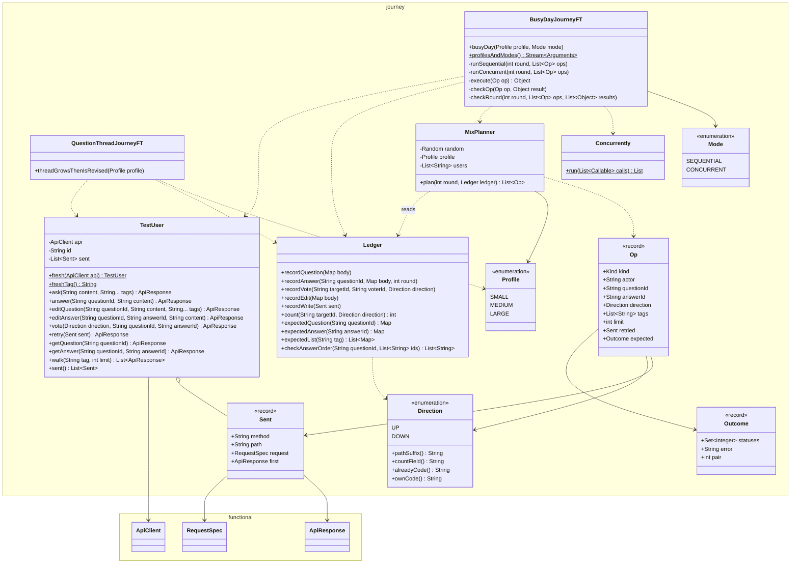
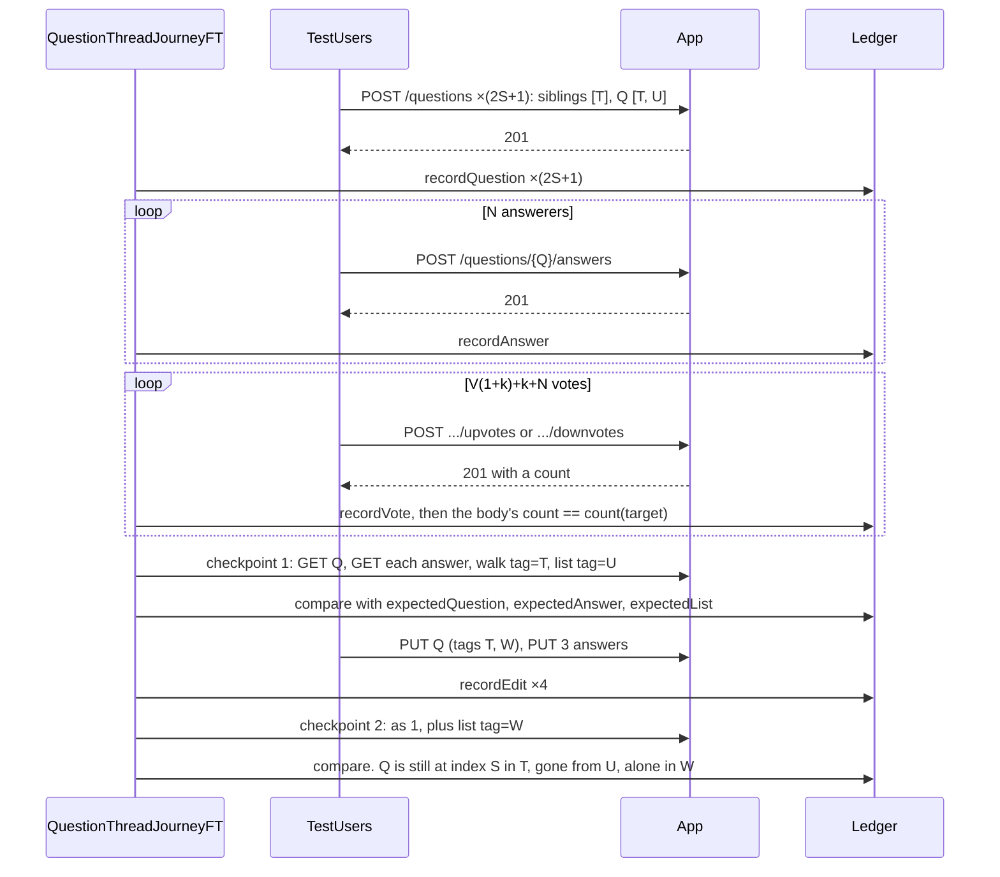
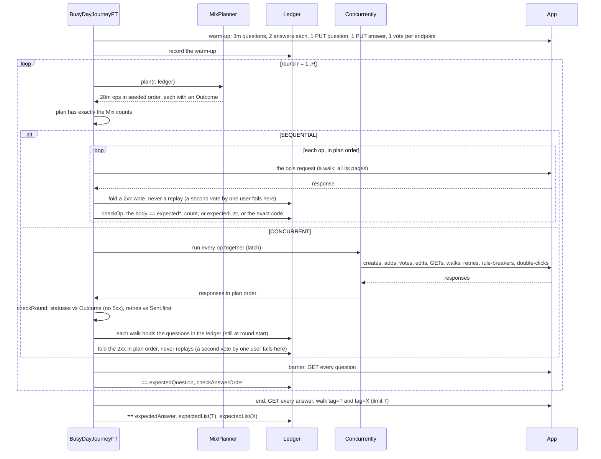

# User Journeys (functional tests, phase 2)

Status: **Agreed** (2026-10-25). See Decisions and Settled questions.

Phase 1 gave each API its own FT class. This phase adds two journey FTs that act out user stories across the APIs. A story is a combination of APIs in some order, and any API may be called several times. The busy day draws a new combination and order from a seed on every run. A journey checks only what no per-API FT can: one API's effect seen through another, retries of every write type after later writes of other types, and invariants that must hold when every API is used at once. The tests are black-box over HTTP against the app that `mvn verify` starts. No main code changes.

## Scope

| In | Out |
|---|---|
| Two journey FT classes in `functional.journey`, each with `@Tag("journey")` | Load and performance: no latency or throughput assertions (Open question 3) |
| Helpers: `TestUser`, `Ledger` (the expected model), `MixPlanner`, `Profile`, `Direction`, `Concurrently` | What the per-API FTs own: validation, 415, boundaries, normalization, single-API 404/403/409, idempotency, and races |
| No unit tests: the journeys exercise the helpers (Open question 9) | Stories that need a new API: delete, accept an answer, unvote or switch a vote, sort by votes, reputation |
| `@Tag("api")` on the 9 per-API FT classes, Failsafe's `groups`, README commands | Trimming the per-API classes (Open question 2) |
| | Restarts and several app instances (data is in memory, and there's one app) |

## Journeys

### Summary

Call counts are SMALL / MEDIUM / LARGE (see Profiles). "Vote" covers all four vote endpoints.

| Journey | User story | Actors | APIs × calls | Proves |
|---|---|---|---|---|
| `QuestionThreadJourneyFT`<br>`.threadGrowsThenIsRevised(Profile)` | A question is asked, answered, and voted on by many users. Then its author revises and retags it. | Asker, 2S sibling askers, N answerers, V voters | Create 5 / 9 / 17, add 3 / 12 / 40, vote 20 / 216 / 746, PUT question 1, PUT answer 3, GET question 2, GET answer 6 / 24 / 80, list pages 9 / 9 / 11 | Vote bodies, GET question, GET answer, and the list agree exactly on every target, at three scales. A retag moves the question between tag lists without moving its place in the order. |
| `BusyDayJourneyFT`<br>`.busyDay(Profile, Mode)` | Many users use every API for a day, in a combination and order the seed picks, while flaky clients retry earlier writes. `SEQUENTIAL` sends one call at a time. `CONCURRENT` sends each round at once. | A pool of 12 / 24 / 48 users, in one mode per invocation | Per round, × m (1 / 2 / 4): create 1, add 3, vote 10, edit 1, GET 6, list walk 2, retry 2 (cycling through the 8 write operations), rule-breaker 2, double-click 1 (2 requests). 4 / 8 / 15 rounds. With walk pages, the warm-up, and barrier GETs, ≈ 180 / 790 / 4,100 requests per mode. | **`SEQUENTIAL`:** every response is exact against a model built from the 2xx responses, op by op, in an order that changes every run. **`CONCURRENT`:** no 5xx, every status matches the plan, and the model holds exactly at every round barrier. **Both:** retries of every write type, after later writes of other types, return their original snapshot. |

### Question thread

Setup: fresh tags T, U, and W, fresh users, and one `Ledger`. S, N, V, k, and L come from the Profile.

| # | Step | Calls | Expect |
|---|---|---|---|
| 1 | S sibling askers create questions tagged `[T]`. The asker creates Q `[T, U]`. S more siblings create `[T]`. | Create ×(2S+1) | 201, recorded in the ledger |
| 2 | N answerers answer Q, one at a time | Add ×N | 201 |
| 3 | Voter i votes on Q and on answers i to i+k-1 (mod N). The asker votes on answers 0 to k-1. Answerer i votes on answer i+1 (mod N). A fixed pattern makes about 1 vote in 4 a downvote. | Vote ×(V(1+k)+k+N) | 201. Each body's count equals the ledger's count after that vote is recorded. Calls are sequential, so this is exact. |
| 4 | Checkpoint 1 | GET Q, GET each answer, walk `tag=T` with `limit` L, list `tag=U` | GET Q equals `expectedQuestion(Q)`. Each GET answer equals its entry in GET Q and `expectedAnswer`. The walk equals `expectedList(T)`, with Q at index S. `tag=U` is exactly Q's summary. |
| 5 | The asker edits Q: new content, tags `[T, W]`. Answerers 0 to 2 edit their answers. | PUT question 1, PUT answer 3 | 200. The PUT Q body equals `expectedQuestion(Q)`: the new content and tags, and all N answers with their counts. Each PUT answer body keeps its counts. |
| 6 | Checkpoint 2 | As step 4, plus list `tag=W` | As step 4, with the edits applied. Every count and `answerCount` is as at checkpoint 1. `createdAt` is unchanged. `updatedAt` is the PUT's, and the answer edits didn't move it. Q is still at index S in `tag=T`. `tag=U` is `{"items": [], "nextCursor": null}`. `tag=W` is exactly Q's summary. |

### Busy day

| # | Step | Expect |
|---|---|---|
| 0 | Seed `s` comes from `-Djourney.seed`, or else `System.nanoTime()`, and is printed. Fresh tags T and X, and P fresh users. Warm-up, one call at a time: 3m users each create a question tagged `[T]`, and 2 others answer each one. Then one PUT question, one PUT answer, and one vote on each of the 4 endpoints, so every retry kind and every rule-breaker has a candidate from round 1. | 2xx, recorded |
| 1 to R | `MixPlanner.plan(r, ledger)` returns 28m ops in a seeded order, each with its expected `Outcome`, and the FT asserts the plan has exactly the Mix counts per kind. The round then runs by mode (the next two rows). Then GET every question of the day and compare it with `expectedQuestion` and `checkAnswerOrder`. | See Invariants |
| `SEQUENTIAL` round | The ops run one at a time, in plan order. Each response is checked exactly right after its op (Per-op checks), and a 2xx write is folded into the ledger before the next op. | Exact per op |
| `CONCURRENT` round | `Concurrently` releases every op together through a latch. When all have returned, the in-round checks run against the ledger, which still reflects round start. The 2xx responses are then folded in plan order. | Per round |
| End | GET every answer. Walk `tag=T` and `tag=X`, each with `limit` 7. | Exact (see Invariants) |

Replays are never folded, in either mode.

#### Mix (per round, × m)

The ratio is about 1 create : 3 answers : 10 votes : 6 reads : 2 list walks, plus edits, retries, and invalid requests. Counts per kind are exact every round. The seed picks the actors, targets, directions, and order.

| Op | Count | Picked from the ledger at round start | Expected `Outcome` |
|---|---|---|---|
| Create question `[T]` | 1 | Any user | 201 |
| Add answer | 3 | A question and a user with no answer on it. Each pair is used once per round. | 201 |
| Vote | 10 | A target (question 1 : answer 2), and a user who isn't its author and holds no vote on it. UP 2 : DOWN 1. Each (user, target) pair is used once per round. | 201 |
| Edit (question or answer, 1 : 1) | 1 | A target not edited this round, by its author, with new content. A question keeps T and gains or drops X (seeded), so retags join the mix. | 200 |
| GET question or GET answer, 1 : 1 | 6 | Any | 200 |
| List walk, `tag=T` or `tag=X` (1 : 1), `limit` 1 to 10 | 2 | None | 200 on every page |
| Retry | 2 | The next of the 8 write operations in a fixed cycle (create, add, PUT question, PUT answer, ↑Q, ↓Q, ↑A, ↓A), and a write of that kind accepted in the warm-up or an earlier round. It's sent again with its `Sent` request and key. | The original status and `Location`, plus `Idempotent-Replayed: true`. Every body is byte-equal to `Sent.first`, counts included (changed 2026-10-25: other bodies were compared apart from their counts). |
| Rule-breaker, in turn: self-vote, repeat vote, second answer, non-owner edit | 2 | Built so it fails whatever else runs this round | 403 `CANNOT_UPVOTE_OWN` or `CANNOT_DOWNVOTE_OWN`. 409 `ALREADY_UPVOTED` or `ALREADY_DOWNVOTED`, naming the vote held. 409 `ANSWER_ALREADY_EXISTS`. 403 `NOT_QUESTION_OWNER` or `NOT_ANSWER_OWNER`. |
| Double-click: one user sends two conflicting writes under two keys (an up and a down vote on one target, or two answers to one question) | 1 (2 requests) | A (user, target) pair not used before | Exactly one 2xx. The other is the 409 that names the winner. |
| **Total** | **28** (29 requests) | | |

- Rule-breakers and double-clicks are why the invariants are worth checking. Without them, the plan never sends a conflicting write, and "one vote per user" would hold trivially. The plan-count check stops a planner bug from quietly leaving them out.
- **Retries.** SMALL has 2 × 4 = 8 retries, so every profile retries each write operation at least once (MEDIUM 4 times, LARGE 15). Each retried write has had later writes of other types since. So a create retry still shows `answers` `[]`, and a PUT-question retry shows the answers as of that PUT (Open question 6). The ledger never folds replays, so a retry that applied its write a second time would show up at the barrier.
- The profiles are sized so every kind always has a candidate. If one doesn't, the planner throws, and the error carries the seed.

#### Per-op checks (`SEQUENTIAL`)

Each check runs right after its op, against the ledger with that op folded in.

| Op | Check |
|---|---|
| Create, add | 2xx. The body equals `expectedQuestion` or `expectedAnswer`: zero counts, and no answers. |
| Vote | 201. The body's count equals `count(target, direction)`. |
| Edit | 200. The body equals `expectedQuestion` or `expectedAnswer`. The counts and nested answers come from the ledger. |
| GET question, GET answer | Equals `expectedQuestion` or `expectedAnswer`, with answers in exact order |
| List walk | The pages joined equal `expectedList(tag)`, and every page but the last is full |
| Rule-breaker | Its exact code, as in `CONCURRENT`. Later checks show it changed nothing. |
| Double-click | The first of the pair in plan order gets the 2xx. The second gets the 409 that names it. |
| Retry | As in `CONCURRENT`: status, `Location`, replay header, and body against `Sent.first` |

**Why `SEQUENTIAL` is the combinations test.** The seed changes the order every run. So votes, edits, answers, retags, retries, and reads hit the same questions in different orders, and each response is checked exactly. A failure reproduces from its seed. `CONCURRENT` runs the same plan for the same seed. So a seed that fails only in `CONCURRENT` points at a race.

#### Invariants

| Invariant | `SEQUENTIAL` | `CONCURRENT` |
|---|---|---|
| The plan has exactly the Mix counts per kind | Every round | Every round |
| No 5xx. Every status and error code is its op's `Outcome`, with exactly one 2xx per double-click. | Every op (the first of a pair wins) | Every round |
| Each retry has the original status and `Location`, plus `Idempotent-Replayed: true`. Every body is byte-equal to `Sent.first`, counts included. | Every retry | Every retry |
| Write and GET bodies equal the ledger | Every op | Not checked during a round |
| List walks. `SEQUENTIAL`: equal to `expectedList(tag)`. `CONCURRENT`: newest first and no duplicates. A `tag=T` walk holds every question in the ledger at round start. A `tag=X` walk holds every question that held X at round start and wasn't edited this round. | Every walk | Every walk |
| A user never holds two votes on one target. `Ledger.recordVote` fails on a second accepted vote for the same (user, target), and the count checks show the server agrees. | Every fold | Every fold |
| `upvotes` and `downvotes` on every question and nested answer equal the ledger's accepted votes. `answers` equals its accepted answers: earlier rounds first, and any order within a round under `CONCURRENT` (apply order, AddAnswer.md). | Every barrier, and at the end | Every barrier, and at the end |
| Each GET answer equals its entry in GET question and `expectedAnswer` | End | End |
| The walks of `tag=T` and `tag=X` equal `expectedList`: `createdAt` descending, then id descending, with every summary field | End | End |

Reproducing a failure:

- Every assertion carries `seed=…, profile=…, mode=…, round=…, op=…`. Rerun with `mvn verify -Dft.groups=journey -Dit.test=BusyDayJourneyFT -Djourney.seed=<s>`, which runs both modes.
- The planner picks by position in the ledger's insertion order, never by id value. Both modes fold in plan order. The planner uses only facts that don't depend on race winners: who has voted on what, who has answered where, and who wrote what. So a seed replays the same plan, in either mode. Only server ids and `CONCURRENT`'s double-click winners can differ.

### Profiles

A profile sets how many times each API is called within a story. The busy day's seed and mode vary the combination and order. The thread takes a `Profile` (`@EnumSource`). The busy day takes `Profile` × `Mode` (`@MethodSource`), so it has 6 invocations.

| Profile | Question thread: N answers, V voters, k answer votes per voter, S siblings each side, list `limit` L | Busy day: m, rounds R, users P, warm-up questions × answers |
|---|---|---|
| `SMALL` | 3, 5, 2, 2, 2 | 1, 4, 12, 3 × 2 |
| `MEDIUM` | 12, 40, 4, 4, 3 | 2, 8, 24, 6 × 2 |
| `LARGE` | 40, 100, 6, 8, 5 | 4, 15, 48, 12 × 2 |

## Overlap with per-API FTs

| Journey | Nearest per-API cases | What the journey adds |
|---|---|---|
| Question thread | `GetAnswerFT.matchesEntryInQuestion` (no votes). `UpvoteFT` and `DownvoteFT.countsShowInGetQuestionAndGetAnswer` (2 answers, at most 4 users). `ListQuestionsFT.itemsCarryLiveCounts` (2 questions). `UpvoteFT.writeResponsesShowTheCountsTheyProduced` (one answer, one edit). `ListQuestionsFT.changesBetweenPagesDoNotShiftPages` (the edit keeps the tag). | A tag-changing edit seen through the list: the question leaves U, joins W, and keeps its place in T. All views agree exactly on every target after many users vote both ways on many answers. The same story at three sizes. |
| Busy day | **Races:** every `parallel*` case, `UpvoteFT.votesRacingQuestionWritesKeepAll`, `AddAnswerFT.questionEditsRacingAnswersKeepBoth`, `UpdateAnswerFT.answerEditsRacingAnswerAddsKeepAll`, and `ListQuestionsFT.parallelCreatesWhilePaging`. Each races on one question or one tag, with at most 3 operation types. **Replays:** `replaysOriginalForSameKey` in the 6 write classes, `UpdateQuestionFT.createReplayAfterUpdateReturnsOriginal`, `UpdateAnswerFT.addReplayAfterEditReturnsOriginal`, and both `retriedOldPutDoesNotRevert`. Each retries one write after at most one later write on the same resource. | All 11 endpoints at once, across many questions and users, with rule-breakers, double-clicks, and retries mixed in. Every write operation is retried after many later writes of other types, including the nested answers of create and PUT-question replays. `SEQUENTIAL` checks every response exactly, op by op, in a new order each run. `CONCURRENT` checks the model exactly at every barrier. |

Considered and dropped as redundant:

| Idea | Why |
|---|---|
| Ask, answer, read | `GetQuestionFT.returnsCreatedQuestion`, `AddAnswerFT.addsAnswer`, `GetAnswerFT.matchesEntryInQuestion`, and `ListQuestionsFT.listsNewestFirst` cover it. What's left is the thread's checkpoint. |
| Popular question, on its own | Merged into the question thread, scaled by Profile |
| Author edits after feedback | Votes and answers surviving edits: `UpvoteFT.writeResponsesShowTheCountsTheyProduced` and `votesRacingQuestionWritesKeepAll`, `AddAnswerFT.questionEditsRacingAnswersKeepBoth`, `UpdateAnswerFT.keepsOtherAnswersAndQuestion`, `ListQuestionsFT.itemsCarryLiveCounts` and `changesBetweenPagesDoNotShiftPages`. Only the retag is new, so it's the thread's step 5. |
| Retry later: a scripted session whose every write is retried after later writes, with a fresh or a reused key per user | Most of it re-proves `replaysOriginalForSameKey` (6 classes), `createReplayAfterUpdateReturnsOriginal`, `addReplayAfterEditReturnsOriginal`, both `retriedOldPutDoesNotRevert`, and the `scopesKeyPerOperation` pairs. Its new part, replaying every write type after later writes of other types, is the busy day's retry cycle. |
| Rules hold under pressure | Each rule and its "nothing changed" check is a per-API case, both sequential and parallel: `rejectsOwnTarget`, `second*Conflicts`, `*After*Conflicts`, `parallelUpAndDownvotesBySameUserKeepOne`, `nonAuthorIsForbidden`, `rejectsNonOwner`, `secondAnswerConflicts`, `parallelAnswersBySameUserCreateOne`. They live on as the busy day's rule-breakers and double-clicks. |
| Browsing while others post | `ListQuestionsFT.changesBetweenPagesDoNotShiftPages` and `parallelCreatesWhilePaging` cover it. The busy day's walks add concurrent votes, answers, and edits. |
| Immediate retries (every write sent twice) | Every write's `replaysOriginalForSameKey` and `parallelRetries*` cover it. Only "retry later, after other writes" remains, as the busy day's retries. |
| Mid-round bounds: every body seen during a round lies between the model before and after it | It was the most complex part of the ledger, for little gain. A lost or extra update shows up exactly at the barrier, and the per-API parallel cases already check response bodies under races. `SEQUENTIAL` now checks every body exactly instead. |

## Design

### Classes



- **Package** `com.practice.qabank.functional.journey`. `ApiClient`, `ApiResponse`, and `RequestSpec` are public and reused unchanged. `Fixture` and `Target` aren't needed. `Sent` is nested in `TestUser`, `Op`, `Outcome`, and `Kind` in `MixPlanner`, and `Mode` in `BusyDayJourneyFT`.
- **The two modes** share the plan, `execute`, the fold, and the barrier and end checks. They differ only in how a round runs and is checked: `runSequential` with `checkOp` after each op, or `runConcurrent` with `checkRound` after the round. The per-op checks use the existing `count`, `expectedQuestion`, `expectedAnswer`, and `expectedList`, so they need no new `Ledger` or `MixPlanner` methods. `Op.tags` holds an edit's new tags, or a walk's tag, and `Op.limit` a walk's page size.
- **`TestUser`** is a thin wrapper: one fresh `user-<uuid>` id, one shared `ApiClient`, and builders on top of `RequestSpec` (`new RequestSpec(headers, body)`, `withHeader`). Every write gets a fresh key and is appended to `sent`. `retry(sent)` resends that exact request. `freshTag()` is `ft-` plus 24 hex chars, as in ListQuestionsFT. `walk` follows `nextCursor` and returns the raw pages. It stops on `null`, a non-200, or a repeated cursor.
- **`Ledger`** is the expected model. It's built only from 2xx bodies (`response.json("$")` maps), never from what the test meant to send, and never from replays. It holds the questions and answers in insertion order, each answer's round, the latest body per target, and the accepted writes a retry can pick (`recordWrite`: no replays, and no double-clicks, whose winner differs between modes). Votes are stored as target → (voter → `Direction`). `recordVote` throws on a second vote by one voter on one target. The `expected*` methods merge the latest bodies with the ledger's counts and answers. `checkAnswerOrder` returns violation strings.
- **`MixPlanner`** turns the Mix table into ops with `Random(seed)`. It applies the exact counts per round, picks by position from the ledger at round start, and attaches the expected `Outcome`. Retries take the next operation in the cycle. A double-click is two `Op`s that share `Outcome.pair`.
- **`Concurrently.run`** is the per-API classes' latch runner, made generic: 10 s for every thread to be ready, then 60 s per result. No assertion runs inside a worker thread. Ops return responses, and every check runs after the round.

### Flow: question thread



### Flow: busy day



## Determinism on a shared app

All FT classes share one app, and with it the data of earlier runs.

| Risk | Handling |
|---|---|
| Other tests' and earlier runs' questions | Each journey lists only its own fresh tags. Exact list assertions run only under those tags. Nothing asserts on the untagged list or on global state. |
| User or key collisions | `TestUser.fresh` gives `user-<uuid>`, and every write gets a fresh key. A retry reuses only its own write's key. |
| Answer order under concurrency | Answers are kept in apply order, and `createdAt` can be out of order (AddAnswer.md). `CONCURRENT` compares answers as sets per round, with earlier rounds first. `SEQUENTIAL` and the thread compare the exact order. |
| `createdAt` ties | The expected list order comes from the create responses: `createdAt` descending, then `UUID` descending, compared as UUIDs, not strings (as ListQuestionsFT does). |
| Counts during a busy round | `SEQUENTIAL`: exact after every op. `CONCURRENT`: not asserted during a round, and exact at every barrier and at the end, when nothing is in flight. |
| Random choices | `Random(seed)`, logged, and part of every assertion message. The plan doesn't depend on race winners or ids, so both modes plan the same day for one seed. |
| Hangs | `ApiClient` allows 30 s per request. `Concurrently` waits 10 s for readiness and 60 s per result. `@Timeout` per invocation: 60 s for the thread, 120 s for each busy-day invocation. |
| Wall clock | No sleeps, and no time assertions apart from `updatedAt` equal to the PUT's own response |
| Concurrency load | `CONCURRENT` only: at most 29m = 116 requests in flight (LARGE), under Tomcat's 200 worker threads |
| Class order | Failsafe runs one class at a time, but nothing relies on that. Isolation comes from tags and ids. |

## Build and tags

`pom.xml` change, the only build change:

```xml
<properties>
    ...
    <!-- JUnit tag expression for the FTs only: api, journey, or empty for every FT. -->
    <ft.groups></ft.groups>
</properties>
...
<plugin>
    <groupId>org.apache.maven.plugins</groupId>
    <artifactId>maven-failsafe-plugin</artifactId>
    ...
    <configuration>
        <includes>
            <include>**/*FT.java</include>
        </includes>
        <groups>${ft.groups}</groups>
        <systemPropertyVariables>...</systemPropertyVariables>
    </configuration>
</plugin>
```

| Command | Runs |
|---|---|
| `mvn verify` | Unit tests, then every FT (api and journey) |
| `mvn verify -Dft.groups=api` | Unit tests and the per-API FTs: the quick green gate |
| `mvn verify -Dft.groups=journey` | Unit tests and the journeys |
| `mvn verify -Dft.groups=journey -Dit.test=BusyDayJourneyFT -Djourney.seed=<s>` | One journey class, with a fixed seed |
| `mvn test` | Unit tests only. No app. |

- **Not `-Dgroups`,** as first agreed. Surefire and Failsafe (3.5.6) both read the `groups` user property, and JUnit drops untagged tests under a tag filter. So `mvn verify -Dgroups=api` runs none of the 525 unit tests and still passes.
- Checked on a scratch project with this pom's versions (Spring Boot 3.5.16 parent, Surefire and Failsafe 3.5.6, JUnit 5.12.2). An empty `ft.groups` runs every FT, untagged ones included. `api` runs only `@Tag("api")` classes. Unit tests run every time. `-Djourney.seed` and `-Dit.test` reach the Failsafe JVM with no pom change.
- **Runtime.** Measured at HEAD `39be387`: `mvn verify` takes 29 s wall time, with 525 unit tests and 383 FT cases in about 6 s. The journeys send about 11,400 requests: about 1,200 in the thread, and about 5,100 in each busy-day mode, four-fifths of that in LARGE.
- **Sequential cost, measured** on a scratch copy of HEAD holding about 4,000 questions. A LARGE-like sequential day of 4,099 requests over one keep-alive connection took 0.8 s (0.2 ms per request, Python client). The JDK client, JsonPath, and the exact per-op checks will cost a few times that, so allow about 3 s for `SEQUENTIAL` LARGE. The budget stays at 15 s for all journeys, so `mvn verify` stays under about 45 s. If it runs over, see Open question 7.

## Unit tests

None. The user asked for no single-function tests, so the helpers get no unit tests of their own. The journeys exercise them.

- **Most helper bugs fail loudly.** A wrong `Ledger` expectation or a bad plan shows up as a mismatch or an unexpected status, with the seed in the message. The busy day's plan-count check stops a planner bug from quietly sending no conflicts. The pick-by-position design (a seed reproduces a plan) is kept, but not unit-tested.
- **The one quiet risk** is `Ledger.recordVote` failing to reject a second vote by one voter on one target. A server that double-counted that voter would then match the ledger. Open question 9 covers it.

## Changes to existing code and docs

No existing file is edited by this doc. Applying it needs:

| Where | Change | Effect |
|---|---|---|
| `pom.xml` | The `ft.groups` property (empty), and `<groups>${ft.groups}</groups>` in Failsafe's configuration | `mvn verify` is unchanged |
| The 9 per-API FT classes: `CreateQuestionFT`, `GetQuestionFT`, `ListQuestionsFT`, `UpdateQuestionFT`, `AddAnswerFT`, `GetAnswerFT`, `UpdateAnswerFT`, `UpvoteFT`, `DownvoteFT` | `@Tag("api")` on the class, plus its import. Nothing else. | None |
| New `src/test/java/.../functional/journey/` | The 2 journey FTs and 6 helper files | 2 test methods, 9 invocations per run: the thread's 3 profiles, plus the busy day's 3 profiles × 2 modes |
| `README.md`, Commands | Add the `-Dft.groups=api`, `-Dft.groups=journey`, and seed-rerun lines, and "not `-Dgroups`" | Doc only |
| CreateQuestion.md, "How they run" | One line: FT classes carry `@Tag("api")` or `@Tag("journey")`, and `-Dft.groups` picks one (UserJourneys.md) | Doc only |
| Main code, `curl.sh`, other design docs | None | None |

## Decisions

Made by the user before this doc, and kept:

1. Phase 1's per-API classes keep the contract rows. Journeys cover cross-API happy paths, retries, multi-user rules, and concurrency, with one self-contained test method per journey. A parameterized method counts as one.
2. A `TestUser` helper.
3. `@Tag("api")` on the per-API classes and `@Tag("journey")` on journeys. Plain `mvn verify` runs everything, and a tag filter gives the quick api gate (through `ft.groups`, see Build and tags).
4. Black-box over HTTP: no Spring context, no main-code classes, and no main-code changes. No journey needs a new API.
5. No unnecessary tests and no single-function tests. Every journey stitches several APIs. No journey or step only re-proves a per-API FT. The test helpers get no unit tests of their own (Open question 9).
6. Naming as everywhere else: `authorId` for authors, and `X-User-Id` for the caller. Every write takes `X-User-Id` and `Idempotency-Key`.

## Settled questions

Agreed on 2026-10-25 (user): question 1 as decided below, and every other question took its draft default. The numbering is kept, so "Open question N" elsewhere in this doc means item N here.

1. **"Different frequencies."** Decided (user, 2026-10-25): frequency means stories made of different combinations and orders of APIs, in which any API may be called several times. It isn't load (question 3). The thread is one fixed combination at three sizes. The busy day draws a new combination and order from its seed every run, and its `SEQUENTIAL` mode checks each one exactly, op by op.
2. **Trim the per-API classes?** Draft: no. Add journeys only, and trim later in a separate step if wanted. Alternative: also drop the two cases the thread's checkpoints subsume, `GetAnswerFT.matchesEntryInQuestion` and `ListQuestionsFT.itemsCarryLiveCounts`.
3. **Load and performance.** Draft: out of scope, with no latency or throughput assertions, which would be flaky on a laptop. Alternative: a later k6 or Gatling step against `mvn spring-boot:run`, with rate profiles.
4. **Group filter.** Draft: `-Dft.groups` (read only by Failsafe), with `api` as the gate. Alternative: gate on `-Dft.groups='!journey'`, which also runs an FT class someone forgot to tag. Or keep `-Dgroups` and tag every unit test class `@Tag("unit")`.
5. **Shared helpers.** Draft: the journeys get their own `Concurrently`, `TestUser.walk`, and `freshTag`, and the per-API classes keep their private copies. Every per-API class has its own latch code, and ListQuestionsFT has `walk` and `uniqueTag`. Alternative: move them to `functional` and switch the 9 classes over.
6. **Nested answers in replays.** Draft: pin them. The busy day's byte-equal check expects a create retry to show `answers` as stored at the create (`[]`), and a PUT-question retry to show the answers as of that PUT. That's what CreateQuestion.md's replay rule implies, though no doc says it for nested answers. Alternative: compare only the replayed resource's own fields, if the user sees this as an accident of storage.
7. **Profiles in the default run.** Draft: all three run in every `mvn verify`, which adds a few seconds. Alternative: `SMALL` by default, with `MEDIUM` and `LARGE` behind `-Djourney.profiles=…`.
8. **Seed.** Draft: random per run, printed, part of every assertion message, and fixed with `-Djourney.seed`. Alternative: a fixed default seed, so every run plans the same day, at the cost of less coverage over time.
9. **Unit tests for `Ledger`.** Draft: none, per "no single-function tests". Alternative: a slim `LedgerTest` of about five cases (counts, the one-vote invariant, the `expectedQuestion` merge, `expectedList` order and retag membership, `checkAnswerOrder`), run by `mvn test` with no app. It would guard the one quiet risk in Unit tests.
