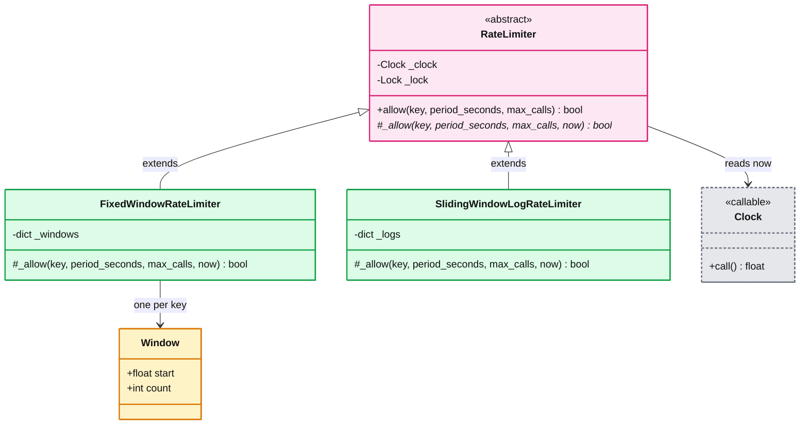
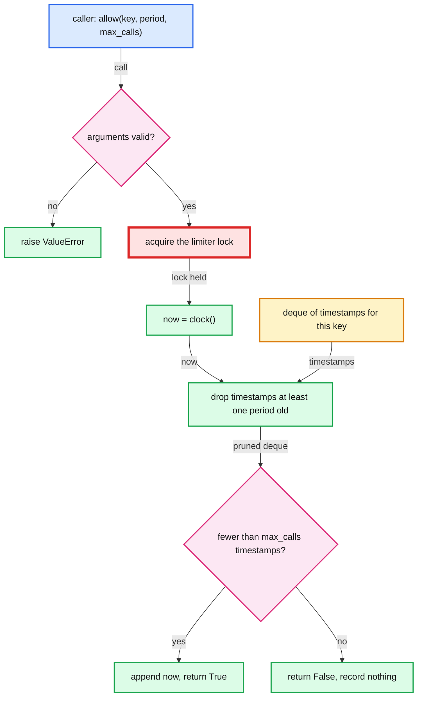

# LLD: Rate Limiter

> One-line answer: `allow(key, period_seconds, max_calls) -> bool` on a `RateLimiter` base class, with two swappable algorithms (Strategy), one lock per limiter, and an injected clock so tests never sleep.

```bash
cd lld-practise
python3 -m unittest rate_limiter.tests.test_rate_limiter -v      # 19 tests, stdlib only
```

```python
from rate_limiter import SlidingWindowLogRateLimiter

limiter = SlidingWindowLogRateLimiter()
limiter.allow("user-42", period_seconds=60, max_calls=100)   # True until the 101st call in 60s
```

## 1. Requirements and scope

- **In scope:** per key limit, limit passed on every call, thread safe inside one process.
- **Out of scope (refused to build):** limiting across many servers, evicting idle keys, returning a `Retry-After` value.
- **Clarifying questions I would ask:**
  - Does a denied call count against the limit? (Chose no. Otherwise a client that keeps retrying is never let back in.)
  - Is "the current time period" a fixed window or any rolling span of `period_seconds`? (Built both.)
  - One process, or many app servers sharing the limit? (One. Section 7 has the distributed seam.)
  - Is the limit stable per key? (Assumed yes. State is keyed by `key` only.)

## 2. Core entities



## 3. Patterns used

| Pattern | Where | Why |
|---|---|---|
| Strategy | `FixedWindowRateLimiter`, `SlidingWindowLogRateLimiter` | Swap the algorithm without touching callers. |
| Template Method | `allow()` calls abstract `_allow()` | Validation, locking and the clock read are written once. A new strategy cannot forget the lock. |
| Dependency injection | `clock` argument | Tests move time by hand. Production uses `time.monotonic`, which never jumps backwards on an NTP (Network Time Protocol) correction. |

## 4. How one call is decided (sliding window log)



## 5. The two algorithms on the same timeline

Limit: 3 calls per 10 seconds.

| Time | Calls | Fixed window | Sliding window log |
|---|---|---|---|
| t=0 | 1 | allow (window 0 to 10 opens) | allow |
| t=9 | 2 | allow, allow (window full) | allow, allow |
| t=10 | 3 | allow, allow, allow (new window) | allow, deny, deny (only the t=0 call aged out) |

Fixed window let **5 calls through in 1 second**. That boundary burst is the follow-up every interviewer asks.

Memory per key, measured with `tracemalloc` on 100k keys:

| Strategy | Per key | 1M keys |
|---|---|---|
| Fixed window | ~110 B | ~110 MB |
| Sliding log, `max_calls=100` | ~820 B deque + ~35 B per timestamp = ~4.3 KB | ~4.3 GB |

## 6. Concurrency

- **Shared mutable state:** the per-key dict (`_windows` or `_logs`).
- **Locking:** one `threading.Lock` per limiter around the whole read, check, write. Without it, two threads both see `count == 2` and both pass a limit of 3.
- **Clock read inside the lock:** so timestamps enter each deque in order, which is what lets `popleft()` prune from the left.
- **Red node, the global lock:** every key waits on one lock. Fine for one process. Under heavy multi-key load, use lock striping: 64 locks, pick one by `hash(key) % 64`.
- **Tests:** `LockingContractTest` proves `_allow` bodies never overlap. With the lock removed it fails 50 out of 50 runs. The 20-thread end-to-end test alone caught that mutant 0 times in 400 runs, because the GIL (Global Interpreter Lock) rarely switches threads inside such a short critical section.

## 7. Extensibility seams

- **"Make it work across 50 app servers"** -> move state to Redis. Fixed window: `INCR key:window` + `EXPIRE`. Sliding log: a sorted set with `ZREMRANGEBYSCORE`, `ZCARD`, `ZADD` inside one Lua script so the check and the write stay atomic.
- **"Memory is too high"** -> sliding window counter: two fixed-window counts, weighted by how far into the current window we are. O(1) per key, approximate.
- **"Allow short bursts but cap the average"** -> token bucket. It takes a rate and a burst size, not a period and a count, so it is a new strategy, not a parameter.
- **"Keys never go away"** -> sweep keys whose newest entry is older than one period, or use Redis TTL (time to live).
- **"Tell the client when to retry"** -> return `Decision(allowed, retry_after_seconds)`. For the log, retry_after is `log[0] + period - now`.

## 8. Trade-offs

| Option | Memory per key | Accuracy | Choice |
|---|---|---|---|
| Fixed window | O(1), ~110 B | Up to 2x `max_calls` across a boundary | Built. Simplest, matches "current time period" literally. |
| Sliding window log | O(max_calls), ~35 B per call | Exact | Built. Default when `max_calls` is small (under ~1k). |
| Sliding window counter | O(1) | Approximate, assumes even traffic in the previous window | Not built. The answer when the log's memory is too high. |
| Token bucket | O(1) | Exact on average, allows a configured burst | Not built. Different inputs from what the question gives. |
| Global lock vs striped locks | Same | Same | Global. Simplest correct option. Stripe only if profiling shows lock wait time. |
