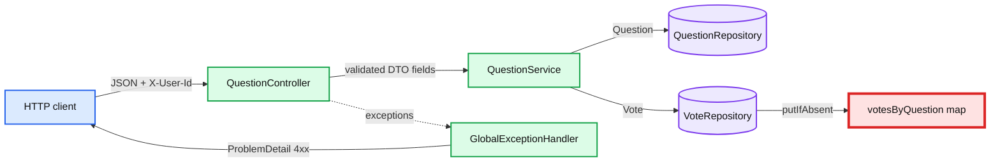
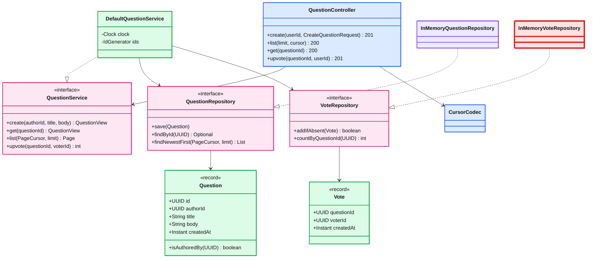
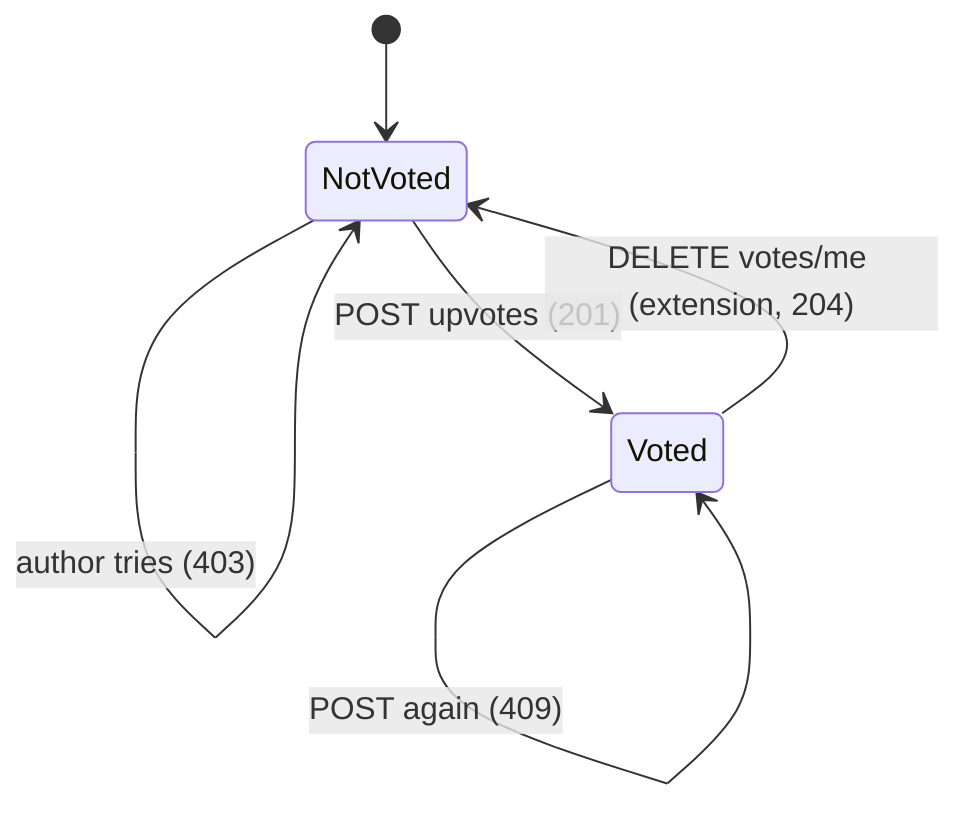

# LLD: Q&A Bank API (Rippling machine coding)

> One line: a three-layer Spring Boot API (web, service, repository) over immutable domain records,
> where the duplicate-vote rule is one atomic `ConcurrentHashMap.putIfAbsent` and the vote count is derived, never stored.

| File | What it is |
|---|---|
| [`interview-version/`](interview-version/) | What you type in 40 minutes. 202 lines of main code excluding imports, `package` lines and blanks (382 raw), 5 tests |
| [`reference-version/`](reference-version/) | Hardened version. Opaque cursor, `ProblemDetail` everywhere, auth seam, injected clock and ids, 32 tests |
| [`45-minute-plan.md`](45-minute-plan.md) | Minute-by-minute typing order and what to say |
| [`discussion-sheet.md`](discussion-sheet.md) | Spoken answers for every probe in the second 45 minutes |
| [`qa-bank.postman_collection.json`](qa-bank.postman_collection.json) | Postman collection for every endpoint and error case |
| [`original-draft/`](original-draft/) | The earlier draft from `~/Desktop/qa-backend-springboot.zip`, kept for the critique below |

Stack: Java 21, Spring Boot 3.5, Maven wrapper, JUnit 5, MockMvc, AssertJ. No Lombok, no database.

---

## 1. Requirements and scope

- **In scope:** create a question, list questions (UUID ids, newest first, paginated), get one question, upvote a question. All data in memory.
- **Rules:** one upvote per user per question. Authors cannot upvote their own question. Title 15 to 150 chars, body 1 to 30,000 chars.
- **Out of scope:** answers, downvotes, undoing votes, editing, search, real authentication, persistence. Each has a seam (see section 7).
- **Consistency model:** strong (linearizable per key) inside one process. Every read sees every completed write. Once there are N servers and a database, this becomes read-your-writes on the primary and eventual consistency on replicas and caches.
- **Clarifying questions:** see [`45-minute-plan.md`](45-minute-plan.md#clarify-first-minutes-0-to-3).

## 2. Layers and core entities



The vote map is red because it is the only shared mutable state that concurrent requests write to. Section 6 explains why it is safe.



## 3. Principles and patterns used

| Principle / pattern | Where | Why |
|---|---|---|
| Layered architecture | `web` / `service` / `repository` / `domain` / `exception` | The brief grades "clear separation of web API and business logic" |
| Repository + Dependency Inversion | Service depends on `QuestionRepository`, `VoteRepository` interfaces | Swapping in Postgres is one new class (see discussion sheet section 13) |
| DTO | `web/dto/*` records | The API shape can change without touching the domain. The domain is never serialized directly |
| Immutable value objects | `Question`, `Vote`, `PageCursor` records | Safe to share across threads with no locks |
| Single Responsibility | Controller maps HTTP, service owns rules, `GlobalExceptionHandler` maps errors, `CursorCodec` owns the cursor format | Each class has one reason to change |
| Strategy-style seams | `Clock`, `IdGenerator`, `CurrentUserArgumentResolver` | Deterministic tests. JWT swaps in by replacing one resolver |
| Constructor injection only | Every bean | Dependencies are explicit, fields are `final`, tests build objects with `new` |

## 4. Vote lifecycle



## 5. Code map

| Concern | Interview version | Reference version |
|---|---|---|
| Domain | `domain/Question.java` | `domain/Question.java`, `Vote.java`, `PageCursor.java`, `Page.java` |
| Vote store | `repository/InMemoryVoteRepository.java` (`Set.add`) | `repository/inmemory/InMemoryVoteRepository.java` (`putIfAbsent`, keeps `createdAt`) |
| Question store | `ConcurrentSkipListSet<Question>` | `ConcurrentSkipListMap<PageCursor, Question>` |
| Rules | `service/QuestionServiceImpl.java` | `service/DefaultQuestionService.java` |
| Identity | `@RequestHeader("X-User-Id")`: missing 401, non-UUID 400 | `@CurrentUser` + `CurrentUserArgumentResolver` (the JWT seam) |
| Cursor | Last question id | Opaque base64url of `(createdAt, id)`, via `CursorCodec` |
| Errors | `GlobalExceptionHandler` (5 handlers) | Same, plus field `errors` map and a safe 500 |

## 6. Concurrency

- **Shared mutable state:** two maps in the question repository and one map of maps in the vote repository. Nothing else.
- **Immutable:** `Question`, `Vote`, `PageCursor` and all DTOs are records with final fields.
- **Locking strategy:** no explicit locks. `computeIfAbsent` creates each question's inner map exactly once. `putIfAbsent` (or `Set.add`) is the duplicate check and the insert in one atomic step. `ConcurrentHashMap` (Java 8+) does this with a CAS on an empty bin or a lock on one bin, so votes on different questions never block each other.
- **Why the count can't drift:** it is `innerMap.size()`, derived from the stored votes. There is no second counter to keep in sync.
- **Listing:** `ConcurrentSkipListMap` iterators are weakly consistent, so a list request never throws `ConcurrentModificationException` while new questions arrive.
- **Proof:** `UpvoteConcurrencyTest` (100 threads, same user, exactly 1 vote. 100 users, exactly 100), stable over 20 looped runs. `NaiveVoteStoreRaceTest` and `RaceConditionDemo` show the `HashMap + ArrayList` version failing.

## 7. Extensibility seams

- **Persist to Postgres:** add `JdbcVoteRepository implements VoteRepository`. The service and the tests don't change.
- **Real auth:** replace the body of `CurrentUserArgumentResolver` with "read the `sub` of a verified JWT". Plus the Spring Security resource-server config (discussion sheet section 12).
- **Undo vote / downvote:** `DELETE` or `PUT /questions/{id}/votes/me`, plus `VoteRepository.remove` or a `value` field on `Vote`.
- **Answers:** new aggregate, its own repository. Votes gain a target type.
- **Sort by top:** a second index in the repository, keyed by `(upvotes, id)`.

---

## How to run

```bash
cd reference-version            # or interview-version
./mvnw test                     # all tests
./mvnw spring-boot:run          # starts on http://localhost:8080

# The race-condition experiment (prints a table, takes ~10 s)
./mvnw test-compile
java -cp target/classes:target/test-classes com.example.qabank.concurrency.RaceConditionDemo
```

Postman: import `qa-bank.postman_collection.json`, then run the collection top to bottom (Collection Runner). The create request stores `questionId` for the requests after it.

## curl examples (reference version, real output)

```bash
BASE=http://localhost:8080/api/v1/questions
AUTHOR=11111111-1111-1111-1111-111111111111
VOTER=22222222-2222-2222-2222-222222222222
```

**Create: 201 + Location**

```bash
curl -i -X POST $BASE -H "X-User-Id: $AUTHOR" -H 'Content-Type: application/json' \
  -d '{"title":"How do I reverse a list in Java?","body":"I tried a for loop but it feels clumsy."}'
```
```
HTTP/1.1 201
Location: http://localhost:8080/api/v1/questions/4222fd57-ab9f-4177-ace9-f055a4193e49
{"id":"4222fd57-...","authorId":"1111...","title":"How do I reverse a list in Java?","body":"...","createdAt":"2026-10-21T10:19:24.205378Z","upvotes":0}
```

**List, page 1 then page 2: 200**

```bash
curl "$BASE?limit=2"
# {"items":[{...number 2...},{...number 1...}],"nextCursor":"MjAyNi0xMC0yMVQxMDoxOToyNC4yNzA0NjJafDUxNThi..."}
curl "$BASE?limit=2&cursor=MjAyNi0xMC0yMVQxMDoxOToyNC4yNzA0NjJafDUxNThi..."
# {"items":[{"id":"4222fd57-...","title":"How do I reverse a list in Java?",...}],"nextCursor":null}
```

**Get one: 200**

```bash
curl -i $BASE/4222fd57-ab9f-4177-ace9-f055a4193e49
```

**Upvote: 201, then 409, author 403, unknown 404**

```bash
curl -i -X POST $BASE/$Q/upvotes -H "X-User-Id: $VOTER"     # 201 {"questionId":"...","upvotes":1}
curl -i -X POST $BASE/$Q/upvotes -H "X-User-Id: $VOTER"     # 409 {"title":"Already upvoted",...}
curl -i -X POST $BASE/$Q/upvotes -H "X-User-Id: $AUTHOR"    # 403 {"title":"Cannot upvote own question",...}
curl -i -X POST $BASE/00000000-0000-0000-0000-000000000000/upvotes -H "X-User-Id: $VOTER"   # 404
```

**Bad input: 400 and 401**

```bash
curl -i -X POST $BASE -H "X-User-Id: $AUTHOR" -H 'Content-Type: application/json' -d '{"title":"short","body":""}'
# 400 {"title":"Bad Request","status":400,"errors":{"body":"must not be blank","title":"size must be between 15 and 150"}}
curl -i -X POST $BASE -H 'Content-Type: application/json' -d '{"title":"A valid title for this one","body":"x"}'
# 401 {"title":"Unauthenticated","detail":"Missing X-User-Id header"}
curl -i "$BASE?limit=500"          # 400 Validation failure
curl -i "$BASE?cursor=garbage"     # 400 {"title":"Invalid cursor"}
```

---

## Critique of the original draft (`original-draft/`, from the Desktop zip)

Good parts first: it has layers, constructor injection, a `ConcurrentHashMap`, and `synchronized` on `Question.upvote`, which does make dedupe correct per question. Against the brief and the Staff bar, it would lose points here:

| # | Issue | Where | Fix in this repo |
|---|---|---|---|
| 1 | Voter and author identity come from the JSON body, so anyone can vote as anyone | `dto/VoteReq.java:3`, `dto/CreateQuestionReq.java:3` | Identity from a header (JWT later), never the body |
| 2 | Duplicate vote and self vote both return **400**. They should be 409 and 403 | `controller/QuestionController.java:49` | Typed exceptions, mapped in one advice |
| 3 | Upvote returns **200**, brief expects 201. Create has no `Location` header | `controller/QuestionController.java:46`, `:29` | `ResponseEntity.created(location)` |
| 4 | `try/catch` in every controller method. Error bodies are bare strings | `controller/QuestionController.java:27-32`, `:44-51` | `@RestControllerAdvice` + `ProblemDetail` |
| 5 | List order is random: `ConcurrentHashMap.values()` has no order, so offset pages repeat and skip | `dao/QuestionDAO.java:22-23` | Sorted skip-list index + cursor |
| 6 | `voteCount` is a plain `int` read without the lock: another thread may see a stale value | `model/Question.java:13`, `:42` | Count derived from a concurrent set |
| 7 | Domain object is mutable (non-final fields) and doubles as the API response | `model/Question.java:9-15`, `controller/QuestionController.java:29` | Immutable records + response DTOs |
| 8 | `UUID.randomUUID()` and `Instant.now()` inside the entity, so tests can't control them | `model/Question.java:18`, `:24` | Injected `Clock` and `IdGenerator` |
| 9 | Only title is validated. A null `authorId` makes `upvote` throw `NullPointerException`, which becomes a 500 | `service/QuestionService.java:21`, `model/Question.java:28` | Bean Validation on DTOs, required header |
| 10 | Business rules live inside the entity and are tied to one lock. They won't survive moving to a DB | `model/Question.java:27-36` | Rules in the service, atomicity in the repository |
| 11 | One test, no HTTP, error, or concurrency coverage | `QuestionServiceTest.java` | 32 tests across 5 classes |
| 12 | Java 17, no `spring-boot-starter-validation` | `pom.xml:20` | Java 21, validation starter |
