# LLMs from the inside out

A study text that follows a language model from text representation through its internal computation, training, adaptation, compression, and serving.

```mermaid
%% The prerequisite flow of the course. Each stage uses the representation or artifact from the previous stage.
flowchart LR
    A["Text and tensors<br/>Chapters 01 to 04"]:::client
    B["Prediction and transformers<br/>05 to 09"]:::service
    C["Data, training, evidence<br/>10 to 12"]:::service
    D["Efficiency and adaptation<br/>13 to 16"]:::service
    E["Compression and inference<br/>17 to 18"]:::cache
    F["Grounding and interpretation<br/>19 to 20"]:::store
    A -->|"ids and vectors"| B
    B -->|"trainable decoder"| C
    C -->|"evaluated checkpoint"| D
    D -->|"adapted model"| E
    E -->|"running component"| F
    classDef client fill:#dbeafe,stroke:#2563eb,stroke-width:2px,color:#111
    classDef service fill:#dcfce7,stroke:#16a34a,stroke-width:2px,color:#111
    classDef store fill:#ede9fe,stroke:#7c3aed,stroke-width:2px,color:#111
    classDef cache fill:#fef3c7,stroke:#d97706,stroke-width:2px,color:#111
    classDef decision fill:#fce7f3,stroke:#db2777,stroke-width:2px,color:#111
```

## Start here

1. Read [the contents](curriculum.md). It shows the six parts, chapters, and their numbered sections.
2. Follow [the reading guide](study-guide.md): read the chapter, work its examples, answer its exercises, and complete the associated practical.
3. Start [Chapter 01: What a language model learns](chapters/01-what-a-language-model-learns.md).

The text has **20 chapters in six parts**, with **12 practical guides** and four teaching scripts. Chapter depth is retained in this revision. The contents follow conceptual prerequisites rather than download order, and numbered sections make the internal organization visible. Each chapter builds on the preceding explanation and closes with exercises and further reading.

The running artifact is a small decoder-only language model. You first trace its numbers by hand, then inspect a complete decoder, train on a small corpus, and evaluate a saved checkpoint. Separate mechanism exercises teach low-rank updates, preference objectives, and quantization. Those toy exercises are explicitly distinguished from a production fine-tuning or alignment run.

## Chapters and practical work

| Form | Purpose | Where |
|---|---|---|
| Chapter | Connected explanation, derivation, worked examples, numbered sections, exercises, and further reading | [chapters/](chapters/) |
| Practical | Make a prediction, inspect an implementation, change one thing, explain evidence | [practicals/](practicals/) |

[The capstone](capstone.md) joins the artifacts into one reproducible small-model investigation. [The glossary](glossary.md) defines terms as they are introduced.

## Relationship to the existing ML course

This is a companion to [ml-learning](../ml-learning/README.md). Useful prerequisite bridges are its [module 5](../ml-learning/m5-under-the-hood/README.md), [module 6](../ml-learning/m6-deep-nets-on-a-mac/README.md), and [module 7](../ml-learning/m7-language-models/README.md). Their learner work and prediction gates continue to belong to that course. The chapters provide the main reading sequence, and the practicals apply those concepts. The ML course's answer files and measured results are not copied here.

## Transcript policy and coverage

All **30 Stanford transcripts** have English outputs. The main reading selection keeps **CME295 Autumn 2026**, excluding the older Autumn 2025 edition's nine files from the required sequence. That leaves **13 LLM/NLP recordings**, plus **8 CME296 diffusion/vision recordings** as an elective. The [source map](sources.md) accounts for every file and identifies the exact sections to read for each chapter.

The lecture collection has gaps. In particular, it contains only CS336 Lecture 1 and four selected CS224N lectures. Prerequisite mathematics, detailed runnable mechanisms, a complete small training loop, and quantization derivations are supplied here as authored supplements. The chapters synthesize the sources; they are not cleaned transcripts presented as a book.

## Practical environment

The scripts use Python's standard library and, for tensor/model work, an existing PyTorch installation. No package is installed by this course. See [practical setup](practicals/README.md). Datasets, checkpoints, and measurements go to a learner-chosen directory outside the repo, normally `~/llm-data/`. The default demonstrations use explicitly synthetic tiny fixtures. Real training is a separate explicit command with a supplied text file.

Training speed, GPU availability, and memory use must be measured in the learner's actual environment. Chapter length does not imply a fixed session duration.
