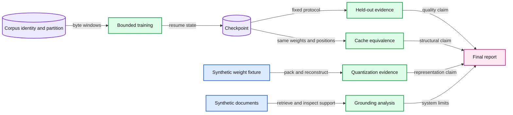

# Capstone: explain, train, compress, and inspect a small language-model system

Produce one reproducible investigation that connects representations, model computation, training, evaluation, and inference. Each important claim must point to an artifact or a calculation.

## Required artifact chain

Use the teaching byte decoder and your own work directory outside the repo. Reuse the practical outputs rather than starting an unrelated demo at the end. The BPE experiment remains a separate tokenizer investigation unless you deliberately build and train a compatible BPE model.

### Session A: representation and baseline

- Identify corpus provenance, tokenizer, data hash, split boundary, context length, and sampling protocol.
- Trace one input/target window and one token through embedding, attention, residual block, and logits.
- State a question and a bounded step/time budget before training.
- Produce a baseline checkpoint and record the initial/final evaluation protocol. Keep failed attempts.

### Session B: controlled training comparison

- Change one chosen variable or extend the saved training state through an explicit resume.
- Distinguish a resumed optimizer trajectory from a new model initialized or loaded with weights alone.
- Compare fixed held-out likelihood, scored-token count, qualitative samples, compute budget, and uncertainty.
- Explain what dataset/task claim the result supports and which broader claims remain unsupported.

### Session C: representation and inference

- Run cached/uncached logit comparison under the same weights, positions, and device.
- Reproduce the cache-payload arithmetic and identify excluded runtime allocations.
- Run packed quantization on a controlled synthetic weight fixture. Show code/scale storage and reconstruction error.
- State explicitly whether you evaluated a real quantized model or only a tensor representation. Do not turn local reconstruction evidence into an unmeasured model-quality or latency claim.

### Session D: system boundary and interpretation

- Show retrieval with present evidence, missing evidence, and untrusted document instructions.
- Define citation support, abstention behavior, and the application's tool-authorization boundary.
- Propose one internal-mechanism hypothesis, an intervention, and a matched control. A protocol is sufficient; do not claim that an unrun intervention established causality.
- Assemble the final report and defend the weakest claim in it.

These are work sessions, not fixed-duration benchmark promises. Plan wall-time budgets according to your actual device and corpus.

## Report template

1. **Question.** One sentence that names the change and intended result.
2. **Representation and data.** Tokenizer, corpus source/hash, split, windows, context, and known contamination limits.
3. **Implementation.** Decoder configuration, trainable parameters, numerical formats, and relevant omissions.
4. **Protocol.** Commands, interpreter/software/device, seeds, budgets, baselines, metric definitions, and stopping rule.
5. **Evidence.** Paired evaluation table, qualitative samples, cache check, storage ledger, and retrieval cases. Include denominators and scopes.
6. **Interpretation.** What changed, alternatives, uncertainty, failed runs, and the next discriminating experiment.
7. **Limits.** Separate arithmetic, tested implementation properties, model/task observations, and untested hypotheses.

## Assessment rubric

| Area | Evidence for a strong submission |
|---|---|
| Mechanism | Trace a token and a gradient with correct shapes and causal boundaries. |
| Experimental identity | Reconstruct tokenizer, data, model, optimizer state, device, and evaluation protocol from saved artifacts. |
| Evaluation | Use a defensible denominator/baseline and avoid treating samples or judge scores as universal quality. |
| Efficiency | Separate weights, optimizer, activations, packed metadata, and KV payload; measure only what the claim requires. |
| Systems reasoning | Diagnose a retrieval failure and enforce tool authority outside generated text. |
| Causal humility | Distinguish observational patterns from controlled interventions and limit conclusions to actual evidence. |

## Optional extensions after the core

- **A compatible pretrained model and real LoRA.** Use the existing [ML lab 40](../ml-learning/m7-language-models/labs/40-lora-vs-prompting.md) with its own prediction/answer rules, after Chapters 14, 15, and 17. Its setup and artifacts belong to that course. Alternatively, design a new adaptation protocol with an explicitly chosen model revision, license, chat template, dataset, runtime, and memory budget.
- **Real low-bit inference.** Use a supported runtime/checkpoint format, identify weight/cache/activation precision, and compare the same prompts and task set with appropriate timing synchronization.
- **BPE decoder.** Replace the fixed-byte contract deliberately, update vocabulary dimensions, and retrain. Do not reuse a byte checkpoint with incompatible ids.
- **Diffusion elective.** Study CME296 separately after the core, preserving its own objective and evaluation methods.

A complete report can explain a small system rigorously without pretending that it has created a general assistant. The deliverable is the connected understanding and its reproducible evidence.
