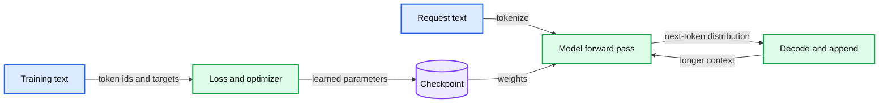

# 01. What a language model learns

A language model predicts a distribution over the next token from the preceding context.



## 1.1 A probability model of sequences

A language model assigns probabilities to possible continuations of a sequence. For a decoder language model, the basic question is: given the tokens already present, how likely is each possible next token? A token is a unit of text represented by an integer. We will construct that representation in Chapter 03. For now, treat a token as one item in a sequence.

The model does not choose an entire response in one indivisible operation. It produces a distribution for the next item, a decoding rule selects one item, and that item becomes part of the context for the next prediction. Repeating the operation produces a response. The probability chain rule connects these local predictions to a probability for the whole sequence:

```
P(t1, t2, ..., tT) = product over i of P(ti | t1, ..., t(i-1))
```

This equation is a factorization of a probability distribution. It is not evidence that a model understands a sentence in a particular human sense. The interesting engineering question is what representations and behavior emerge when a parameterized network is trained to make these predictions over a large and varied corpus.

## 1.2 Four objects that are often confused

The **tokenizer** converts text to integer ids and back. The **model weights** are learned numerical parameters. The **context** is the token sequence supplied for one request. The **decoding algorithm** turns model probabilities into a selected continuation. These four objects cooperate, but changing one is not the same as changing another.

A prompt changes the context. It ordinarily does not update the weights. Fine-tuning changes weights or added adapter parameters by optimizing on examples. A retrieval system selects external information and inserts it into the request. Its documents are not automatically incorporated into the model weights. A server may also retain a temporary cache of intermediate computations. That cache is neither the training corpus nor a durable memory of everything the model has ever seen.

A checkpoint packages parameters and enough model configuration to reconstruct the network. A usable deployment also needs the compatible tokenizer, special-token conventions, and decoding settings. A file of numbers without these conventions can be impossible to interpret correctly.

## 1.3 Training and inference are different computations

During training, a corpus supplies many examples of contexts and the token that follows them. The model predicts, a loss measures the error, and an optimizer updates the trainable parameters using gradients. The optimizer has state of its own. Training therefore requires more memory and more stored state than merely using the final model.

During inference, the usual operation reads fixed weights and calculates predictions for a supplied context. Generating a response may require many network evaluations, but these forward evaluations are not gradient updates. A reasoning-oriented model may spend additional tokens exploring an answer; that is additional inference computation, not necessarily learning from that request.

Pretraining usually exposes a model to broad text with a next-token objective. Instruction tuning trains it on desired response behavior. Preference or reward optimization further changes behavior according to chosen feedback. These stages share much of the architecture while changing the data, objective, or trainable parameters. Chapters 14 to 16 make the distinctions explicit.

## 1.4 Worked sequence: one model, two decoding choices

Consider a synthetic vocabulary containing `red`, `blue`, and an end token. Suppose a fixed model gives probabilities 0.5, 0.3, and 0.2 after a supplied context. Greedy decoding chooses the largest probability. Random sampling chooses according to the entire distribution, so repeated requests can differ while the weights stay identical.

These probabilities are invented for arithmetic, not measurements from a practical. They demonstrate why output variability does not prove that the model is updating itself. They also show why comparing two outputs without recording decoding settings is weak evidence about model quality. Chapter 09 returns to this distribution and the generation loop.

## 1.5 What we will build and what it can teach

Our running model is a small decoder with an explicit byte vocabulary. Its scale makes the tensor operations, loss, training loop, and inference cache inspectable. The architecture is complete enough to connect those concepts, but the corpus and compute budget are far below the scale needed for a broadly capable assistant.

A short experiment can establish that gradients flow, a checkpoint resumes, a held-out metric is computed correctly, or a cached forward pass agrees with its uncached counterpart. It cannot establish broad reasoning, factual reliability, or that a method will scale unchanged to a frontier training run. We will separate these claims instead of asking a tiny model to impersonate a large one.

The next chapter gives us the numerical vocabulary to follow one prediction through that model. The trade-off of starting small is limited capability; the benefit is that every mechanism remains visible.

## 1.6 Exercises

Work through [Practical 01: Text to tokens](../practicals/01-tokens-and-bpe.md) at the checkpoint specified there. These are authored exercises; their empirical outcomes are not reference lecture results.

1. Which objects change when you edit a prompt, fine-tune an adapter, or retrieve a document?
2. Why can two responses differ with identical weights?
3. Name one claim a tiny-model experiment can establish and one it cannot.

## 1.7 Further reading

Read the assigned sections of **S04, S03** in [the source map](../sources.md#chapter-reading-map).

---

[Contents](../curriculum.md) | [Next chapter](02-tensors-probability-and-gradients.md)
