# 02. Tensors, probability, and gradients

Tensor shapes describe the computation; gradients describe local changes in a scalar objective.

```mermaid
%% Shapes constrain the forward computation and gradients flow backward from one scalar objective.
flowchart LR
    X["X: T by D"]:::client -->|"multiply W: D by H"| Y["Y: T by H"]:::service
    Y -->|"compare with target"| L["Scalar loss"]:::service
    L -->|"chain rule"| G["Gradient shaped like W"]:::store
    G -->|"optimizer update"| W["New W"]:::service
    W -->|"next forward calculation"| Y
    classDef client fill:#dbeafe,stroke:#2563eb,stroke-width:2px,color:#111
    classDef service fill:#dcfce7,stroke:#16a34a,stroke-width:2px,color:#111
    classDef store fill:#ede9fe,stroke:#7c3aed,stroke-width:2px,color:#111
    classDef cache fill:#fef3c7,stroke:#d97706,stroke-width:2px,color:#111
    classDef decision fill:#fce7f3,stroke:#db2777,stroke-width:2px,color:#111
```

## 2.1 Shape is part of the meaning

A tensor is an array with named conceptual axes even when a library stores only their sizes. In this course, B means batch size, T means sequence length, D means model width, and V means vocabulary size. A token-id tensor has shape B by T. Its embedding representation has shape B by T by D. Each axis answers a different question: which example, which position, and which feature?

A reshape changes how existing entries are grouped; a transpose exchanges axes. Neither operation learns anything. Confusing these axes can produce valid code that calculates the wrong relationship. Write shapes beside the equations before relying on a library error to find the mistake.

We use row-vector convention. If X has shape T by D and W has shape D by H, then XW has shape T by H. Every row in X receives the same linear transformation. In PyTorch, `nn.Linear(D, H)` stores its weight as H by D and applies the appropriate transpose internally. Both conventions describe the same operation; mixing their written forms creates unnecessary confusion.

## 2.2 Dot products and learned transformations

A dot product multiplies matching coordinates and sums them. For synthetic vectors x = [2, -1] and w = [3, 4], the dot product is 2 times 3 plus -1 times 4, which equals 2. The result is one scalar. A matrix multiplication performs many compatible dot products at once.

Consider X = [[1, 2], [3, 4]] and W = [[1, 0], [0, -1]]. Then XW = [[1, -2], [3, -4]]. This is exact arithmetic. W changes the sign of the second feature while preserving the first. A learned matrix uses the same calculation, but training chooses its entries to reduce an objective across data.

A linear transformation alone has limited expressiveness: composing linear maps yields another linear map. Neural networks insert nonlinear functions between transformations. Later we use a smooth activation in the decoder's feed-forward sublayer. Attention also includes a nonlinear normalization of scores.

## 2.3 Probabilities and log probabilities

A categorical distribution is a set of nonnegative numbers that sum to one. Our model will produce one such distribution over V vocabulary items at each position. An unnormalized score is not yet a probability. Chapter 05 introduces softmax to convert scores into a distribution.

Multiplying many small probabilities is numerically inconvenient. Logarithms turn products into sums: log(ab) = log(a) + log(b). A negative log probability turns an unlikely observed event into a larger positive penalty. All course loss equations use natural logarithms unless stated otherwise. The unit is then nats per token, not bits per token.

For example, an observed event with probability 1/4 has negative log probability ln(4). This is a worked probability calculation. It is not an expected result from a model-training lab.

## 2.4 Gradients tell us how a scalar objective changes

A derivative measures local sensitivity. For L(w) = (wx - y)^2 / 2, the chain rule gives dL/dw = (wx - y)x. With synthetic x = 2, y = 1, and w = 0, the derivative is -2. A gradient-descent step with learning rate eta updates w to w - eta times the derivative.

The derivative is local. A step that is too large can move beyond the region where the local approximation is useful. An optimizer also needs choices about update size, state, and scheduling. Chapter 11 returns to these issues after we have a complete language-model objective.

For a vector or matrix parameter, the gradient has the same shape as that parameter. Automatic differentiation records how intermediate tensors were calculated and applies the chain rule backward from a scalar loss. It does not decide whether the target, split, or objective is appropriate. A correct derivative of the wrong objective is still the wrong experiment.

## 2.5 Numerical checks and limitations

A finite-difference check estimates a derivative using [L(w + epsilon) - L(w - epsilon)] / (2 epsilon). It is useful on tiny examples. Epsilon must balance truncation error against floating-point rounding, so progressively smaller values are not automatically more accurate. We use such checks to understand code, not to replace automatic differentiation during training.

Keep three distinctions: a tensor's shape versus its values; a parameter versus an intermediate activation; and a calculated derivative versus an empirically useful update. Chapter 03 uses integer ids rather than gradients, but those ids will soon select trainable vectors with exactly the shapes introduced here.

## 2.6 Exercises

Work through [Practical 02: Vectors, logits, and loss](../practicals/02-vectors-logits-and-loss.md) at the checkpoint specified there. These are authored exercises; their empirical outcomes are not reference lecture results.

1. If X is B by T by D and a projection maps D to V, what is the output shape?
2. What does autograd guarantee, and what can a wrong target still make it optimize?
3. Why can an extremely small finite-difference epsilon produce a worse derivative estimate?

## 2.7 Further reading

Read the assigned sections of **S01; original prerequisite bridge** in [the source map](../sources.md#chapter-reading-map).

---

[Previous chapter](01-what-a-language-model-learns.md) | [Contents](../curriculum.md) | [Next chapter](03-text-bytes-and-tokenization.md)
