# 03. Text, bytes, and tokenization

A tokenizer maps text to a vocabulary of ids. BPE learns reusable adjacent-symbol merges.

```mermaid
%% BPE learns a merge table once, then uses that table during encoding.
flowchart LR
    TXT["Text"]:::client -->|"UTF-8"| B["Bytes 0 to 255"]:::service
    B -->|"training: count pairs"| P["Frequent adjacent pair"]:::service
    P -->|"assign id and merge"| M[("Ordered merge table")]:::store
    B -->|"encoding: replay ranks"| E["Token ids"]:::service
    M -->|"merge rules"| E
    E -->|"expand ids to bytes"| D["Original valid text"]:::client
    classDef client fill:#dbeafe,stroke:#2563eb,stroke-width:2px,color:#111
    classDef service fill:#dcfce7,stroke:#16a34a,stroke-width:2px,color:#111
    classDef store fill:#ede9fe,stroke:#7c3aed,stroke-width:2px,color:#111
    classDef cache fill:#fef3c7,stroke:#d97706,stroke-width:2px,color:#111
    classDef decision fill:#fce7f3,stroke:#db2777,stroke-width:2px,color:#111
```

## 3.1 Why a model needs a vocabulary

A network consumes numbers, but ordinary text is a variable-length string. A tokenizer turns that string into a sequence drawn from a finite vocabulary. Each vocabulary item has an id. The model treats that id as an index, not as an ordinary magnitude: token 200 is not inherently twice token 100.

Characters are one possible vocabulary. Words are another. Characters make sequences long; whole-word vocabularies struggle with new words, spelling variants, and multilingual text. Subword tokenizers learn reusable pieces. The relevant trade-off is between sequence length, vocabulary size, coverage, and the distribution of text used to learn the tokenizer.

UTF-8 encodes Unicode text as bytes. A byte vocabulary has 256 possible values and can represent every UTF-8 byte sequence before any learned merge is added. A visible character may occupy several bytes, and a visible emoji may contain several Unicode code points. Consequently, character count, byte count, and token count are different quantities.

## 3.2 Byte-pair encoding as a learned compression rule

Byte-pair encoding, or BPE, begins with basic symbols and repeatedly merges frequent adjacent pairs. In a byte tokenizer, the initial symbols are bytes. The learned artifact includes a table giving each added id its byte sequence and an ordered list of merges.

A synthetic example makes the algorithm concrete. The text `abab` begins as [97, 98, 97, 98]. If the first selected pair is [97, 98], assign the new id 256 to the bytes `ab`. Replacing non-overlapping occurrences from left to right gives [256, 256]. The decoded bytes are unchanged. A later merge may combine two already learned symbols, so learning order matters.

Training needs a deterministic rule for tied pair counts. It also needs a precise counting convention. Counting adjacent occurrences and replacing non-overlapping matches are distinct operations: a pair may overlap itself in the input, while a replacement consumes its matched symbols. An implementation that leaves these details unspecified can produce different vocabularies from identical text.

## 3.3 Training a tokenizer and using it are separate stages

Tokenizer training learns the merge table from a corpus. Encoding a new string replays applicable merges according to learned rank. It does not relearn frequencies from each request. Decoding expands every id to its bytes, concatenates them, and applies UTF-8 decoding.

With a correct byte-level implementation, encoding followed by decoding should reproduce a valid input string exactly. The inverse statement is different: arbitrary model-generated token or byte sequences may not form valid UTF-8. A byte model can generate incomplete multibyte characters. Our small decoder makes this visible instead of silently assuming that every generated byte is a printable character.

A practical tokenizer often adds a pre-tokenization rule, normalization choices, and special tokens. These choices are part of the artifact. A special token such as an end-of-turn marker gets its role from the model's training convention and the application, not from magical behavior in its integer id. Handling user text that resembles a reserved marker also needs an explicit policy.

## 3.4 A vocabulary change is a model change

The vocabulary indexes both the input embedding table and the output distribution. A tokenizer with V items requires compatible model vocabulary dimensions. Even if two tokenizers have the same V, id 42 can represent different bytes. Reusing weights under that changed id mapping makes the numerical model read a different language of symbols.

Our running decoder uses a fixed 256-byte vocabulary. The BPE practical is a separate representation experiment. Its learned ids must not be fed into the byte checkpoint. To make BPE the running model's tokenizer, construct matching embedding/output dimensions and train that model with the BPE representation. We keep the byte path for continuity and inspectability, not because bytes are universally the best production choice.

## 3.5 Data hygiene starts before the model

Learn a tokenizer from training data or use an explicitly fixed pretrained tokenizer. Record which choice you made. Fitting preprocessing on a held-out evaluation corpus can expose information about that corpus before the model experiment begins. Document boundaries also matter: pair counts should not invent adjacent symbols across unrelated documents unless the representation intentionally joins them.

The tokenizer is the first durable component of the model pipeline. Save its vocabulary, merge order, normalization, special tokens, and version with the checkpoint. The next chapter turns its ids into trainable vectors, where the vocabulary size becomes an explicit memory and parameter cost.

## 3.6 Exercises

Work through [Practical 01: Text to tokens](../practicals/01-tokens-and-bpe.md) at the checkpoint specified there. These are authored exercises; their empirical outcomes are not reference lecture results.

1. Why can equal vocabulary sizes still conceal incompatible tokenizers?
2. Trace one BPE merge and explain the difference between pair counting and replacement.
3. Why does a reversible encoder not guarantee that arbitrary generated bytes are valid text?

## 3.7 Further reading

Read the assigned sections of **S03, S01** in [the source map](../sources.md#chapter-reading-map).

---

[Previous chapter](02-tensors-probability-and-gradients.md) | [Contents](../curriculum.md) | [Next chapter](04-embeddings-and-representations.md)
