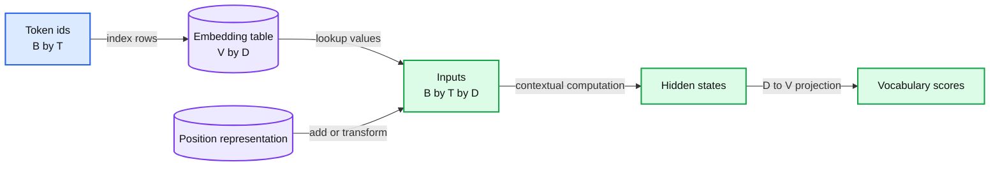

# 04. Embeddings and representations

An embedding table E[V,D] converts ids into trainable feature vectors by row lookup.



## 4.1 An id selects a trainable row

A token id is a discrete label. To supply useful numerical features to a neural network, we map each id to a D-dimensional vector. Store the vectors in an embedding table E with shape V by D. A batch of ids with shape B by T indexes that table and produces a tensor with shape B by T by D.

The lookup can also be written as one-hot multiplication. A one-hot row of length V contains one 1 at the selected id and 0 elsewhere. Multiplying it by E returns the selected row. An actual implementation uses efficient indexing rather than constructing a large one-hot tensor, but the algebra explains what the operation means.

The table is a parameter. Its values normally change during training. The integer ids do not acquire a meaningful numerical ordering merely because their rows are learned. Relabeling vocabulary ids and permuting every dependent table consistently would preserve the model's function.

## 4.2 Worked lookup and parameter cost

Take a synthetic table with four rows and three features:

```
E = [[1, 0, 0],
     [0, 1, 0],
     [1, 1, 0],
     [0, 0, 2]]
ids = [2, 0]
lookup(ids) = [[1, 1, 0], [1, 0, 0]]
```

The output has two positions and three features. If those ids are one example in a batch, its shape is 1 by 2 by 3. These are invented coordinates for a worked example; feature 0 is not inherently a semantic category.

An embedding table holds V times D parameters. With V = 8,000 and D = 128, that is 1,024,000 parameters before adding any transformer blocks. At four bytes per stored parameter, the table alone uses 4,096,000 bytes for those weights. This is arithmetic about storage, excluding gradients, optimizer state, allocator overhead, and activations.

A larger vocabulary can shorten sequences but enlarges the input table and vocabulary prediction operation. Tokenizer design therefore interacts with architecture and compute rather than remaining an isolated text-preprocessing choice.

## 4.3 Static lookup and contextual representation

The initial embedding for a token is the same row wherever that id occurs. The token `bank` does not obtain a new entry for each sentence in an ordinary vocabulary table. Later layers transform its hidden state using the surrounding context. That contextual hidden state is an activation: it is calculated for a particular input, layer, and position.

Distinguish three things: the stored row E[id], the hidden vector h at some layer, and an optional vector exported for retrieval. A decoder hidden state is not automatically a well-calibrated sentence embedding. Retrieval embeddings are trained or pooled for a particular similarity task. Similar dimensions do not make these representations interchangeable.

Vector closeness also needs a defined metric. Dot product, cosine similarity, and Euclidean distance answer related but different questions. Cosine removes the effect of magnitude. A nearest neighbor can reveal a pattern in a representation, but it does not prove that one coordinate corresponds to a clean human concept. Chapter 20 revisits that interpretation problem.

## 4.4 Position must enter somewhere

A set of token embeddings alone does not identify sequence order. The model needs a position mechanism. A simple decoder adds a learned position table P with shape maximum-context by D. Its input at position t is E[id_t] + P[t]. The sum preserves shape while allowing order to influence later computations.

There are alternatives. Fixed sinusoidal encodings create coordinates from known functions. Rotary position embeddings modify query/key comparisons rather than adding one learned position vector at the input. We wait until Chapter 07 to derive that version, because it depends on attention's dot products. Position handling is an architectural choice and constrains how a checkpoint can be used at lengths beyond those it was trained on.

## 4.5 Reading out vocabulary scores

At the end of the decoder, each hidden vector must produce V vocabulary scores. A linear output projection maps D to V. Some models tie its weight to the input embedding table: logits = h E-transpose. Tying reuses parameters, but it does not make an input vector and a probability distribution the same object. Chapter 05 still needs a normalization and a target to define the learning objective.

The lookup itself is simple. Its importance comes from the bridge it creates between discrete symbols and differentiable computation. The trade-off is that convenient geometric analogies can outrun the evidence: these vectors are optimized for an objective, and their meaning must be examined within that objective.

## 4.6 Exercises

Work through [Practical 02: Vectors, logits, and loss](../practicals/02-vectors-logits-and-loss.md) at the checkpoint specified there. These are authored exercises; their empirical outcomes are not reference lecture results.

1. What is the difference between a token embedding parameter and a contextual hidden state?
2. Calculate the parameter count for V vocabulary items of width D, including the storage format assumption.
3. Why is a hidden vector with a familiar dimension not automatically a good retrieval embedding?

## 4.7 Further reading

Read the assigned sections of **S01, S02** in [the source map](../sources.md#chapter-reading-map).

---

[Previous chapter](03-text-bytes-and-tokenization.md) | [Contents](../curriculum.md) | [Next chapter](05-next-token-prediction-and-loss.md)
