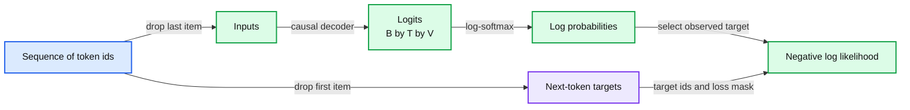

# 05. Next-token prediction and loss

Next-token learning pairs each prefix position with the following token and minimizes its negative log probability.



## 5.1 The target is one position to the right

For a synthetic sequence [7, 2, 9, 4], a training example can use input [7, 2, 9] and targets [2, 9, 4]. At the first position the model sees 7 and predicts 2. At the second it sees the prefix ending in 2 and predicts 9. At the third it predicts 4. Chapter 07 will enforce the restriction that a position cannot inspect future input positions.

A batch contains many such windows. The decoder produces logits with shape B by T by V, while target ids have shape B by T. Each supervised position selects one vocabulary item as the observed next token. Training can evaluate all positions in parallel because the correct previous tokens are supplied from the corpus. This is commonly called teacher forcing.

Generation is different: after the prompt, the model must condition on tokens selected by its own decoding process. Parallel supervised positions during training do not imply that a decoder can generate all future tokens at once.

## 5.2 From logits to a distribution

A logit is an unrestricted real-valued score. Softmax converts the V scores z into probabilities:

```
p_i = exp(z_i) / sum_j exp(z_j)
```

Adding the same constant to every logit leaves the distribution unchanged. Numerically stable code subtracts the largest logit before exponentiation, avoiding unnecessary overflow. Libraries typically combine log-softmax and loss into one stable operation. Do not first round probabilities and then take their logarithms.

For synthetic logits [ln(2), 0, 0], exponentiation gives [2, 1, 1]. The probabilities are [1/2, 1/4, 1/4]. If the observed next token is the second item, its negative log likelihood is -ln(1/4) = ln(4). This worked calculation separates logits, probabilities, and the scalar penalty.

## 5.3 Cross-entropy and its gradient

For one observed target y, the loss is L = -log(p_y). Equivalently, L = log(sum_j exp(z_j)) - z_y. The gradient with respect to logit z_i is p_i minus an indicator that i is the observed target. The target logit is encouraged relative to the others according to the model's present probabilities.

The full network receives this gradient through the output projection, decoder blocks, and embedding lookup. Automatic differentiation handles the chain rule, but the target construction determines what the gradient teaches. An off-by-one shift can train the wrong task while every tensor dimension remains legal.

Across a dataset, average the negative log likelihood over the intended supervised tokens. Padding tokens, ignored prompt labels, or masked examples must be handled deliberately. A mean of batch means is only the same as a global token mean when batch denominators match. Chapter 12 makes this detail part of evaluation.

## 5.4 Three masks with different jobs

A causal attention mask controls which input positions a hidden state can read. A padding attention mask prevents attention to positions that merely fill a batch to a uniform length. A loss mask decides which target positions contribute to the objective. They solve different problems.

A system can need all three. For example, a chat fine-tuning batch may contain padded sequences and train only on assistant responses, while causal visibility still applies at every position. Ignoring a prompt's labels does not remove that prompt from the context. Conversely, a correct causal mask cannot fix targets that were paired with the wrong input positions.

Our first byte decoder uses fixed-length windows with all next-byte positions supervised. Later exercises introduce response-only loss explicitly rather than silently changing the objective.

## 5.5 What likelihood does and does not tell us

Maximum-likelihood training rewards predicting the observed continuation. A natural-language context can have many valid continuations, even though a corpus supplies one realization. The model learns a distribution across many examples; it is not given a universal truth label for every possible answer.

Perplexity is exp(mean negative log likelihood) when using natural logs. It is a transformation of the same token-level statistic. Comparing perplexities under different tokenizers is generally misleading because the units and sequence lengths change. Even a well-defined likelihood comparison does not directly measure factual correctness, instruction following, or retrieval quality.

We now have representations and an objective. The next chapters specify the missing computation: how each position combines information from earlier positions before producing those logits. The main trade-off is that the objective is clean and scalable while the downstream behavior we care about is broader than one scalar likelihood.

## 5.6 Exercises

Work through [Practical 02: Vectors, logits, and loss](../practicals/02-vectors-logits-and-loss.md) at the checkpoint specified there. These are authored exercises; their empirical outcomes are not reference lecture results.

1. Why can training supervise many positions in parallel while ordinary autoregressive generation is sequential?
2. What is the distinct job of a causal mask, a padding mask, and a loss mask?
3. Why is averaging batch losses without checking their token counts potentially wrong?

## 5.7 Further reading

Read the assigned sections of **S05, S04** in [the source map](../sources.md#chapter-reading-map).

---

[Previous chapter](04-embeddings-and-representations.md) | [Contents](../curriculum.md) | [Next chapter](06-attention-from-first-principles.md)
