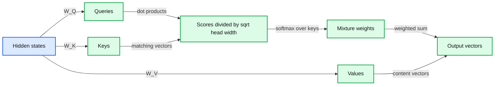

# 06. Attention from first principles

Attention mixes value vectors using weights computed from query/key compatibility.



## 6.1 Why token lookup alone is insufficient

The same token id starts with the same embedding row in every sentence. A useful next-token predictor must also depend on surrounding tokens. Attention creates one route for that dependence: each position builds a weighted mixture of information from selected positions.

Suppose X is T by D. Three learned projections produce queries Q, keys K, and values V. For a single head, queries and keys have width d_k, while values can have width d_v. A query represents the current position's matching vector; keys are vectors to compare with it; values are the vectors that will be mixed. These are learned numerical roles, not an explicit database schema of human-readable questions and answers.

For every query, calculate a score against each key. Scaled dot-product attention uses the query/key dot product divided by the square root of d_k. Normalize scores across the permitted key positions with softmax, then use those normalized weights to mix values:

```
Q = X W_Q              # T by d_k
K = X W_K              # T by d_k
V = X W_V              # T by d_v
A = softmax(Q K^T / sqrt(d_k), along key positions)
O = A V                # T by d_v
```

The T by T matrix A answers which source positions contribute to each destination position. A row belongs to one query position. Each row sums to one after softmax. The attention output is a new vector at each position, ready for the rest of the network.

## 6.2 A worked mixture

Use a synthetic query/key setup that yields scores [ln(2), 0] for one query. For example, let d_k = 2, q = [1, 0], k1 = [sqrt(2) ln(2), 0], and k2 = [0, 1]. After division by sqrt(2), softmax gives weights [2/3, 1/3].

Choose values v1 = [2, 0] and v2 = [0, 4]. The output is (2/3)v1 + (1/3)v2 = [4/3, 4/3]. Matching was calculated using keys; the returned content came from values. Changing a value can change the output without changing the score, while changing a key can change the mixture weights. Q, K, and V are separated precisely to provide these different learned degrees of freedom.

This example uses exact chosen scores to expose the mechanism. It does not claim that a real attention head discovers one particular relation or that its weights are a complete explanation of the model's decision.

## 6.3 What the scaling factor addresses

As a simplified argument, assume independent query/key components with mean zero and variance one. The dot product's variance grows with d_k. Dividing by sqrt(d_k) keeps the variance scale roughly stable under those assumptions. Without controlling score scale, softmax can become sharply concentrated and its useful gradient range can change.

Actual learned vectors need not satisfy the simplified assumptions exactly. The point is to motivate a useful architectural normalization, not to prove that every trained head has a prescribed variance. Initialization, normalization, and training all interact with score magnitude.

## 6.4 Self-attention and cross-attention

In self-attention, queries, keys, and values are projected from the same sequence. In cross-attention, queries come from one set of hidden states while keys and values come from another, such as an encoder's representation in a translation model. The score-and-mixture calculation is similar even though the sequence lengths can differ.

Our decoder uses causal self-attention. We have not yet imposed causality in the equation above; as written, every position could read every key. Chapter 07 adds that visibility rule before normalization. Keeping the unrestricted computation visible first helps separate the weighted-mixture mechanism from the information boundary needed for next-token learning.

## 6.5 Costs and interpretive limits

A straightforward full-sequence attention implementation materializes T by T scores for each head. The pairwise part therefore grows quadratically with context length. Efficient kernels can avoid storing the full score matrix and reduce memory traffic while calculating the same attention function. They do not make every long-context cost disappear.

An attention weight describes one mixture inside one layer. Values, output projections, residual paths, and later nonlinear computation also affect the final prediction. A large weight can be useful evidence to inspect, but treating it as a complete causal explanation skips those paths. The practical asks you to compute mixtures and verify shapes before attaching semantic labels.

Attention provides input-dependent routing of information. The trade-off is its pairwise computation and the temptation to interpret an intermediate weight too literally. Next we constrain the information route so it can support honest next-token prediction.

## 6.6 Exercises

Work through [Practical 03: Attention and causality](../practicals/03-attention-and-causality.md) at the checkpoint specified there. These are authored exercises; their empirical outcomes are not reference lecture results.

1. Why are attention keys and values separate projections?
2. For T positions and head width d_k, give the shapes of QK-transpose and the normalized attention matrix.
3. Why is a large attention weight insufficient to establish the cause of the final output?

## 6.7 Further reading

Read the assigned sections of **S06, S01** in [the source map](../sources.md#chapter-reading-map).

---

[Previous chapter](05-next-token-prediction-and-loss.md) | [Contents](../curriculum.md) | [Next chapter](07-causality-heads-and-position.md)
