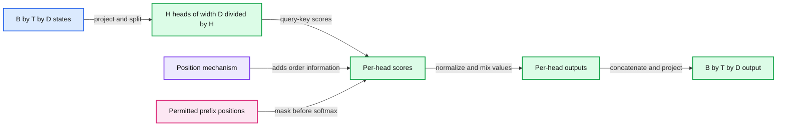

# 07. Causality, heads, and position

Causal attention allows a query at t to read keys s <= t, then predicts token t+1.



## 7.1 Causality is an information boundary

In next-token training, the representation at position t may use tokens through t, because it predicts the token at t+1. It may not inspect later input tokens. Training still supplies a complete window in one batch, so the architecture must enforce the boundary inside each attention operation.

Construct a score mask M where M[t,s] is zero for s <= t and negative infinity for s > t. Add it to the scores before softmax. The exponential of a masked negative-infinity score is zero, so the excluded position has no mixture weight. Multiplying normalized weights by a zero mask afterward is a different operation unless they are correctly renormalized.

For three positions, the permitted score locations form a lower triangle:

```
query 0: key 0
query 1: keys 0, 1
query 2: keys 0, 1, 2
```

This is a logical rule, not a result of fitting more data. Repeated masked layers preserve the boundary: if every source representation already depends only on its own prefix, mixing permitted sources cannot introduce a future token. The residual and per-position feed-forward paths must preserve the same property.

## 7.2 Masking details that matter

A padding mask removes non-content keys. A causal mask removes future keys. A query row with no permitted key needs deliberate handling: softmax of a row containing only negative infinities is undefined. In our simple decoder every real position can attend at least to itself, and fixed windows avoid padded query rows. More complicated batching must maintain that invariant or handle those rows explicitly.

Masking is not the same as shifting targets. You need both the right information boundary and the right observed next token. A useful structural check compares logits for a prefix with logits at the same positions inside a longer sequence. Prefix predictions should not depend on the appended future suffix when evaluated under the same causal model and compatible positions.

## 7.3 Multiple heads

A multi-head layer projects several query/key/value subspaces. With H heads and total model width D, the common choice uses d_h = D/H per head. A batch is rearranged from B by T by D to B by H by T by d_h. Each head computes its own B by H by T by T score block. Concatenate the head outputs back to width D, then apply an output projection.

For a synthetic configuration D=12 and H=3, each head has width 4. This is shape arithmetic, not evidence that three human concepts will emerge. Heads can distribute or duplicate work. Assigning one fixed semantic function to each head before examining a model would confuse an implementation partition with an interpretation.

## 7.4 Why position changes attention

Without position information, token content alone does not tell a self-attention layer whether one source preceded another by one step or many. A causal mask indicates permitted direction, but it does not supply a full relative-distance representation.

Learned position vectors add a table entry at the input, as Chapter 04 described. Rotary position embeddings, or RoPE, instead rotate pairs of query/key coordinates by angles associated with position. For a two-dimensional pair, write R(theta) for a rotation matrix. Then:

```
(R(m theta) q)^T (R(n theta) k)
    = q^T R((n-m) theta) k
```

The dot product depends on relative displacement n-m through the rotations. Real implementations apply different frequencies to coordinate pairs. They usually rotate queries and keys, not the value vectors. RoPE does not replace the causal mask or prove that arbitrary longer contexts will work. Training lengths, frequency choices, and extrapolation methods still matter.

Our educational decoder uses learned absolute positions. The practical includes an independent small rotation calculation so you can understand the alternative without pretending that the checkpoint implements it.

## 7.5 Trade-offs and the next construction

More heads alter subspace partitioning and implementation layout, but adding heads alone at fixed width does not simply multiply representational width. Position mechanisms change generalization assumptions and checkpoint compatibility. A sliding-window mask changes available context and can reduce computation, but it also removes potential information routes.

We now have input vectors, an objective, and a causal multi-head communication mechanism. Chapter 08 combines that mechanism with normalization, residual paths, and nonlinear transformations into a decoder block.

## 7.6 Exercises

Work through [Practical 03: Attention and causality](../practicals/03-attention-and-causality.md) at the checkpoint specified there. These are authored exercises; their empirical outcomes are not reference lecture results.

1. Why must a next-token model need both shifted targets and a causal visibility rule?
2. Explain the B, H, T, and d_h axes without calling a reshape a learned transformation.
3. What relative-position property does the rotation identity establish, and what does it not establish?

## 7.7 Further reading

Read the assigned sections of **S01, S02** in [the source map](../sources.md#chapter-reading-map).

---

[Previous chapter](06-attention-from-first-principles.md) | [Contents](../curriculum.md) | [Next chapter](08-the-decoder-transformer.md)
