# 08. The decoder transformer

A decoder block combines causal communication and per-position transformation while preserving model width.

```mermaid
%% A pre-normalized decoder block preserves an identity route around each sublayer.
flowchart LR
    X["Residual state x"]:::client -->|"normalize"| N1["LayerNorm"]:::service
    N1 -->|"causal attention"| A["Attention output"]:::service
    X -->|"identity path"| U["Residual sum u"]:::service
    A -->|"learned update"| U
    U -->|"normalize"| N2["LayerNorm"]:::service
    N2 -->|"per-position MLP"| F["Feature update"]:::service
    U -->|"identity path"| Y["Residual sum y"]:::store
    F -->|"learned update"| Y
    classDef client fill:#dbeafe,stroke:#2563eb,stroke-width:2px,color:#111
    classDef service fill:#dcfce7,stroke:#16a34a,stroke-width:2px,color:#111
    classDef store fill:#ede9fe,stroke:#7c3aed,stroke-width:2px,color:#111
    classDef cache fill:#fef3c7,stroke:#d97706,stroke-width:2px,color:#111
    classDef decision fill:#fce7f3,stroke:#db2777,stroke-width:2px,color:#111
```



## 8.1 From attention to a full block

Attention supplies communication across token positions. A decoder also needs transformations within each position and a stable path through many layers. A common pre-normalized decoder block combines two residual sublayers:

```
u = x + Attention(LayerNorm(x))
y = u + MLP(LayerNorm(u))
```

The equations preserve the B by T by D shape. A stack applies multiple such blocks, then a final normalization and vocabulary projection produce logits. The architecture in the practical follows this form with learned position embeddings, dense multi-head attention, and a two-layer feed-forward network.

The formula is one architectural choice, not a definition of every LLM. Other families use different normalization, gated feed-forward layers, sparse experts, or attention variants. We start with a complete simple block so later variants have a clear baseline to modify.

## 8.2 What residual connections preserve

The term x added to a sublayer output creates an identity route through the computation. The sublayer can learn a change to the representation rather than having to recreate the entire input representation at every step. Backpropagation also has a direct path through the addition.

A residual connection does not make training failure impossible. Poor scales, unstable optimization, incorrect masks, or corrupt targets can still defeat the model. It changes the computation and gradient paths; it is not a guarantee about the objective or data.

As a worked arithmetic example, if a synthetic token state is [1, 2] and an attention sublayer returns [0.2, -0.5], their residual sum is [1.2, 1.5]. The sublayer's interpretation depends on the surrounding model. The addition itself does not identify which human concept was updated.

## 8.3 Layer normalization and feed-forward transformation

Layer normalization computes a mean and variance across the feature dimension of each position, then applies learned scale and bias. For width D, it does not average together unrelated batch examples. This distinguishes it from batch normalization, whose training statistics depend on a batch and whose inference behavior uses stored estimates.

RMS normalization is a related alternative that rescales by root mean square without subtracting the feature mean. Choosing a different normalization changes the network even when tensor shapes remain identical. Likewise, whether normalization occurs before or after a residual sublayer affects optimization behavior.

The multilayer perceptron, or MLP, applies the same per-position transformation across the sequence. A common form projects D to a larger hidden width, applies a nonlinear activation such as GELU, and projects back to D. It can transform features but does not itself mix different positions. Position mixing came from attention.

A gated feed-forward alternative uses one projection to modulate another, as in SwiGLU-style blocks. We discuss it as an extension rather than silently using it in code whose diagram shows a simple two-layer MLP.

## 8.4 Parameter and activation accounting

Attention's projection matrices, the embedding table, the feed-forward matrices, and normalization parameters are learned weights. Query/key/value tensors, attention scores, residual states, and logits are activations calculated for a batch. Training may retain some activations for backward computation. Inference may retain keys and values to avoid recomputing earlier positions.

For width D and a feed-forward expansion factor 4, two bias-free feed-forward matrices contain D*(4D) + (4D)*D = 8D-squared parameters. Three full-width attention projections and one output projection contain about 4D-squared weights. These are architectural counts, not the complete runtime memory. Chapter 13 adds gradients, optimizer state, activation storage, and precision.

Our output projection shares weights with the token embedding. The code should count shared parameters once. Duplicating the same parameter in an optimizer or summing both names as if they were separate allocations gives misleading accounting.

## 8.5 The educational implementation's boundary

Read `practicals/scripts/tiny_decoder.py` after completing the chapter. It contains explicit Q/K/V projections, masking, learned positions, pre-LayerNorm blocks, a feed-forward layer, a tied output projection, and optional key/value caches. These choices make the whole prediction inspectable.

It does not implement rotary positions, dropout, mixture-of-experts routing, distributed training, fused attention kernels, or a production tokenizer. These omissions should not be inferred as requirements that real models lack. They keep one complete implementation small enough to reason about.

The next chapter runs this decoder repeatedly to generate text. The trade-off is that a compact block teaches the data flow clearly while leaving production efficiency and architectural diversity for later sections.

## 8.6 Exercises

Work through [Practical 04: Decoder and generation](../practicals/04-decoder-and-generation.md) at the checkpoint specified there. These are authored exercises; their empirical outcomes are not reference lecture results.

1. Which part of a decoder mixes positions, and which part transforms features independently per position?
2. Why are parameter bytes insufficient to describe training memory?
3. Name the teaching decoder's actual position and normalization choices before proposing an architectural modification.

## 8.7 Further reading

Read the assigned sections of **S01, S02** in [the source map](../sources.md#chapter-reading-map).

---

[Previous chapter](07-causality-heads-and-position.md) | [Contents](../curriculum.md) | [Next chapter](09-generating-text.md)
