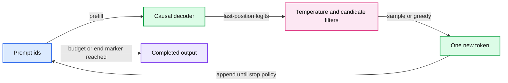

# 09. Generating text

Generation repeatedly selects a token from the final-position distribution, appends it, and runs the causal decoder again.



## 9.1 The generation loop

Provide a tokenized prompt, run the decoder, and inspect the logits at the prompt's final position. Those logits define a distribution over the next token. Select one token, append it, and repeat. The ordinary causal decoder generates one new token per sequence per iteration.

The prompt can be processed as a whole in a prefill pass. Once generation starts, key/value caches can reuse computations for earlier positions. That optimization leaves the logical loop intact. Chapter 18 explains its memory, positions, and serving consequences; here we focus on the choice made at each iteration.

Generation needs a stop policy. A chat model may stop on a trained end-of-turn marker or a supplied output budget. Our byte model has no dedicated end token, so its explicit maximum-new-token budget is the stop rule. A server should also account for context limits and cancellation. Hoping that random text eventually ends is not a resource policy.

## 9.2 Greedy decoding and temperature

Greedy decoding chooses an item with the largest logit. Random sampling instead draws from the categorical distribution. Temperature tau > 0 divides logits before softmax:

```
p_i(tau) = exp(z_i / tau) / sum_j exp(z_j / tau)
```

Temperature changes the distribution used for selection, not the learned weights. Positive-temperature division preserves the ordering of finite logits, so greedy argmax does not change merely because you adjusted temperature. Exact ties, numerical precision, or a changed implementation require their own tie-breaking policy. Treat tau = 0 as an explicit greedy mode rather than dividing by zero.

For synthetic logits [ln(4), 0], temperature 1 produces probabilities [4/5, 1/5]. At temperature 2, exponentiation produces [2, 1], so the probabilities are [2/3, 1/3]. The order remains the same while the uncertainty changes. These are arithmetic examples, not expected measured behavior from a practical.

## 9.3 Restricting the candidate set

Top-k sampling keeps the k largest logits and renormalizes within that set. Nucleus, or top-p, sampling sorts tokens by probability and keeps a small prefix whose cumulative probability reaches a threshold. Boundary conventions matter: the token that first crosses the threshold generally remains included.

Temperature, top-k, top-p, repetition penalties, and structured-output constraints compose into a decoding policy. Their order can matter. Renormalization after one filter changes the distribution on which another filter operates. Record the implementation and order rather than describing a request only as 'creative' or 'deterministic'.

A structured decoder can restrict choices to tokens compatible with a grammar or schema. That is useful for output syntax. It does not prove that a syntactically valid value is true or that a generated tool argument is authorized.

## 9.4 Context conditioning versus weight updates

Few-shot prompting places demonstrations in the context. The same model can then produce different continuations without a gradient update. An instruction-tuned chat model has additionally learned behavior from a particular training format. A base model receiving the same words is not guaranteed to interpret the conversation in the same way.

Longer context also changes compute and may expose a model to information that its evaluation did not anticipate. Record the entire effective prompt, including system instructions, retrieved text, templates, and special tokens. The string visible in a user interface may not be the whole model input.

## 9.5 Reproducibility and interpretation

A random seed helps reproduce a sampling process under a specified implementation. It does not guarantee identical output across library versions, devices, kernel choices, or changed batching. For debugging, compare logits or token distributions before comparing long sampled strings. A tiny numerical difference can lead to a different sampled token and then a completely different continuation.

A generated sample is qualitative evidence. It can reveal obvious corruption, formatting failures, or repetition. It is not a replacement for a fixed evaluation set. Likewise, a fluent response does not establish factual reliability, and an awkward sample from a tiny model does not establish that its loss calculation is broken.

The next module creates training data and a small bounded optimization run for this exact decoder. The trade-off in sampling is between concentration, diversity, constraints, and reproducibility. Choose the policy for a task and evaluate it under the intended budget.

## 9.6 Exercises

Work through [Practical 04: Decoder and generation](../practicals/04-decoder-and-generation.md) at the checkpoint specified there. These are authored exercises; their empirical outcomes are not reference lecture results.

1. Why does changing positive temperature not change an exact greedy argmax?
2. Which settings are needed to make a generation comparison interpretable?
3. Why can grammar-constrained decoding still produce a semantically wrong answer?

## 9.7 Further reading

Read the assigned sections of **S01, S02** in [the source map](../sources.md#chapter-reading-map).

---

[Previous chapter](08-the-decoder-transformer.md) | [Contents](../curriculum.md) | [Next chapter](10-building-the-pretraining-dataset.md)
