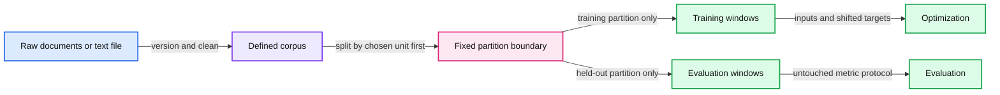

# 10. Building the pretraining dataset

Choose the held-out boundary before making overlapping next-token windows.

## 10.1 The corpus is part of the experiment

The training objective consumes token windows, but the source data consists of documents with provenance, quality, rights, duplicates, and boundaries. A clean tensor can hide a poor corpus decision. Record where the text came from, what transformations were applied, and which task the held-out data is intended to represent.

Begin with a small openly usable corpus rather than an opaque mixture. The existing ML course documents TinyShakespeare as a public-domain text option. Our decoder accepts a local text file and performs no download. The byte vocabulary is fixed, so new characters do not require learning an embedding id from the held-out partition.

A short corpus is useful for observing optimization and overfitting. It does not represent all styles, languages, or instruction tasks. The corpus choice determines which evaluation claims are reasonable.

## 10.2 Split before making overlapping windows

If adjacent windows share text, randomly assigning windows to training and evaluation can leak nearly identical contexts across the split. Instead, choose a split unit before window generation. Documents or source groups are good units when available. A chronological split can be appropriate when the intended question concerns later material.

The teaching script uses a simple contiguous byte boundary within one supplied file. Training windows are sampled entirely from the training prefix. Evaluation windows remain entirely within the held-out suffix. This avoids cross-boundary token overlap, but it does not remove duplicates that occur in both parts of the file. A document-aware corpus pipeline is a later improvement that must be stated explicitly.

For a synthetic byte array of length 1,000 and a boundary at 900, the training partition contains indices 0 through 899 and the held-out partition 900 through 999. A window of context length T needs T input bytes and the following T target bytes, constructed from a T+1 slice. No training slice may reach index 900. These are boundary arithmetic examples, not dataset measurements.

## 10.3 Cleaning changes the distribution

Unicode normalization, whitespace changes, boilerplate removal, deduplication, and language filtering alter what the model learns. Cleaning can improve consistency, but an aggressive filter can also remove dialects, rare formats, code, or hard examples. Keep a transformation log and inspect a sample before and after every consequential rule.

Learned preprocessing, including BPE merges, should be fitted on the intended training partition or explicitly inherited from a fixed pretrained tokenizer. A tokenizer trained elsewhere may already have seen related material; document this when interpreting benchmark novelty. Our fixed byte representation simplifies this issue at the cost of longer sequences.

Deduplication is not just exact file hashing. Near-duplicates and template variants may cross source boundaries. An evaluation that shares a memorized answer template with training data may overstate generalization even if no complete document is identical.

## 10.4 Packing and boundaries

Packing several documents into one fixed-length sequence reduces padding. However, placing an end marker between documents does not automatically prevent attention across the marker. The marker is an observed token; a block-diagonal attention rule is a separate architectural choice if examples must be isolated.

Likewise, padding inputs to one length and ignoring padded target labels are different from restricting attention to real keys. Chapter 05 separated these mask roles. The first decoder avoids padding by sampling fixed-length windows. Instruction tuning later needs an explicit conversation serialization and loss mask.

Long-context training adds another dimension. Increasing the context length changes memory, pairwise attention work, and which dependencies are available. Merely increasing a configuration limit does not establish that a model can use much longer evidence reliably.

## 10.5 Versioning the data path

Save a content hash of the input file, the byte split boundary, tokenizer identity, and the model's context length with the run. Record whether training samples windows with replacement and whether evaluation covers non-overlapping positions. A path alone is insufficient because a file can change while keeping its name.

Keep raw data outside the repository. Save derived token arrays and checkpoints in a learner-chosen work directory. The teaching script stores a file hash and refuses checkpoint evaluation under a different file. This supports a narrow reproducibility guarantee; it is not a full dataset governance system.

At the end of this chapter, data should be an explicit experimental object rather than a global variable. Chapter 11 uses those fixed partitions in the training loop. The trade-off of our small contiguous split is simplicity and visibility, with limited protection against source duplication and distribution bias.

## 10.6 Exercises

Work through [Practical 05: Data and small-model training](../practicals/05-data-and-small-model-training.md) at the checkpoint specified there. These are authored exercises; their empirical outcomes are not reference lecture results.

1. Why is a random split of overlapping windows weaker than a split before window construction?
2. What does an end-of-document marker fail to guarantee about attention visibility?
3. What can a contiguous byte split establish, and which duplicate/data-distribution problems remain?

## 10.7 Further reading

Read the assigned sections of **S05, S04** in [the source map](../sources.md#chapter-reading-map).

---

[Previous chapter](09-generating-text.md) | [Contents](../curriculum.md) | [Next chapter](11-training-a-small-language-model.md)
