# 11. Training a small language model

Training connects the causal model to the chosen loss and optimizer state.

```mermaid
%% A reproducible update depends on model, data, optimizer, and random state.
flowchart LR
    D[("Fixed training partition")]:::store -->|"batch windows"| F["Decoder forward"]:::service
    F -->|"logits and targets"| L["Token loss"]:::service
    L -->|"backward"| G["Gradients"]:::service
    G -->|"clip and update"| O["AdamW plus state"]:::service
    O -->|"new weights"| F
    O -->|"save state and data identity"| C[("Resume checkpoint")]:::store
    classDef client fill:#dbeafe,stroke:#2563eb,stroke-width:2px,color:#111
    classDef service fill:#dcfce7,stroke:#16a34a,stroke-width:2px,color:#111
    classDef store fill:#ede9fe,stroke:#7c3aed,stroke-width:2px,color:#111
    classDef cache fill:#fef3c7,stroke:#d97706,stroke-width:2px,color:#111
    classDef decision fill:#fce7f3,stroke:#db2777,stroke-width:2px,color:#111
```



## 11.1 One update, in order

We now have a fixed representation, partitions, a decoder, and a loss. One training iteration draws a batch from the training partition, calculates logits, calculates next-token cross-entropy, backpropagates its gradients, and asks an optimizer to change the trainable parameters. The loop also clears gradients at the intended boundary. Forgetting that boundary changes the update rather than merely slowing the program.

In compact pseudocode:

```
optimizer.zero_grad(set_to_none=True)
logits = model(input_ids)
loss = cross_entropy(logits, shifted_targets)
loss.backward()
clip_grad_norm_(model.parameters(), chosen_threshold)
optimizer.step()
```

Gradient clipping limits the norm of an update's gradient vector before the optimizer consumes it. It is not a substitute for correct targets or a reasonable learning rate. Log enough information to distinguish numerical failure from an experiment that simply has not learned useful patterns yet.

## 11.2 AdamW, learning rate, and accumulation

Adam keeps moving estimates of first and second gradient moments. These optimizer buffers consume memory and affect future updates. AdamW applies decoupled weight decay rather than treating it as an ordinary added loss term inside the moment estimate. These details matter when comparing an optimizer configuration or resuming a run.

A learning-rate schedule changes step size over training. Warmup and decay are often useful, but every new schedule is another experimental choice. Our small teaching loop uses an explicit learning rate and fixed step budget. That makes a first run easier to inspect; it does not claim to be a competitive recipe for large-model pretraining.

Gradient accumulation combines several microbatches before an optimizer step. To match a full token-mean objective, weight microbatch losses by their supervised token counts. Dividing each microbatch mean by the number of equally sized microbatches works in the equal-denominator case. It is not a general rule for variable response lengths or padding masks. Numerical order, stochastic layers, and stateful operations can still make implementations differ.

## 11.3 Training mode and gradient recording

`model.eval()` changes the behavior of modules such as dropout. It does not disable gradient recording. `torch.no_grad()` disables the usual autograd recording for a calculation; it does not put the model into evaluation behavior. Use both deliberately during ordinary validation and restore training mode afterward.

The educational decoder has no dropout, but its evaluation code still makes these choices explicit. A small implementation should teach a habit that survives adding stochastic modules, not rely on an incidental absence of them.

Training evaluation must not secretly consume a different stream of training randomness and thereby change the next batches merely because you chose to print metrics more often. Use a separate deterministic evaluation protocol. The provided script evaluates fixed windows rather than sampling training batches with the optimization random-number stream.

## 11.4 Worked update on one scalar

Use the synthetic objective from Chapter 02: L(w) = (2w - 1)^2 / 2. At w=0 the gradient is -2. Plain gradient descent with learning rate 0.1 yields w=0.2. This exact arithmetic illustrates the order of operations. It is not an AdamW update: an adaptive optimizer has additional state and a different effective step.

In the language model, the scalar loss's gradient flows through many parameter tensors. A correct small scalar calculation gives a useful reference for understanding the loop, but it cannot certify that every matrix shape, mask, or data boundary in the full model is correct. The structural smoke checks address those independently.

## 11.5 Checkpoints and resume

For continued training, save model configuration, weights, optimizer state, completed update count, tokenizer identity, dataset fingerprint and split, training settings, and random-number-generator states. Include device/software details in the experiment record. A weights-only file is useful for inference, but restarting an optimizer from it is a new training path.

The teaching script stores the training state and uses the same file fingerprint on resume. CPU random state and the relevant device generator state must be restored where supported. Exact bitwise reproducibility across changed hardware or libraries is a stronger claim and is not promised.

Write artifacts to an explicit external path. A failed run should retain its logs and its status rather than being quietly omitted from a comparison. Set a maximum number of steps before beginning, inspect a short bounded run, and extend it only with a reason. We will use the checkpoint in Chapter 12 to ask a more difficult question than whether the code finished: what evidence says the resulting model improved?

The trade-off is that a controlled tiny loop omits many performance features. Its value is a traceable training state, not maximum throughput.

## 11.6 Exercises

Work through [Practical 05: Data and small-model training](../practicals/05-data-and-small-model-training.md) at the checkpoint specified there. These are authored exercises; their empirical outcomes are not reference lecture results.

1. Which state is missing from a weights-only checkpoint if the goal is continued training?
2. Why do eval mode and no_grad solve different problems?
3. How should unequal-length microbatches be combined to match a global supervised-token mean?

## 11.7 Further reading

Read the assigned sections of **S05, S04** in [the source map](../sources.md#chapter-reading-map).

---

[Previous chapter](10-building-the-pretraining-dataset.md) | [Contents](../curriculum.md) | [Next chapter](12-evaluating-models-and-experiments.md)
