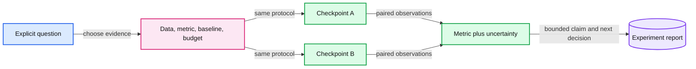

# 12. Evaluating models and experiments

Evaluation starts with the claim, then fixes data, metric, baseline, and compute budget.

## 12.1 Define the claim before the metric

A lower held-out language-model loss supports a claim about predicting that held-out token distribution under a specified representation. It does not by itself support a claim about factuality, chat behavior, coding correctness, or retrieval. Begin an experiment with a question precise enough to select evidence.

For the running byte model, useful early questions include whether a bounded training run changes held-out likelihood, whether the same checkpoint produces reproducible fixed-window metrics, and whether an architectural change preserves causal behavior. The answers are empirical. Record predictions and compare evidence; do not substitute a fluent sample or a remembered lecture claim for a result.

A task benchmark needs an explicit input set, scoring rule, baseline, and budget. If an example has several acceptable answers, a string-equality metric may be inappropriate. If a response must be executable or schema-valid, evaluate that property separately from semantic correctness.

## 12.2 Token-weighted likelihood

For each supervised target token, collect its negative log probability. Sum those losses and divide by the total number of supervised tokens. With natural logarithms, perplexity is the exponential of that mean.

Suppose two synthetic evaluation batches have total negative log likelihoods 4 and 18 over 2 and 6 tokens. Their per-token means are 2 and 3, but the combined mean is (4+18)/(2+6)=2.75 nats per token. An unweighted average of the two batch means gives 2.5 and overweights the smaller batch. This is exact aggregation arithmetic. A comparison is interpretable only if its denominator is visible.

The teaching evaluator uses fixed, non-overlapping target windows in the held-out suffix, with context reset at each window. It reports how many targets were scored. Resetting context changes the question relative to a rolling-context evaluator, so do not silently compare their values as if the protocols matched. The unscored final remainder is also reported or inferable from the scored count.

## 12.3 Tokenizers define the metric unit

A byte and a learned subword token are different units. Per-token perplexities cannot generally be compared across tokenizers as if each token represented the same information. A bits-per-byte or normalized sequence-likelihood analysis can sometimes help, but its boundary conditions and encoding assumptions must be defined.

Our main model keeps its byte tokenizer fixed. That makes checkpoint-to-checkpoint likelihood comparisons simpler. It does not make a tiny Shakespeare-style corpus a benchmark for instruction following or factual knowledge.

## 12.4 Fair comparisons and uncertainty

Compare methods on the same examples, preferably as paired observations. Fix the full prompt format, decoding policy, maximum output budget, and scoring implementation. A model allowed many more sampled attempts spends a different inference budget. Report that difference instead of attributing all gains to weights.

Use multiple seeds or repeated runs where training randomness affects the claim. Confidence intervals should reflect the sampling unit: repeatedly scoring a near-duplicate template does not create independent evidence. Small toy datasets are especially vulnerable to large apparent changes caused by a few examples.

Do not repeatedly optimize against the final test set. Keep a development set for choosing methods and a final set for assessing the chosen method. If the data is too small to support that division, state the limitation and use a protocol designed for the available evidence rather than inventing certainty.

## 12.5 Human and model-based judges

Human preference judgments can vary with presentation, order, and length. A language-model judge can be useful but adds its own biases and prompt sensitivity. It may favor verbosity, familiar styles, or outputs from related models. A judge is a measurement instrument, not a ground-truth oracle.

For open-ended tasks, use a clear rubric, randomized order where possible, and a small manually inspected set of disagreements. Separate correctness, helpfulness, format adherence, latency, and resource cost rather than hiding them behind one unexplained number.

## 12.6 From evaluation to the next decision

Write an experiment report with what changed, what stayed fixed, what was measured, the uncertainty, and the next decision. Keep failed runs. A model that scores well but cannot fit the deployment memory budget may be unsuitable; an inference optimization that changes quality may need a different comparison.

Chapter 13 introduces efficiency mechanisms only after we have a way to assess their effects. That ordering is deliberate: efficiency is a claim about resources under a defined useful result, not merely a smaller tensor or a faster isolated kernel.

## 12.7 Exercises

Work through [Practical 06: Honest evaluation](../practicals/06-honest-evaluation.md) at the checkpoint specified there. These are authored exercises; their empirical outcomes are not reference lecture results.

1. What claim does held-out perplexity support, and which important LLM claims need different evidence?
2. Why must an evaluator report its token denominator and context-reset policy?
3. How can an LLM judge distort a comparison even when its output is a single numeric score?

## 12.8 Further reading

Read the assigned sections of **S08, S04** in [the source map](../sources.md#chapter-reading-map).

---

[Previous chapter](11-training-a-small-language-model.md) | [Contents](../curriculum.md) | [Next chapter](13-efficient-training-and-scaling.md)
