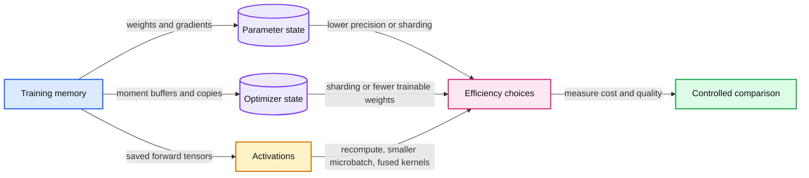

# 13. Efficient training and scaling

Efficiency methods save different resources and should be chosen against a measured bottleneck.

## 13.1 First name the scarce resource

An optimization can save parameter storage, optimizer memory, activation memory, communication, arithmetic, or memory traffic. These are different bottlenecks. A method that reduces one can increase another. Before choosing an implementation, name the measured constraint and the quality/result budget that must remain acceptable.

Parameters are only part of training memory. You may also store gradients, optimizer buffers, master-weight copies, activations retained for backward, temporary workspaces, and runtime overhead. Inference replaces much of that state with a different pattern, including key/value caches. Do not use the size of a model file as a universal memory estimate.

For a simplified FP32 Adam-style training example with N parameters, weights use 4N bytes, gradients 4N, and two FP32 moment buffers 8N. That is 16N bytes before activations or overhead. This is conditional arithmetic, not a measured process footprint. Mixed-precision systems may add or alter copies, so their memory must be accounted for according to the actual implementation.

## 13.2 Floating-point formats and mixed precision

A floating-point format divides its bits between sign, exponent, and significand. Exponent bits affect range; significand bits affect local precision. FP16 and BF16 both use 16 bits but have different ranges and precision. Merely saying 'half precision' conceals that distinction.

Mixed-precision training executes selected operations in a lower-precision format while retaining sensitive reductions or optimizer state in a suitable higher precision. Loss scaling is useful in some FP16 training paths to keep small gradients representable. BF16's exponent range changes the need for that mechanism. Neither format makes all numerical problems disappear.

A cast changes stored numerical representation. Mixed-precision execution, integer quantization, and low-rank adaptation are separate ideas. Chapter 17 derives quantization; Chapter 15 changes which parameters are trainable. Combining techniques requires accounting for each mechanism rather than treating all memory savings as one trick.

## 13.3 Activation memory and gradient accumulation

Activation checkpointing saves fewer intermediate tensors and recomputes selected forward operations during backward. It trades additional computation for lower retained activation memory. Efficient attention kernels improve how attention is calculated and stored, often avoiding an explicit full score matrix. They need not change the mathematical attention function.

Gradient accumulation reduces the microbatch that must be present at once while combining several gradients into one optimizer update. It does not reduce the total examples or tokens in the chosen effective batch. Correct supervised-token weighting is still necessary. It can also change throughput, so compare wall time and token counts rather than only whether the run fits.

A synthetic memory ledger should list parameter dtype, gradient dtype, optimizer copies, approximate activation axes, and the sequence/batch settings. Validate that ledger against the actual runtime before making a deployment claim.

## 13.4 Data parallelism and sharding

Ordinary data parallel training replicates the model across devices, divides examples, and synchronizes gradients. Sharded optimizers and fully sharded data parallel systems partition some parameter, gradient, or optimizer state. Tensor and pipeline parallelism divide model computation in other ways. Each method introduces communication and scheduling choices.

Our local decoder implements none of these distributed systems. Their place in the course is conceptual: understand what state is replicated or partitioned, when communication occurs, and which failure/restart state must be saved. Reading a distributed-memory estimate is not the same as having tested a distributed training job.

## 13.5 Scaling laws and compute budgets

For many dense transformer training estimates, C approximately equals 6ND is a useful rough FLOP model, where N is parameter count and D is the number of training tokens. It assumes a particular accounting of forward and backward work and suppresses details such as sequence-dependent attention, embeddings, hardware utilization, and optimizer overhead.

A compute-optimal allocation balances model size and data for a specified family, training recipe, and objective. It is not a universal instruction to use one fixed tokens-per-parameter ratio. Inference cost and repeated deployment use can change the economically useful training choice. Mixture-of-experts models further separate total parameters from the active parameter path for a token, while routing and communication add costs.

The next chapter adapts a pretrained checkpoint to instructions. The trade-off of efficiency methods is that the system becomes less transparent. Keep a simple baseline and an explicit resource ledger so a smaller allocation or shorter timer does not conceal changed training semantics or degraded quality.

## 13.6 Exercises

Work through [Practical 07: Precision and training memory](../practicals/07-precision-and-training-memory.md) at the checkpoint specified there. These are authored exercises; their empirical outcomes are not reference lecture results.

1. Why is a checkpoint file size insufficient to estimate training memory?
2. Which resource does activation checkpointing save, and what does it spend?
3. Which assumptions make a FLOP estimate different from a wall-time claim?

## 13.7 Further reading

Read the assigned sections of **S09, S02, S04** in [the source map](../sources.md#chapter-reading-map).

---

[Previous chapter](12-evaluating-models-and-experiments.md) | [Contents](../curriculum.md) | [Next chapter](14-instruction-tuning-and-chat.md)
