# 14. Instruction tuning and chat

Instruction tuning trains desired responses under a compatible conversation serialization.

```mermaid
%% Chat serialization and target masking specify what supervised adaptation actually teaches.
flowchart LR
    C["Conversation examples"]:::client -->|"checkpoint-compatible template"| T["Serialized token sequence"]:::service
    T -->|"shift"| Y["Next-token targets"]:::store
    T -->|"retain full allowed context"| M["Causal model"]:::service
    Y -->|"assistant-target mask"| L["Supervised loss"]:::service
    M -->|"logits"| L
    L -->|"update selected parameters"| A[("Adapted checkpoint or adapter")]:::store
    classDef client fill:#dbeafe,stroke:#2563eb,stroke-width:2px,color:#111
    classDef service fill:#dcfce7,stroke:#16a34a,stroke-width:2px,color:#111
    classDef store fill:#ede9fe,stroke:#7c3aed,stroke-width:2px,color:#111
    classDef cache fill:#fef3c7,stroke:#d97706,stroke-width:2px,color:#111
    classDef decision fill:#fce7f3,stroke:#db2777,stroke-width:2px,color:#111
```

## 14.1 The same predictor, a different training distribution

A pretrained causal model learns continuations from its corpus. Instruction tuning presents examples in which a request is followed by a desired response. The network may remain the same next-token predictor while the data distribution, serialization, and loss mask change.

A chat interface often hides special tokens and role markers. The model sees a serialized token sequence, not an abstract list of UI messages. Its training may use particular markers for system, user, assistant, and end-of-turn boundaries. Applying the matching chat template is part of correctly using that checkpoint.

A base model and an instruction-tuned model are different checkpoints. A prompt can improve behavior without changing weights; supervised fine-tuning, or SFT, changes trainable parameters using example responses. These routes need a fair comparison, because additional training can be unnecessary when a well-designed prompt already solves the task.

## 14.2 Serialization is part of the model contract

Consider a synthetic conversation with a user request and an assistant answer. A serializer might insert role and boundary tokens around the text. The exact token ids depend on the checkpoint's tokenizer and template. We do not invent a universal string such as `User:` and assume that every model was trained to interpret it identically.

Record the template, special-token policy, truncation side, and output-prefix convention. Truncating a long conversation can remove the very instruction or evidence that defines the desired answer. A template mismatch can also cause a model to continue the wrong speaker or reproduce unwanted role text.

The byte decoder is a base language model with no pretrained conversation template. A toy loss-mask exercise can teach SFT mechanics on synthetic ids, but it does not turn that decoder into an assistant or claim that arbitrary special markers have been learned.

## 14.3 Which tokens are supervised?

Some SFT pipelines supervise all serialized tokens. Others supervise assistant response tokens while retaining user/system tokens as input context. The choice changes the objective and its denominator. In a response-only setup, ignoring prompt labels does not remove the prompt from attention.

Suppose synthetic tokens are [10, 11, 12, 13], with the first two designated as prompt and the last two as response. Shifted input is [10, 11, 12], and shifted targets are [11, 12, 13]. The response-only loss mask applies to the target positions: [ignore, score, score]. Applying the input-position roles without shifting would supervise a different set of predictions.

Use an explicit ignore index or a per-token mask, then normalize over supervised targets. A long prompt with a short response should not acquire an arbitrary loss weight merely because the batch contains many ignored positions. Handle empty-response examples deliberately rather than dividing by zero.

## 14.4 Data quality and held-out tasks

Instruction data should represent the behavior you want: correct responses, appropriate refusals, formatting, relevant evidence use, and task diversity. Synthetic instruction examples are not automatically independent or correct. A teacher model can reproduce its own biases and errors across a generated dataset.

Split by task family, document, user, or source where shared templates could leak. A random split of near-identical prompt variants may test template memorization more than generalization. Record whether examples used in few-shot baselines overlap the final evaluation set.

Compare a base model with a well-specified prompt, the adapted model with the compatible template, and any retrieval/tool alternatives under the same useful task protocol. Chapter 12's judge and length-bias cautions still apply. Report resource costs as well as task scores.

## 14.5 Behavior is not a factual guarantee

SFT can change response style, formatting, and task competence. It does not guarantee that the model's statements are true, that private documents have been memorized correctly, or that tool requests are authorized. Rapidly changing factual information may belong in retrieval or a verified tool path rather than repeated weight updates.

Save the adapted checkpoint or adapter together with the base-model identity, tokenizer, and template. Chapter 15 introduces LoRA as one way to parameterize the trainable change. Its role is orthogonal to the supervised objective: SFT describes what examples and loss teach, while LoRA describes which parameters are adjusted and how.

The trade-off is that imitation of desired responses is direct and useful, but the dataset must carry the desired behavior and the evaluation must detect what it missed.

## 14.6 Exercises

Work through [Practical 08: Instruction loss and LoRA](../practicals/08-instruction-loss-and-lora.md) at the checkpoint specified there. These are authored exercises; their empirical outcomes are not reference lecture results.

1. Why must a response-only mask be aligned with shifted targets rather than unshifted input roles?
2. Which artifacts besides adapter weights are necessary to reconstruct chat behavior?
3. When would retrieval or a prompt baseline be a more appropriate comparison than another fine-tuning run?

## 14.7 Further reading

Read the assigned sections of **S05, S07** in [the source map](../sources.md#chapter-reading-map).

---

[Previous chapter](13-efficient-training-and-scaling.md) | [Contents](../curriculum.md) | [Next chapter](15-low-rank-adaptation.md)
