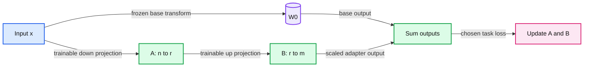

# 15. Low-rank adaptation

LoRA freezes a base matrix W0 and learns a low-rank additive update.



## 15.1 An update with fewer degrees of freedom

Full fine-tuning can update a large collection of pretrained weights. Low-rank adaptation, or LoRA, freezes a base weight matrix and learns a structured additive update. With a linear layer stored as W0 of shape m by n, choose rank r and learn A of shape r by n and B of shape m by r:

```
W_effective = W0 + (alpha / r) B A
output = x W0^T + (alpha / r) (x A^T) B^T
```

The factorization restricts the update matrix's rank to at most r. The base operation still runs. LoRA reduces the trainable parameter set and corresponding optimizer/gradient state; it does not remove the frozen model from memory or eliminate every activation needed for backward.

The matrices' names and orientations vary across implementations. Check the actual tensor shapes rather than copying a formula whose transposes assume a different convention. Our worked notation matches a linear weight stored as output features by input features.

## 15.2 Worked parameter count

For m=n=1,024 and r=8, the full weight has 1,048,576 entries. A and B together have r*n + m*r = 16,384 entries, or 1/64 as many. This is exact parameter-count arithmetic for one targeted matrix. A real adapter may target multiple projections, keep other modules trainable, and add biases or other state, so the whole model's ratio can differ.

If A is initialized to nonzero random values and B to zero, the initial additive output is zero. This preserves the base layer's initial function. The first backward pass can still supply gradients to B through A, while the gradient to A through zero B is initially zero. These are algebraic properties of that initialization, not an empirical claim about the quality of the resulting adapter.

A practical implementation must exclude frozen base parameters from the optimizer. Setting `requires_grad=False` prevents ordinary gradient accumulation for them; the optimizer configuration and checkpoint format should reflect the intended trainable set explicitly.

## 15.3 Rank, target modules, and objective are separate choices

Rank controls the factorization width. The scaling factor alpha/r controls update scaling under the chosen convention. Which matrices receive adapters, whether dropout is used, and the learning rate are additional choices. A higher rank is not a theorem of better generalization. It changes capacity, memory, and optimization behavior and therefore needs the same evaluation discipline as any other change.

LoRA can be used with supervised instruction tuning or other differentiable objectives. It does not specify the data, target mask, or reward function. Conversely, SFT can use full fine-tuning without LoRA. Keeping the objective and parameterization separate makes experiments interpretable.

The mechanism practical fits an update to a synthetic linear mapping. That isolates factorization and gradient flow. It is not a measured adapter run on a pretrained language model. The capstone offers an explicitly optional real adaptation extension after the base evaluation path is understood.

## 15.4 Deployment and compatibility

For ordinary compatible floating-point weights, an adapter update can be merged into the base weight, yielding W_effective. Compare merged and unmerged outputs numerically on fixed inputs. Finite precision can introduce small differences even when the algebra is identical.

Merging into quantized weights requires more care. Quantized codes and scales do not support arbitrary real-valued updates by simple integer addition. A dequantize/add/requantize path introduces another approximation. Chapter 17 uses this observation to explain why a quantized base plus trainable low-rank adapters is a distinct execution arrangement.

An adapter belongs to a particular base model and module layout. Store the base revision, target-module names, rank/scaling convention, tokenizer, and any chat template with it. An adapter file that loads into a superficially similar model can still describe the wrong transformation.

## 15.5 The useful decision

Choose adaptation only after identifying a behavior the base/prompt/retrieval baseline fails to provide. Compare held-out task evidence, memory, runtime, and operational cost. Small adapter files are convenient to store and swap, but deployment still needs the base checkpoint and compatible runtime.

The trade-off is a constrained, often economical trainable change in exchange for additional hyperparameters and compatibility obligations. The next chapter changes the learning signal itself, from demonstrations to preferences and rewards. LoRA can remain the parameterization while that objective changes.

## 15.6 Exercises

Work through [Practical 08: Instruction loss and LoRA](../practicals/08-instruction-loss-and-lora.md) at the checkpoint specified there. These are authored exercises; their empirical outcomes are not reference lecture results.

1. Which memory costs remain even when the base weights are frozen?
2. Derive the trainable parameter count for one adapted m by n matrix.
3. Why must adapter/base compatibility be recorded even when a weight-loading operation succeeds?

## 15.7 Further reading

Read the assigned sections of **S05, S09** in [the source map](../sources.md#chapter-reading-map).

---

[Previous chapter](14-instruction-tuning-and-chat.md) | [Contents](../curriculum.md) | [Next chapter](16-preferences-rewards-and-reasoning.md)
