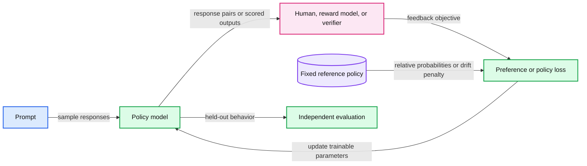

# 16. Preferences, rewards, and reasoning

Preference and reward training change what the model is optimized to do.



## 16.1 Feedback changes the objective

Instruction tuning imitates selected responses. A preference dataset instead states that one response is preferred to another for the same prompt. A reward-based method assigns or learns a score and optimizes the policy's generated behavior. These forms of feedback can be related, but they supply different information.

A language model used as a policy defines probabilities for token sequences. Its actions are generated tokens, and the prompt plus generated prefix is its current context. A final response score must somehow influence the probabilities of the token decisions that produced it. That is the credit-assignment problem behind many reinforcement-learning approaches to LLMs.

The feedback source matters. Human preference, a learned reward model, a test suite, and an arithmetic verifier can all be useful, but none defines universal correctness. A program that passes a narrow set of tests may still fail other cases. A reward model can have exploitable patterns that are unrelated to the behavior the designer intended.

## 16.2 A reference policy constrains drift

A common reward objective balances expected reward with a penalty for departing from a reference policy. The reference is a fixed comparison model, often an earlier checkpoint. The constraint discourages optimizing the reward by moving too far from the original distribution, but the coefficient and estimator are substantive choices.

Policy-gradient methods use generated samples to estimate how changing sequence probabilities affects expected reward. PPO, or proximal policy optimization, limits certain policy-probability changes using clipping and related controls. Value estimates and advantage estimates can help reduce variance or assign credit. Implementation details are substantial; the toy practical does not implement full PPO.

GRPO, or group relative policy optimization, compares rewards among several responses to a prompt and uses relative advantages. Group composition, reward variance, normalization, length, and token-level aggregation all affect the objective. A group with no useful reward variation needs deliberate handling. The absence of one separately learned value model does not make the rest of the training system trivial.

## 16.3 Direct preference optimization

DPO, or direct preference optimization, trains from preferred/rejected response pairs relative to a fixed reference model. A common pair loss is:

```
margin = beta * [log pi(chosen|x) - log pi_ref(chosen|x)
                 - log pi(rejected|x) + log pi_ref(rejected|x)]
loss = -log sigmoid(margin)
```

Here sequence log probabilities are sums over the chosen response tokens under a defined template and mask. This formula does not make response length irrelevant. Longer sequences contain more log-probability terms, and the pair dataset can contain its own length/style biases.

For a synthetic pair where the model/reference relative log-probability difference is 0.3 and beta is 2, the margin is 0.6. The loss is log(1 + exp(-0.6)). That is arithmetic about a pairwise objective, not evidence that the update will improve factuality or a downstream benchmark.

The toy practical exposes this scalar loss and its gradients. A real DPO experiment additionally needs compatible base/reference checkpoints, pair data, sequence likelihoods, masking, a training loop, and held-out evaluation.

## 16.4 Reasoning and inference-time computation

A model may improve performance on some tasks by producing intermediate tokens, sampling several attempts, using a verifier, or retrieving evidence. These mechanisms spend inference compute. Training can also reward outputs that succeed on verifiable tasks. Prompting, supervised demonstrations, and reinforcement learning therefore provide different routes to behavior that looks like multi-step reasoning.

More intermediate tokens are not a universal guarantee of correctness. A generated rationale may omit the actual causal factors or rationalize an answer after the fact. Evaluating answer accuracy, resource use, and sensitivity to controlled changes is stronger than treating a fluent reasoning trace as a faithful account of internal computation.

## 16.5 Reward hacking and evaluation

Suppose a synthetic score rewards the presence of a particular phrase. A model can maximize that score without satisfying the user's task. More subtle reward hacking can exploit verbosity, formatting, or a judge's preferences. This is an objective-design failure even if optimization itself is functioning correctly.

Use a held-out task set and inspect failure modes that the reward did not capture. Record generation budget, number of sampled responses, verifier reliability, and any human feedback. Do not compare a single-attempt model with a many-attempt system without accounting for the extra compute.

The trade-off is that feedback can target useful behavior beyond imitation, while the optimization learns the feedback's imperfections too. Chapter 17 returns to the numerical representation of model weights so we can compress and adapt the resulting model under an explicit quality evaluation.

## 16.6 Exercises

Work through [Practical 09: Preference objectives](../practicals/09-preference-objectives.md) at the checkpoint specified there. These are authored exercises; their empirical outcomes are not reference lecture results.

1. What extra artifacts and computation separate a toy DPO scalar from an actual DPO training experiment?
2. Why can a correct optimizer still produce reward hacking?
3. Why is a generated reasoning trace insufficient evidence of the model's internal causal process?

## 16.7 Further reading

Read the assigned sections of **S10, S07, S11** in [the source map](../sources.md#chapter-reading-map).

---

[Previous chapter](15-low-rank-adaptation.md) | [Contents](../curriculum.md) | [Next chapter](17-quantization-and-qlora.md)
