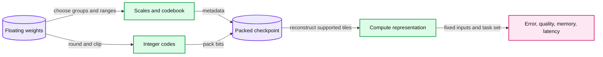

# 17. Quantization and QLoRA

Quantization replaces values with finite codes plus reconstruction metadata.



## 17.1 Precision is a design choice

Weights and activations are real-valued quantities represented with finite bits. Lowering their storage precision can reduce memory and data movement, but it introduces numerical approximation and may require specialized kernels to achieve a speed benefit. A smaller file alone is not proof of lower latency or acceptable quality.

Floating-point casting and integer quantization are related compression choices with different representations. Quantization maps values to a finite codebook, usually with scales and sometimes zero points. Dequantization reconstructs approximate values from those codes. It does not recover information already lost.

Quantizing stored weights for inference is also different from mixed-precision training, where selected calculations use lower precision while optimization retains appropriate state. Chapter 13's resource ledger still matters when a quantized model participates in adaptation.

## 17.2 Symmetric uniform quantization

For a group of weights w, choose a signed range from -Q to Q and a scale s = max(abs(w))/Q when the group is nonzero. Quantize and reconstruct with:

```
q = clamp(round(w / s), -Q, Q)
w_hat = s * q
```

An all-zero group needs a defined scale, such as 1, so the calculation never divides by zero. With no clipping and nearest rounding, each scalar's absolute error is at most s/2, apart from finite-arithmetic details. Choosing a smaller scale can improve resolution near zero but clip outliers; the unclipped error bound no longer describes those clipped values.

Take synthetic w = [-1.0, -0.2, 0.3, 0.9] and Q=7. The scale is 1/7. Rounded codes are [-7, -1, 2, 6], reconstructing [-1, -1/7, 2/7, 6/7]. These are worked numbers, not an observed quality result. They expose where approximation enters before we ask a model-level evaluation what that approximation does.

## 17.3 Asymmetric, per-channel, and grouped formats

An affine asymmetric format introduces a zero point z, so q approximately equals w/s + z and reconstruction is s*(q-z). It can use a code range efficiently when a distribution is offset from zero. Symmetric formats are simpler for some kernels and weight distributions.

One scale for a whole tensor lets one outlier set the resolution for every weight. Per-channel or grouped scales localize that effect but add metadata and potentially change kernel access patterns. Calibration procedures choose ranges using data or representative statistics. A calibration set must not become an unreported source of evaluation leakage.

Non-uniform codebooks place representable values unevenly. NF4 is a four-bit format designed around a roughly normally distributed weight assumption. That is distinct from simply casting a tensor to a four-bit integer type. Format assumptions and kernel support must match the checkpoint and runtime.

## 17.4 Bits, packing, and actual memory

Four-bit codes require packing two codes into a byte to realize the nominal storage saving. Storing values from 0 to 15 in an eight-bit tensor still uses eight bits per entry. Account for padding, scale/zero-point metadata, unquantized layers, and runtime buffers.

For synthetic groups of g weights with b-bit codes and one FP16 scale, idealized storage is b + 16/g bits per weight before other metadata. At b=4 and g=64, that is 4.25 bits per weight. This arithmetic is not a process-memory measurement. A serving implementation may retain temporary dequantized tiles or other allocations.

The practical physically packs uniform four-bit codes and reports reconstruction metrics. It does not provide an optimized low-bit matrix-multiplication kernel. Its reconstruction path may be slower than a native floating-point operation; no speed conclusion is implied by the code representation.

## 17.5 Quantization error and task quality

Weight reconstruction error is a useful local diagnostic, not a complete predictor of task degradation. Layers and channels differ in sensitivity. Errors propagate through nonlinear and residual computations. Evaluate fixed model outputs or a held-out task set under the same tokenizer, input, and decoding protocol.

Separate quantization of weights, activations, and KV caches. They touch different tensors and may use different formats. An inference system advertised as 'four-bit' can still use higher precision for activations, normalization, selected layers, and the cache. Record the actual arrangement.

## 17.6 Where QLoRA fits

QLoRA keeps a compressed base model frozen while optimizing low-rank adapters. Computation reconstructs base-weight values in a supported compute dtype, commonly BF16 in the original design, and adds the adapter contribution. The adapters and their optimizer state remain trainable. Double quantization additionally compresses some quantization constants; it is not a second round of language-model training.

QLoRA therefore combines Chapter 15's parameterization with a quantized-base storage scheme and a suitable execution/training stack. Freezing the base does not remove activation memory. Merging an adapter into a low-bit base may require dequantization and requantization, introducing another numerical change to evaluate.

The latest required CME295 edition does not supply a dedicated quantization lesson in this archive. This chapter's derivation is an authored supplement; older CME295 2025 Lecture 4 is optional background only. The trade-off is lower representation cost against approximation, metadata, and implementation complexity. Chapter 18 adds another large inference allocation: the context cache.

## 17.7 Exercises

Work through [Practical 10: Quantization](../practicals/10-quantization.md) at the checkpoint specified there. These are authored exercises; their empirical outcomes are not reference lecture results.

1. Why does storing four-bit-range values in uint8 fail to realize four-bit storage?
2. Which assumptions are needed for the s/2 rounding-error bound?
3. What stays trainable in QLoRA, and which major memory costs remain?

## 17.8 Further reading

Read the assigned sections of **S09; original quantization supplement** in [the source map](../sources.md#chapter-reading-map).

---

[Previous chapter](16-preferences-rewards-and-reasoning.md) | [Contents](../curriculum.md) | [Next chapter](18-kv-caches-and-serving.md)
