# 18. KV caches and serving

A KV cache saves each layer's earlier keys and values for the same causal prefix.

```mermaid
%% Cache correctness requires unchanged prefix semantics, causal visibility, and position offsets.
flowchart LR
    P["Prompt"]:::client -->|"prefill every layer"| C[("Layer KV caches")]:::cache
    N["New token plus correct position"]:::client -->|"new query, key, value"| A["Attention to permitted prefix"]:::service
    C -->|"earlier keys and values"| A
    A -->|"logits"| D["Select next token"]:::decision
    A -->|"append new K and V"| C
    D -->|"next iteration"| N
    classDef client fill:#dbeafe,stroke:#2563eb,stroke-width:2px,color:#111
    classDef service fill:#dcfce7,stroke:#16a34a,stroke-width:2px,color:#111
    classDef store fill:#ede9fe,stroke:#7c3aed,stroke-width:2px,color:#111
    classDef cache fill:#fef3c7,stroke:#d97706,stroke-width:2px,color:#111
    classDef decision fill:#fce7f3,stroke:#db2777,stroke-width:2px,color:#111
```



## 18.1 Prefill and decode do different work

Prefill processes the prompt and creates representations for its positions. During generation, the new position attends to the allowed earlier positions. In a causal decoder, earlier positions' keys and values remain valid for that same unchanged prefix. Saving them avoids recalculating those projections and earlier hidden states at every generation step.

The cache stores keys and values for each layer, not final answers. A new query still compares with the permitted cached keys and mixes cached values. Decode attention cost therefore still depends on context length. Cache reuse removes repeated work; it does not make an arbitrarily long context free.

Training's activation checkpointing is a different mechanism. It deliberately discards some intermediates and recomputes them for backward. Inference KV caching retains a particular subset to avoid repeated forward work. Similar words such as 'checkpoint' and 'cache' can obscure opposite resource choices.

## 18.2 Position and visibility are correctness conditions

A new token's position must reflect the length of the cached prefix. Starting learned position ids at zero for every incremental call changes the model. For rotary embeddings, query/key rotation positions also need the correct offsets. Chunked prefill must preserve the same causal rule across old and new keys.

For a current chunk of q tokens and p cached positions, query row i may read key indices through p+i. An ordinary q by q lower triangle alone is insufficient if applied without the cache offset. It can be correct for a special one-token path with an appropriate all-prefix rule, but general incremental code needs the actual absolute positions.

Our decoder's smoke check compares cached and uncached logits on a synthetic prefix under evaluation mode. It uses learned positions and refuses to exceed its configured maximum context. It does not silently slide the context and reuse invalid absolute positions. Sliding-window models require their own deliberate design.

## 18.3 Worked cache ledger

A simplified dense cache size is:

```
bytes = 2 * layers * batch * cached_tokens * KV_heads * head_width * bytes_per_value
```

The leading 2 accounts for keys and values. In ordinary multi-head attention, KV_heads equals query-head count. Grouped-query attention shares fewer key/value heads among more query heads, changing this cache term and the model architecture. Multi-query attention uses one key/value head.

For a synthetic configuration of 12 layers, batch 1, 1,024 cached tokens, 4 KV heads, head width 64, and two-byte values, the formula gives 12,582,912 bytes, or 12 MiB. That is payload arithmetic. It excludes page tables, fragmentation, temporary tensors, model weights, and other runtime state.

Weight quantization and cache quantization are separate. Reducing weight-file size does not reduce a full-precision KV cache automatically. Long requests or many concurrent sequences can make cache residency the relevant constraint.

## 18.4 Serving several requests

A server groups work from multiple requests to use the device efficiently. Static batches wait for a fixed group; continuous batching can admit and retire sequences as they progress. Variable prompt and output lengths create scheduling and memory-management decisions. Paged cache allocation can reduce wasted contiguous storage without changing the logical attention values.

Measure time to first token, time per subsequent output token, total latency, throughput, and memory under a defined request mix. Report whether tokenization, queueing, retrieval, and network transport are included. A single short warmed request is not a service-level latency distribution.

Sharing an identical prompt prefix can save computation, but the cache key must identify model revision, tokenizer/template, effective prefix, and execution conventions. A production system also needs correct tenant and authorization isolation. Cached computations must not accidentally expose another user's private context.

## 18.5 What the practical establishes

P11 checks output equivalence for the exact teaching model and reports cache payload entries. It can also time both paths, but small Python implementations and device synchronization can dominate results. A structural correctness check is stronger than a noisy timer for the claim that cache offsets were implemented correctly.

The practical is not a production scheduler, fused kernel, or load test. Those require realistic workloads and a suitable serving runtime. The trade-off is retained context memory in exchange for avoided repeated forward work. Chapter 19 places the running model inside a larger system where retrieval and tools add another set of correctness boundaries.

## 18.6 Exercises

Work through [Practical 11: Cached inference](../practicals/11-cached-inference.md) at the checkpoint specified there. These are authored exercises; their empirical outcomes are not reference lecture results.

1. Why does a KV cache avoid repeated work without making attention cost independent of context length?
2. Which axes and representation bytes belong in a KV-cache payload estimate?
3. Why is cached/uncached logit agreement a necessary check before a speed comparison?

## 18.7 Further reading

Read the assigned sections of **S02, S13** in [the source map](../sources.md#chapter-reading-map).

---

[Previous chapter](17-quantization-and-qlora.md) | [Contents](../curriculum.md) | [Next chapter](19-retrieval-tools-and-compound-systems.md)
