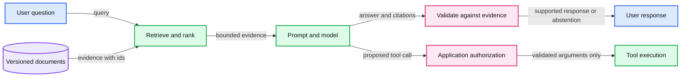

# 19. Retrieval, tools, and compound systems

A compound system combines a model with retrieval, prompts, validation, and tools.

## 19.1 A model is one component

A useful application may retrieve documents, select a prompt template, call a model, validate output, invoke tools, and record evidence. Its quality depends on the whole chain. Improving weights cannot repair a retriever that fails to supply the relevant document, and retrieving a correct document cannot guarantee that a model uses it correctly.

A compound system makes these components explicit. Retrieval-augmented generation, or RAG, supplies selected external text in the model's context. It changes the input for a request, not the model weights. Tools supply capabilities such as a database query or calculator under an application's execution rules. A generated tool call is a proposal, not automatic permission to execute it.

The running byte decoder is not a useful factual assistant. We use a separate synthetic document fixture to inspect retrieval and evidence flow without implying that short small-model training has created reliable question answering. An optional capable pretrained model can later occupy the generator slot under an explicit resource/license choice.

## 19.2 Retrieval has its own pipeline

Prepare documents with identifiers and provenance. Divide them into chunks that retain enough context to interpret a fact. A query selects candidates using a lexical or dense representation. A reranker can reorder candidates before a constrained evidence budget is passed to generation.

Lexical retrieval matches words or terms. Dense retrieval compares learned vectors. Neither method universally dominates. Chunk size, overlap, document versioning, query form, and ranking objectives can change whether the useful evidence is selected. A small term-overlap fixture teaches ranking and missing-evidence cases; it is not a substitute for a measured semantic retriever.

For a synthetic example, imagine three policy snippets about refunds, password resets, and retention. A refund-time question should retrieve evidence containing the applicable rule and conditions. A question about an absent policy should expose that absence rather than be assigned a fabricated answer key. The practical asks you to inspect both the selection and the missing-evidence case.

## 19.3 An evidence-bearing prompt

Keep retrieved content clearly delimited with document ids and provenance. Ask the generator to cite the relevant ids and to state when supplied evidence is insufficient. A citation is only useful if the cited material actually supports the claim. A response can cite an existing document while misreading its condition or inventing a number.

Retrieval text is untrusted input. A document can contain instructions telling the model to ignore the user or invoke a tool. Labeling evidence helps comprehension, but the application still needs explicit controls around tool permissions, secrets, and side effects. Prompt wording alone is not a security boundary.

The application should authorize a tool action using the actual user's privileges, validate arguments, restrict destinations, and require the intended confirmation for consequential operations. These checks belong outside the language model's generated prose. Model confidence is not a substitute for an authorization decision.

## 19.4 Evaluate components and end-to-end behavior

Retrieval evaluation asks whether relevant evidence appears within the selected budget and in a useful order. Generation evaluation asks whether the response is supported, correct, complete enough, and appropriately uncertain. Tool evaluation asks whether the proposed action is valid and whether execution succeeded under the right authority.

An end-to-end dataset should include answerable questions, absent evidence, contradictory or stale versions, and irrelevant or adversarial content. Record which component failed before choosing a fix. Additional retrieved text can introduce distraction or exceed the context budget, so measure quality and latency rather than assuming that more context always helps.

A useful report includes source ids, retrieval settings, prompt version, model revision, decoding policy, answer rubric, and failure categories. When comparing a prompt, retrieval change, and fine-tuning, hold the task and evaluation protocol stable enough to interpret the difference.

## 19.5 The design decision

Use prompting for behavior that a compatible checkpoint can already express. Use retrieval or verified tools for changing external facts and operations. Use adaptation when a stable desired behavior demonstrably needs a learned change. These routes can be combined, but each adds a component whose failures need observation.

The trade-off is flexibility and current evidence against added latency, complexity, and attack surfaces. The final chapter asks what can be learned from internal activations and what evidence is needed to defend claims about the complete system we have built.

## 19.6 Exercises

Work through [Practical 12: Grounding and capstone](../practicals/12-grounding-and-capstone.md) at the checkpoint specified there. These are authored exercises; their empirical outcomes are not reference lecture results.

1. Which failure would you investigate first when the correct document never enters the model context?
2. Why is a valid citation id weaker than proof that the cited text supports the answer?
3. Which tool-execution checks must be enforced outside the generated response?

## 19.7 Further reading

Read the assigned sections of **S13, S11** in [the source map](../sources.md#chapter-reading-map).

---

[Previous chapter](18-kv-caches-and-serving.md) | [Contents](../curriculum.md) | [Next chapter](20-interpretability-and-the-capstone.md)
