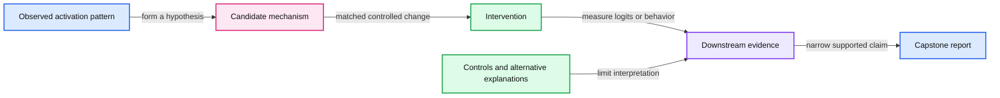

# 20. Interpretability and the capstone

Interpretability asks what internal computation supports a behavior and what evidence makes that claim causal.

## 20.1 Return to the original question

At the beginning, a language model was a conditional probability distribution. We now know one implementation of that distribution: token ids select vectors; decoder layers combine permitted context; a vocabulary projection produces logits; a learning objective updates trainable parameters; inference selects a continuation.

This mechanical understanding is necessary for interpreting a model, but it is not a complete account of every learned algorithm. Large networks can distribute a useful feature across many units and reuse a unit across different contexts. Understanding the architecture does not automatically explain a specific factual answer or hallucination.

## 20.2 Parameters, activations, and candidate features

A parameter is a stored learned value. An activation is a value computed for a particular input at a layer and position. A candidate feature is an interpretation or representation we use to describe a pattern in those activations. These three levels should not be conflated.

A neuron with a large activation on several related examples can suggest a hypothesis. It does not establish that the neuron uniquely represents that concept or causes the final behavior. A linear probe that predicts a label from hidden states shows decodability under that probe and dataset. The label information can be present without being used by the model's own output path.

Sparse autoencoders or transcoders can learn a representation intended to separate features or approximate a network's internal computation. They introduce their own training objective and approximation error. An interpretable replacement model is evidence to investigate, not a transparent window guaranteed to preserve every original causal mechanism.

## 20.3 Interventions strengthen a hypothesis

An intervention changes an internal state and measures a downstream effect under controlled inputs. Examples include ablating an activation, patching a state from another example, or modifying a proposed feature direction. These operations can test whether a hypothesized route matters to a behavior.

Controls are essential. A large perturbation can move hidden states off the distribution on which the remaining layers were trained. An observed change may therefore reflect generic damage rather than removal of a specific concept. Compare matched alternatives, vary intervention strength, inspect multiple contexts, and state whether the intervention preserves the rest of the computation.

A synthetic arithmetic intervention on our decoder can show that changing an activation changes logits. It cannot establish that the chosen direction means truth, deception, or a human-like plan. Semantics require a broader dataset, careful controls, and evidence that the feature interpretation generalizes.

## 20.4 Attention and explanations are partial observations

Chapter 06 showed why an attention weight is only one intermediate mixture. Residual paths, values, MLPs, and later layers also affect outputs. Similarly, a generated reasoning trace is part of the model's observable output. It can be helpful to a user without faithfully describing the internal cause of that output.

The CS25 biology talk illustrates how researchers combine features, tracing, and interventions to investigate models. The appropriate lesson is methodological: formulate a hypothesis, gather observational evidence, intervene, inspect controls, and limit the conclusion. A compelling visualization alone is not a complete causal proof.

## 20.5 Assemble the capstone evidence

The capstone asks for an end-to-end small-model investigation. Begin with a question, representation, and dataset. Preserve the training/evaluation boundary. Run a bounded baseline, save the checkpoint and reproducibility state, and compare one controlled modification. Include generated samples as qualitative diagnostics alongside token-level metrics.

Next, verify an inference mechanism such as cached versus uncached logits. Account for cache payload and model storage independently. Perform the local quantization exercise and state whether it only measures weight reconstruction or includes a full model/task evaluation. If you add real adapters, record the base identity, template, trainable set, and held-out task protocol.

Finally, use the retrieval fixture to show how an application can fail despite having a model that executes correctly. Identify a missing-evidence case and an authority boundary. A system report should say which artifact or metric supports every important claim.

## 20.6 What completion means

Completing the course means you can trace a token, a gradient, a low-rank update, a quantized value, and a cached key through concrete code. It means you can distinguish an exact algebraic identity, a tested implementation property, a model-quality observation, and a broad capability claim. Those are different levels of evidence.

The small model will not be a frontier assistant, and no arbitrary capability threshold is required to declare the mechanism investigation useful. Its educational value lies in a complete causal chain and an honest account of the experiment's limits.

Use the [capstone brief](../capstone.md) to produce the final report. The trade-off of mechanistic investigation is depth over breadth: a carefully controlled small example can establish a narrow fact strongly, while general claims about learned reasoning or interpretation require a wider research program.

## 20.7 Exercises

Work through [Practical 12: Grounding and capstone](../practicals/12-grounding-and-capstone.md) at the checkpoint specified there. These are authored exercises; their empirical outcomes are not reference lecture results.

1. Why does a successful linear probe not prove that the model uses the decoded feature?
2. How can an internal intervention change outputs without isolating the intended semantic concept?
3. Choose one capstone claim and identify whether its evidence is arithmetic, structural, empirical, or still hypothetical.

## 20.8 Further reading

Read the assigned sections of **S12, S08** in [the source map](../sources.md#chapter-reading-map).

---

[Previous chapter](19-retrieval-tools-and-compound-systems.md) | [Contents](../curriculum.md)
