# Practical machine learning: 40 one-hour labs

> 40 hands-on labs in the fast.ai style, one hour each, that teach what machine learning can do by predicting a result, running real code on this Mac, breaking it on purpose and rebuilding the key piece from memory. The AI writes the setup code; you do the thinking.

```mermaid
%% Zoom-out: the 7 modules in order, with the capstone each one unlocks
flowchart LR
    M1[M1 Whole game, labs 01 to 05]:::client -->|five working models| M2[M2 Do not fool yourself, 06 to 11]:::service
    M2 -->|honest evaluation| M3[M3 More of the map, 12 to 18]:::service
    M3 -->|every problem type| M4[M4 Production ML for payments, 19 to 27]:::service
    M4 -->|one model lifecycle| CA[Capstone A card fraud]:::decision
    CA -->|then the internals| M5[M5 Under the hood, 28 to 33]:::store
    M5 -->|from scratch| M6[M6 Deep nets on a Mac, 34 to 37]:::store
    M6 -->|training dynamics| M7[M7 Language models, 38 to 40]:::store
    M7 -->|demand and ETA| CB[Capstone B ride-hailing]:::decision
    M7 -->|retrieval and a small LLM| CC[Capstone C support triage]:::decision
    M5 -->|embeddings and bandits| CD[Capstone D recommendations]:::decision
    classDef client   fill:#dbeafe,stroke:#2563eb,stroke-width:2px,color:#111
    classDef service  fill:#dcfce7,stroke:#16a34a,stroke-width:2px,color:#111
    classDef store    fill:#ede9fe,stroke:#7c3aed,stroke-width:2px,color:#111
    classDef decision fill:#fce7f3,stroke:#db2777,stroke-width:2px,color:#111
```



- M4 is the module payments-risk interviews probe hardest: as-of features, label delay, calibration, shadow launches.
- Every number a lab asks you to predict was measured on this Mac (Apple M4 Pro, 24 GB) and sits in `answers/`, hidden until you have predicted.

## How a session runs

Start a session with `cd ml-learning && claude`, then say `start lab NN`. [`CLAUDE.md`](CLAUDE.md) holds the rules the AI follows.

| Clock | Block | Minutes | You |
|---|---|---|---|
| 0:00 | Retrieval | 5 | Answer three quiz cards closed book |
| 0:05 | Predict | 7 | Write P1 to P3, each with an 80% range or a confidence, no AI |
| 0:12 | Baseline | 10 | Run it, compare with P1 |
| 0:22 | Change one thing | 10 | One knob, compare with P2 |
| 0:32 | Break it | 10 | Break it on purpose, explain P3 in three sentences |
| 0:42 | Explain-back | 5 | Five sentences, no AI |
| 0:47 | Rebuild | 10 | Rewrite the key 12 to 20 lines from memory, run its check |
| 0:57 | Close | 3 | Edit three new quiz cards |
| After | Follow-up | about 10 | Fix your weakest explain-back claim, answer the Staff follow-up probe |

Lab 27, the audit, runs 0:12 to 0:42 as one block.

How much code you get fades as each kind of problem becomes familiar, and restarts with every new kind:

- **W (worked):** the full script; you answer its `# Q:` prompts.
- **C (completion):** the script minus its concept function; you write that function.
- **S (spec):** data loading and reporting only; you spec the harness, the AI writes it, you write the concept function.
- **B (blank):** the spec only; you design the experiment first.

## Set up once

```
$ mkdir -p ~/ml-data
$ /opt/homebrew/bin/python3.13 -m venv ~/.venvs/ml
$ source ~/.venvs/ml/bin/activate
$ python -m pip install pip==26.2.1
$ python -m pip install torch==2.14.1 torchvision==0.29.1 fastai==2.8.12 scikit-learn==1.9.1 lightgbm==4.7.0 xgboost==3.4.1 pandas==2.3.3 numpy==2.5.4 scipy==1.18.1 matplotlib==3.11.2 pyarrow==26.0.0 openpyxl==3.1.5 requests==2.34.2 joblib==1.6.0
$ python -c "import pandas, torch; assert pandas.__version__.split('.')[0] == '2', pandas.__version__; print(torch.__version__, torch.backends.mps.is_available())"
$ brew list --versions libomp || brew install libomp
$ python -m pip freeze > ~/ml-data/pip-freeze-$(date +%F).txt
$ export PYTHONHASHSEED=0     # matches the reference runs; add it to your shell profile
```

Python 3.13 on purpose: torchvision 0.29.1 refuses Python 3.14.1 and fastai's tests stop at 3.13. Data and model caches go to `~/ml-data` (`ML_DATA`, with `HF_HOME=~/ml-data/hf`), never into the repo.

| Module | Extra install, exact pins |
|---|---|
| M1 | `python -m pip install transformers==5.20.1` (lab 04). Optional: `tabpfn==9.2.0` (lab 03 `--tabpfn`) |
| M2 | none |
| M3 | `python -m pip install sentence-transformers==6.1.0 bm25s==0.3.11` (lab 12). Optional: `faiss-cpu==1.15.1` (lab 13 `--stretch`). Labs 14 and 15: Ollama, below |
| M4 | `python -m pip install statsmodels==0.15.0` (lab 25) |
| M5, M6 | none |
| M7 | `python -m pip install mlx==0.32.4 mlx-lm==0.32.2` (lab 40) |

Labs 14 and 15 use a local model through Ollama, on its default `127.0.0.1:11434`. Run `serve` in its own terminal and leave it open; pull from a second one:

```
$ brew install ollama          # once, if `ollama --version` fails
$ ollama serve                 # terminal 1; lab 15: OLLAMA_NUM_PARALLEL=4 ollama serve
$ ollama pull qwen2.5:7b       # terminal 2, once, 4.7 GB
```

Before each lab, run its `--download` and `--smoke` (the lab file's "Before the session" line says what else it needs).

## Modules

| Module | What it covers | Labs |
|---|---|---|
| [M1. Whole game: five working models before any theory](m1-whole-game/README.md) | Ship an image classifier, a CPU service, a tabular model, a text model and a recommender, one per session, before opening any of them. | [01](m1-whole-game/labs/01-pet-breeds.md), [02](m1-whole-game/labs/02-ship-it.md), [03](m1-whole-game/labs/03-tabular-in-ten-minutes.md), [04](m1-whole-game/labs/04-text-bag-of-words-vs-transformer.md), [05](m1-whole-game/labs/05-recommender-embeddings.md) |
| [M2. Do not fool yourself: leakage, splits, metrics and error analysis](m2-dont-fool-yourself/README.md) | Catch the silent failures that raise a score instead of raising an error. | [06](m2-dont-fool-yourself/labs/06-leak-through-preprocessing.md), [07](m2-dont-fool-yourself/labs/07-post-outcome-leak.md), [08](m2-dont-fool-yourself/labs/08-feature-importance-and-reason-codes.md), [09](m2-dont-fool-yourself/labs/09-metrics-for-rare-events.md), [10](m2-dont-fool-yourself/labs/10-random-vs-time-split.md), [11](m2-dont-fool-yourself/labs/11-error-analysis.md) |
| [M3. More of the map: retrieval, ranking, LLM evals, forecasts, anomalies, clusters](m3-more-of-the-map/README.md) | See the rest of the problem types once, each with the baseline it must beat. | [12](m3-more-of-the-map/labs/12-lexical-vs-dense-retrieval.md), [13](m3-more-of-the-map/labs/13-two-stage-retrieval-and-ranking.md), [14](m3-more-of-the-map/labs/14-llm-judge.md), [15](m3-more-of-the-map/labs/15-llm-in-production.md), [16](m3-more-of-the-map/labs/16-forecast-demand.md), [17](m3-more-of-the-map/labs/17-anomaly-windows.md), [18](m3-more-of-the-map/labs/18-clustering-hygiene.md) |
| [M4. Production ML for payments risk](m4-production-ml-payments/README.md) | One payments model lifecycle: as-of features, skew, late labels, thresholds, the decline blind spot, shadow, experiments, drift, then an audit of AI-written code. | [19](m4-production-ml-payments/labs/19-as-of-features.md), [20](m4-production-ml-payments/labs/20-training-serving-skew.md), [21](m4-production-ml-payments/labs/21-delayed-labels.md), [22](m4-production-ml-payments/labs/22-calibration-and-thresholds.md), [23](m4-production-ml-payments/labs/23-selective-labels-and-exploration.md), [24](m4-production-ml-payments/labs/24-shadow-challenger.md), [25](m4-production-ml-payments/labs/25-experiments-with-late-labels.md), [26](m4-production-ml-payments/labs/26-drift-monitoring.md), [27](m4-production-ml-payments/labs/27-audit-an-ai-written-pipeline.md) |
| [M5. Under the hood: models from scratch](m5-under-the-hood/README.md) | Rebuild SGD, cross-entropy, backprop, a random forest, gradient boosting and embeddings, each in under 20 lines. | [28](m5-under-the-hood/labs/28-sgd-by-hand.md), [29](m5-under-the-hood/labs/29-softmax-and-cross-entropy.md), [30](m5-under-the-hood/labs/30-micrograd.md), [31](m5-under-the-hood/labs/31-random-forest-by-hand.md), [32](m5-under-the-hood/labs/32-gradient-boosting-by-hand.md), [33](m5-under-the-hood/labs/33-embeddings-from-scratch.md) |
| [M6. Deep nets on a Mac: training dynamics](m6-deep-nets-on-a-mac/README.md) | Convolutions, learning rates, initialization and regularisation, measured on the M4 Pro. | [34](m6-deep-nets-on-a-mac/labs/34-convolutions.md), [35](m6-deep-nets-on-a-mac/labs/35-learning-rates-and-one-cycle.md), [36](m6-deep-nets-on-a-mac/labs/36-initialization.md), [37](m6-deep-nets-on-a-mac/labs/37-overfit-then-regularise.md) |
| [M7. Language models from scratch](m7-language-models/README.md) | Tokenize, train a small GPT, then decide between prompting and LoRA with a paired eval. | [38](m7-language-models/labs/38-bpe-tokenizer.md), [39](m7-language-models/labs/39-gpt-from-scratch.md), [40](m7-language-models/labs/40-lora-vs-prompting.md) |

## All 40 labs

| Lab | Title | Module | Level | Runs on | Compute | Status |
|---|---|---|---|---|---|---|
| [01](m1-whole-game/labs/01-pet-breeds.md) | Pet breeds: reuse all, part or none of a pretrained network | M1 | W | mps | 3 runs x at most 4 min | todo |
| [02](m1-whole-game/labs/02-ship-it.md) | Ship it: a model is a service with a size, a p95 and inputs it has never seen | M1 | W | cpu | 3 runs x at most 1 min | todo |
| [03](m1-whole-game/labs/03-tabular-in-ten-minutes.md) | Tabular in ten minutes: majority baseline, logistic regression and LightGBM | M1 | W | cpu | 3 runs x 1 min, plus the optional --tabpfn run x 5 min | todo |
| [04](m1-whole-game/labs/04-text-bag-of-words-vs-transformer.md) | Text: bag of words vs a pretrained transformer | M1 | W | mps | 3 runs x at most 3 min | todo |
| [05](m1-whole-game/labs/05-recommender-embeddings.md) | Recommender: embeddings learned from ratings | M1 | W | cpu | 3 runs x at most 2 min | todo |
| [06](m2-dont-fool-yourself/labs/06-leak-through-preprocessing.md) | Leak through preprocessing: fit every transform inside each fold | M2 | C | cpu | 9 runs x 1 min | todo |
| [07](m2-dont-fool-yourself/labs/07-post-outcome-leak.md) | Leak through a post-outcome column: ask when each value is known | M2 | C | cpu | 3 runs x 1 min | todo |
| [08](m2-dont-fool-yourself/labs/08-feature-importance-and-reason-codes.md) | Which features does the model use? Split counts, permutation importance and reason codes | M2 | C | cpu | 3 runs x 1 min | todo |
| [09](m2-dont-fool-yourself/labs/09-metrics-for-rare-events.md) | Accuracy lies on rare events: PR-AUC, cost thresholds and their noise | M2 | C | cpu | 6 runs x 1 min | todo |
| [10](m2-dont-fool-yourself/labs/10-random-vs-time-split.md) | Random vs time split: test on the future, not a shuffle | M2 | C | cpu | 3 runs x 1 min | todo |
| [11](m2-dont-fool-yourself/labs/11-error-analysis.md) | Error analysis by hand: errors decide the next experiment | M2 | C | mps | 4 runs x at most 5 min | todo |
| [12](m3-more-of-the-map/labs/12-lexical-vs-dense-retrieval.md) | Lexical vs dense retrieval: BM25, embeddings and fusion | M3 | C | cpu | 3 runs x 2 min | todo |
| [13](m3-more-of-the-map/labs/13-two-stage-retrieval-and-ranking.md) | Two-stage retrieval, then ranking: how much can the re-ranker recover? | M3 | C | cpu | 3 runs x 1 min | todo |
| [14](m3-more-of-the-map/labs/14-llm-judge.md) | An eval set and an LLM judge: judges need a human ceiling | M3 | S | cpu+ollama | 3 runs x up to 6 min | todo |
| [15](m3-more-of-the-map/labs/15-llm-in-production.md) | LLM in production: latency, schema validity and a regression gate | M3 | S | cpu+ollama | 3 runs x at most 4 min | todo |
| [16](m3-more-of-the-map/labs/16-forecast-demand.md) | Forecast demand: seasonal naive first, then lag features | M3 | C | cpu | 3 runs x 1 min | todo |
| [17](m3-more-of-the-map/labs/17-anomaly-windows.md) | Anomaly windows: unsupervised detection, scored by windows and delay | M3 | S | cpu | 3 runs x 1 min | todo |
| [18](m3-more-of-the-map/labs/18-clustering-hygiene.md) | Clustering hygiene: what scaling and outliers do to k-means | M3 | S | cpu | 3 runs x 1 min | todo |
| [19](m4-production-ml-payments/labs/19-as-of-features.md) | Time split and as-of features: point-in-time correct joins | M4 | S | cpu | 4 runs x 2 min at most: --baseline 1 min, --change 1 min, --baseline again after your fix 1 min, and the reference --break the AI runs, 2 min | todo |
| [20](m4-production-ml-payments/labs/20-training-serving-skew.md) | Training-serving skew replay: two code paths, one feature | M4 | S | cpu | 4 runs x 3 min at most: --baseline 1 min, --change 1 min and again after your fix, and the reference --break the AI runs, 3 min | todo |
| [21](m4-production-ml-payments/labs/21-delayed-labels.md) | Delayed labels: mature, proxy or naive, and an attack that started 3 weeks ago | M4 | S | cpu | 3 runs x 1 min | todo |
| [22](m4-production-ml-payments/labs/22-calibration-and-thresholds.md) | Calibration and decline thresholds: what downsampling does to probabilities | M4 | S | cpu | 4 runs x 1 min | todo |
| [23](m4-production-ml-payments/labs/23-selective-labels-and-exploration.md) | Counterfactual evaluation: declined payments never get a label | M4 | S | cpu | 3 runs x 2 min at most: --baseline 1 min, --change 1 min, --break 2 min | todo |
| [24](m4-production-ml-payments/labs/24-shadow-challenger.md) | Shadow challenger: matched decline rates, swap sets and the latency bill | M4 | B | cpu | 3 runs x 1 min | todo |
| [25](m4-production-ml-payments/labs/25-experiments-with-late-labels.md) | A/B power, peeking and label maturity | M4 | B | cpu | 3 runs x 1 min | todo |
| [26](m4-production-ml-payments/labs/26-drift-monitoring.md) | Drift: two-sample tests, PSI and a domain classifier | M4 | S | cpu | 3 runs x 1 min | todo |
| [27](m4-production-ml-payments/labs/27-audit-an-ai-written-pipeline.md) | Audit an AI-written fraud pipeline: silent bugs in fluent code | M4 | B | cpu | 3 runs x 1 min | todo |
| [28](m5-under-the-hood/labs/28-sgd-by-hand.md) | Pixel baseline, then SGD by hand: loss, gradient and learning rate | M5 | W | cpu | 3 runs x 1 min | todo |
| [29](m5-under-the-hood/labs/29-softmax-and-cross-entropy.md) | Softmax and cross-entropy: from 2 digits to 10 | M5 | C | cpu | 3 runs x 1 min | todo |
| [30](m5-under-the-hood/labs/30-micrograd.md) | micrograd: the chain rule and a gradient check | M5 | C | cpu | 3 runs x 1 min | todo |
| [31](m5-under-the-hood/labs/31-random-forest-by-hand.md) | Random forest by hand: one deep tree vs many averaged trees | M5 | S | cpu | 3 runs x 1 min | todo |
| [32](m5-under-the-hood/labs/32-gradient-boosting-by-hand.md) | Gradient boosting by hand: each small tree fits what the others missed | M5 | S | cpu | 3 runs x 1 min | todo |
| [33](m5-under-the-hood/labs/33-embeddings-from-scratch.md) | Embeddings from scratch: DotProductBias and what factors encode | M5 | S | cpu | 3 runs x 1 min | todo |
| [34](m6-deep-nets-on-a-mac/labs/34-convolutions.md) | Convolutions by hand, then a CNN | M6 | W | cpu | 3 runs x 1 min | todo |
| [35](m6-deep-nets-on-a-mac/labs/35-learning-rates-and-one-cycle.md) | Learning-rate finder and one-cycle | M6 | C | mps | 3 runs x 4 min | todo |
| [36](m6-deep-nets-on-a-mac/labs/36-initialization.md) | Initialization and activation statistics | M6 | C | cpu | 3 runs x 1 min | todo |
| [37](m6-deep-nets-on-a-mac/labs/37-overfit-then-regularise.md) | Overfit on purpose, then regularise | M6 | S | mps | 3 runs x 1 min | todo |
| [38](m7-language-models/labs/38-bpe-tokenizer.md) | BPE tokenizer: the merge loop, bytes vs characters | M7 | W | cpu | 3 runs x 2 min | todo |
| [39](m7-language-models/labs/39-gpt-from-scratch.md) | A GPT from scratch: attention, the causal mask and sampling | M7 | W | mps | 3 runs: baseline 5 min, change 1, break 3 | todo |
| [40](m7-language-models/labs/40-lora-vs-prompting.md) | LoRA on a 4-bit model vs 5-shot prompting: when to fine-tune at all | M7 | S | mlx | 2 runs x 5 min; one step precomputed | todo |

Compute is measured from the reference runs on this Mac. A precomputed step runs over the 6-minute cap; you get its stored result after you predict it.

## Which order

- **Default:** module order, 01 to 40, with Capstone A after M4, Capstone D after M5, and Capstones B and C after M7.
- **Interview track** (for an ML design round within a few months; every lab still comes after the labs it reads from): [01](m1-whole-game/labs/01-pet-breeds.md), [03](m1-whole-game/labs/03-tabular-in-ten-minutes.md), [02](m1-whole-game/labs/02-ship-it.md), [04](m1-whole-game/labs/04-text-bag-of-words-vs-transformer.md), [05](m1-whole-game/labs/05-recommender-embeddings.md), [06](m2-dont-fool-yourself/labs/06-leak-through-preprocessing.md), [07](m2-dont-fool-yourself/labs/07-post-outcome-leak.md), [08](m2-dont-fool-yourself/labs/08-feature-importance-and-reason-codes.md), [09](m2-dont-fool-yourself/labs/09-metrics-for-rare-events.md), [10](m2-dont-fool-yourself/labs/10-random-vs-time-split.md), [11](m2-dont-fool-yourself/labs/11-error-analysis.md), [19](m4-production-ml-payments/labs/19-as-of-features.md), [12](m3-more-of-the-map/labs/12-lexical-vs-dense-retrieval.md), [14](m3-more-of-the-map/labs/14-llm-judge.md), [15](m3-more-of-the-map/labs/15-llm-in-production.md), [21](m4-production-ml-payments/labs/21-delayed-labels.md), [22](m4-production-ml-payments/labs/22-calibration-and-thresholds.md), [23](m4-production-ml-payments/labs/23-selective-labels-and-exploration.md), [16](m3-more-of-the-map/labs/16-forecast-demand.md), [20](m4-production-ml-payments/labs/20-training-serving-skew.md), [24](m4-production-ml-payments/labs/24-shadow-challenger.md), [25](m4-production-ml-payments/labs/25-experiments-with-late-labels.md), [17](m3-more-of-the-map/labs/17-anomaly-windows.md), [26](m4-production-ml-payments/labs/26-drift-monitoring.md), [13](m3-more-of-the-map/labs/13-two-stage-retrieval-and-ranking.md), [27](m4-production-ml-payments/labs/27-audit-an-ai-written-pipeline.md), then [Capstone A](capstones/a-card-fraud/README.md) with its timed mock, then 18, 28 to 40, and Capstones B and C. At 3 sessions a week, Capstone A starts in about week 9.
- **Minimum path** (12 labs, the interview-weighted core):

1. [03](m1-whole-game/labs/03-tabular-in-ten-minutes.md) Tabular in ten minutes: majority baseline, logistic regression and LightGBM
2. [07](m2-dont-fool-yourself/labs/07-post-outcome-leak.md) Leak through a post-outcome column: ask when each value is known
3. [09](m2-dont-fool-yourself/labs/09-metrics-for-rare-events.md) Accuracy lies on rare events: PR-AUC, cost thresholds and their noise
4. [11](m2-dont-fool-yourself/labs/11-error-analysis.md) Error analysis by hand: errors decide the next experiment
5. [19](m4-production-ml-payments/labs/19-as-of-features.md) Time split and as-of features: point-in-time correct joins
6. [20](m4-production-ml-payments/labs/20-training-serving-skew.md) Training-serving skew replay: two code paths, one feature
7. [21](m4-production-ml-payments/labs/21-delayed-labels.md) Delayed labels: mature, proxy or naive, and an attack that started 3 weeks ago
8. [22](m4-production-ml-payments/labs/22-calibration-and-thresholds.md) Calibration and decline thresholds: what downsampling does to probabilities
9. [23](m4-production-ml-payments/labs/23-selective-labels-and-exploration.md) Counterfactual evaluation: declined payments never get a label
10. [24](m4-production-ml-payments/labs/24-shadow-challenger.md) Shadow challenger: matched decline rates, swap sets and the latency bill
11. [25](m4-production-ml-payments/labs/25-experiments-with-late-labels.md) A/B power, peeking and label maturity
12. [13](m3-more-of-the-map/labs/13-two-stage-retrieval-and-ranking.md) Two-stage retrieval, then ranking: how much can the re-ranker recover?

  With 3 more hours, add [32](m5-under-the-hood/labs/32-gradient-boosting-by-hand.md) Gradient boosting by hand, [08](m2-dont-fool-yourself/labs/08-feature-importance-and-reason-codes.md) Reason codes and [26](m4-production-ml-payments/labs/26-drift-monitoring.md) Drift.
- **Pace:** at 3 sessions a week the 40 labs take about 13.5 weeks and the 16 capstone sessions about 5.5 more, about 19 weeks in all, plus about 3 hours a week of borrowed video as the second contact. Labs 30, 38 and 39 need their video before the lab (2 evenings each), so put them in lighter weeks.

## Concepts come back

| Concept | First met | Comes back in |
|---|---|---|
| Leakage | 03 | 06, 07, 10, 16, 19, 20, 27, 39 |
| Baselines first | 03 | 05, 09, 12, 16, 28 |
| Thresholds and calibration | 09 | 22, 23, 24 |
| Embeddings | 05 | 12, 13, 33, 38 |
| Time-based splits | 10 | 16, 19, 21, 26 |
| Latency budgets | 02 | 13, 15, 24 |
| Overfitting | 05 | 31, 32, 37, 40 |
| Gradient boosting | 03 | 08, 16, 19, 32, Capstone A |
| Feature importance | 07 | 08, Capstone A |
| Cross-entropy | 29 | 32, 39, 40 |
| Bias and variance | 05 | 31, 32, 37 |
| Feedback loops and selection bias | 05 | 13, 23, Capstones A and D |
| Cost per prediction | 02 | 04, 15, 24 |

## Capstones

Four sessions each, no reference answers: [overview](capstones/README.md).

- [A. Card-fraud model end to end](capstones/a-card-fraud/README.md), after M4.
- [B. Ride-hailing demand and ETA](capstones/b-ride-demand-eta/README.md), after M7.
- [C. Support triage with retrieval and a small LLM](capstones/c-support-triage/README.md), after M7.
- [D. Recommendations with bandits](capstones/d-recommendations-bandits/README.md), after M5.

## Wording rules and licences

- Gradient-boosted trees are the right first model here, and the repo's payments-risk HLD uses them at about 3 M payments a day. Stripe Radar, though, moved from an XGBoost plus deep-network ensemble to deep networks only in mid-2022 (stripe.dev, 2023-03-29). So never call LightGBM "the payments workhorse".
- Stripe says Radar decides in under 100 ms over more than 1,000 characteristics and wrongly blocks 0.1% of legitimate payments (stripe.dev, 2023). Those are published figures, not SLOs. Radar's 0 to 99 score is not a probability.
- The repo's Stripe research found ML design rounds only in an MLE (machine learning engineer) loop ([`hld/company-questions.md`](../hld/company-questions.md) §3.2), so the payoff of these labs is depth on payments-risk probes. For the 2026-10-19/20 Stripe loop, use [`model-lifecycle-shadow-and-labels.md`](../hld/payments-risk-decisioning/deep-dives/model-lifecycle-shadow-and-labels.md) §10, not the labs.
- Data stays in `~/ml-data` for private study. No dataset or GPL file is vendored into the repo. The M4 payments data is synthetic, generated by [`paystream.py`](m4-production-ml-payments/scripts/paystream.py).

## Files

| Path | What it is |
|---|---|
| [`CLAUDE.md`](CLAUDE.md) | The tutor and build rules: the spoiler gate, the session clock, hints, levels |
| [`quiz-bank.md`](quiz-bank.md) | Spaced-repetition cards (questions only), filled at each close |
| [`prediction-log.md`](prediction-log.md) | One row per prediction, graded after each run; calibration every 10 labs |
| [`notes.md`](notes.md) | Yours; the AI never edits it |
| `answers/` | Spoilers: reference answers, scripts and keys. Do not browse it before a lab |
| [`labkit.py`](labkit.py) | The small helper every script imports: modes, seeds, downloads, RESULT lines |
| [`research/`](research/practical-machine-learning-curriculum.md) | The research behind the design |
