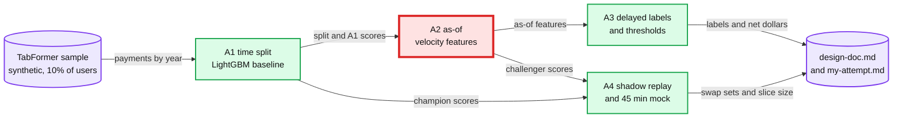

# Capstone A: card-fraud model, end to end

> One line: take a synthetic card dataset from a framing line to a shadow plan in 4 sessions, then defend the design in a timed 45-minute mock on the payments-risk probe ladder.

**When:** after M4 (lab 27). In the interview-track order it comes right after lab 27, with the mock. **Level:** B, Explanatory output style. **Runs on:** cpu, light lane. **Needs:** base install only.
**No reference run and no answers file.** Your RESULT lines are the result. How a capstone session runs: [`../README.md`](../README.md#the-60-minute-loop-adapted).

## Goal

After these 4 sessions I can:

- frame a card-fraud model in 6 fields and report a time-split LightGBM PR-AUC (area under the precision-recall curve) with a 95% bootstrap interval over 1,000 resamples of cards;
- build 6 as-of velocity features per card and prove each one on 200 random payments;
- simulate dispute delays of 7 to 120 days plus a proxy flag (recall 0.5, precision 0.4), and price amount-aware decline thresholds in net dollars;
- compare a champion and a challenger at a matched 0.5% decline rate, and size an exploration slice with its fraud dollars per 30 days;
- answer all 8 probes of the payments-risk ladder in 45 minutes and grade the answer on 6 criteria.

## Sessions

| Session | File | Baseline | One change | labkit id | Status |
|---|---|---|---|---|---|
| A1 | [Framing and baseline](session-1-framing-and-baseline.md) | Base rate, and Amount as the only score | LightGBM on the raw columns, with bootstrap intervals by row and by card | 41 | todo |
| A2 | [As-of velocity features](session-2-as-of-velocity-features.md) | A1's model plus 6 as-of features | The same features from a latest-value join | 42 | todo |
| A3 | [Delayed labels and thresholds](session-3-delayed-labels-and-thresholds.md) | Mature labels only | Mature plus proxy labels, then amount-aware thresholds | 43 | todo |
| A4 | [Shadow plan and mock](session-4-shadow-plan-and-mock.md) | Champion vs challenger at a matched 0.5% decline rate | None: the 45-minute mock | 44 | todo |

Sessions 3 and 4 use a 0.5% decline rate. If your A1 framing line sets another guardrail, rewrite those rows before you predict.

Red is the as-of join (A2). If it leaks, sessions 3 and 4 inherit the leak and every later number moves with it. That is why its 200-row check must pass before A2's first measured run.

## Data

**IBM TabFormer, synthetic credit card transactions.** No real cardholder is behind any row: label every number from it "synthetic", and never quote one as a real-world fraud rate.

| Fact | Value |
|---|---|
| Rows and users | 24 M records (the TabFormer README: "24M records with 12 fields"). 2,000 users by IBM's own description of the simulation ("The data covers 2000 (synthetic) consumers", [Kaggle](https://www.kaggle.com/datasets/ealtman2019/credit-card-transactions)); the TabFormer paper says 20,000. `--download` prints the count it finds |
| Columns (15 in the CSV) | User, Card, Year, Month, Day, Time, Amount, Use Chip, Merchant Name, Merchant City, Merchant State, Zip, MCC (merchant category code), Errors?, Is Fraud? |
| URL | <https://media.githubusercontent.com/media/IBM/TabFormer/main/data/credit_card/transactions.tgz> |
| Size | 278,576,638 B (278.6 MB) tgz, holding `card_transaction.v1.csv` (2,354,626,737 B) |
| Checked | HEAD request on 2026-10-17: HTTP 200, no login. It is a Git LFS (Large File Storage) object, so check only with a HEAD request; the download itself counts against the repo's LFS bandwidth |
| Integrity | The LFS pointer (a 134 B text file at the same path on raw.githubusercontent.com) gives sha256 `e9f589a0958f40d60f81b1a2e8428db86e00c05755caf44fb055827976c0efa2` and size 278576638. Check the tgz against it |
| Licence | Apache-2.0 ([IBM/TabFormer](https://github.com/IBM/TabFormer)) |

**The sample.** A1's `--download` fetches the tgz with `labkit.fetch(..., size=278_576_638)`, extracts the CSV, then reads it in chunks of 1 M rows and keeps 10% of the `User` ids it finds (200 if the file holds 2,000), drawn with `numpy.random.default_rng(0)`. All of a kept user's payments stay. It writes `~/ml-data/tabformer/sample.parquet` and prints paths, sizes, users found, users kept and rows per year, never a fraud count.

- Card key: the pair (User, Card).
- Timestamp: from Year, Month, Day and Time. Time is `HH:MM`, so payments in the same minute tie, and every window rule must say how ties count.
- Amount is text with a leading `$` (TabFormer's own loader strips the first character). Is Fraud? is `Yes` or `No`.
- Disk: 278.6 MB of tgz plus 2.35 GB of CSV while sampling. Delete the CSV once `sample.parquet` exists; keep the tgz.
- Why not Credit Card Fraud (OpenML 1597): it has no card or merchant key, so it stays in labs 09, 22, 24 and 27.

**If the download fails** (an LFS bandwidth quota error, or HTTP 403 or 429): the TabFormer README offers a [Box link](https://ibm.box.com/v/tabformer-data) for exactly this case. It is a shared folder, "Data for TabFormer", whose `credit_card` folder is 278,576,638 B, the tgz's size. Open it in a browser: on 2026-10-17 it answered HTTP 200 to a browser and HTTP 404 to a script. Save the file as `~/ml-data/tabformer/transactions.tgz` and check the sha256. If that fails too, use the fallback.

### Fallback: the paystream generator (synthetic)

[`../../m4-production-ml-payments/scripts/paystream.py`](../../m4-production-ml-payments/scripts/paystream.py) is the seeded, synthetic payments stream of labs 19, 21 and 23: 5,000 customers, 10,000 terminals and 183 days from 2018-04-01, about 1.80 M payments, with a dispute delay for every fraud and an early-warning proxy flag. Its parameters follow the [Fraud Detection Handbook, chapter 3](https://fraud-detection-handbook.github.io/fraud-detection-handbook/Chapter_3_GettingStarted/SimulatedDataset.html); the code is written fresh. Import it, never edit it.

- In A1's `--download`, put `ml-learning/m4-production-ml-payments/scripts` on `sys.path` (found from the script's own path, the way labkit is found), then call `paystream.load()`. On first use it writes `~/ml-data/paystream/v1/transactions.parquet` and prints only its path and size. Running `paystream.py --download` directly also prints the overall fraud share, so write A1's P1 first, or log it as skip.
- Use all 5,000 customers: the 10% user sample applies to TabFormer only.
- Never quote a fallback number as a real-world rate: the generator is synthetic and easier than real fraud.

| TabFormer | paystream (synthetic) |
|---|---|
| User and Card | `customer_id` (one card per customer) |
| Year, Month, Day, Time | `tx_datetime`, to the second |
| Amount | `amount` |
| Merchant Name | `terminal_id` |
| MCC, Use Chip, Merchant City, Merchant State, Zip, Errors? | No counterpart. Drop them, and drop A2's first-time-at-this-MCC flag |
| Is Fraud? | `is_fraud` |
| Nothing (A3 simulates delays) | `label_available_at`, `proxy_flag`, `proxy_at`: use them as shipped |

Calendar on the fallback: years become days. Train on days 0 to 99, validate on days 100 to 126, test on days 127 to 182 (lab 19's test window). A3 uses lab 21's calendar instead (today is day 183, mature-only labels on days 0 to 62, the test on days 170 to 182), because 183 days cannot hold a 120-day maturity plus a separate test period.

## Deliverable

1. **`design-doc.md`** in this folder, 1 page (about 60 lines), in ML-design order: framing, offline and online metrics, labels, features, model, training, serving, evaluation, A/B testing, monitoring. Each write-up block adds its sections: A1 framing and metrics; A2 features and model; A3 labels, training and evaluation; A4 serving, A/B testing and monitoring.
2. **5 soundbites** at the end of `design-doc.md`, one or two sentences each. Cross-check each against a named section of [`hld/payments-risk-decisioning/`](../../../hld/payments-risk-decisioning/README.md): it agrees, or you say where your run differs and why.
3. **`hld/payments-risk-decisioning/my-attempt.md`**: the timed 45-minute answer to the [8-probe ladder](../../../hld/payments-risk-decisioning/README.md#what-interviewers-probe-the-ladder), with its self-grade. That path is the file [`hld/CLAUDE.md`](../../../hld/CLAUDE.md#6-workflow-for-a-new-problem) reserves for a timed attempt (§6 step 2), and problem 52's row in `hld/README.md` lists it as missing.

## Rubric

| # | Criterion | Pass when |
|---|---|---|
| 1 | Framing | All 6 fields hold a number or a named event, and the same line opens `design-doc.md` |
| 2 | Honest split | Train, validation and test years are named; no choice is made on the test year; every comparison uses the same test year |
| 3 | Uncertainty | Every PR-AUC, recall and dollar figure has a 95% bootstrap interval; any difference inside its interval is called noise |
| 4 | As-of features | Each feature has a written window rule, and the 200-row brute-force check passed before the first measured run |
| 5 | Labels | The maturity rule and the proxy rule fit in one sentence each, and both training sets are scored on true labels |
| 6 | Thresholds | p\*(a) with its cost inputs marked as estimates, net dollars against a flat threshold, and the decline rate of each |
| 7 | Shadow | Overlap, swap-in and swap-out counts at a matched decline rate; an exploration slice sized from an interval width, with its fraud dollars per 30 days |
| 8 | Monitoring | 3 to 5 signals, each with a threshold and the person it pages |
| 9 | Mock | 45 minutes, all 8 probes answered, self-graded on the six criteria of root [`CLAUDE.md`](../../../CLAUDE.md#7-staff-level-bar-calibrate-answers-to-this) §7, the weakest one named |
| 10 | Wording | Every number labelled synthetic. LightGBM is never "the payments workhorse". Radar's 0 to 99 score is never called a probability |

## Repo HLD it maps to

[`hld/payments-risk-decisioning/`](../../../hld/payments-risk-decisioning/README.md), problem 52: inline risk decisioning inside a 100 ms budget.

- The [probe ladder](../../../hld/payments-risk-decisioning/README.md#what-interviewers-probe-the-ladder), 8 probes: the A4 mock.
- [`solution.md` §5.5](../../../hld/payments-risk-decisioning/solution.md#55-labels-arrive-60-to-90-days-later-how-do-you-train-and-how-do-you-know-a-new-model-is-better-before-it-declines-real-customers-loss-budget-the-model): labels, thresholds, shadow, canary and drift monitors.
- [`deep-dives/model-lifecycle-shadow-and-labels.md`](../../../hld/payments-risk-decisioning/deep-dives/model-lifecycle-shadow-and-labels.md): §1 labels (A3), §2 leakage (A2), §3 exploration slices (A4), §4 thresholds (A3), §5 proving a model (A4), §10 numbers to say out loud.
- [`deep-dives/features-and-freshness.md` §6](../../../hld/payments-risk-decisioning/deep-dives/features-and-freshness.md#6-point-in-time-correctness): point-in-time correctness (A2).
- [`deep-dives/latency-budget-and-hot-path.md` §5](../../../hld/payments-risk-decisioning/deep-dives/latency-budget-and-hot-path.md#5-what-else-is-in-process-and-why): the in-process GBDT and the shadow scored after the response (A4).

Wording for the model section. GBDT (gradient-boosted decision trees) is the right first model and the HLD's inline choice at about 3 M payments a day. Stripe Radar, though, moved from an XGBoost plus DNN (deep neural network) ensemble to a DNN-only model in mid-2022 ([stripe.dev, 2023-03-29](https://stripe.dev/blog/how-we-built-it-stripe-radar)). So never call LightGBM "the payments workhorse". Stripe's "under 100 ms" is a published figure, not an SLO (service level objective).

## Builds on

| Lab | What A reuses |
|---|---|
| 03 | Baselines first, then LightGBM as the first model |
| 09 | PR-AUC and its interval on rare events |
| 10 | Test on the future: a time split |
| 19 | As-of features with a point-in-time join (A2) |
| 20 | One feature function for training and serving (A2, A4) |
| 21 | Mature, proxy and naive labels (A3) |
| 22 | Calibration and amount-aware thresholds (A3) |
| 23 | The exploration slice and its interval widths (A4) |
| 24 | Matched decline rates and swap sets (A4) |
| 25 | Why label maturity, not traffic, sets the experiment clock (A4) |
| 26 | PSI (population stability index) for the monitoring plan (A4) |
| 27 | The audit questions you now ask of your own script |

The labs live in [`../../m1-whole-game/labs/`](../../m1-whole-game/labs/), [`../../m2-dont-fool-yourself/labs/`](../../m2-dont-fool-yourself/labs/) and [`../../m4-production-ml-payments/labs/`](../../m4-production-ml-payments/labs/).

## Sources

- Padhi et al. 2021, "Tabular Transformers for Modeling Multivariate Time Series" ([arXiv 2011.01843](https://arxiv.org/abs/2011.01843)): the paper behind TabFormer and its data.
- [IBM/TabFormer](https://github.com/IBM/TabFormer): the data, the Apache-2.0 licence and the loader (`dataset/card.py`; `args.py` names the file `card_transaction.v1`).
- IBM, [Credit Card Transactions](https://www.kaggle.com/datasets/ealtman2019/credit-card-transactions), Kaggle: the same simulation, described as "2000 (synthetic) consumers". Reading the page needs no login; only the files do, and A never uses them.
- Drapeau 2023, [How we built it: Stripe Radar](https://stripe.dev/blog/how-we-built-it-stripe-radar), stripe.dev.
