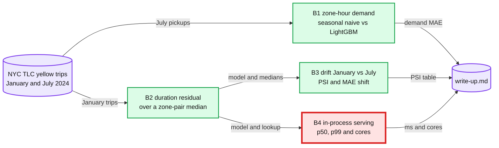

# Capstone B: ride-hailing demand and ETA

> One line: on NYC taxi trips, forecast pickups per zone-hour, then build a trip-duration model for pickup time, measure its drift from January to July, and serve it in process against a few-millisecond budget, in 4 sessions.

**When:** after M7 (lab 40), before or after Capstone C. **Level:** B, Explanatory output style. **Runs on:** cpu, light lane. **Needs:** base install only.
**No reference run and no answers file.** Your RESULT lines are the result. How a capstone session runs: [`../README.md`](../README.md#the-60-minute-loop-adapted).

## Goal

After these 4 sessions I can:

- forecast July 2024 pickups per zone-hour against seasonal naive, 1 hour and 3 hours ahead, with every lag proven to point at the past;
- predict trip duration in seconds at pickup time as a residual over a zone-pair median, without the metered `trip_distance`, which exists only at dropoff;
- measure January-to-July drift with PSI (population stability index) per feature, the MAE (mean absolute error) it costs, and what a refresh on July buys back;
- state p50 and p99 ms per prediction in process and the cores needed at an assumed 10,000 predictions a second, against Uber DeepETA's "within a few milliseconds at most".

## Sessions

| Session | File | Baseline | One change | labkit id | Status |
|---|---|---|---|---|---|
| B1 | [Zone-hour demand](session-1-zone-hour-demand.md) | Seasonal naive and LightGBM, 1 hour ahead | 3 hours ahead | 45 | todo |
| B2 | [Duration residual](session-2-duration-residual.md) | Median duration per zone pair and hour | LightGBM on the residual; the metered distance shown, never shipped | 46 | todo |
| B3 | [Drift, January vs July](session-3-drift-january-vs-july.md) | PSI per feature; the January model on a July week | Medians and model refreshed on July | 47 | todo |
| B4 | [Latency and serving cost](session-4-latency-and-serving-cost.md) | p50 and p99 per single prediction, default threads | One thread per predict call; cores at peak | 48 | todo |

B1 is the demand half. B2 to B4 are the ETA (estimated time of arrival) half, one model carried through.

Red is serving (B4). Uber's DeepETA post calls its ETA post-processing model "the highest QPS (queries per second) model at Uber", so the per-prediction budget, not the offline MAE, decides which model can ship.

## Data

**NYC TLC (Taxi and Limousine Commission) yellow taxi trip records, 2024.**

| File | URL | Size | Checked |
|---|---|---|---|
| January 2024 trips | <https://d37ci6vzurychx.cloudfront.net/trip-data/yellow_tripdata_2024-01.parquet> | 49,961,641 B (49.96 MB), 2,964,624 trips | HEAD request on 2026-10-17: HTTP 200, no login |
| July 2024 trips | <https://d37ci6vzurychx.cloudfront.net/trip-data/yellow_tripdata_2024-07.parquet> | 52,299,432 B (52.30 MB) | HEAD request on 2026-10-17: HTTP 200, no login |
| Zone lookup | <https://d37ci6vzurychx.cloudfront.net/misc/taxi_zone_lookup.csv> | 12,331 B, 265 zones | HEAD request on 2026-10-17: HTTP 200, no login |

- **Already on disk** in `~/ml-data/tlc/` if labs 16, 20 and 26 ran. Each session's `--download` fetches only what is missing, with `labkit.fetch(url, dest, size=...)`.
- **Licence:** the [nyc.gov terms of use](https://www.nyc.gov/main/terms-of-use); the files come from the [TLC trip record page](https://www.nyc.gov/site/tlc/about/tlc-trip-record-data.page). Fine for private study with the data in `~/ml-data/`. Never commit the files or publish a derived dataset.
- **Columns used:** `tpep_pickup_datetime`, `tpep_dropoff_datetime`, `PULocationID`, `DOLocationID`, and `trip_distance` (only for a zone pair's median past distance, and in B2's one run that shows the metered distance).
- **Filters:** each month keeps the pickups inside that month. Zones 264 ("Unknown") and 265 ("Outside of NYC") are dropped.
- **Fallback:** none is needed. The files are public on CloudFront with no login; if a URL moves, the TLC trip record page lists the same month.

## Deliverable

`write-up.md` in this folder, 1 page:

1. **Demand.** Seasonal naive and LightGBM MAE, in pickups per zone-hour, 1 hour and 3 hours ahead, on July 25 to 31.
2. **Duration.** The B2 model's MAE in seconds against the zone-pair median baseline on January 25 to 31, plus the metered-distance number, labelled "cannot ship".
3. **Drift.** PSI per feature from January to July, the MAE shift on a July week, and what the July refresh bought.
4. **Serving.** p50 and p99 ms per prediction with their conditions, against DeepETA's "within a few milliseconds at most" and your own reading of "a few", written before the run.
5. **Cost.** Cores at the assumed 10,000 predictions a second and dollars a month at an assumed $0.04 per core-hour, both labelled assumed.
6. **Links.** [`hld/driver-hot-clusters/solution.md`](../../../hld/driver-hot-clusters/solution.md) for the demand half, and the sentence "No repo file covers ETA."

## Rubric

| # | Criterion | Pass when |
|---|---|---|
| 1 | Demand baseline first | Seasonal naive and LightGBM on the same July test week, at both horizons; the busy zones chosen on training days only; lab 16's lag check passed |
| 2 | Duration at pickup time | MAE in seconds against the zone-pair median baseline, every feature known at pickup; the metered-distance model reported and excluded |
| 3 | Uncertainty | Every MAE difference has a 95% bootstrap interval; any difference inside it is called noise |
| 4 | Drift | PSI per feature with the 0.2 threshold, plus the MAE shift that PSI does or does not explain |
| 5 | Serving | p50 and p99 ms with their conditions (M4 Pro, cpu, batch 1, threads, n, median of 5 repeats), against your written reading of "a few milliseconds" |
| 6 | Cost | Cores from CPU-ms per prediction at the stated peak, and dollars a month, each assumption labelled |
| 7 | Links and scope | The driver-hot-clusters link for demand, and the statement that no repo file covers ETA |

## Repo HLD it maps to

- **Demand:** [`hld/driver-hot-clusters/solution.md`](../../../hld/driver-hot-clusters/solution.md). It counts supply, distinct drivers per 1 km² cell over the last 20 minutes ([§4.2](../../../hld/driver-hot-clusters/solution.md#42-count-distinct-drivers-per-cell-over-the-last-20-minutes)), and makes hourly counts final after a 15-minute late-data cutoff ([§4.4](../../../hld/driver-hot-clusters/solution.md#44-institutions-hourly-final-private-files)). B1 forecasts demand per zone-hour, and positioning drivers needs both. [§5.3](../../../hld/driver-hot-clusters/solution.md#53-institutions-and-ops-see-different-numbers-which-is-right) is where provisional and final counts differ, which decides what a 1-hour lag can read at serving time.
- **ETA: no repo file covers ETA.** The closest, [`hld/uber-ride-hailing/my-attempt.md`](../../../hld/uber-ride-hailing/my-attempt.md), lists routing and ETA as out of scope. B3 and B4 borrow two patterns from the payments HLD instead: PSI alerts ([`model-lifecycle-shadow-and-labels.md` §5](../../../hld/payments-risk-decisioning/deep-dives/model-lifecycle-shadow-and-labels.md#5-proving-a-model-before-it-declines-anyone)) and a model kept in process on the hot path ([`latency-budget-and-hot-path.md` §5](../../../hld/payments-risk-decisioning/deep-dives/latency-budget-and-hot-path.md#5-what-else-is-in-process-and-why)).

## Builds on

| Lab | What B reuses |
|---|---|
| 16 | Seasonal naive first, and every lag checked against a direct lookup (B1) |
| 20 | One feature function for training and serving (B2, B4) |
| 26 | PSI between these same two months (B3) |
| 24 | Latency per decision and cores at a peak rate (B4) |

The labs live in [`../../m3-more-of-the-map/labs/`](../../m3-more-of-the-map/labs/) and [`../../m4-production-ml-payments/labs/`](../../m4-production-ml-payments/labs/).

## Sources

- Binaykiya, Hu, Cirit and Hora 2022, [DeepETA: How Uber Predicts Arrival Times Using Deep Learning](https://www.uber.com/blog/deepeta-how-uber-predicts-arrival-times/), Uber blog, 2022-02-10: "The model must return an ETA within a few milliseconds at most." It gives no QPS (queries per second) figure, so B4's peak is an assumption.
- NYC TLC, [trip record data](https://www.nyc.gov/site/tlc/about/tlc-trip-record-data.page).
