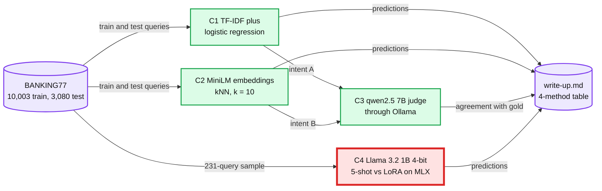

# Capstone C: support triage with retrieval and a small LLM

> One line: route banking support queries to 77 intents four ways (TF-IDF, embedding kNN, a 5-shot 1B LLM and a LoRA-tuned one), settle the disputed cases with a 7B judge, and price every method per 1,000 queries, in 4 sessions.

**When:** after M7 (lab 40), before or after Capstone B. **Level:** B, Explanatory output style. **Runs on:** cpu (C1, C2), cpu+ollama (C3), mlx (C4). **Lane:** light for C1 and C2, heavy for C3 and C4.
**Needs:** `python -m pip install sentence-transformers==6.1.0 mlx==0.32.4 mlx-lm==0.32.2`, plus Ollama 0.18 with `qwen2.5:7b`. Labs 12, 14, 15 and 40 set all of them up.
**No reference run and no answers file.** Your RESULT lines are the result. How a capstone session runs: [`../README.md`](../README.md#the-60-minute-loop-adapted).

## Goal

After these 4 sessions I can:

- compare 4 intent classifiers on the same 231 BANKING77 test queries (3 per intent) by accuracy and macro-F1, each with an exact paired sign test against TF-IDF (term frequency, inverse document frequency), and TF-IDF and kNN (k nearest neighbours) also on all 3,080;
- measure a `qwen2.5:7b` judge's agreement with gold labels on 50 disputed queries, in both answer orders;
- price every method in tokens and Mac-seconds per 1,000 queries.

## Sessions

| Session | File | Baseline | One change | labkit id | Status |
|---|---|---|---|---|---|
| C1 | [TF-IDF and the confused pairs](session-1-tfidf-and-confused-pairs.md) | Word TF-IDF plus logistic regression | Character 2- to 5-grams | 49 | todo |
| C2 | [Embedding kNN](session-2-embedding-knn.md) | all-MiniLM-L6-v2 kNN vs C1's TF-IDF | Both rebuilt on 10 queries per intent | 50 | todo |
| C3 | [LLM judge](session-3-llm-judge.md) | `qwen2.5:7b` picks between C1's and C2's intent, both orders | 3 training examples per candidate intent in the prompt | 51 | todo |
| C4 | [LoRA vs 5-shot](session-4-lora-vs-few-shot.md) | Llama 3.2 1B 4-bit, 5-shot | A LoRA adapter, zero-shot | 52 | todo |

Red is the LLM path (C4). A router answers every message, so the seconds and tokens per query decide whether an LLM can sit in front of all traffic or only behind a TF-IDF or kNN first pass.

## Data

**BANKING77** (Casanueva et al. 2020): customer queries to an online bank, labelled with 77 intents such as `card_arrival` and `lost_or_stolen_card`.

| File | URL | Size | Checked |
|---|---|---|---|
| `train.csv` | <https://raw.githubusercontent.com/PolyAI-LDN/task-specific-datasets/master/banking_data/train.csv> | 839,073 B, 10,003 queries | HEAD request on 2026-10-17: HTTP 200, no login |
| `test.csv` | <https://raw.githubusercontent.com/PolyAI-LDN/task-specific-datasets/master/banking_data/test.csv> | 239,961 B, 3,080 queries | HEAD request on 2026-10-17: HTTP 200, no login |

- **Total:** 13,083 queries, 77 intents. Columns: `text` and `category` (the intent).
- **Licence:** CC BY 4.0 ([PolyAI-LDN/task-specific-datasets](https://github.com/PolyAI-LDN/task-specific-datasets)). Cite it in the write-up. The files stay in `~/ml-data/`.
- **Download:** C1's `--download` fetches both into `~/ml-data/banking77/` (1.1 MB). Lab 15 fetches the same two files.
- **Fallback:** none is needed. The files are 1.1 MB on raw.githubusercontent.com with no login.

| Model | Size and licence | Used in | Already set up by |
|---|---|---|---|
| `sentence-transformers/all-MiniLM-L6-v2` | 384 dimensions, 90.9 MB, Apache-2.0, ungated | C2 | lab 12, in `~/ml-data/hf/` |
| `qwen2.5:7b` through Ollama | 4.68 GB, Apache-2.0 (the Qwen2.5-7B-Instruct card), ungated | C3 | labs 14 and 15 |
| `mlx-community/Llama-3.2-1B-Instruct-4bit` | 695.3 MB, Llama 3.2 Community License, ungated | C4 | lab 40, in `~/ml-data/hf/` |

## Deliverable

`write-up.md` in this folder, 1 page:

1. **The 4-method table** on the same 231 queries: accuracy, macro-F1, flips against TF-IDF each way with the exact sign-test p-value, tokens per query, and Mac-seconds per 1,000 queries. TF-IDF and kNN also on all 3,080.
2. **The judge:** agreement with gold on the 50 disputed queries in both orders, the share of verdicts that flip when the order swaps, and its tokens and Mac-seconds per 1,000 judged queries.
3. **The router decision:** which method goes first in the router, what it falls back to, and why, in 3 sentences that cite your numbers and the HLD sections below.

## Rubric

| # | Criterion | Pass when |
|---|---|---|
| 1 | Same items | All 4 methods scored on the same 231 queries, drawn once with seed 0, and TF-IDF and kNN also on all 3,080 |
| 2 | Paired tests | Flips each way and an exact sign-test p-value for every method against TF-IDF; a gap the test cannot separate is called a tie |
| 3 | Judge | Agreement with gold in both orders, the flip rate, and the rule for when this judge may settle disputes |
| 4 | Cost | Tokens and Mac-seconds per 1,000 queries for every method and for the judge, with the conditions (M4 Pro, device, batch, sequential or not) |
| 5 | Decision | A router choice in 3 sentences that follows from rows 1 to 4 and cites the HLD |
| 6 | Licences | BANKING77's CC BY 4.0 cited, the Llama 3.2 Community License named, and no data in the repo |

## Repo HLD it maps to

[`hld/financial-ai-assistant/solution.md`](../../../hld/financial-ai-assistant/solution.md), problem 55, has the same problem inside it: a question must be routed to an intent before anything else happens.

- [§5.1, the bounded loop](../../../hld/financial-ai-assistant/solution.md#51-first-visible-event-under-2-s-and-a-verified-answer-under-8-s-at-300-questions-a-second-the-bounded-loop): a router on a small model "picks the intent and one of ~8 tool bundles".
- [§5.6, availability](../../../hld/financial-ai-assistant/solution.md#56-the-llm-provider-is-down-what-still-works-availability): when the provider is down, "A local intent matcher (keywords plus a small classifier in the orchestrator, ~5 ms)" answers the templated intents.
- [§5.5, the quality gate](../../../hld/financial-ai-assistant/solution.md#55-how-do-you-know-a-new-prompt-or-model-is-better-before-shipping-what-is-in-the-eval-set-and-who-labels-it-the-quality-gate): paired comparisons, and per-intent drops flagged for a human.
- [`deep-dives/offline-evals-and-rollout.md`](../../../hld/financial-ai-assistant/deep-dives/offline-evals-and-rollout.md): §3 what a paired suite of a given size can see, §5 the judge and how far to trust it.
- [`deep-dives/latency-cost-and-context.md` §4](../../../hld/financial-ai-assistant/deep-dives/latency-cost-and-context.md#4-cost-per-question-and-what-moves-it): cost per question, and what moves it.
- For C2's retrieval half: [`concepts/rag-and-react.md` §3](../../../concepts/rag-and-react.md#3-retrieval-quality-dense-sparse-hybrid-rerank), dense, sparse and hybrid retrieval.

## Builds on

| Lab | What C reuses |
|---|---|
| 04 | TF-IDF against a pretrained model, and ms per 1,000 items (C1, C2) |
| 12 | Dense retrieval with all-MiniLM-L6-v2 on the CPU (C2) |
| 14 | An LLM judge checked against human labels, in both orders (C3) |
| 15 | BANKING77 through Ollama, a JSON schema, and a paired gate (C3) |
| 40 | LoRA on the 1B 4-bit model against a 5-shot prompt, with a sign test (C4) |

The labs live in [`../../m1-whole-game/labs/`](../../m1-whole-game/labs/), [`../../m3-more-of-the-map/labs/`](../../m3-more-of-the-map/labs/) and [`../../m7-language-models/labs/`](../../m7-language-models/labs/).

## Sources

- Casanueva et al. 2020, "Efficient Intent Detection with Dual Sentence Encoders" ([arXiv 2003.04807](https://arxiv.org/abs/2003.04807)): BANKING77.
- Zheng et al. 2023, "Judging LLM-as-a-Judge with MT-Bench and Chatbot Arena" ([arXiv 2306.05685](https://arxiv.org/abs/2306.05685)): judge agreement and position bias.
- Hu et al. 2021, LoRA ([arXiv 2106.09685](https://arxiv.org/abs/2106.09685)), and the [mlx-lm LORA.md](https://github.com/ml-explore/mlx-lm/blob/main/mlx_lm/LORA.md).
