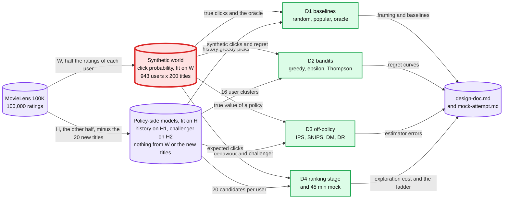

# Capstone D: recommendations with bandits

> One line: split 100,000 MovieLens ratings per user into a world half and a policy half, turn the world half into a synthetic click world, learn which title to show at each visit with greedy, epsilon-greedy and Thompson sampling, value a new policy from logged propensities before it serves anyone, then put the bandit at the ranking stage and defend the design in a timed 45-minute mock, in 4 sessions.

**When:** after M5 (lab 33), or as soon as labs 05, 13, 18, 23, 25 and 33 are done. **Level:** B, Explanatory output style. **Runs on:** cpu, light lane. **Needs:** base install only.
**Prerequisites:** labs 05, 13, 18, 23, 25 and 33, each with its debrief. D2 uses lab 18 for k-means hygiene.
**No reference run and no answers file.** Your RESULT lines are the result. How a capstone session runs: [`../README.md`](../README.md#the-60-minute-loop-adapted).

## Goal

After these 4 sessions I can:

- frame a one-title home-page slot in 6 fields, split 100,000 ratings per user into a world half W and a policy half H, and build a synthetic click world for 943 users x 200 titles from a matrix-factorization (MF) model fit on W alone, with random, most-popular and oracle baselines in clicks per 1,000 visits and cumulative regret over 500,000 visits;
- compare greedy, epsilon-greedy at 0.01 and 0.1, and Thompson sampling per title and per 16 user clusters by their regret curves, and count the exposure 20 titles new to every policy get when they join at visit 250,000;
- estimate a challenger's clicks per 1,000 visits from 200 logs of 100,000 epsilon-greedy visits with IPS (inverse propensity scoring), self-normalised IPS, the direct method and doubly robust, as bias, SD (standard deviation) and RMSE (root mean squared error) against the true value, at 4 exploration rates and with a positivity hole: titles the log can never show;
- price exploration at the ranking stage of lab 13's two-stage system in clicks per 1,000 visits, compare a 4-arm A/B test that holds each user in one arm and computes its interval over users with a 4-arm bandit in clicks lost, and answer an 8-probe streaming home page ladder in 45 minutes, graded on 6 criteria.

## Sessions

| Session | File | Baseline | One change | labkit id | Status |
|---|---|---|---|---|---|
| D1 | [Framing and a simulated user](session-1-framing-and-simulated-user.md) | A synthetic click world fit on W; random, most popular and the oracle | Greedy on a history model trained on H1, ratings the world never saw | 53 | todo |
| D2 | [Explore vs exploit](session-2-explore-vs-exploit.md) | Greedy, epsilon-greedy at 0.01 and 0.1, and Thompson sampling, per title | Thompson sampling per user cluster and title, then 20 titles no policy-side model has seen join mid-run | 54 | todo |
| D3 | [Off-policy evaluation](session-3-off-policy-evaluation.md) | IPS, self-normalised IPS, the direct method and doubly robust on 200 logs at epsilon 0.1 | Epsilon 0.01, 0.05 and 0.3, then a positivity hole | 55 | todo |
| D4 | [Ranking stage and mock](session-4-ranking-stage-and-mock.md) | Exploration cost among 20 candidates, a 4-arm A/B test vs a bandit, the spread of impressions | None: the 45-minute mock | 56 | todo |

labkit takes a number. A to C use 41 to 52, so D1 to D4 use 53 to 56, each with its own `~/ml-data/runs/labNN/`. D2 to D4 read what D1 saved, so run D1's `--download`, then its `--baseline` and `--change` at seed 0, first.

Red is the synthetic world (D1). Every click rate, regret and estimator error in D2 to D4 is measured against it, so a flaw in it moves every later number together. Li, Chu, Langford and Wang 2011 name the risk: "creating simulator itself is often difficult and modeling bias is usually unavoidably introduced." That is why D1 fits it once, on W only, labels it synthetic, and writes down what it cannot tell you, the coupling that remains included.

## Data

**MovieLens 100K** (GroupLens). The world trains on one half of it, W. Every policy-side model trains on the other half, H.

| Fact | Value |
|---|---|
| Ratings | 100,000 ratings from 1 to 5 by 943 users on 1,682 movies, every user with at least 20 (the dataset's README) |
| Items | The title, as in labs 05 and 33: 1,682 movie ids under 1,664 titles. 18 titles sit under two ids each, 3 of them in the catalogue, so keying on the title merges their ratings |
| Catalogue | The 200 most-rated titles: every title with at least 152 ratings (the 201st has 151, so there is no tie). They hold 48,011 of the 100,000 ratings |
| Split | One fixed shuffle per user: half of each user's ratings, rounded down, go to W (49,760 ratings) and the rest to H (50,240). The 20 new titles (D1's Terms) hold 4,634 of the 100,000 ratings. With their H share removed, every user keeps at least 6 ratings in H, whatever the shuffle, so H1 and H2 each hold at least 3 ratings of every user |
| Collected | September 19, 1997 to April 22, 1998, on the MovieLens web site (the README) |
| Files used | `u.data` (user id, item id, rating, timestamp) and `u.item` (movie id, title, release date, genres), read as lab 05's script reads them |
| URL | <https://files.grouplens.org/datasets/movielens/ml-100k.zip> |
| Size | 4,924,029 B (4.92 MB) zip |
| Checked | HEAD request on 2026-10-17: HTTP 200, no login. The counts in this table were read from that zip on the same day, the Split row's on 2026-10-18 |
| Licence | Research use only. The README's terms: no redistribution without separate permission, no commercial or revenue-bearing use without permission from GroupLens, and cite Harper and Konstan 2015 in any publication |
| On disk | `~/ml-data/ml-100k/ml-100k/` once lab 05 has run. D1's `--download` fetches the zip only if it is missing, with `labkit.fetch(URL, ZIP, size=4_924_029)` |

- Data stays in `~/ml-data/`. Never commit the zip, a file derived from it, or a table of the synthetic world.
- Fallback: none is needed. The zip is 4.92 MB with no login. If the URL moves, the [GroupLens 100K page](https://grouplens.org/datasets/movielens/100k/) lists it.

### The synthetic click world

D1 builds it and D1's Terms define it: an MF model fit on W, half of each user's ratings, predicts a rating for every user and title, and a fixed link turns that rating into a click probability. Every click, click rate and regret in this capstone comes from it, so label each one synthetic.

- **Why a simulator.** A log holds outcomes only for what was shown. Gomez-Uribe and Hunt 2015 (Netflix, §4.6) say offline experiments "assume that members would have behaved the same way ... if the new algorithm being evaluated had been used to generate the recommendations". A simulator knows the click probability of every title for every user, so regret and an estimator's error can be measured exactly.
- **Its price.** No number from D transfers to a real home page. What transfers is the method: compare policies on one stream, price exploration, and check an estimator against a known truth.
- **What the split buys, and what it does not.** W fits the world and nothing else. H fits every policy-side model. The history model learns from H1, and it is also D3's champion and the direct method's reward model. The 16 clusters come from its user rows, the challenger learns from H2, and every popularity sort counts ratings in H. So no policy learns from the ratings that define the truth. W and H share no rating, but they are the same 943 users' tastes, so a policy that learns H learns the users the world was fit on. Every result holds inside this MovieLens-derived simulator, and D1's write-up says so.
- **What it leaves out.** Netflix: "There are typically about 40 rows on each homepage ... and up to 75 videos per row." D fills one slot with one title per visit: no rows, positions, artwork or slates.

### Sizes for the 6-minute cap

| What | Size |
|---|---|
| Users | All 943 |
| Titles | The 200 in the catalogue, the only titles any policy shows. Every rating trains one side only: W the world, H the policy side |
| Visits | 500,000 per policy in D1, D2 and D4; 200,000 for D4's A/B test and bandit, plus a fresh 200,000 for the A/B test's top two |
| Logs | 200 logs of 100,000 visits per setting in D3 |
| Model fits | Lab 33's DotProductBias config, 3 fits in all: the world on W, the history model on H1 and the challenger on H2. Lab 33's reference runs finished within a minute on 80,000 ratings |

- Every policy step is vectorised over its arms: Thompson sampling draws every arm in one `rng.beta` call per visit.
- In D2 and D4, `--smoke` runs 1% of each full run's visits and prints `smoke.loop_s`, the seconds its policy loops took (a timing line, `smoke_ok=True` in `labkit.result()`). Over 3 s is a conservative warning: 100 x 3 s is 5 minutes of loops, which leaves 1 minute of the 6-minute cap for loading and plots, and at 3.6 s the loops alone would fill the cap. Fix the loop first. D3's logs are whole arrays, with no loop per visit.

### Scripts, seeds and saved files

- One script per session in `scripts/`, created in that session: `d1_framing_and_simulated_user.py`, `d2_explore_vs_exploit.py`, `d3_off_policy_evaluation.py` and `d4_ranking_stage_replay.py`. Run every mode from this folder. Each imports labkit before numpy and calls `labkit.start(lab=NN)` with its id, 53 to 56, and uses the modes and RESULT format of [`../README.md`](../README.md#scripts-and-data).
- **Split once, fit once.** D1's `--download` splits the ratings into W, H1 and H2 with a fixed seed and saves the split. The world (D1 `--baseline`, on W), the history model (D1 `--change`, on H1), the 16 clusters (D2) and the challenger (D3, on H2) are fit at seed 0 and saved. Every later run, at any `--seed`, reads them. `--seed` changes the visits, the clicks, the policies' own draws and D4's user-to-arm hash, never the split or the world.
- Saved to `~/ml-data/capstones/d/`: `split.npz`, `world.npz`, `history.npz`, `clusters.npy`, `challenger.npz` and the regret plots. Nothing lands in the repo except your scripts and your markdown.

## Deliverable

1. **`design-doc.md`** in this folder, 1 page (about 60 lines): §1 Framing, §2 Metrics, §3 The simulator and its limits, §4 Policies, §5 Exploration and cold start, §6 Logging and propensities, §7 Offline evaluation, §8 Serving at the ranking stage, §9 Bandit or A/B test, §10 Monitoring and guardrails. Each write-up block adds its sections: D1 §1 to §3, D2 §4 and §5, D3 §6 and §7, D4 §8 to §10.
2. **5 soundbites** at the end of `design-doc.md`, one or two sentences each. Cross-check each against a named section in [Repo HLD it maps to](#repo-hld-it-maps-to): it agrees, or you say where your run differs and why.
3. **`mock-attempt.md`** in this folder: the timed 45-minute answer to the ladder below, with its self-grade. No repo HLD covers a streaming home page. [`hld/README.md`](../../../hld/README.md) lists problem 35, a feature store plus recommendation platform, as todo with no folder, so the attempt lives here.

## The mock: "Design the recommendations for a streaming home page"

D4 runs it: 45 minutes, closed book, this ladder open and nothing else.

1. Frame it. One title per visit: what is the decision, the label and when it matures, the online metric and two guardrails? What does a click reward that a play would not?
2. Walk one page load: candidates, then a ranker, then the slot. Where does the time go, where does a bandit sit, and why not run the bandit over the whole catalogue?
3. A title launches today with no plays. How does it get its first impressions, what do they cost, and when does it stop being explored?
4. You have last week's logs from the current ranker. Estimate a new ranker's click rate before it serves anyone: which estimator, what must every logged impression hold, and how wrong can the estimate be?
5. Bandit or A/B test for a ranking change? Compare the two on clicks lost and on days to a decision, and say what changes with many arms and with drift.
6. The page keeps showing what is already popular. Which number shows it, and what pushes back?
7. A deploy drops the propensity from the impression log, or doubles the exploration rate. What breaks, what pages and at what threshold, and how do you roll back?
8. Product cares about retention, not clicks, and Netflix needs "roughly 2 million members per cell" to measure a 0.1-point retention change. How do you connect a click-trained bandit to that, and what do you refuse to optimise?

Where each probe is answered, for the self-grade only, not during the mock:

| Probe | From your runs | From the repo and the sources |
|---|---|---|
| 1 | D1 framing line | [§7](../../../hld/news-aggregator/deep-dives/ranking-and-cold-start.md#7-cold-start-and-moving-to-a-learned-model) of the ranking deep dive (the v2 label: a click minus bounce-backs) |
| 2 | D4 recall ceiling and exploration cost | [§1 Candidate lanes](../../../hld/news-aggregator/deep-dives/ranking-and-cold-start.md#1-candidate-lanes); [`concepts/vector-index.md` §1](../../../concepts/vector-index.md#1-mental-model) and [§2](../../../concepts/vector-index.md#2-hnsw-the-one-to-explain-on-a-whiteboard) |
| 3 | D2 cold start | [§7](../../../hld/news-aggregator/deep-dives/ranking-and-cold-start.md#7-cold-start-and-moving-to-a-learned-model) (the new article) and [§4](../../../hld/news-aggregator/deep-dives/ranking-and-cold-start.md#4-one-card-per-story-diversity-exploration) (the slot) |
| 4 | D3 | [§7](../../../hld/news-aggregator/deep-dives/ranking-and-cold-start.md#7-cold-start-and-moving-to-a-learned-model) (Offline vs online); the payments [exploration slices](../../../hld/payments-risk-decisioning/deep-dives/model-lifecycle-shadow-and-labels.md#3-two-exploration-slices-because-3ds-biases-one) |
| 5 | D4 A/B test vs bandit; lab 25 | Lattimore and Szepesvári ch 1.2 and ch 31 ([Sources](#sources)) |
| 6 | D4 effective catalogue size and top-10 share | [§8](../../../hld/news-aggregator/deep-dives/ranking-and-cold-start.md#8-feedback-loops-and-popularity-bias); Gomez-Uribe and Hunt §5.3 |
| 7 | D3 positivity hole | [§7](../../../hld/news-aggregator/deep-dives/ranking-and-cold-start.md#7-cold-start-and-moving-to-a-learned-model) (Rollout); [edge case: a bad ranking model release](../../../hld/news-aggregator/edge-cases.md#edge-case-a-bad-ranking-model-release) |
| 8 | D1 §3, what the simulator cannot tell you | Gomez-Uribe and Hunt §4.1 (metrics for A/B tests); [§7](../../../hld/news-aggregator/deep-dives/ranking-and-cold-start.md#7-cold-start-and-moving-to-a-learned-model) (the permanent 1% holdout) |

## Rubric

| # | Criterion | Pass when |
|---|---|---|
| 1 | Framing | All 6 fields hold a number or a named event, the click's maturity is named, and the same line opens `design-doc.md` |
| 2 | Synthetic honesty | Every click number is labelled synthetic. The split is fixed, and the world, both logged-data models and the clusters were fit once at seed 0. No policy-side model saw a rating in W, no policy except the oracle reads the world, and §3 names the coupling that remains: W and H are the same users' tastes |
| 3 | Baselines first | Random, most popular, the oracle and greedy on the history model, on one stream, before any bandit |
| 4 | Noise | Every comparison runs on one stream. Each effect the write-up calls real exceeds 2x its spread over seeds 0, 1 and 2, and the rest are called noise |
| 5 | Explore vs exploit | Regret curves for every policy, the checkpoints, the crossover visit or none, and one sentence on what the Beta(1, 1) prior did |
| 6 | Cold start | New-title shares against the oracle's, and the regret per 1,000 visits before and after the 20 titles join, titles whose ratings no policy-side model or cluster saw |
| 7 | Off-policy evaluation | Bias, SD and RMSE of all four estimators against the true value at 4 exploration rates, and the positivity hole named with its unsupported share |
| 8 | Production | The bandit at the ranking stage with its recall ceiling, the exploration cost in clicks per 1,000 visits and per day at a labelled traffic assumption, propensity logging as a hard requirement, and when an A/B test is still the right tool, with the user as its unit and its comparison declared before the run |
| 9 | Monitoring | 3 to 5 signals, each with a threshold, a window and the person it pages |
| 10 | Mock | 45 minutes, all 8 probes answered, self-graded on the six criteria of root [`CLAUDE.md`](../../../CLAUDE.md#7-staff-level-bar-calibrate-answers-to-this) §7, the weakest one named |

## Repo HLD it maps to

No repo file covers a streaming home page. The closest is the news aggregator's ranking deep dive: one feed, candidates then a scorer, a uniform exploration slot, and a bandit planned for that slot.

- [`hld/news-aggregator/deep-dives/ranking-and-cold-start.md`](../../../hld/news-aggregator/deep-dives/ranking-and-cold-start.md):
  - [§1 Candidate lanes](../../../hld/news-aggregator/deep-dives/ranking-and-cold-start.md#1-candidate-lanes): candidates, then a scorer whose per-request CPU is the red node; "A v2 model must fit the same ~1 ms" (D4).
  - [§4 One card per story, diversity, exploration](../../../hld/news-aggregator/deep-dives/ranking-and-cold-start.md#4-one-card-per-story-diversity-exploration): "The exploration slot is position 7 of every 10, a uniform random draw", at a cost of "~5% of clicks" [estimate] (D2, D3).
  - [§7 Cold start, and moving to a learned model](../../../hld/news-aggregator/deep-dives/ranking-and-cold-start.md#7-cold-start-and-moving-to-a-learned-model): the new article, LinUCB as v2 for the slot, the rollout with a permanent 1% holdout, and offline vs online (D2 to D4).
  - [§8 Feedback loops and popularity bias](../../../hld/news-aggregator/deep-dives/ranking-and-cold-start.md#8-feedback-loops-and-popularity-bias): the loop "ranked high, more impressions, more clicks", and exploration impressions up-weighted by inverse propensity [proposed] (D4).
  - [§10 Trade-offs](../../../hld/news-aggregator/deep-dives/ranking-and-cold-start.md#10-trade-offs): "Uniform draw, 1 slot in 10" chosen over "Bandit on the whole page" (D1, D4).
- [`hld/news-aggregator/solution.md` §5.6](../../../hld/news-aggregator/solution.md#56-a-new-user-a-new-article-a-new-publisher-what-do-they-see): "v1 is an epsilon-greedy slot; LinUCB is v2" (D2).
- [`hld/news-aggregator/edge-cases.md`, evolve from a popularity baseline to personalization](../../../hld/news-aggregator/edge-cases.md#edge-case-evolve-from-a-popularity-baseline-to-personalization-without-tanking-ctr): the ramp, the holdout, and the exploration slot as the log for offline replay (D1, D4).
- The payments HLD's exploration slice, [`model-lifecycle-shadow-and-labels.md` §3](../../../hld/payments-risk-decisioning/deep-dives/model-lifecycle-shadow-and-labels.md#3-two-exploration-slices-because-3ds-biases-one) and [`solution.md` §5.5](../../../hld/payments-risk-decisioning/solution.md#55-labels-arrive-60-to-90-days-later-how-do-you-train-and-how-do-you-know-a-new-model-is-better-before-it-declines-real-customers-loss-budget-the-model): ~0.1% of model declines approved "with a monthly dollar cap set by risk policy", weighted by the logged propensity (D3, D4). Its labels take 60 to 90 days, so it learns from a slice and proves a model in shadow and canary. A click matures inside the visit, which is what lets a home page run a bandit (D4).
- [`hld/feature-flag-service/deep-dives/evaluation-and-bucketing.md` §3](../../../hld/feature-flag-service/deep-dives/evaluation-and-bucketing.md#3-measured-sticky-monotonic-independent-uniform): sticky, uniform assignment from a salted hash of the unit id, which D4's A/B replay uses with the user as the unit and the seed as the salt (D4).
- [`concepts/vector-index.md` §1 Mental model](../../../concepts/vector-index.md#1-mental-model) and [§2 HNSW](../../../concepts/vector-index.md#2-hnsw-the-one-to-explain-on-a-whiteboard): the candidate stage once the catalogue holds millions of titles (D4).

## Builds on

| Lab | What D reuses |
|---|---|
| 05 | MovieLens 100K, its loader, and baselines before any model (D1) |
| 33 | DotProductBias in plain PyTorch: the config behind the world, the history model and the challenger (D1, D3) |
| 18 | k-means hygiene, for the 16 user clusters (D2) |
| 13 | Candidates, then a ranker: the recall ceiling and the popularity re-rank (D4) |
| 23 | Logged propensities, inverse propensity weights, and an exploration slice priced in what it lets through (D3, D4) |
| 25 | `n_per_arm()`, peeking, and label maturity as the experiment clock (D4) |

The labs live in [`../../m1-whole-game/labs/`](../../m1-whole-game/labs/), [`../../m3-more-of-the-map/labs/`](../../m3-more-of-the-map/labs/), [`../../m4-production-ml-payments/labs/`](../../m4-production-ml-payments/labs/) and [`../../m5-under-the-hood/labs/`](../../m5-under-the-hood/labs/).

## Sources

- Harper and Konstan 2015, "The MovieLens Datasets: History and Context", ACM TiiS 5(4), article 19 ([doi 10.1145/2827872](https://doi.org/10.1145/2827872)): the citation the dataset's README asks for.
- Li, Chu, Langford and Schapire 2010, "A Contextual-Bandit Approach to Personalized News Article Recommendation" ([arXiv 1003.0146](https://arxiv.org/abs/1003.0146)): LinUCB on a Yahoo! Front Page Today Module dataset "containing over 33 million events", with "a 12.5% click lift compared to a standard context-free bandit algorithm".
- Li, Chu, Langford and Wang 2011, "Unbiased Offline Evaluation of Contextual-bandit-based News Article Recommendation Algorithms", WSDM 2011 ([arXiv 1003.5956](https://arxiv.org/abs/1003.5956)): the replay method, and the warning about simulators quoted above.
- Chapelle and Li 2011, ["An Empirical Evaluation of Thompson Sampling"](https://papers.nips.cc/paper_files/paper/2011/hash/e53a0a2978c28872a4505bdb51db06dc-Abstract.html), NIPS 2011: "since this heuristic is very easy to implement, we argue that it should be part of the standard baselines to compare against."
- Russo, Van Roy, Kazerouni, Osband and Wen, "A Tutorial on Thompson Sampling" ([arXiv 1707.02038](https://arxiv.org/abs/1707.02038)): Bernoulli bandits first, then product recommendation.
- Dudík, Langford and Li 2011, "Doubly Robust Policy Evaluation and Learning" ([arXiv 1103.4601](https://arxiv.org/abs/1103.4601)): models of rewards "are plagued by a large bias" and models of the past policy "have a large variance"; doubly robust combines them.
- Swaminathan and Joachims 2015, ["The Self-Normalized Estimator for Counterfactual Learning"](https://papers.nips.cc/paper_files/paper/2015/hash/39027dfad5138c9ca0c474d71db915c3-Abstract.html), NIPS 2015.
- Lattimore and Szepesvári, [Bandit Algorithms](https://tor-lattimore.com/downloads/book/book.pdf), Cambridge University Press, free online edition. Ch 1.2: "In traditional A/B testing, the objective of the statistician is to decide which website is better. When using a bandit algorithm, there is no need to end the trial", and for targeting, "clustering users and implementing a separate bandit algorithm for each cluster". Ch 4 (the regret), ch 18 (contextual bandits), ch 31 (non-stationary bandits), ch 36 (Thompson sampling).
- Gomez-Uribe and Hunt 2015, "The Netflix Recommender System: Algorithms, Business Value, and Innovation", ACM TMIS 6(4), article 13 ([doi 10.1145/2843948](https://doi.org/10.1145/2843948)): the home page is "where 2 of every 3 hours streamed on Netflix are discovered", with about 40 rows of up to 75 videos; a member "loses interest after perhaps 60 to 90 seconds of choosing, having reviewed 10 to 20 titles"; the take-rate, "the fraction of recommendations offered resulting in a play"; the effective catalog size (Appendix A); "roughly 2 million members per cell" for a 0.1-point retention delta (§4.2); offline experiments and their limit (§4.6); interleaving tests on click-through rates (§5.1); and §5.3 on the feedback loop and "effective ways to introduce randomness into the recommendations".
- Chaney, Stewart and Engelhardt, "How Algorithmic Confounding in Recommendation Systems Increases Homogeneity and Decreases Utility" ([arXiv 1710.11214](https://arxiv.org/abs/1710.11214)).

Checked on 2026-10-17: the arXiv and NeurIPS pages, the Lattimore and Szepesvári PDF, and the Netflix paper's text (read from a copy of the paper, because the ACM site refused scripted requests with HTTP 403). The MovieLens citation is as the dataset's README gives it.
