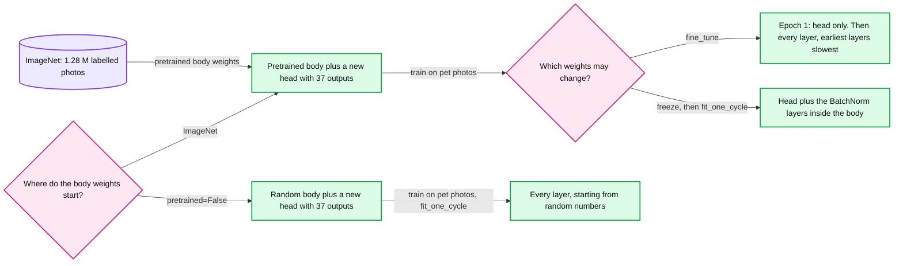
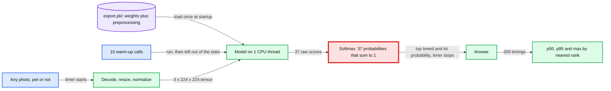
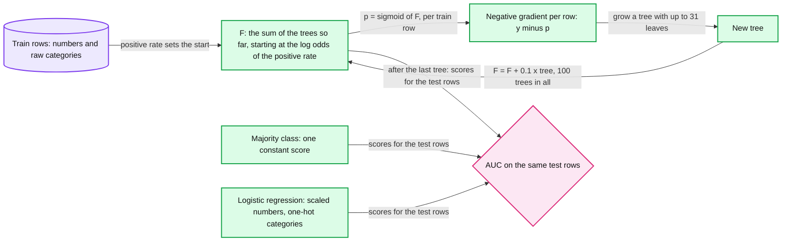
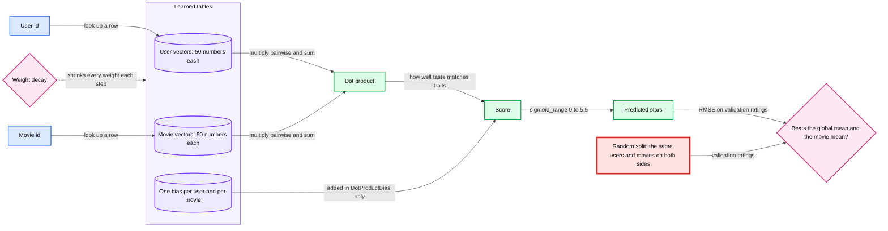

# Whole game: five working models before any theory

> Ship an image classifier, a CPU service, a tabular model, a text model and a recommender, one per session, before opening any of them.

Each lab is one 60-minute session: predict, run the baseline, change one thing, break it, explain it back, then rebuild one piece from memory. All five labs are Level W (worked example): the script is the full reference, with three `# Q:` prompts to answer before anything runs (levels: [`../CLAUDE.md` §7 Code by level](../CLAUDE.md#7-code-by-level)). This page and the lab files hold no measured values. The reference runs live in `../answers/`, and the AI opens a step only after your prediction for it is logged.

## Labs

| Lab | Title | Level | Runs on | Interview question | Status |
|---|---|---|---|---|---|
| 01 | [Pet breeds: reuse all, part or none of a pretrained network](labs/01-pet-breeds.md) | W | mps | You have 200 labelled photos and one day: how do you ship a usable classifier, how much does pretraining save over random weights, and when would you fine-tune the whole backbone instead of only a new head? | todo |
| 02 | [Ship it: a model is a service with a size, a p95 and inputs it has never seen](labs/02-ship-it.md) | W | cpu | Your model must answer in under 100 ms p95 on one CPU core and sometimes sees inputs unlike its training data: what do you measure, and what do you do with a wrong answer at 0.97 confidence? | todo |
| 03 | [Tabular in ten minutes: majority baseline, logistic regression and LightGBM](labs/03-tabular-in-ten-minutes.md) | W | cpu | What is your first model for a new fraud problem, what baseline must it beat, and what evidence would make you move off gradient-boosted trees? | todo |
| 04 | [Text: bag of words vs a pretrained transformer](labs/04-text-bag-of-words-vs-transformer.md) | W | mps | Categorize 1 M bank-transaction descriptions a day inside a 200 ms budget: TF-IDF plus logistic regression or a transformer, and what does each cost per 1,000 items? | todo |
| 05 | [Recommender: embeddings learned from ratings](labs/05-recommender-embeddings.md) | W | cpu | Recommend movies for a user with 20 ratings and for a brand-new user: what baseline must the model beat, and what does a random split hide? | todo |

- `mps` labs train on the Apple GPU through PyTorch's MPS (Metal Performance Shaders) backend. `cpu` labs never touch the GPU.
- p95 is the 95th-percentile latency. TF-IDF is term frequency times inverse document frequency.
- Default order is 01 to 05. The interview-track order is 01, 03, 02, 04, 05. Lab 02 serves the model that lab 01 exports, so lab 01 always comes first.

## Before you start

**Base install.** Follow [`../README.md`](../README.md) first: the Python 3.13 venv at `~/.venvs/ml` and the pinned base packages. Labs 01, 02, 03 and 05 need nothing more.

**This module's extra package.** Lab 04 needs Hugging Face transformers:

```
$ source ~/.venvs/ml/bin/activate
$ python -m pip install transformers==5.20.1
```

**Optional parts.** Install a package only if you plan to do that part:

```
$ python -m pip install tabpfn==9.2.0
$ python -m pip install gradio==6.30.0
$ python -m pip install ddgs==9.16.0
```

| Package | Lab and part | Captured by the script | Note |
|---|---|---|---|
| `tabpfn==9.2.0` | 03, `--tabpfn` | yes, optional section | Install it before lab 03's `--download`, which then also fetches the TabPFN v2 weights (29.0 MB, no login) |
| `gradio==6.30.0` | 02, a local web UI | no | A Hugging Face Spaces deploy also needs a login |
| `ddgs==9.16.0` | 01, a classifier on your own photos | no | DuckDuckGo answered scripted searches with HTTP 202 in review |

**Data.** Download everything once, before the first session. Run each command from this folder (`cd ml-learning/m1-whole-game`). Files land in `~/ml-data` (set `ML_DATA` to move it), never in the repo, and each command prints paths and sizes only.

| Lab | Dataset | MB | Command |
|---|---|---|---|
| 01 | Oxford-IIIT Pet: 37 breeds, about 7,390 photos, CC BY-SA 4.0. Falls back to the Oxford originals if the fast.ai mirror fails. Plus the ResNet-34 ImageNet weights from download.pytorch.org | 811.7 + 87.3 | `python scripts/01_pet_breeds.py --download` |
| 02 | Imagenette 160 px, Apache-2.0, for 20 non-pet photos: church, parachute, golf ball, gas pump, garbage truck. The 200 pet photos come from lab 01's download | 99.0 | `python scripts/02_ship_it.py --download` |
| 03 | Adult census income, OpenML 1590: 48,842 rows, 14 features. Falls back to OpenML's parquet copy, then the UCI (University of California, Irvine) original | 0.66 | `python scripts/03_tabular_in_ten_minutes.py --download` |
| 04 | IMDB (Internet Movie Database) reviews, `stanfordnlp/imdb` train and test parquet, plus `distilbert/distilbert-base-uncased` (DistilBERT, a smaller distilled BERT, Apache-2.0). Install transformers first | 41.45 + 268.0 | `python scripts/04_text_bag_of_words_vs_transformer.py --download` |
| 05 | MovieLens 100K: 100,000 ratings, GroupLens research use only, no redistribution | 4.92 | `python scripts/05_recommender_embeddings.py --download` |

About 1.3 GB in all, plus the unpacked pet photos.

**Cross-lab files.** Lab 01's `--baseline` at seed 0 writes `~/ml-data/models/lab01/export.pkl` and its validation list. Lab 02 reads both, and prints lab 01's command if they are missing. Lab 05's `--baseline` at seed 0 writes `~/ml-data/results/lab05.json` for lab 33, and its seed-0 change and break runs add to it.

**Before each session**, run `export PYTHONHASHSEED=0` to match the reference runs, then that lab's `--smoke`: under 60 s, and it prints `SMOKE ... ok` lines, never values.

## Concepts (read after the lab)

One section per lab, written as the second contact: read it after your runs, next to the borrowed unit. Each section explains mechanisms and quotes only published numbers with their source. No section holds a value from any lab run.

### Transfer learning

**Lab:** [01. Pet breeds](labs/01-pet-breeds.md). **In one line:** a network trained on ImageNet already turns pixels into useful features, so you keep its body, add a new head for your classes, and choose how much of the body may change.



- **Body and head.** An image classifier is a body, convolution layers that turn pixels into features, plus a head, small layers that turn features into one score per class. Pretraining sets the body. The head is always new: here it has 37 outputs, one per breed.
- **What the body holds.** Early layers respond to edges and color gradients, middle layers to textures and simple patterns, later layers to object parts such as eyes and faces ([Zeiler and Fergus 2014](https://arxiv.org/abs/1311.2901), pictured in fastbook chapter 1). The later the layer, the more its features belong to the original task rather than to photos in general ([Yosinski et al. 2014](https://arxiv.org/abs/1411.1792)).
- **Freezing** turns off gradients for the body's weights, so only the head learns. fastai's default `train_bn=True` keeps the BatchNorm layers inside a frozen body trainable, so their scale and shift can adjust to the new photos.
- **Unfreezing** lets every layer move. Discriminative learning rates give the earliest layers the smallest steps, because their general features need the least change.
- **`fine_tune`** does both in order: frozen epochs that train the new head, then unfrozen epochs for the whole network.
- **Random weights** (`pretrained=False`) keep the architecture and reuse nothing. Every feature has to come from the pet photos alone.

**Key definition.** What `learn.fine_tune(epochs, base_lr=2e-3)` runs in fastai 2.8.12 (`fastai/callback/schedule.py`). A ResNet has 3 parameter groups: early body, late body, head.

```
freeze()                                  body frozen, except its BatchNorm layers
fit_one_cycle(1, slice(base_lr))          head at base_lr, body BatchNorm at base_lr/10
unfreeze()
fit_one_cycle(epochs, slice(base_lr/200, base_lr/2))
                                          early body at base_lr/200, late body at base_lr/20, head at base_lr/2
```

With lab 01's `base_lr` of 2e-3, the unfrozen epoch steps at 1e-5, 1e-4 and 1e-3.

**Published numbers.**

- ImageNet (ILSVRC 2012): 1,281,167 training photos in 1,000 classes ([Russakovsky et al. 2015](https://arxiv.org/abs/1409.0575)).
- ResNet-34 ([He et al. 2016](https://arxiv.org/abs/1512.03385)): 21.8 M parameters. torchvision's `IMAGENET1K_V1` weights, the ones lab 01 loads, score 73.3% top-1 on ImageNet ([torchvision docs](https://pytorch.org/vision/stable/models/generated/torchvision.models.resnet34.html)).
- Oxford-IIIT Pet ([Parkhi et al. 2012](https://www.robots.ox.ac.uk/~vgg/data/pets/)): 37 breeds, 12 cats and 25 dogs, about 200 photos each. The paper's best model reached 59.21% accuracy, the figure lab 01's P3 quotes.

**Trade-off.** Unfreezing gives every body weight a gradient and optimizer state, and large steps on a small labelled set can overwrite general features. That is why the body gets the smallest learning rates. Freezing trains the fewest weights, but it cannot change features that miss your photos. The further your images sit from ImageNet photos (X-rays, satellite tiles, scanned receipts), the more of the body has to move: Yosinski et al. found that transferability falls as the two tasks drift apart.

**Second contact (after the lab, 1 to 3 days later):** fast.ai [Lesson 1](https://course.fast.ai/Lessons/lesson1.html) and [Lesson 2](https://course.fast.ai/Lessons/lesson2.html); fastbook [chapter 1](https://github.com/fastai/fastbook/blob/master/01_intro.ipynb) and [chapter 5](https://github.com/fastai/fastbook/blob/master/05_pet_breeds.ipynb). Both chapters print results for setups close to lab 01's, so open them only after your runs. Optional: the Kaggle notebook ["Is it a bird?"](https://www.kaggle.com/code/jhoward/is-it-a-bird-creating-a-model-from-your-own-data) for a classifier on your own photos.

**Repo links:** a vision model in production, with its threshold set by the cost of a miss: [`hld/streetview-ingestion/deep-dives/privacy-blur-and-takedowns.md` §1 Recall first, because the detector will miss](../../hld/streetview-ingestion/deep-dives/privacy-blur-and-takedowns.md#1-recall-first-because-the-detector-will-miss). What shipping a better model costs afterwards: [`processing-pipeline-and-reprocessing.md` §10 The blur-model backfill](../../hld/streetview-ingestion/deep-dives/processing-pipeline-and-reprocessing.md#10-the-blur-model-backfill-from-19-b-re-tiles-to-500-m).

**Later labs that open this up:** 34 (convolutions by hand), 35 (the learning-rate finder and one-cycle), 40 (LoRA, which freezes a pretrained language model and trains a small add-on).

### Inference is a service

**Lab:** [02. Ship it](labs/02-ship-it.md). **In one line:** after training, a model is a service: a file to load, a latency percentile to meet on stated hardware, and inputs it does not choose.



- **The artifact.** `learn.export()` pickles the trained model with its preprocessing (resize, normalize, the class names) into one `export.pkl`, without the data or the optimizer state. Its size is about the parameter count times 4 bytes (32-bit floats), and it sets the load time and the memory per replica.
- **Warm-up.** The first calls pay one-time costs: lazy initialization, memory allocation, cold caches. A benchmark leaves them out, and a server sends warm-up requests before it takes traffic.
- **Percentiles, not the mean.** p50 (the median) is the typical call. p95 is the time that 1 call in 20 exceeds. A latency budget is a percentile, on stated hardware, at a stated load.
- **One thread.** `torch.set_num_threads(1)` keeps inference on one core, which is what "one CPU core per request" means. On an idle laptop, extra threads borrow cores that a busy server does not have.
- **Softmax** turns the head's 37 raw scores into 37 probabilities that sum to 1. There is no "none of these" output, so an input from outside the training data (out-of-distribution, OOD) still has all of its probability spread over the 37 breeds. That is why the softmax is red in the diagram.
- **What the top probability means.** It says how far one breed beat the other 36 on this input. Whether the input is a pet at all is a separate question, and it needs its own signal: a reject class trained on non-pets, an OOD detector, or monitoring of the input distribution.

**Key definitions.**

```
softmax:       p_i = exp(z_i) / (exp(z_1) + ... + exp(z_37)),   so p_1 + ... + p_37 = 1
nearest rank:  sort the n timings; the q-th percentile is the value at rank ceil(q/100 x n)
               n = 200 gives p50 = the 100th value and p95 = the 190th value
               (the same as numpy.percentile with method="inverted_cdf")
```

**Published numbers.**

- Dean and Barroso, "The Tail at Scale" (CACM, 2013): servers that answer in 10 ms but take 1 s for 1 request in 100 make 63% of requests slow when each request waits on 100 of them (`1 - 0.99^100`). Tails compound, which is why budgets are written as percentiles. The repo works the arithmetic in [`concepts/fan-out-fan-in.md` §2 The tail latency maths](../../concepts/fan-out-fan-in.md#2-the-tail-latency-maths).
- Stripe says Radar decides in under 100 ms over more than 1,000 characteristics of a payment ([stripe.dev, 2023](https://stripe.dev/blog/how-we-built-it-stripe-radar)). That is a published figure, not an SLO (service level objective).
- [Hendrycks and Gimpel (ICLR 2017)](https://arxiv.org/abs/1610.02136) made the maximum softmax probability the standard baseline for flagging misclassified and OOD inputs. A better detector has to beat it on held-out OOD data.

**Trade-off.** An OOD guard buys safety with coverage: some real pets get refused or sent to a person. Input size and model size are serving knobs, so measure latency and accuracy together on the serving hardware before picking either. In payments the guard sits outside the model: rules, limits, and a fallback answer that needs no network call.

**Second contact (after the lab, 1 to 3 days later):** fast.ai [Lesson 2](https://course.fast.ai/Lessons/lesson2.html) (deployment with Gradio and Hugging Face Spaces); fastbook [chapter 2](https://github.com/fastai/fastbook/blob/master/02_production.ipynb).

**Repo links:** [`hld/payments-risk-decisioning/deep-dives/latency-budget-and-hot-path.md` §1 The 100 ms, line by line](../../hld/payments-risk-decisioning/deep-dives/latency-budget-and-hot-path.md#1-the-100-ms-line-by-line) (the model's slot inside one payment's budget) and [§5 What else is in process, and why](../../hld/payments-risk-decisioning/deep-dives/latency-budget-and-hot-path.md#5-what-else-is-in-process-and-why) (why the model and the fallback table live inside the service process).

**Comes back in:** latency budgets in 13, 15 and 24; cost per prediction in 04, 15 and 24; softmax and cross-entropy in 29.

### Tabular baselines and gradient-boosted trees

**Lab:** [03. Tabular in ten minutes](labs/03-tabular-in-ten-minutes.md). **In one line:** on a table, score a model that learns nothing, then a linear model, then gradient-boosted trees, all on the same test rows with the same metric, and test the pipeline itself before trusting any of them.



- **Majority baseline.** Predict the most common class for every row. Its accuracy is the majority class's share of the test rows. It gives every row the same score, so it ranks no row above another.
- **Logistic regression.** A weighted sum of the features through a sigmoid. It needs the numbers on one scale and each category one-hot encoded. Both transforms sit inside the pipeline (lab 06 shows why that matters).
- **Gradient-boosted decision trees (GBDT).** Every row starts at the log odds of the positive rate. Each new tree is grown on the per-row negative gradient of the loss (for log loss, `y - p`), and its output is added after shrinking by the learning rate. LightGBM also uses the second derivative, `p(1 - p)`, to size each leaf. Its defaults: 100 trees, at most 31 leaves each, learning rate 0.1.
- **Why trees suit tables.** A split compares one column with a threshold, so the column's scale does not matter and no scaler is needed. LightGBM splits a category column directly: at each node it sorts the categories by their gradient statistics and splits that order ([LightGBM docs](https://lightgbm.readthedocs.io/en/latest/Features.html#optimal-split-for-categorical-features)), so no one-hot step is needed. Interactions, such as age with hours worked, come from nested splits.
- **AUC (area under the ROC curve, the receiver operating characteristic) is ranking quality.** It ignores the threshold and the probability scale and asks one thing: do positives score above negatives?
- **The shuffled-target leak alarm.** Shuffle the training target, retrain the same pipeline, and score against the true test labels. The shuffle keeps every feature and the label rate but cuts the link between them. Any clear ranking skill that survives the shuffle did not come from that link, so it points to a leak or a bug in the evaluation.
- **TabPFN** (lab 03's optional section) is a transformer pretrained on synthetic tables. It reads the training rows as context and predicts the test rows in one forward pass, with no training loop.

**Key definitions.**

```
AUC = P(score of a random positive > score of a random negative) + 0.5 x P(the two scores tie)
    = (R_pos - n_pos x (n_pos + 1) / 2) / (n_pos x n_neg)          the Mann-Whitney form
      R_pos: the sum of the positives' ranks, all scores sorted ascending, ties given their average rank

boosting:  F_m(x) = F_(m-1)(x) + 0.1 x tree_m(x)
           tree_m is grown on the negative gradients y - sigmoid(F_(m-1)(x)) of the training rows
```

**Published numbers.**

- [Grinsztajn, Oyallon and Varoquaux (NeurIPS 2022)](https://arxiv.org/abs/2207.08815), 45 datasets: tree-based models "remain state-of-the-art on medium-sized data (~10K samples)".
- [Hanley and McNeil (Radiology, 1982)](https://doi.org/10.1148/radiology.143.1.7063747): the area under the ROC curve equals the probability that a random positive is ranked above a random negative, which is the Wilcoxon statistic.
- Stripe moved Radar from an XGBoost plus DNN (deep neural network) ensemble to a DNN-only model in mid-2022 ([stripe.dev, 2023-03-29](https://stripe.dev/blog/how-we-built-it-stripe-radar)). The repo's HLD (high-level design) still keeps a GBDT inline at about 3 M payments a day. Read the two together as "trees first, then move when the evidence says so".
- [TabPFN v2 (Hollmann et al., Nature 2025)](https://www.nature.com/articles/s41586-024-08328-6) is built for datasets of up to 10,000 rows. On a CPU, `tabpfn` 9.2.0 refuses more than 1,000 training rows unless told to ignore its limits.

**Trade-off.** Trees train on a CPU, need no scaling, take mixed column types, and give per-row reason codes cheaply (lab 08). They cannot extrapolate: past the largest value seen in training, a tree predicts what it predicted at the edge. They also do not read raw text, images or long event sequences. A neural network earns its place when the data is large or unstructured, and that is the evidence to ask for before moving off trees.

**Second contact (after the lab, 1 to 3 days later):** fast.ai [Lesson 6](https://course.fast.ai/Lessons/lesson6.html) (random forests); Kaggle [Intro to Machine Learning](https://www.kaggle.com/learn/intro-to-machine-learning); the [TabPFN README](https://github.com/PriorLabs/TabPFN) for the optional section.

**Repo links:** [`hld/payments-risk-decisioning/solution.md` §7 Trade-offs](../../hld/payments-risk-decisioning/solution.md#7-trade-offs), row "Model family inline", and [§10.8 How the big companies do it](../../hld/payments-risk-decisioning/solution.md#108-how-the-big-companies-do-it) (Stripe Radar and Uber Mastermind).

**Comes back in:** leakage in 06, 07, 10, 16, 19, 20, 27 and 39; baselines first in 05, 09, 12, 16 and 28; gradient boosting in 08, 16, 19, 32 and Capstone A.

### Bag of words vs transformers

**Lab:** [04. Text: bag of words vs a pretrained transformer](labs/04-text-bag-of-words-vs-transformer.md). **In one line:** text becomes numbers either by counting words (TF-IDF) or by reading word pieces in order with a pretrained transformer; the counting model sets the bar, and cost per 1,000 items is part of the answer.

```mermaid
%% Lab 04: two ways to turn one review into a label. Red marks where the compute per review goes
flowchart LR
    R[Review text] -->|regex words, lowercased| C[Word counts]
    C -->|times idf, row scaled to length 1| V[Sparse TF-IDF vector: one column per vocabulary word]
    V -->|one sparse dot product| LRC[Logistic regression]
    R -->|WordPiece, keep the first max_length pieces| P[Word-piece ids]
    P -->|token embedding plus position embedding| E[768 numbers per piece]
    E -->|6 attention layers, every piece attends to every piece| L[Contextual vectors]
    L -->|vector of the first token| H[Classification head]
    LRC -->|probability of positive| OUT[Positive or negative]
    H -->|probability of positive| OUT

    class R client
    class C,V,LRC,P,E,H,OUT service
    class L critical

    classDef client   fill:#dbeafe,stroke:#2563eb,stroke-width:2px,color:#111
    classDef service  fill:#dcfce7,stroke:#16a34a,stroke-width:2px,color:#111
    classDef store    fill:#ede9fe,stroke:#7c3aed,stroke-width:2px,color:#111
    classDef cache    fill:#fef3c7,stroke:#d97706,stroke-width:2px,color:#111
    classDef queue    fill:#cffafe,stroke:#0891b2,stroke-width:2px,color:#111
    classDef critical fill:#fee2e2,stroke:#dc2626,stroke-width:4px,color:#111
    classDef external fill:#e5e7eb,stroke:#6b7280,stroke-width:2px,color:#111,stroke-dasharray:4 3
    classDef decision fill:#fce7f3,stroke:#db2777,stroke-width:2px,color:#111
```



- **TF-IDF.** Split each review into words with a regex and count each word. Multiply each count by the word's inverse document frequency, so words found in nearly every review weigh little. Then scale the row to length 1. A review becomes a sparse vector with one column per vocabulary word.
- **Unseen words.** A word that never appeared in the training reviews has no column, so TF-IDF drops it.
- **Word pieces.** DistilBERT's WordPiece tokenizer has 30,522 entries, the BERT base uncased vocabulary. It splits a rare word into known pieces: "unwatchable" becomes `un`, `##watch`, `##able`, where `##` marks a piece that continues a word. Nothing is dropped; rare words are spelled out.
- **Order and context.** Each piece enters as a token embedding plus a position embedding (512 positions), and 6 layers of self-attention let every piece read every other piece. The vector that comes out for a word depends on its neighbours.
- **`max_length`** keeps the first N pieces of a review and cuts the rest.
- **Fine-tuning.** A new classification head reads the final vector of the first token, and every weight trains at a small learning rate (lab 04: AdamW at 5e-5 for 2 epochs).
- **Cost per item.** TF-IDF plus logistic regression scores a review with one sparse dot product over the words it contains. DistilBERT (66 M parameters) runs 6 transformer layers over every piece, and self-attention work grows with the square of the number of pieces. That is why the attention layers are red in the diagram.

**Key definitions.**

```
tf-idf(t, d) = count(t, d) x idf(t)
idf(t)       = ln((1 + N) / (1 + df(t))) + 1        N training reviews, df(t) of them contain word t
row          = row / its L2 length                  every review vector gets length 1
classifier:    p(positive) = sigmoid(w . row + b)
```

These are scikit-learn's `TfidfVectorizer` defaults: token pattern `(?u)\b\w\w+\b` (words of 2 or more characters), lowercase, single words.

**Published numbers.**

- [Sanh et al. 2019](https://arxiv.org/abs/1910.01108), DistilBERT: 40% smaller than BERT (Bidirectional Encoder Representations from Transformers) base and 60% faster, while keeping 97% of its language understanding on the GLUE (General Language Understanding Evaluation) benchmark. 66 M parameters and 6 layers, against BERT base's 110 M and 12.
- [Devlin et al. 2019](https://arxiv.org/abs/1810.04805), appendix A.3: fine-tune BERT with batch 16 or 32, a learning rate of 5e-5, 3e-5 or 2e-5, and 2 to 4 epochs.
- [Maas et al. 2011](https://aclanthology.org/P11-1015.pdf), the IMDB dataset: 50,000 reviews split 25,000 and 25,000, half positive, at most 30 reviews per movie, and no movie in both splits.
- [Vaswani et al. 2017](https://arxiv.org/abs/1706.03762): one self-attention layer costs on the order of n^2 x d for n tokens of width d.

**Trade-off.** TF-IDF plus logistic regression needs no GPU, scores with one sparse dot product, and shows a weight per word, so its mistakes are easy to read. A transformer brings context and spells out rare words, at a cost per item set by pieces times layers. For 1 M bank descriptions a day inside 200 ms, measure accuracy and milliseconds per 1,000 items on the serving CPU for both, and keep a cheap fallback for when the model misses its deadline.

**Second contact (after the lab, 1 to 3 days later):** fast.ai [Lesson 4](https://course.fast.ai/Lessons/lesson4.html) (natural language processing with Hugging Face transformers); fastbook [chapter 10](https://github.com/fastai/fastbook/blob/master/10_nlp.ipynb) (a language model fine-tuned on IMDB).

**Repo links:** [`hld/quickbooks-ledger/solution.md` §12 Presenting this as an Intuit case study](../../hld/quickbooks-ledger/solution.md#12-presenting-this-as-an-intuit-case-study), the paragraph "The AI story: one place a model does real work" (bank-transaction categorization that falls back to a rule after 200 ms); [`concepts/rag-and-react.md` §3 Retrieval quality](../../concepts/rag-and-react.md#3-retrieval-quality-dense-sparse-hybrid-rerank) (the same lexical vs dense choice, for search).

**Comes back in:** cost per prediction in 15 and 24; lexical vs dense retrieval in 12; how a tokenizer learns its pieces in 38; attention in 39.

### Embeddings from ratings

**Lab:** [05. Recommender: embeddings learned from ratings](labs/05-recommender-embeddings.md). **In one line:** collaborative filtering learns a vector for each user and each movie so that their dot product predicts the rating, and it earns its place only by beating baselines that learn nothing.



- **An embedding is a learned lookup table.** `Embedding(n_users, 50)` holds 50 numbers per user. Looking up row u is the same as multiplying a one-hot vector by the table, without building the one-hot.
- **Dot product.** The score `p_u . q_m` is large when the user's 50 numbers and the movie's 50 numbers point the same way. Nobody names the 50 factors; training finds whatever directions cut the error (lab 33 looks at what they encode).
- **Squashing.** `sigmoid_range` maps any score into the range 0 to 5.5, so predictions stay on the rating scale.
- **Bias terms.** `DotProductBias` adds one learned number per user (rates everything high or low) and one per movie (rated high or low by everyone), outside the dot product. They carry the part of a rating that does not depend on the match between this user and this movie.
- **Weight decay** shrinks every weight a little at each step, so a vector grows only as far as the training ratings keep pushing it.
- **Train vs validation RMSE (root mean squared error).** Training RMSE measures fit to ratings the model saw. Validation RMSE measures prediction on ratings it did not see. The gap between the two is overfitting.
- **Baselines.** The global mean predicts one number for every rating. The movie mean predicts each movie's average training rating, and the global mean for a movie with none. Neither looks at who is asking.
- **What a random split hides** (red in the diagram). Every user in MovieLens 100K has at least 20 ratings, so a random 80/20 split leaves practically every validation user, and most validation movies, with ratings in training. Ratings made later can also train a model that is scored on ratings made earlier. So the split measures filling gaps for known users. It cannot test a brand-new user, a brand-new movie or next week's ratings, and every logged rating exists only because someone chose to watch that movie.

**Key definitions.**

```
DotProduct:       r_hat(u, m) = sigmoid_range(p_u . q_m, 0, 5.5)
DotProductBias:   r_hat(u, m) = sigmoid_range(p_u . q_m + b_u + b_m, 0, 5.5)
sigmoid_range(x, lo, hi) = lo + (hi - lo) x sigmoid(x),    sigmoid(x) = 1 / (1 + e^-x)
RMSE = sqrt(mean((r_hat - r)^2)), in stars
weight decay in fastai (decoupled, as in AdamW):  w = w x (1 - lr x wd) at every step, then the Adam step
```

The classic form ([Koren, Bell and Volinsky, IEEE Computer 2009](https://doi.org/10.1109/MC.2009.263)) adds the global mean `mu` explicitly and writes weight decay as an L2 penalty: minimize, over the known ratings, the sum of `(r - mu - b_u - b_m - p_u . q_m)^2 + lambda x (|p_u|^2 + |q_m|^2 + b_u^2 + b_m^2)`.

**Published numbers.**

- MovieLens 100K ([GroupLens](https://grouplens.org/datasets/movielens/100k/); [Harper and Konstan 2015](https://doi.org/10.1145/2827872)): 100,000 ratings from 1 to 5 by 943 users on 1,682 movies, collected from September 1997 to April 1998, and every user has at least 20 ratings. The ratings fill 6.3% of the 943 x 1,682 user-movie grid.

**Trade-off.** Collaborative filtering needs history. A brand-new user or movie has no trained vector, so cold start falls back to popularity, content features or onboarding questions, and hands over to the learned model as ratings arrive. More factors can fit finer tastes and lean harder on weight decay. A random split rewards filling gaps; a time split asks the question production asks (labs 10 and 19).

**Second contact (after the lab, 1 to 3 days later):** fast.ai [Lesson 7](https://course.fast.ai/Lessons/lesson7.html) (collaborative filtering); fastbook [chapter 8](https://github.com/fastai/fastbook/blob/master/08_collab.ipynb). Its cells 62 to 105 print results for setups close to lab 05's, so open them only after your runs.

**Repo links:** [`hld/news-aggregator/deep-dives/ranking-and-cold-start.md` §7 Cold start, and moving to a learned model](../../hld/news-aggregator/deep-dives/ranking-and-cold-start.md#7-cold-start-and-moving-to-a-learned-model) and [§8 Feedback loops and popularity bias](../../hld/news-aggregator/deep-dives/ranking-and-cold-start.md#8-feedback-loops-and-popularity-bias); [`concepts/vector-index.md` §1 Mental model](../../concepts/vector-index.md#1-mental-model) (finding the nearest vectors when there are millions).

**Comes back in:** embeddings in 12, 13, 33 and 38; overfitting in 31, 32, 37 and 40; the bias-variance trade-off in 31, 32 and 37; feedback loops and selection bias in 13, 23 and Capstone A.
