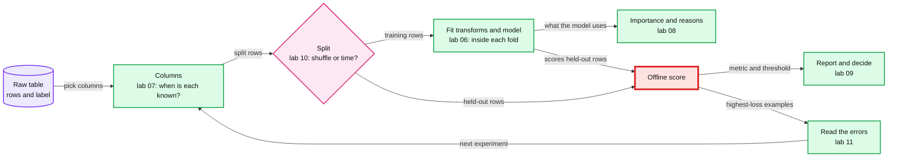
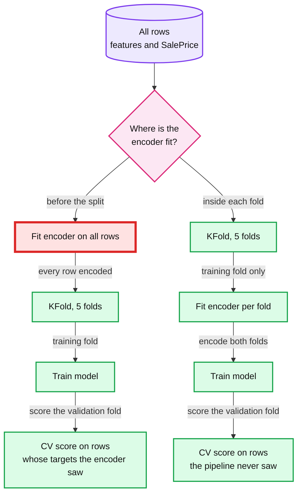
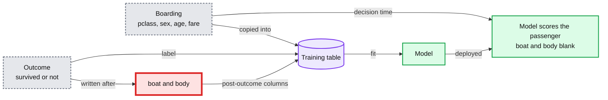
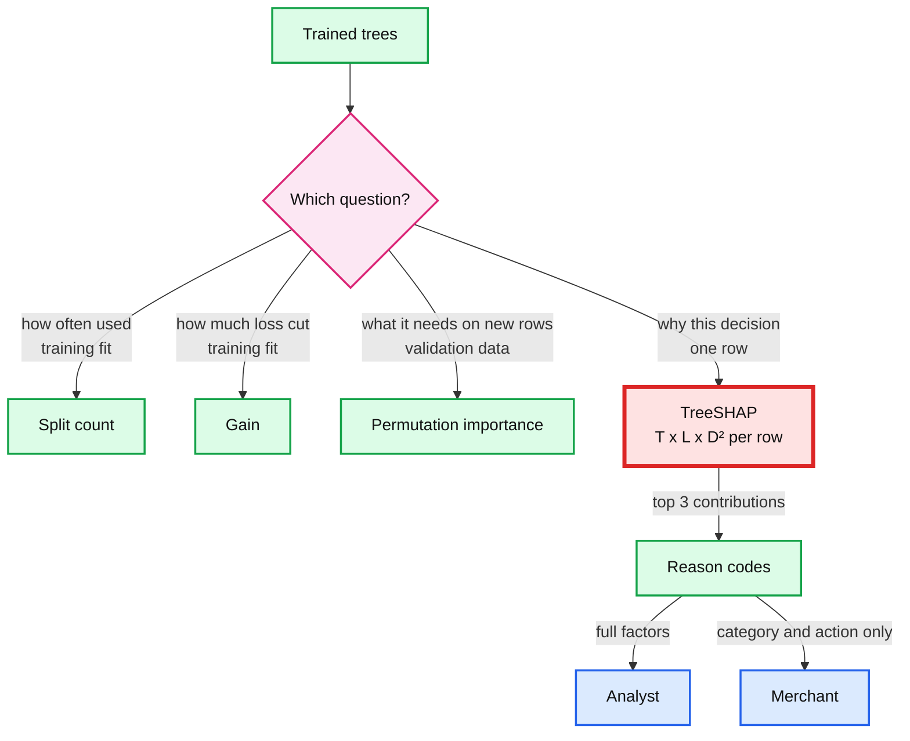
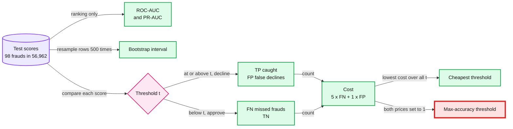
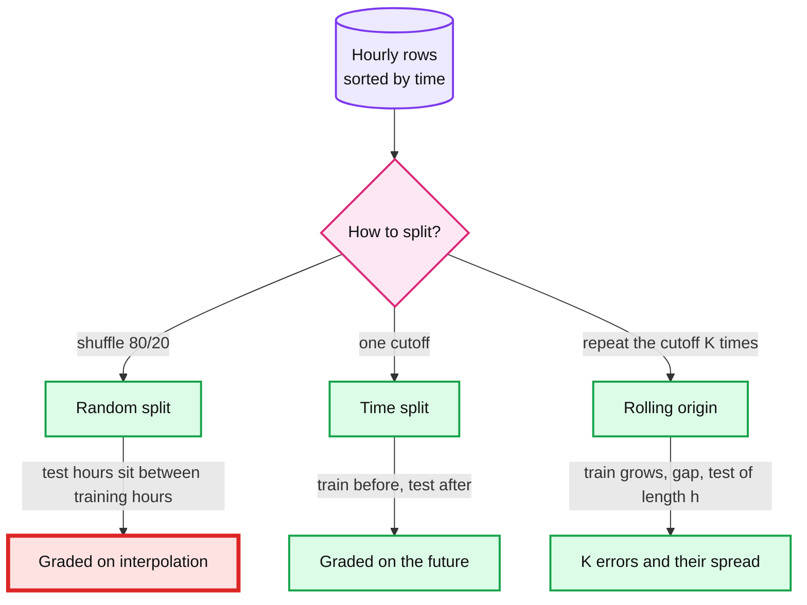
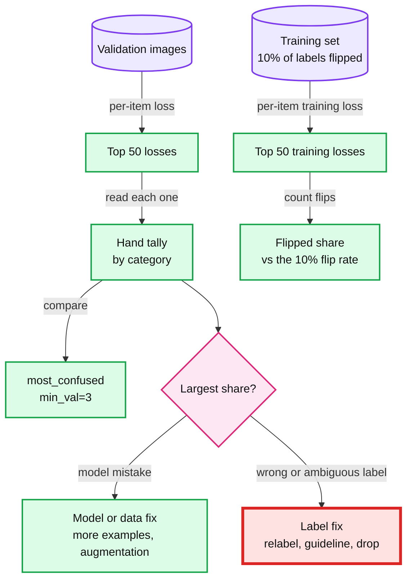

# Do not fool yourself: leakage, splits, metrics and error analysis

> Catch the silent failures that raise a score instead of raising an error.

Six labs, 06 to 11, one 60-minute session each. Each lab sheet holds its own predictions, commands and Record table. The concept sections at the bottom are after-lab reading.

## Labs

| Lab | Title | Level | Runs on | Interview question | Status |
|---|---|---|---|---|---|
| [06](labs/06-leak-through-preprocessing.md) | Leak through preprocessing: fit every transform inside each fold | C | cpu | Your target-encoded merchant_id lifts offline AUC (area under the ROC, receiver operating characteristic, curve) by 0.05: how do you prove it is not leaking? | todo |
| [07](labs/07-post-outcome-leak.md) | Leak through a post-outcome column: ask when each value is known | C | cpu | Which of these is not known at authorization time: the AVS (address verification service) result, the 3DS (3-D Secure) outcome, the merchant's current tier, or chargebacks on the card? | todo |
| [08](labs/08-feature-importance-and-reason-codes.md) | Which features does the model use? Split counts, permutation importance and reason codes | C | cpu | A merchant asks why a payment was declined: what can you tell them, and what does each explanation cost at serving time? | todo |
| [09](labs/09-metrics-for-rare-events.md) | Accuracy lies on rare events: PR-AUC, cost thresholds and their noise | C | cpu | Fraud is 0.17% of payments: which metric do you report to the business, and where do you set the decline threshold? | todo |
| [10](labs/10-random-vs-time-split.md) | Random vs time split: test on the future, not a shuffle | C | cpu | Offline RMSE (root mean squared error) looks good and production behaves much worse: how did you split, and what does a time split show? | todo |
| [11](labs/11-error-analysis.md) | Error analysis by hand: errors decide the next experiment | C | mps | Precision fell 5 points after a retrain: how do you tell whether it is the model, the labels or one segment? | todo |

Level C: you write the lab's concept function yourself, a `TODO(human)` in the script that `--check` compares with a library, before the baseline run. `ml-learning/CLAUDE.md` defines the levels. `cpu` labs never touch the GPU; `mps` (Metal Performance Shaders) is PyTorch's Apple GPU backend.

## Before you start

- **Base install:** set it up once from [`../README.md`](../README.md): the Python 3.13.7 venv at `~/.venvs/ml` with the pinned base packages.
- **Extra packages:** none. Every lab in this module runs on the base install, so there is no extra `python -m pip install` line. Lab 08 gets TreeSHAP from LightGBM's `predict(pred_contrib=True)`, so the `shap` package is not needed.
- **Data:** run each lab's `--download` once from this folder, then its `--smoke` (under 60 s each). Everything lands under `~/ml-data/`; nothing is written into the repo.

```
$ source ~/.venvs/ml/bin/activate
$ cd ml-learning/m2-dont-fool-yourself
```

| Lab | Dataset | Download | Command, from this folder |
|---|---|---|---|
| 06 | House Prices, OpenML 42165: 1,460 rows, 81 columns | 0.2 MB into `~/ml-data/openml/` | `python scripts/06_leak_through_preprocessing.py --download` |
| 07 | Titanic, OpenML 40945: 1,309 rows | 0.05 MB into `~/ml-data/openml/` | `python scripts/07_post_outcome_leak.py --download` |
| 08 | Adult census income, OpenML 1590: 48,842 rows (shared with lab 03) | 0.7 MB into `~/ml-data/openml/` | `python scripts/08_feature_importance_and_reason_codes.py --download` |
| 09 | Credit Card Fraud, ULB (Université Libre de Bruxelles), OpenML 1597: 284,807 payments, 492 of them fraud (shared with labs 22, 24 and 27) | 69 MB into `~/ml-data/openml/`; the fallback parquet is 73 MB | `python scripts/09_metrics_for_rare_events.py --download` |
| 10 | Bike Sharing hourly file, UCI (University of California, Irvine) 275: 17,379 rows | 0.28 MB zip into `~/ml-data/bike-sharing/` | `python scripts/10_random_vs_time_split.py --download` |
| 11 | Oxford-IIIT Pet: about 7,390 images of 37 breeds (shared with lab 01), plus the ResNet-34 ImageNet weights | 811.7 MB into `~/ml-data/` and about 0.9 GB more once extracted, plus 87 MB of weights into the PyTorch cache | `python scripts/11_error_analysis.py --download` |

About 0.97 GB to download in all, nearly all of it for lab 11. If lab 01 already ran, lab 11 finds its images and weights; if lab 03 ran, lab 08 finds its table. Either way the download is skipped.

## Concepts (read after the lab)

One section per lab. Each holds mechanisms, formulas and published figures, never a lab result: your numbers live in your Record tables. Read a section after its lab, then do its second contact 1 to 3 days later.



Kapoor and Narayanan (Patterns, 2023) sort leakage into 8 types in 3 groups: no clean separation of training and test data, features that are not legitimate, and a test set that is not drawn from the distribution of interest. Their survey table counts leakage in 30 fields, affecting 648 papers ([reproducible.cs.princeton.edu](https://reproducible.cs.princeton.edu/), table updated May 2024). This module drills one type from each group: preprocessing fit on training and test data together (lab 06), a feature that is not legitimate (lab 07), and temporal leakage (lab 10).

### Leakage through preprocessing

**Lab:** [06. Leak through preprocessing](labs/06-leak-through-preprocessing.md). **Comes back:** leakage starts in lab 03, runs through 06, 07 and 10, and returns in 16, 19, 20, 27 and 39.

Anything that learns from rows is fit on the training fold only. Fit it on all rows before cross-validation (CV), and the CV score includes rows whose targets it has already seen.



- CV estimates the error on rows the pipeline has never seen. The pipeline is every fitted step: imputer, scaler, encoder, feature selector and model.
- Target encoding replaces a category with the smoothed mean target of its rows. It is how a high-cardinality key (one with many distinct values), such as a merchant id, reaches a model as one number.
- Fit on all rows, each row's encoded value contains its own target, with a weight of about `1 / (n + m)`. The rows per level, `n`, and the smoothing, `m`, set that weight.
- Fit inside each fold, a validation row's target never reaches its own encoding. Training rows still see their own targets, so scikit-learn's `TargetEncoder.fit_transform` also cross-fits: each of 5 training folds is encoded from the other 4, to "help prevent the downstream model from overfitting spurious correlations" ([scikit-learn user guide, Target Encoder](https://scikit-learn.org/stable/modules/preprocessing.html#target-encoder)).
- The habit: put every fitted step in a `Pipeline` and hand the pipeline to `cross_val_score`, which refits all of it in each fold. scikit-learn calls the pipeline "a great way to prevent data leakage" ([Common pitfalls](https://scikit-learn.org/stable/common_pitfalls.html)).
- Kaggle's Data Leakage lesson calls this kind of leak train-test contamination.

```text
enc(c) = (n_c x mean_c + m x mean_all) / (n_c + m)
    n_c       rows of level c among the rows the encoder is fit on
    mean_c    their mean target
    mean_all  the mean target of all rows the encoder is fit on
    m         the smoothing, 10 in lab 06
A row the encoder is fit on puts its own target into enc(c) with weight about 1 / (n_c + m).
```

Trade-off: one-hot encoding has no target inside it to leak, but a 10,000-level id becomes 10,000 sparse columns. Target encoding keeps one column and moves the risk into where you fit it.

**Second contact:** Kaggle Learn [Intermediate Machine Learning](https://www.kaggle.com/learn/intermediate-machine-learning), lessons Pipelines, Cross-Validation and Data Leakage.

**Repo:** [`model-lifecycle-shadow-and-labels.md` §2 "Leakage: the trap in the training data"](../../hld/payments-risk-decisioning/deep-dives/model-lifecycle-shadow-and-labels.md#2-leakage-the-trap-in-the-training-data). In the payments design, training on feature vectors logged at decision time removes most leakage by construction, and §2 lists where it comes back.

### Post-outcome columns

**Lab:** [07. Leak through a post-outcome column](labs/07-post-outcome-leak.md). **Comes back:** leakage as in lab 06; feature importance starts here, with the top-3 gain list, and returns in 08 and Capstone A.

Ask of every column when its value is written, relative to the decision. A column written after the outcome is a trace of the label: it sits in the training table, and it does not exist yet when the model decides.



- scikit-learn's definition: "Data leakage occurs when information that would not be available at prediction time is used when building the model" ([Common pitfalls](https://scikit-learn.org/stable/common_pitfalls.html)). Kaggle's Data Leakage lesson calls this kind target leakage.
- Titanic's `boat` (lifeboat number) and `body` (body identification number) were written after the sinking. In payments, a refund flag or an analyst's review outcome is written after the decision.
- Time, not correlation, is the test. A strong honest feature and a leak can both score high on their own; only "when is this written?" tells them apart.
- A single-column leak scan finds the loud cases fast: fit a small model on one column at a time and rank the columns by 5-fold AUC. Lab 07 uses a depth-3 tree and flags an AUC of 0.9 or more. Code missing values as their own value (`-999`), so missingness stays visible to the scan.
- A model trained with a post-outcome column was graded offline on inputs it will never get at decision time. Score it as at decision time: rebuild each test row as it looked then, with the post-outcome columns blank, and compare it with a model trained without them.
- The durable fix is upstream: train on the feature vector logged at decision time, so a column written later has nothing to join to.

```text
AUC = P(score of a random positive > score of a random negative), a tie counts one half
    0.5 is a coin flip, 1.0 a perfect ranking
```

Trade-off: a value known only after the decision can still serve a later decision. The repo lets a post-authorization re-scorer use events the inline model must not, at the cost of two feature schemas instead of one.

**Second contact:** Kaggle Learn [Intermediate Machine Learning](https://www.kaggle.com/learn/intermediate-machine-learning), lesson Data Leakage; fast.ai [Lesson 5](https://course.fast.ai/Lessons/lesson5.html), the Titanic notebooks.

**Repo:** [`edge-cases.md` "Edge case: the leakage trap in training data"](../../hld/payments-risk-decisioning/edge-cases.md#edge-case-the-leakage-trap-in-training-data), and [§2 of the lifecycle deep dive](../../hld/payments-risk-decisioning/deep-dives/model-lifecycle-shadow-and-labels.md#2-leakage-the-trap-in-the-training-data), which lists where leakage enters a payments training set.

### Feature importance and reason codes

**Lab:** [08. Which features does the model use?](labs/08-feature-importance-and-reason-codes.md) **Comes back:** feature importance, first met in lab 07, returns in Capstone A; gradient boosting, from lab 03, returns in 16, 19, 32 and Capstone A.

Each importance measure answers its own question, so rank columns at least two ways and test every ranking against a column you know is noise. Reason codes are a different tool: one decision's score split into per-feature parts, at a cost per call.



- **Split count**, LightGBM's default `feature_importances_`, gives the "numbers of times the feature is used in a model". How often, not how much.
- **Gain**, `importance_type="gain"`, gives the "total gains of splits which use the feature": the training loss each split removed while fitting ([LightGBM docs](https://lightgbm.readthedocs.io/en/stable/pythonapi/lightgbm.Booster.html)).
- Both are training-time bookkeeping, so they can credit a column for fitting noise. scikit-learn warns that impurity-based importance is "strongly biased" toward "high cardinality features" ([permutation importance guide](https://scikit-learn.org/stable/modules/permutation_importance.html)), and [Strobl et al. 2007](https://doi.org/10.1186/1471-2105-8-25) found random forest importance unreliable when predictors differ in scale or in number of categories.
- **Permutation importance** asks what the model needs on rows it has not seen: shuffle one validation column, re-score, and average the drop over K shuffles. No retraining, K re-scores per column.
- **Correlated columns share credit.** Shuffle one, and the model still reads the shared signal from its twin, which gives "a lower reported importance value for both features, though they might actually be important" (same scikit-learn guide). Dropping a column and retraining asks a third question: what the model loses when the column is gone and the rest of the table can stand in.
- **A random column** is the cheapest sanity check. A measure that ranks pure noise among real columns is measuring something other than usefulness.
- **Reason codes are local.** TreeSHAP (SHAP: SHapley Additive exPlanations) splits one score, in log-odds (the raw score before the sigmoid), into a base value plus one contribution per feature. The largest contributions toward decline are the reasons. LightGBM's `predict(pred_contrib=True)` returns them "with an extra column, where the last column is the expected value".
- **Mean |SHAP| over many rows** is a consistent global ranking. Split count and gain are not: a model can come to rely more on a feature while its gain or split count drops ([Lundberg, Erion and Lee 2018](https://arxiv.org/abs/1802.03888)). Mean |SHAP| can also audit a sensitive column, but a proxy can carry the same signal under another name.

```text
permutation  I_j  = s - (s_1j + s_2j + ... + s_Kj) / K
                    s = validation AUC, s_kj = AUC with column j shuffled in repeat k, K = 5 in lab 08
TreeSHAP     f(x) = phi_0 + phi_1(x) + ... + phi_M(x), in log-odds, phi_0 = the expected value
cost         exact TreeSHAP is O(T L D^2) per row, the direct method over feature subsets O(T L 2^M),
             and a plain score walks one root-to-leaf path per tree, O(T D)
             T trees, L leaves per tree at most, D depth at most, M features
```

Trade-off: an explanation costs compute on every decision that gets one, and an explanation that names the score or the rule teaches an attacker the boundary. So decide which decisions get one, when it is computed and who sees which part; the repo's answer is in solution §5.9, linked below.

**Second contact:** [fastbook ch 9](https://github.com/fastai/fastbook/blob/master/09_tabular.ipynb) (feature importance, partial dependence, tree interpreter); Kaggle Learn [Machine Learning Explainability](https://www.kaggle.com/learn/machine-learning-explainability) (permutation importance, partial plots, SHAP values); the scikit-learn example [Permutation Importance vs Random Forest Feature Importance (MDI)](https://scikit-learn.org/stable/auto_examples/inspection/plot_permutation_importance.html).

**Repo:** [`solution.md` §5.9 "A merchant asks why their customer was declined. And what is in PCI scope?"](../../hld/payments-risk-decisioning/solution.md#59-a-merchant-asks-why-their-customer-was-declined-and-what-is-in-pci-scope-security) (PCI: Payment Card Industry), and [`edge-cases.md` "Edge case: a merchant asks why their customer was declined"](../../hld/payments-risk-decisioning/edge-cases.md#edge-case-a-merchant-asks-why-their-customer-was-declined).

### Metrics for rare events

**Lab:** [09. Accuracy lies on rare events](labs/09-metrics-for-rare-events.md). **Comes back:** thresholds and calibration return in 22, 23 and 24; baselines first, from labs 03 and 05, return in 12, 16 and 28.

When positives are rare, compare models with a ranking metric that feels every false positive, PR-AUC computed as average precision, with its interval. Then set the threshold from what each error costs.

The four outcomes: TP (true positive) is a fraud declined, FP (false positive) a good payment declined, FN (false negative) a fraud approved, and TN (true negative) a good payment approved.



- At a positive rate `pi`, a model that never flags anything has accuracy `1 - pi`. On rare events, accuracy mostly counts the easy negatives.
- ROC-AUC is the chance that a random positive outscores a random negative. Its false positive rate divides by all negatives, so on rare events many false positives barely move it.
- PR-AUC (area under the precision-recall curve) is computed here as average precision (AP). Precision divides by what you flag, so every false positive counts. A random score has ROC-AUC 0.5 at any positive rate, but its precision-recall baseline is the positive rate, `P / (P + N)` ([Saito and Rehmsmeier 2015](https://journals.plos.org/plosone/article?id=10.1371/journal.pone.0118432)). Read AP against `pi`, not against 0.5.
- The two curves agree on dominance: one curve dominates another in ROC space if and only if it dominates in PR space ([Davis and Goadrich 2006](https://doi.org/10.1145/1143844.1143874)). They weight the regions differently, so the best ROC-AUC need not be the best PR-AUC.
- A threshold is a business decision. Price each error, count both at every candidate threshold, keep the cheapest. Accuracy is the special case that prices a missed fraud and a false decline the same.
- Every metric is noisy when positives are few. A bootstrap interval shows how noisy: resample the test rows with replacement 500 times, recompute the metric each time, and keep the 2.5th and 97.5th percentiles. The count of positives, not of rows, mostly sets the width.
- At the chosen threshold the business reads recall and the false-decline rate. Stripe says Radar "incorrectly blocks just 0.1%" of legitimate payments ([stripe.dev, 2023](https://stripe.dev/blog/how-we-built-it-stripe-radar)): a published figure, not an SLO (service level objective).

```text
precision = TP / (TP + FP)    recall = TP / (TP + FN)    false positive rate = FP / (FP + TN)
AP        = sum over thresholds n of (R_n - R_(n-1)) x P_n, with P_n and R_n the precision and recall at threshold n
cost(t)   = 5 x FN(t) + 1 x FP(t), counted in false declines; the cheapest threshold is the candidate t with the lowest cost(t)
t*        = C_FP / (C_FP + C_FN), the cost-optimal threshold only when the score is a calibrated probability
```

scikit-learn's AP "is not interpolated and is different from computing the area under the precision-recall curve with the trapezoidal rule, which uses linear interpolation and can be too optimistic" ([average_precision_score](https://scikit-learn.org/stable/modules/generated/sklearn.metrics.average_precision_score.html)).

Trade-off: AP summarises every threshold, and the business runs at one. Report both: AP with its interval to compare models, and recall and false declines at the chosen threshold to run the business.

**Second contact:** Google [Machine Learning Crash Course: Classification](https://developers.google.com/machine-learning/crash-course/classification): thresholds and the confusion matrix; accuracy, precision and recall; ROC and AUC.

**Repo:** [lifecycle deep dive §4 "Thresholds from cost, and why the inputs must scale"](../../hld/payments-risk-decisioning/deep-dives/model-lifecycle-shadow-and-labels.md#4-thresholds-from-cost-and-why-the-inputs-must-scale): the same formula, `p* = C_fd / (C_fd + L)`, with both costs scaled by the payment amount, and calibration before any threshold.

### Random vs time splits

**Lab:** [10. Random vs time split](labs/10-random-vs-time-split.md). **Comes back:** time-based splits return in 16, 19, 21 and 26.

Split by time when the model will score the future. A random split grades the model on gaps between hours it has seen; a time split grades it on hours after all of them, as production does.



- A random split shuffles time. Test hours sit between training hours, and neighbouring hours look alike, so the test asks the model to fill gaps.
- Production asks for the future: every hour it scores comes after every hour it trained on, with weather, trends and a calendar it has not seen. A time split tests that: train before a cutoff, test after it.
- Rules of ML #33: "If you produce a model based on the data until January 5th, test the model on the data from January 6th and after" ([Rules of ML](https://developers.google.com/machine-learning/guides/rules-of-ml)).
- One cutoff gives one estimate of one period. Rolling origin repeats the cutoff: K folds, each testing a block of length `h` after a gap `g`, with a training window that grows. [FPP3 §5.10](https://otexts.com/fpp3/tscv.html) calls this "evaluation on a rolling forecasting origin".
- scikit-learn's `TimeSeriesSplit` builds these folds and has no shuffle option. Its docs say other CV methods "would lead to training on future data and evaluating on past data" ([TimeSeriesSplit](https://scikit-learn.org/stable/modules/generated/sklearn.model_selection.TimeSeriesSplit.html)).
- The gap keeps the last training rows from touching the first test rows, for anything that takes time to settle.
- A feature may only use what was known at prediction time: the lab 07 question, asked of every column.

```text
fold k of K, n rows sorted by time, test length h, gap g, [a, b) = from row a up to, not including, row b:
    test  = rows [n - (K - k + 1) x h,  n - (K - k) x h)
    train = rows [0,  n - (K - k + 1) x h - g)
    check in every fold: max(train time) < min(test time)
lab 10's rebuild compares with TimeSeriesSplit(n_splits=4, test_size=720, gap=24): 30 days of hours per test fold, a one-day gap
```

Trade-off: a time split spends the newest data on testing instead of training, and one test period can be unusual. Rolling origin answers both at K times the training cost. Retrain on everything, test period included, before you ship.

**Second contact:** [Rules of ML](https://developers.google.com/machine-learning/guides/rules-of-ml) rule #33, and Kaggle Learn [Time Series](https://www.kaggle.com/learn/time-series) lesson 1, "Linear Regression With Time Series".

**Repo:** [lifecycle deep dive §2](../../hld/payments-risk-decisioning/deep-dives/model-lifecycle-shadow-and-labels.md#2-leakage-the-trap-in-the-training-data), item 5 "Random splits", for card data, and [§5 "Proving a model before it declines anyone"](../../hld/payments-risk-decisioning/deep-dives/model-lifecycle-shadow-and-labels.md#5-proving-a-model-before-it-declines-anyone) for the out-of-time test in the release gates.

### Error analysis

**Lab:** [11. Error analysis by hand](labs/11-error-analysis.md).

Before choosing the next experiment, read the highest-loss examples and tally them by cause. The biggest category caps what any one fix can buy, and some errors are the labels' fault.



- Ng: "The process of looking at misclassified examples is called error analysis." His tool is a spreadsheet: one row per example, one column per category, and more than one tick allowed.
- Sort by per-item loss, not by right or wrong. The highest losses are the confident mistakes, where the model and the label disagree most.
- Make the categories by looking, then count. A category's share is a ceiling: fixing all of it lowers the error rate by at most that share of the current error rate.
- Some errors are the label's fault: a wrong or ambiguous label. Those need a data fix (relabel, a labelling guideline, merge two classes, drop the item), not a bigger model. [Northcutt, Athalye and Mueller 2021](https://arxiv.org/abs/2103.14749) estimate "an average of at least 3.3% errors" across the test sets of 10 common benchmarks, and label errors in "at least 6%" of the ImageNet validation set.
- Label noise also shows in training. A model that has learned the real pattern gives a wrong label a low probability, so a flipped label tends to carry a high training loss. Networks can also memorise noise: they "easily fit a random labeling of the training data" ([Zhang et al. 2017](https://arxiv.org/abs/1611.03530)), though they "tend to prioritize learning simple patterns first" ([Arpit et al. 2017](https://arxiv.org/abs/1706.05394)). Training length and model capacity decide which effect dominates.
- A flip test measures how well the loss finds noise: flip labels at a known rate, then compare the flipped share among the top k training losses with that rate. A share near the flip rate means the loss carries no signal about the noise.
- fastai's `interp.plot_top_losses(k)` shows the k highest-loss images with their labels, and `interp.most_confused(min_val=3)` lists the (actual, predicted) class pairs seen at least 3 times, most frequent first.
- In payments the same tally runs per segment and per label source. Friendly fraud, a real purchase disputed as fraud, is label noise at scale.

```text
loss_i  = -log softmax(z_i)[y_i] = log(sum over classes c of exp(z_ic)) - z_i[y_i]
          per-item cross-entropy from the logits z_i and the label y_i
top-k   = the k items with the largest loss_i
ceiling = a category with a share s of the errors can lower the error rate by at most s x (error rate)
```

Ng's time budget, from the Machine Learning Yearning draft: "Manually examining 100 examples does not take long. Even if you take one minute per image, you'd be done in under two hours." Lab 11 budgets 15 minutes for 50 images, about 18 s each.

Trade-off: reading costs people time and a metric does not. It buys what a metric cannot give: which category to fix first.

**Second contact:** Andrew Ng, [Machine Learning Yearning](https://info.deeplearning.ai/machine-learning-yearning-book), the error analysis chapters; fast.ai [Lesson 2](https://course.fast.ai/Lessons/lesson2.html), `plot_top_losses`.

**Repo:** [`edge-cases.md` "Edge case: friendly fraud poisons the labels"](../../hld/payments-risk-decisioning/edge-cases.md#edge-case-friendly-fraud-poisons-the-labels) for label noise in payments, and ["Edge case: a new model doubles the decline rate in one segment"](../../hld/payments-risk-decisioning/edge-cases.md#edge-case-a-new-model-doubles-the-decline-rate-in-one-segment) for errors that live in one segment.
