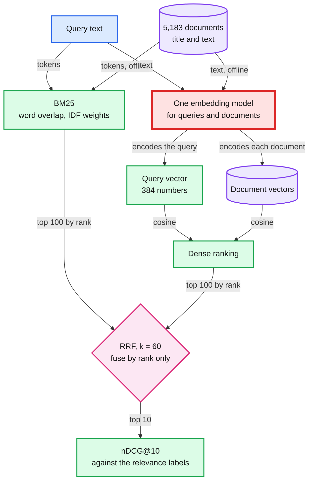
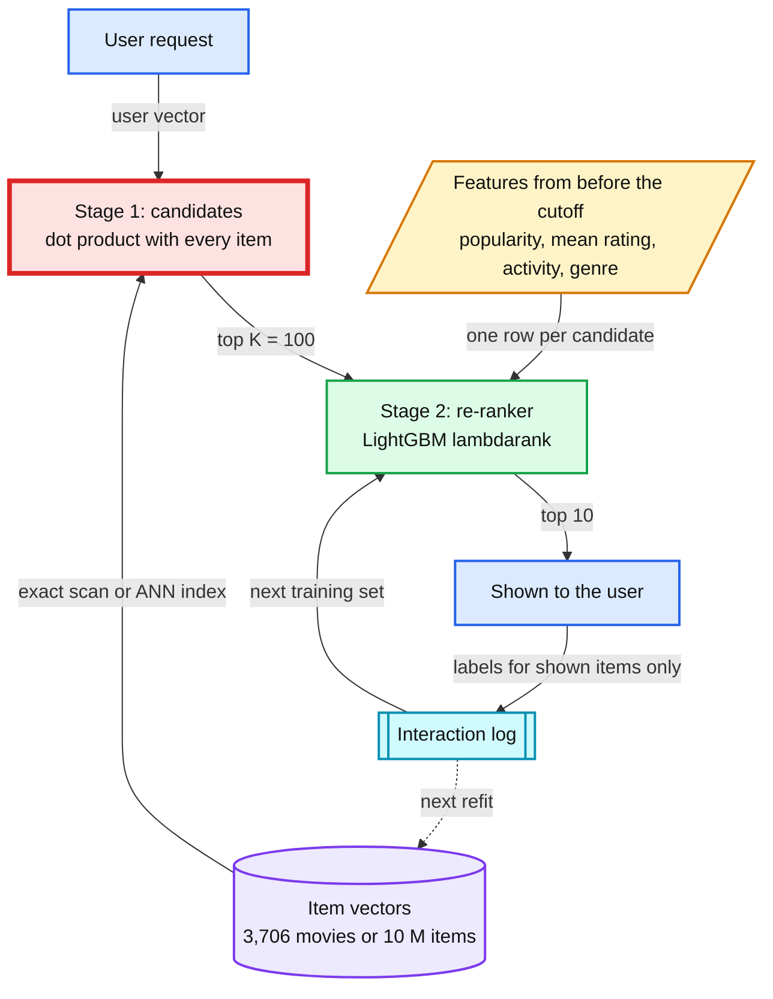
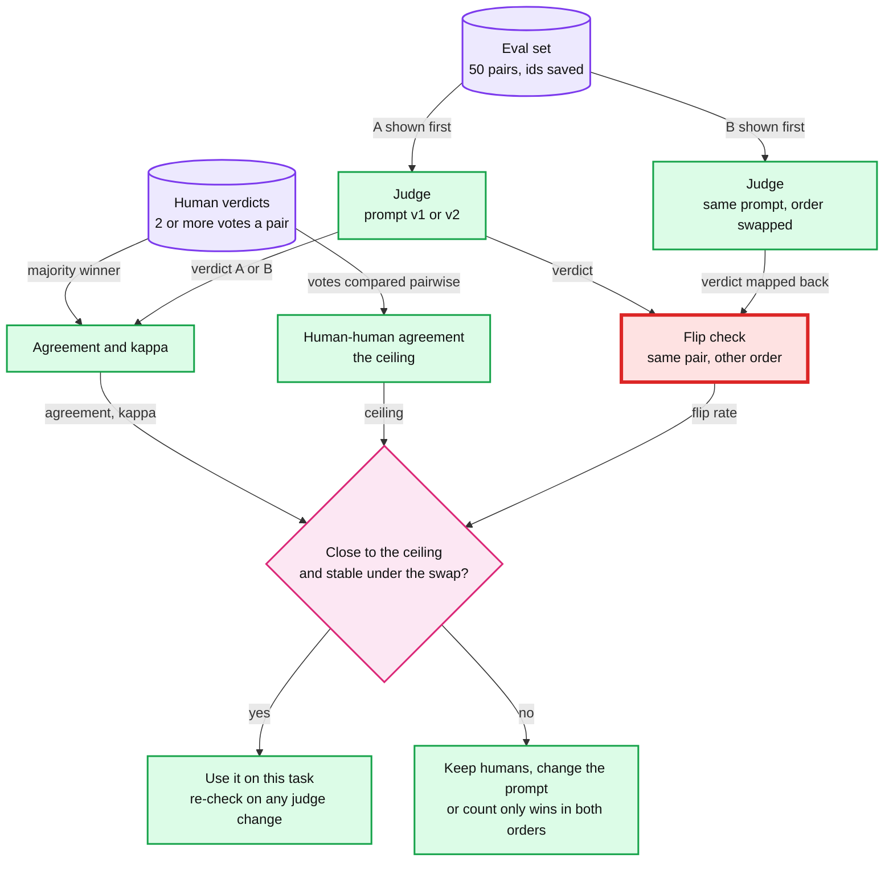
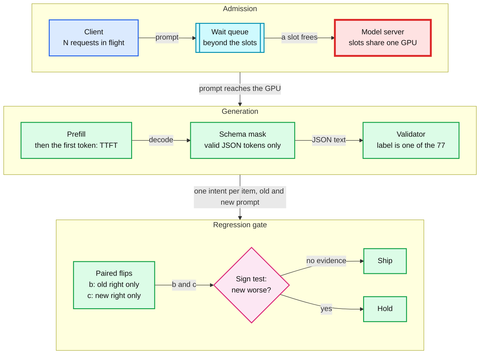
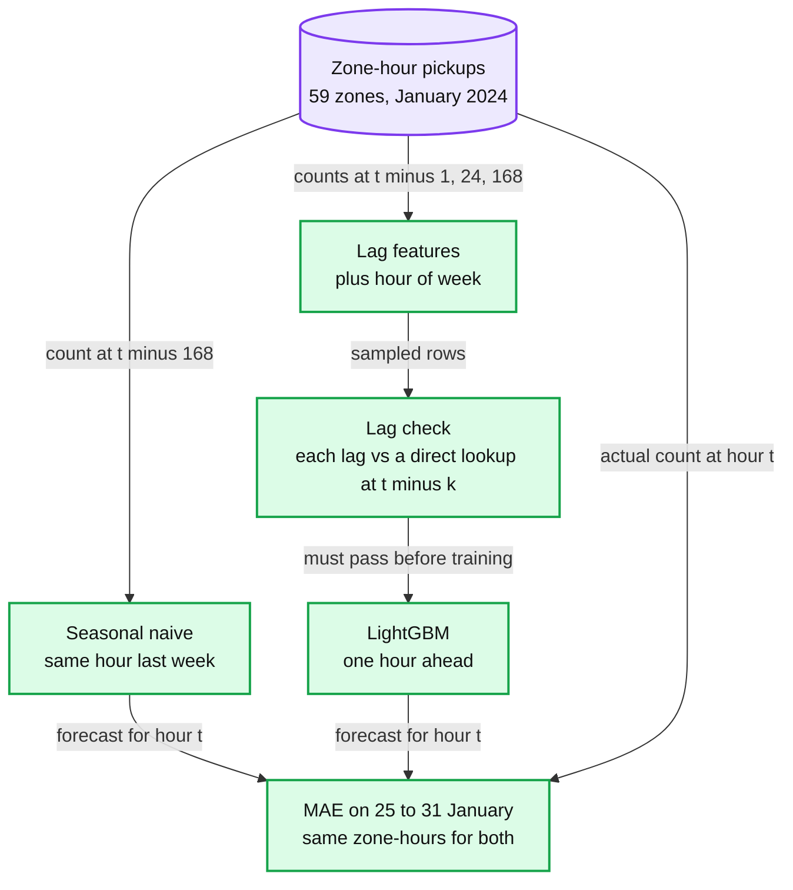
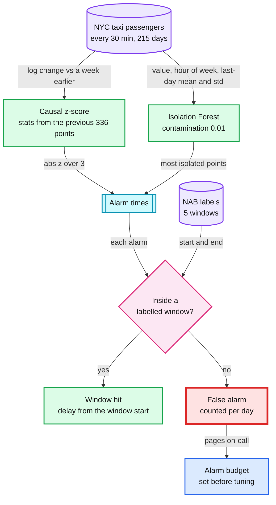
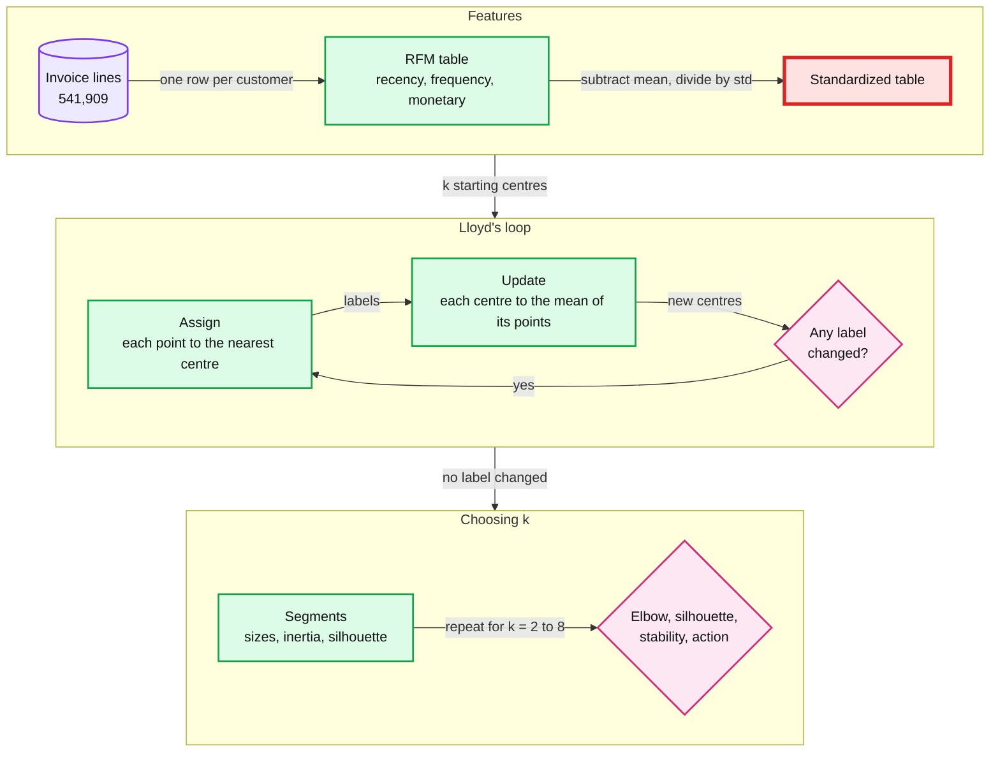

# More of the map: retrieval, ranking, LLM evals, forecasts, anomalies, clusters

> See the rest of the problem types once, each with the baseline it must beat.

Seven labs, one problem type each: retrieval, ranking, judging LLM (large language model) answers, serving an LLM, forecasting, anomaly detection and clustering. Each lab starts from the simplest thing that could work, then measures what one change adds and what one break costs. No lab here reads another lab's output, so any order works.

## Labs

| Lab | Title | Level | Runs on | Interview question | Status |
|---|---|---|---|---|---|
| 12 | [Lexical vs dense retrieval: BM25, embeddings and fusion](labs/12-lexical-vs-dense-retrieval.md) | C | cpu | Design search over 5,000 help articles: BM25, embeddings or hybrid, and which offline metric tells you a change helped before users see it? | todo |
| 13 | [Two-stage retrieval, then ranking: how much can the re-ranker recover?](labs/13-two-stage-retrieval-and-ranking.md) | C | cpu | Pick 10 movies per user from about 3,900 for 6,040 users, then from 10 M items for 200 M users under 100 ms: what recall does the candidate stage cost, and what does ANN (approximate nearest neighbour search) cost on top? | todo |
| 14 | [An eval set and an LLM judge: judges need a human ceiling](labs/14-llm-judge.md) | S | cpu+ollama | How do you know a prompt or model change did not make the assistant worse before it ships, and when can you trust an LLM judge? | todo |
| 15 | [LLM in production: latency, schema validity and a regression gate](labs/15-llm-in-production.md) | S | cpu+ollama | Your LLM feature has an 8 s p95 and returns malformed JSON 3% of the time: what do you measure, what do you cap, and how does the fix pass a regression gate? | todo |
| 16 | [Forecast demand: seasonal naive first, then lag features](labs/16-forecast-demand.md) | C | cpu | Forecast pickups per zone per hour for driver positioning: what baseline must a model beat, and how does a lag feature read the future? | todo |
| 17 | [Anomaly windows: unsupervised detection, scored by windows and delay](labs/17-anomaly-windows.md) | S | cpu | A card-testing wave starts tonight: what detects it within a minute without paging on-call ten times a night? | todo |
| 18 | [Clustering hygiene: what scaling and outliers do to k-means](labs/18-clustering-hygiene.md) | S | cpu | Segment about 4,000 customers into risk tiers without labels: what does skipping feature scaling do to k-means, and how do you choose k? | todo |

- **Level C** (completion, Learning output style): the script works except for one TODO(human) block. You write it before the baseline and test it with `--check`.
- **Level S** (spec, Explanatory output style): you get `load_data()` and `report()`. You write the prompt (split, metric, RESULT contract) and the concept function, then the AI writes the harness. Full rules: `ml-learning/CLAUDE.md` §7.
- **Runs on:** `cpu` labs never touch the GPU (graphics processing unit). `cpu+ollama` labs call a local Ollama server, which runs the model on the GPU.

## Before you start

**1. Base install.** The Python 3.13.7 venv at `~/.venvs/ml` and the pinned base packages are set up in [`../README.md`](../README.md).

**2. This module's extras.**

```
$ source ~/.venvs/ml/bin/activate
$ python -m pip install sentence-transformers==6.1.0 bm25s==0.3.11    # lab 12
$ python -m pip install faiss-cpu==1.15.1                              # lab 13 --stretch only, optional
```

Labs 14 and 15 need Ollama 0.18 with the `qwen2.5:7b` model, and no Python package: the scripts call its HTTP API (application programming interface) with `requests`, which the base install has.

```
$ ollama serve                          # lab 15: OLLAMA_NUM_PARALLEL=4 ollama serve, as in its reference run
$ ollama pull qwen2.5:7b                # 4.68 GB, public registry, no login
$ curl -s localhost:11434/api/version   # expect a 0.18 version
```

- Quit the Ollama menu-bar app before you start `OLLAMA_NUM_PARALLEL=4 ollama serve` for lab 15. Otherwise the app already holds port 11434, the new server cannot start, and the setting never applies.
- Leave `OLLAMA_HOST` unset. The scripts default to `127.0.0.1:11434`.

**3. Data, once per lab.** Run each command from this folder (`ml-learning/m3-more-of-the-map`) with the venv active, then run the same script with `--smoke`. Both modes print paths, sizes and smoke lines only. Everything lands under `~/ml-data/` (Hugging Face models under `~/ml-data/hf`), never in the repo.

| Lab | What `--download` fetches | Size | Command |
|---|---|---|---|
| 12 | SciFact from BEIR, a zero-shot information retrieval benchmark (5,183 documents, 300 test queries, relevance labels), and two embedding models, all-MiniLM-L6-v2 and BAAI/bge-small-en-v1.5 | about 4.5 MB of data and 226 MB of models | `python scripts/12_lexical_vs_dense_retrieval.py --download` |
| 13 | MovieLens 1M (1,000,209 ratings) | 5.92 MB | `python scripts/13_two_stage_retrieval_and_ranking.py --download` |
| 14 | MT-Bench human judgments, human split (3,355 pairwise verdicts) | 0.74 MB, plus `qwen2.5:7b` | `python scripts/14_llm_judge.py --download` |
| 15 | BANKING77 test and train CSV (comma-separated values) files | 1.08 MB, plus the same `qwen2.5:7b` | `python scripts/15_llm_in_production.py --download` |
| 16 | NYC TLC (Taxi and Limousine Commission) yellow taxi trips for January 2024, and the zone lookup | about 50 MB, shared with labs 20 and 26 and Capstone B | `python scripts/16_forecast_demand.py --download` |
| 17 | NAB (Numenta Anomaly Benchmark) `nyc_taxi.csv` and its labelled windows | 0.28 MB | `python scripts/17_anomaly_windows.py --download` |
| 18 | UCI (University of California, Irvine) Online Retail workbook (541,909 invoice lines), converted once to parquet | 23.7 MB zip, 1 to 2 minutes to convert | `python scripts/18_clustering_hygiene.py --download` |

- In all: about 0.31 GB of data and models, plus 4.68 GB for `qwen2.5:7b` (shared by labs 14 and 15 and Capstone C).
- Lab 14 has a human step before the session: label 20 pairs yourself into `~/ml-data/lab14/my_labels.csv`, as the lab file describes.
- Lab 13's optional `--stretch` (after the session, not captured) fetches MovieLens 32M, 239 MB, on its first run.

## Concepts (read after the lab)

One section per lab. Read it after the lab; the borrowed unit is the second contact, 1 to 3 days later. Each section gives mechanisms, never what a lab's runs show: your numbers live in your lab file. A **Formula** block is safe to open mid-lab once your P1 to P3 rows are logged.

### Lexical vs dense retrieval

**Lab** [12](labs/12-lexical-vs-dense-retrieval.md). **Comes back:** baselines first (labs 03, 05, 09, 12, 16, 28); embeddings (labs 05, 12, 13, 33, 38, and Capstone C).

**In one line:** BM25 ranks by weighted word overlap, a dense model ranks by the cosine between learned vectors, and reciprocal rank fusion merges the two lists by rank alone; the vectors mean something only when queries and documents come from the same model.

- **BM25** (Best Matching 25, the Okapi ranking function) scores a document by the query words it contains. A rare word counts more than a common one (IDF, inverse document frequency). Each repeat of a word adds less (`k1`), and long documents are discounted (`b`). It needs no training and is exact on rare terms such as product codes or error codes.
- **Dense retrieval** embeds every document once, offline, and each query at request time, then ranks by cosine similarity. It can match a paraphrase that shares no word with the document. It knows only what its training pairs taught it, so a new domain tests how well it transfers.
- **The bar to clear.** Out of domain, BM25 is the baseline a dense model has to beat, on the same queries and the same metric.
- **Reciprocal rank fusion** (RRF) adds `1 / (k + rank)` from each list and ignores raw scores, so a BM25 score and a cosine never need a common scale. A document near the top of both lists beats one at the top of a single list. Fusion helps when the lists miss different documents. Every list gets the same weight, so a much weaker list can also push good documents down.
- **nDCG@10** (normalized discounted cumulative gain at rank 10) rewards relevant documents near the top and divides by the best possible order, so a perfect ranking scores 1.0 on every query.
- **Compare per query.** Two rankers on the same queries are a paired comparison. Resample the queries with replacement, recompute the difference each time, and read the 95% interval of the difference.
- **One embedding space.** Two models of the same width do not share coordinates: dimension 17 means something different in each. Nothing raises an error when you mix them, because the shapes match. The embedding model is part of the index's schema, so changing it means re-embedding every document.

**Formula**

```
BM25(q, d) = sum over query terms t of
             IDF(t) * tf(t, d) * (k1 + 1) / (tf(t, d) + k1 * (1 - b + b * len(d) / avg_len))
IDF(t)     = ln(1 + (N - df(t) + 0.5) / (df(t) + 0.5))           k1 = 1.2, b = 0.75
cos(q, d)  = (q . d) / (|q| * |d|)                                a dot product once both are normalized
RRF(d)     = sum over lists L of 1 / (60 + rank_L(d))             a list that lacks d adds 0
DCG@10     = sum over ranks i = 1 to 10 of rel_i / log2(i + 1)    binary gains: rel_i is 1 or 0
nDCG@10    = DCG@10 / DCG@10 of the ideal order
```

`tf(t, d)` counts t in d, `df(t)` counts the documents that hold t, and N is the number of documents. Lucene, and bm25s with `method='lucene'`, drop the `(k1 + 1)` factor. It scales every score by the same constant, so the ranks do not change.



**Published numbers.** BEIR (Thakur et al. 2021) scored 10 retrieval systems zero-shot on 18 datasets. On SciFact, BM25 scored 0.665 nDCG@10 and DPR (Dense Passage Retrieval), a dense retriever trained on open-domain question answering, scored 0.318. The paper calls BM25 "a robust baseline". RRF's k = 60 "was fixed during a pilot investigation" (Cormack, Clarke and Buettcher, SIGIR 2009).

**Trade-off.** BM25 is free to build and exact on rare terms, and blind to synonyms. Dense retrieval matches meaning, and costs an embedding pass per document plus a full re-index for every model change. Hybrid pays for both indexes and a fusion step. Decide on a labelled query set, per query, never on one example.

**Second contact:** BEIR, [arXiv 2104.08663](https://arxiv.org/abs/2104.08663), the results table and its zero-shot discussion; then this repo's rag-react exercises [04 measure retrieval](../../tool-practise/rag-react/exercises/04-measure-retrieval.md) and [05 hybrid and filters](../../tool-practise/rag-react/exercises/05-hybrid-and-filters.md).

**Repo links:** [`concepts/rag-and-react.md` §3 Retrieval quality: dense, sparse, hybrid, rerank](../../concepts/rag-and-react.md#3-retrieval-quality-dense-sparse-hybrid-rerank); [§4 Evaluation and migration](../../concepts/rag-and-react.md#4-evaluation-and-migration), for re-embedding as a migration with a rollback path.

### Two-stage retrieval and ranking

**Lab** [13](labs/13-two-stage-retrieval-and-ranking.md). **Comes back:** embeddings (labs 05, 12, 13, 33, 38); latency budgets (labs 02, 13, 15, 24); feedback loops and selection bias (labs 05, 13, 23, Capstone A).

**In one line:** score every item cheaply to keep a candidate set, then re-rank only the candidates with a richer model; the candidate stage's recall is the ceiling for everything after it.

- **Stage 1, candidates.** One dot product per item between a user vector and an item vector, with seen items removed and the top K kept. Lab 13 learns both vectors with a truncated SVD (singular value decomposition) of the user x movie matrix. It is cheap enough to score the whole catalog on every request.
- **Stage 2, ranking.** A second model reorders the K candidates with signals one dot product does not carry: popularity, mean rating, user activity and genre overlap, each computed before the cutoff. LightGBM's `lambdarank` objective weighs each pair of items by how much swapping them would change nDCG.
- **The ceiling.** A relevant item outside the top K is gone, and no re-ranker can show it. Measure recall@K of stage 1 before tuning stage 2, so you know which stage owns a miss.
- **Latency per request** is stage 1 (n items x d dimensions) plus stage 2 (K feature rows and K passes through the trees). Measure p50 and p99 (the median and the 99th percentile) one request at a time. The p99 is what a page budget is set against.
- **ANN only at scale.** Exact search costs n x d multiply-adds per request: about 237,000 for 3,706 movies at 64 dimensions, and 640 million for 10 M items. That is where an approximate index such as HNSW (hierarchical navigable small world graph) or IVF (inverted file) earns its keep. Measure its recall against exact search on sampled queries. Never assume it.
- **Feedback loop.** A recommender learns from what it showed. Items it never showed get no labels, so next month's model inherits this month's choices. A small random exploration slot and logged positions give training and evaluation a slice the ranker did not choose.

**Formula**

```
recall@K(u)   = relevant items of u in its top K / relevant items of u       mean over users with a positive
nDCG@10(u)    = DCG@10 / ideal DCG@10, binary gains, as in lab 12
ANN recall@10 = items in both the ANN top 10 and the exact top 10 / 10        exact search is the ground truth
request cost  ≈ n * d multiply-adds to score candidates + K * trees * depth node visits to re-rank
```



**Published numbers.** Covington et al. 2016 split YouTube recommendations into candidate generation, which picks "hundreds of videos" out of millions, and a ranker that uses "hundreds of features". Their reason for an approximate first stage: "Scoring millions of items under a strict serving latency of tens of milliseconds requires an approximate scoring scheme sublinear in the number of classes." The repo's working figures for HNSW: about 1 ms per query per core at 95% recall on 10 M vectors, and recall@10 of at least 0.95 against brute force as the target ([`concepts/vector-index.md`](../../concepts/vector-index.md#8-numbers-worth-memorizing) §8). Chaney et al. 2017 put the loop's cost in their title: "How Algorithmic Confounding in Recommendation Systems Increases Homogeneity and Decreases Utility".

**Trade-off.** A larger K raises the ceiling and the re-rank bill together. ANN makes the scan sublinear and adds a recall loss you must measure. Offline nDCG on logged data covers only what the old ranker chose to show: use it to reject models, and let an online test or a replay of the random slot pick the winner.

**Second contact:** [Covington et al. 2016](https://static.googleusercontent.com/media/research.google.com/en//pubs/archive/45530.pdf); [FAISS, arXiv 1702.08734](https://arxiv.org/abs/1702.08734); [HNSW, arXiv 1603.09320](https://arxiv.org/abs/1603.09320); on feedback loops, [Chaney et al. 2017, arXiv 1710.11214](https://arxiv.org/abs/1710.11214) and [Rules of ML #36](https://developers.google.com/machine-learning/guides/rules-of-ml#rule_36_avoid_feedback_loops_with_positional_features).

**Repo links:** [`hld/news-aggregator/deep-dives/ranking-and-cold-start.md` §1 Candidate lanes](../../hld/news-aggregator/deep-dives/ranking-and-cold-start.md#1-candidate-lanes); [§7 Cold start, and moving to a learned model](../../hld/news-aggregator/deep-dives/ranking-and-cold-start.md#7-cold-start-and-moving-to-a-learned-model), where a GBDT (gradient-boosted decision trees) re-ranks only the top ~100 and offline scores only reject models; [§8 Feedback loops and popularity bias](../../hld/news-aggregator/deep-dives/ranking-and-cold-start.md#8-feedback-loops-and-popularity-bias); [`concepts/vector-index.md` §1 Mental model](../../concepts/vector-index.md#1-mental-model), for when brute force stops being enough, and [§2 HNSW](../../concepts/vector-index.md#2-hnsw-the-one-to-explain-on-a-whiteboard).

### LLM judges and eval sets

**Lab** [14](labs/14-llm-judge.md). **Comes back:** Capstone C, session 3 (an LLM judge against gold labels).

**In one line:** an LLM judge is a model with its own biases: trust it on a task only when its agreement with human verdicts is close to how often humans agree with each other, and when its verdicts survive swapping the order of the answers.

- **An eval set** is a fixed list of items with trusted verdicts. Fix it and save the item ids before changing anything, so two prompts or two models meet the same items.
- **Raw agreement** is the share of items where the judge and the human majority pick the same winner. It flatters any rater when one label dominates: a judge that always says "A" agrees on every "A" item.
- **Cohen's kappa** removes the agreement two raters would reach by chance at their own label rates. 0 is chance, 1 is perfect, and below 0 is worse than chance.
- **The human ceiling** is how often humans agree with each other on the same items. Compare like with like: a majority of several people is less noisy than one person, and keeping only items with a clear majority raises the human-human figure on that subset.
- **Position bias.** A judge can prefer the first or the second answer whatever it says. Judge every pair in both orders: a verdict that changes when only the order changed was decided by position, not content. Count a win only when it holds in both orders.
- **A rubric** (score correctness, helpfulness and concision first, then decide) changes what the judge attends to. Whether that helps on your items is measured on the same items, with the same agreement and kappa.
- **Criteria drift** (Shankar et al. 2024): people refine what "good" means while they grade. Version the rubric and the eval set, and re-check the judge whenever its model or prompt changes.

**Formula**

```
2 x 2 table over n items: rows = human majority verdict (A or B), columns = judge verdict
p_o       = (n_AA + n_BB) / n                                         observed agreement
p_e       = (row_A / n) * (col_A / n) + (row_B / n) * (col_B / n)     chance agreement at each rater's own rates
kappa     = (p_o - p_e) / (1 - p_e)
flip rate = pairs whose chosen answer changes when the order swaps / pairs judged in both orders
```

Toy check: two raters who each say "A" on 80% of items, independently of the content, agree on 0.8 x 0.8 + 0.2 x 0.2 = 68% of items. p_e is 0.68 too, so kappa is 0.



**Published numbers.** Zheng et al. 2023 (MT-Bench and Chatbot Arena): strong judges such as GPT-4 reach "over 80% agreement" with human preferences, "the same level of agreement between humans". The same paper names position, verbosity and self-enhancement biases, and proposes calling the judge in both orders and declaring a win only when it holds in both. Landis and Koch (1977) read kappa from 0.41 to 0.60 as moderate, 0.61 to 0.80 as substantial and above 0.80 as almost perfect: a convention, not a test.

**Trade-off.** A judge is cheap per item and scales to thousands of items. Humans are slow and costly per item, and they define the ceiling. Use code wherever a right answer exists (exact match, a schema, an oracle) and keep the judge for what only a reader can grade.

**Second contact:** Zheng et al. 2023, [arXiv 2306.05685](https://arxiv.org/abs/2306.05685); Huyen, [AI Engineering](https://github.com/chiphuyen/aie-book), chapters 3 and 4; Shankar et al. 2024, [arXiv 2404.12272](https://arxiv.org/abs/2404.12272).

**Repo links:** [`hld/financial-ai-assistant/deep-dives/offline-evals-and-rollout.md` §5 The judge, and how far to trust it](../../hld/financial-ai-assistant/deep-dives/offline-evals-and-rollout.md#5-the-judge-and-how-far-to-trust-it); [§3 The statistics: what the suite can and cannot see](../../hld/financial-ai-assistant/deep-dives/offline-evals-and-rollout.md#3-the-statistics-what-the-suite-can-and-cannot-see), for the first half of the interview question.

### LLMs in production

**Lab** [15](labs/15-llm-in-production.md). **Comes back:** latency budgets (labs 02, 13, 15, 24); cost per prediction (labs 02, 04, 15, 24); Capstone C (BANKING77 again).

**In one line:** an LLM feature is a service: time to first token and output speed set its latency, concurrency becomes queueing, a JSON (JavaScript Object Notation) schema makes every output parse, and a prompt change ships only if a paired comparison on the same items says it did not get worse.

- **Where the time goes.** A call waits for a free slot, then prefills (the model reads the whole prompt), then decodes one output token at a time. TTFT (time to first token) is the wait plus the prefill. The rest is output tokens divided by output speed, so capping output tokens is the most direct latency lever.
- **Concurrency.** A local server runs a fixed number of requests at once (`OLLAMA_NUM_PARALLEL` for Ollama) and queues the rest. The running requests share one GPU. Little's law links the numbers: requests in flight = arrival rate x time per request.
- **Measure it like a service.** Percentiles (p50, p95) at a stated concurrency, warm-up calls excluded (the first call can also pay to load the model). TTFT comes from the first streamed chunk with content, output speed from the server's own `eval_count` and `eval_duration`.
- **Schema vs instruction.** A JSON schema in the request's `format` field turns on constrained decoding: at each step the server allows only tokens that keep the output valid against the schema, so it always parses and an `enum` field can only hold a listed label. "Answer in JSON" in the prompt asks for the same thing and enforces nothing.
- **The schema is the shape, the validator is the rule.** Code still checks what a schema cannot say, then rejects or retries.
- **Few-shot examples** ride along as prompt tokens on every call. They cost prefill time and money on each request, so they earn their place only through accuracy measured on the same items.
- **The paired regression gate.** Run the old and the new prompt on the same items. Items both get right, or both get wrong, say nothing about the change. Only the flips count: b items right only for the old prompt, c right only for the new one. An exact sign test asks how surprising a split that uneven would be if neither prompt were better. "Not significantly worse" is not "not worse": a small gate rarely sees a small drop.

**Formula**

```
latency       ≈ wait for a slot + prefill + output_tokens / output_speed
TTFT          = time from sending the request to the first streamed chunk with content
output_speed  = eval_count / eval_duration * 10^9          tokens per second; Ollama reports nanoseconds
in flight     = arrival rate * time per request            Little's law
b, c          = items right only for the old prompt, items right only for the new prompt
n             = b + c                                      items both get right or both get wrong drop out
p, two-sided  = min(1, 2 * sum over i = 0 to min(b, c) of C(n, i) / 2^n)    exact sign test (McNemar's exact test)
```



**Published numbers.** Ollama's API reports every duration in nanoseconds and gives output speed as `eval_count / eval_duration * 10^9` tokens per second. Its `format` field accepts a JSON schema. BANKING77 (Casanueva et al. 2020) holds 13,083 banking queries over 77 intents, 10,003 for training and 3,080 for test. The repo's gate simulation (5% of items flipping, a one-sided exact sign test at alpha 0.05) catches a 1-point drop 8% of the time with 200 items, 37% with 1,000 and 77% with 3,100.

**Trade-off.** More parallel slots raise throughput and stretch each request. A schema guarantees a parseable label, never the right one. Few-shot examples trade prefill on every call for accuracy. A bigger gate set sees smaller regressions and costs more calls per release.

**Second contact:** the [Ollama API docs](https://docs.ollama.com/) for `/api/chat` (`format`, `options`, `stream`, `eval_count`); Huyen, [AI Engineering](https://github.com/chiphuyen/aie-book), chapters 3, 4 and 9; Casanueva et al. 2020, BANKING77, [arXiv 2003.04807](https://arxiv.org/abs/2003.04807).

**Repo links:** [`hld/financial-ai-assistant/deep-dives/latency-cost-and-context.md` §1 Where the time goes](../../hld/financial-ai-assistant/deep-dives/latency-cost-and-context.md#1-where-the-time-goes) and [§4 Cost per question, and what moves it](../../hld/financial-ai-assistant/deep-dives/latency-cost-and-context.md#4-cost-per-question-and-what-moves-it), for what to cap; [`offline-evals-and-rollout.md` §3 The statistics](../../hld/financial-ai-assistant/deep-dives/offline-evals-and-rollout.md#3-the-statistics-what-the-suite-can-and-cannot-see), for the gate's power; [`hld/employee-ops-bundle/deep-dives/expense-assistant.md` §4 The QueryPlan schema](../../hld/employee-ops-bundle/deep-dives/expense-assistant.md#4-the-queryplan-schema), for a schema plus a validator; [`concepts/rate-limiting-and-load-shedding.md` §5 Load shedding](../../concepts/rate-limiting-and-load-shedding.md#5-load-shedding), for a concurrency limit set by Little's law.

### Forecasting baselines and lag features

**Lab** [16](labs/16-forecast-demand.md). **Comes back:** leakage (labs 03, 06, 07, 10, 16, 19, 20, 27, 39); baselines first (labs 03, 05, 09, 12, 16, 28); time-based splits (labs 10, 16, 19, 21, 26); gradient boosting (labs 03, 08, 16, 19, 32, Capstone A); Capstone B, session 1 (zone-hour demand again).

**In one line:** beat "same hour last week" before trusting a model, and prove that every lag feature reads exactly k hours into the past, because a feature that sees the future inflates the score.

- **Seasonal naive** forecasts each hour with the value one season earlier. For hourly demand with a weekly cycle that is the same zone at the same hour, 168 hours back. It is one lookup with no training, and it already knows the weekly shape, so a model is worth only its margin over it on the same test week.
- **Lag features** are past values of the target. Lag k at hour t is the same zone's count at hour t - k. Lags 1, 24 and 168 give the model the last hour, the same hour yesterday and the same hour last week. Hour-of-week (0 to 167) gives it the weekly shape directly.
- **Known at prediction time.** A forecast made at time t for t + h may use only what was known at t, so every lag k must be at least h. One hour ahead, lag 1 is the newest value allowed.
- **Prove it, do not assume it.** For a random sample of rows, look up the count at (zone, t - k) directly and assert that it equals the lag column. The check is cheap, so it runs on every change to the feature code.
- **Time-based split.** Train on the weeks before the test week, test on the last 7 days, and never shuffle. Score both forecasts on exactly the same zone-hours.
- **MASE** (mean absolute scaled error) divides a model's MAE (mean absolute error) by the seasonal naive MAE on the training period. Below 1 beats seasonal naive, and it puts zones of very different size on one scale.
- **The serving question.** When the forecast runs, the newest hour may still be provisional, and late data revises it later (repo §4.4 below). Which count a feature reads at serving time is part of its definition.

**Formula**

```
seasonal naive   y_hat(zone, t) = y(zone, t - 168)
lag k            lag_k(zone, t) = y(zone, t - k)        k in {1, 24, 168}; every k >= the horizon h
MAE              mean over the test zone-hours of |y - y_hat|
improvement %    100 * (MAE_naive - MAE_model) / MAE_naive
MASE             MAE_model / seasonal naive MAE on the training period
lag check        for sampled rows: lag_k(zone, t) == y looked up directly at (zone, t - k)
```



**Published reference.** Hyndman and Athanasopoulos, [Forecasting: Principles and Practice](https://otexts.com/fpp3/) (3rd edition), use seasonal naive as one of four simple benchmark methods throughout the book, and scale MASE by the seasonal naive error for seasonal series, following Hyndman and Koehler (2006).

**Trade-off.** Seasonal naive cannot react to today's surge. Lag 1 reacts within the hour, and it is also the feature most exposed to late or revised data. A model counts only when it beats the baseline by more than its seed-to-seed spread.

**Second contact:** Kaggle Learn [Time Series](https://www.kaggle.com/learn/time-series): [Trend](https://www.kaggle.com/code/ryanholbrook/trend), [Seasonality](https://www.kaggle.com/code/ryanholbrook/seasonality) and [Time Series as Features](https://www.kaggle.com/code/ryanholbrook/time-series-as-features).

**Repo links:** [`hld/driver-hot-clusters/solution.md` §4.4 Institutions: hourly, final, private files](../../hld/driver-hot-clusters/solution.md#44-institutions-hourly-final-private-files) and [§5.3 Institutions and ops see different numbers](../../hld/driver-hot-clusters/solution.md#53-institutions-and-ops-see-different-numbers-which-is-right), where an hourly count becomes final; [`concepts/stream-processing.md` §2 Event time, processing time, and watermarks](../../concepts/stream-processing.md#2-event-time-processing-time-and-watermarks), for late events. No repo file covers forecasting itself.

### Anomaly detection scored by windows

**Lab** [17](labs/17-anomaly-windows.md).

**In one line:** score a detector by labelled windows hit, false alarms per day and minutes to detect, and let its statistics see only the past, because statistics that include an anomaly can hide it.

- **Windows, not points.** An event lasts hours, and an early alarm is worth more than a late one. NAB (the Numenta Anomaly Benchmark) labels a window around each known event and judges alarms against windows.
- **Three numbers together.** Windows hit (at least one alarm inside), false alarms per day (alarms outside every window, divided by the days covered) and delay (first alarm inside a window minus the window's start). Any one alone can be gamed: alarm on every point and every window is hit.
- **Causal z-score.** Judge each point against the mean and standard deviation of the previous W points only, so a point never enters its own statistics. On a seasonal series, score a de-seasonalized signal, such as the log change against the same half-hour a week earlier, or every Monday morning looks unusual.
- **Masking.** When the statistics that judge a point include anomalies, a large anomaly raises the standard deviation and drags the mean toward itself, which shrinks its own z. Whether that costs a window depends on how large the anomalies are next to the normal spread. Whole-series statistics also use data from after the moment the alarm should have fired.
- **Robust statistics** (the median and the MAD, median absolute deviation) barely move for a few extreme points, so they resist masking.
- **Isolation Forest** grows random trees that split on a random feature at a random threshold. An outlier needs few splits to end up alone, so its average path length is short and its anomaly score is high. `contamination` sets the score threshold so that this share of the training points is flagged.
- **The alarm budget comes first.** Decide how many false alarms per day on-call can absorb, then choose the earliest-detecting threshold that fits it.

**Formula**

```
z_t          = (x_t - mean(x_(t-W) .. x_(t-1))) / std(x_(t-W) .. x_(t-1))    x_t never enters its own window
alarm_t      = |z_t| > 3
robust z_t   = (x_t - median) / (1.4826 * MAD), MAD = median of |x - median|, over the same past window
hit(w)       = at least one alarm with start(w) <= t <= end(w)
false alarms per day = alarms outside every window / days covered
delay(w)     = first alarm inside w - start(w)
Isolation Forest score  s(x) = 2^(-E[h(x)] / c(psi)),  c(psi) = 2 * H(psi - 1) - 2 * (psi - 1) / psi
             h(x) = splits to isolate x, psi = points per tree, H(i) ≈ ln(i) + 0.5772; s near 1 = anomalous
```



**Published numbers.** NAB (Lavin and Ahmad 2015) has 58 labelled data files. Each window spans 10% of the series length divided by the number of labelled events, centred on the event. The score counts the first detection in each window, gives it more credit the earlier it comes, and penalizes false positives, under three profiles: standard, reward low false positives and reward low false negatives. NAB's data notes name the five events in `nyc_taxi.csv`: the NYC marathon, Thanksgiving, Christmas, New Year's Day and a snow storm. Isolation Forest (Liu, Ting and Zhou 2008) defaults to 100 trees on subsamples of 256 points, and scikit-learn uses the same defaults.

**Trade-off.** A lower threshold detects earlier and pages more. A longer window gives steadier statistics and adapts more slowly to a new normal. The median ignores a real level shift until the shift fills half the window. Isolation Forest weighs several features at once but scores each point on its own, with no notion of time beyond the features you give it.

**Second contact:** the [NAB README](https://github.com/numenta/NAB) and paper, [Lavin and Ahmad 2015, arXiv 1510.03336](https://arxiv.org/abs/1510.03336); the [scikit-learn outlier detection guide](https://scikit-learn.org/stable/modules/outlier_detection.html).

**Repo links:** [`hld/payments-risk-decisioning/deep-dives/features-and-freshness.md` §3 Freshness against an attack, in numbers](../../hld/payments-risk-decisioning/deep-dives/features-and-freshness.md#3-freshness-against-an-attack-in-numbers), for how fast a counter-based rule fires during card testing; [`hld/credit-score-alerts/deep-dives/bad-batch-circuit-breaker.md` §3 The rule](../../hld/credit-score-alerts/deep-dives/bad-batch-circuit-breaker.md#3-the-rule), a robust z-score with an absolute floor.

### Clustering hygiene

**Lab** [18](labs/18-clustering-hygiene.md).

**In one line:** k-means groups by Euclidean distance, so scaling decides what "close" means, a few extreme customers can claim whole clusters, and k is a choice you justify.

- **RFM** (recency, frequency, monetary) turns invoice lines into one row per customer: days since the last purchase, distinct invoices and total spend.
- **Distance is the model.** k-means minimizes inertia, the sum of squared distances from each point to its centre. Squared differences add up across columns, so the column with the largest spread decides the distances unless the columns are scaled. Standardizing (subtract the mean, divide by the standard deviation) gives every column the same spread.
- **Scaling is linear.** It changes units, not shape: a customer far out in a skewed column stays far out. Squared error weighs far points heavily, so a few of them can pull a centre to themselves. A log transform or a cap changes the shape, and dropping rows changes who gets segmented. Each is a decision to write down.
- **Cancellations** are their own invoices (`InvoiceNo` starting with C) with negative quantities: they add to frequency and subtract from monetary. Decide whether a segment means gross activity or net spend before the first run.
- **Lloyd's algorithm** alternates assign and update, and stops at a local minimum that depends on the starting centres. Run several starts (`n_init`) and keep the lowest inertia. k-means++ seeding spreads the starting centres out.
- **Choosing k.** Inertia always falls as k grows, so look for the elbow where the drop stops paying. Read the silhouette, check that the clusters survive a change of seed, and ask how many tiers the team can act on.
- **Labels are arbitrary.** Cluster 2 this week need not be cluster 2 next week. A segmentation that feeds decisions needs ids that stay put across runs (repo link below).

**Formula**

```
standardize   z_ij = (x_ij - mean_j) / std_j            per column j; population std (ddof 0), as StandardScaler
assign        c_i  = argmin over j of ||x_i - mu_j||^2    each point to its nearest centre
update        mu_j = mean of the points with c_i = j       a centre that loses all its points stays put
repeat assign and update until no label changes, or for n_iter rounds
inertia       sum over i of ||x_i - mu_(c_i)||^2
silhouette    s_i = (b_i - a_i) / max(a_i, b_i)            a_i: mean distance to its own cluster
                                                           b_i: mean distance to the nearest other cluster
```



**Published numbers.** UCI's Online Retail holds every transaction from 1 December 2010 to 9 December 2011 of a UK-based online retailer, and an `InvoiceNo` that starts with "c" marks a cancellation. k-means++ seeding (Arthur and Vassilvitskii 2007) is O(log k)-competitive with the optimal clustering, in expectation. Since scikit-learn 1.4, `KMeans` defaults to `n_init='auto'`, a single k-means++ start, so pass `n_init` when you want restarts. FAISS (Johnson, Douze and Jégou 2017) trains the coarse quantizer of its IVF indexes with k-means, so the same algorithm partitions vectors for approximate search.

**Trade-off.** Scaling makes the columns equal, which is itself a claim that each matters equally. Dropping outliers is a product decision: those customers still need a rule of their own. More clusters always lower inertia and always cost more to act on.

**Second contact:** Kaggle Learn [Feature Engineering](https://www.kaggle.com/learn/feature-engineering), the lesson "Clustering With K-Means".

**Repo links:** [`hld/news-aggregator/deep-dives/dedup-and-story-clustering.md` §8 Level 5: story clustering](../../hld/news-aggregator/deep-dives/dedup-and-story-clustering.md#8-level-5-story-clustering), for how a production clusterer keeps its clusters stable; [`concepts/vector-index.md` §1 Mental model](../../concepts/vector-index.md#1-mental-model), where IVF clusters vectors with k-means.
