# Production ML for payments risk

> One payments model lifecycle: as-of features, skew, late labels, thresholds, the decline blind spot, shadow, experiments, drift, then an audit of AI-written code.

Module 4 of `ml-learning/` has nine labs, 19 to 27. Each one is a 60-minute session on the Mac's CPU (central processing unit, the light lane). Together they follow one payments-risk ML (machine learning) model from its training rows to its launch and its first months in production. This file holds no measured values. Reference results live in `../answers/` and open only after the gate in `ml-learning/CLAUDE.md`.

## Labs

| Lab | Title | Level | Runs on | Interview question | Status |
|---|---|---|---|---|---|
| [19](labs/19-as-of-features.md) | Time split and as-of features: point-in-time correct joins | S | cpu | How do you build "transactions per card in the last hour" for training without leaking the future or the label itself? | todo |
| [20](labs/20-training-serving-skew.md) | Training-serving skew replay: two code paths, one feature | S | cpu | Offline MAE is 12 and production behaves like 18: where do you look first, and how do you make skew impossible by construction? | todo |
| [21](labs/21-delayed-labels.md) | Delayed labels: mature, proxy or naive, and an attack that started 3 weeks ago | S | cpu | Chargebacks land up to 120 days later: what do you train on this month, how do you evaluate last week's model, and how do you still catch an attack that started 10 days ago? | todo |
| [22](labs/22-calibration-and-thresholds.md) | Calibration and decline thresholds: what downsampling does to probabilities | S | cpu | After downsampling legitimate payments 10:1, what does a score of 0.3 mean, who owns the decline threshold, and why should $20 and $2,000 payments get different thresholds? | todo |
| [23](labs/23-selective-labels-and-exploration.md) | Counterfactual evaluation: declined payments never get a label | S | cpu | Declined payments never get a label: how do you know your declines are right, and how do you train the next model without learning your own blind spot? | todo |
| [24](labs/24-shadow-challenger.md) | Shadow challenger: matched decline rates, swap sets and the latency bill | B | cpu | How do you launch a new fraud model without declining good customers or adding checkout latency, and what does it cost in cores at 2,000 payments a second? | todo |
| [25](labs/25-experiments-with-late-labels.md) | A/B power, peeking and label maturity | B | cpu | Fraud is 0.1% and labels mature in 120 days: how long does a model experiment run, and what decides the launch in the meantime? | todo |
| [26](labs/26-drift-monitoring.md) | Drift: two-sample tests, PSI and a domain classifier | S | cpu | How do you know the inputs have shifted since training, and which shift justifies a page, a retrain or nothing? | todo |
| [27](labs/27-audit-an-ai-written-pipeline.md) | Audit an AI-written fraud pipeline: silent bugs in fluent code | B | cpu | An AI assistant wrote your team's fraud training pipeline and its offline PR-AUC looks great: what checks do you run before anyone trusts that number? | todo |

- **Levels.** S (spec): you write the split, the metric and the RESULT contract, then the concept function from the lab file's formula. The AI writes the harness. B (blank): you write the experiment design first (what varies, what is fixed, the repeats, the stop rule). Lab 27 is an audit with hints only. The rules are in `ml-learning/CLAUDE.md`.
- **Order.** Do lab 22 before lab 24, because lab 24 replays the models lab 22 saves. Labs 19, 21 and 23 share one synthetic stream.
- **Minimum path.** Labs 19 to 25 are on the 12-lab minimum path in [`../README.md`](../README.md). Lab 26 is in its "+3 hours" line.
- **Acronyms in the table.** MAE: mean absolute error. PR-AUC: area under the precision-recall curve. PSI: population stability index. A/B: a randomized experiment with two arms.

## Before you start

1. **Base install.** Set up the venv and the pinned base packages from [`../README.md`](../README.md) first. Every command below assumes `source ~/.venvs/ml/bin/activate`.
2. **This module's one extra**, for lab 25 only: `python -m pip install statsmodels==0.15.0`.
3. **Data.** Run each lab's command from this folder before its session. Data goes to `~/ml-data/`, never into the repo. Then run the lab script's `--smoke` once. Labs 24 and 25 have no script until the AI writes it in the session.

```
$ source ~/.venvs/ml/bin/activate
$ python -m pip install statsmodels==0.15.0
$ cd ml-learning/m4-production-ml-payments
```

| Lab | Data | Size on disk | Command, from this folder |
|---|---|---|---|
| 19, 21, 23 | The generated payments stream, synthetic, seed 0 ([below](#the-generated-payments-stream)) | about 1.8 M rows, about 30 MB of parquet in `~/ml-data/paystream/v1/` | `python scripts/paystream.py --download` (generated on this Mac, no network; the lab scripts also generate it on first use) |
| 20 | NYC TLC (Taxi and Limousine Commission) yellow taxi trips, January 2024 | 49.96 MB of parquet in `~/ml-data/tlc/`, shared with labs 16 and 26 | `python scripts/20_training_serving_skew.py --download` |
| 22 | Credit Card Fraud, ULB (Université Libre de Bruxelles), OpenML 1597 | about 69 MB of gzipped ARFF (Attribute-Relation File Format), or the 73.2 MB parquet fallback, under `~/ml-data/openml/`; shared with labs 09, 24 and 27 | `python scripts/22_calibration_and_thresholds.py --download` |
| 24 | OpenML 1597, as lab 22, plus the models lab 22 saves | `~/ml-data/models/lab22/`: `champion_lr.joblib`, `challenger_lgbm.joblib` and `test_idx.npy` | Nothing new. Lab 22's `--baseline` at seed 0 writes the models. If they are missing, run `python scripts/22_calibration_and_thresholds.py --baseline` |
| 25 | A synthetic numpy simulation, seed 0 | 0 MB | Nothing: only the statsmodels install above |
| 26 | NYC TLC yellow taxi trips, January and July 2024 | 49.96 MB and 52.30 MB of parquet in `~/ml-data/tlc/` | `python scripts/26_drift_monitoring.py --download` (a January file from lab 16 or 20 is reused) |
| 27 | OpenML 1597, as lab 22 | as lab 22 | `python scripts/27_audit_an_ai_written_pipeline.py --download` |

## The frame every M4 lab uses

Every M4 soundbite (section 8 of each lab file) carries one framing line. Fill it in your own words:

```
decision | prediction time | label and its maturity | offline metric | online metric | guardrail
```

| Field | What it pins down |
|---|---|
| decision | The action the score drives: approve, decline, step up to 3DS (3-D Secure), or send to review |
| prediction time | The moment the score is computed, and so what any feature may use |
| label and its maturity | What counts as the truth, and how long until it is final |
| offline metric | What you measure on held-out history, at the operating point that will ship |
| online metric | What moves in production once the model acts |
| guardrail | What must not get worse while you test, readable without waiting for labels |

Every lab sits somewhere in one lifecycle: offline evaluation, shadow, then canary, then champion. Each gate can stop a model before it declines a real customer.

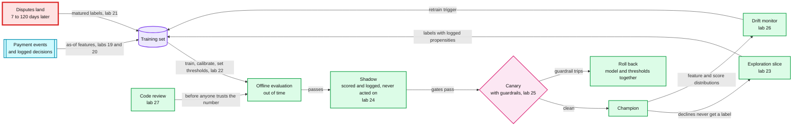

Red is the label clock. A dispute can land up to 120 days after its payment, and no model can be judged on final outcomes before then. Shadow costs no customer anything. The canary is the first step where the new model acts.

## Stripe and Radar wording

Use these when you talk about Stripe, in a lab or in an interview.

- **GBDT, not "the workhorse".** GBDT (gradient-boosted decision trees) is the right first model here. It is also the repo design's inline choice at about 3 M payments a day ([`solution.md` §7](../../hld/payments-risk-decisioning/solution.md#7-trade-offs)). But Stripe Radar moved from an XGBoost plus DNN (deep neural network) ensemble to DNN-only in mid-2022 ([stripe.dev, 2023-03-29](https://stripe.dev/blog/how-we-built-it-stripe-radar)). So never call LightGBM "the payments workhorse".
- **Radar's 0 to 99 score is not a probability.** It is a risk score. By default 65 and above is elevated risk and 75 and above is high risk, which Radar blocks by default ([risk evaluation docs](https://docs.stripe.com/radar/risk-evaluation)).
- **Published figures, not SLOs.** Stripe says Radar assesses "more than 1,000 characteristics", decides "in less than 100 milliseconds" and "incorrectly blocks just 0.1%" of legitimate payments ([stripe.dev, 2023](https://stripe.dev/blog/how-we-built-it-stripe-radar)). These are published figures, not SLOs (service level objectives).
- **ML design rounds.** Hello Interview's "at the senior level they are the norm" is about ML roles ([Hello Interview](https://www.hellointerview.com/learn/ml-system-design)). The repo's Stripe research found ML design only in an MLE (machine learning engineer) loop ([`hld/company-questions.md` §3.2](../../hld/company-questions.md#32-system-design-prompts-ranked)). The payoff of this module is depth on payments-risk probes.
- **The Stripe loop on 2026-10-19 and 20.** Prepare from [`model-lifecycle-shadow-and-labels.md` §10](../../hld/payments-risk-decisioning/deep-dives/model-lifecycle-shadow-and-labels.md#10-numbers-to-say-out-loud), not from these labs.
- **Chaney et al. is a recommender result.** It is cited in lab 13. Do not cite it for declines; for declines the reference is Lakkaraju et al. 2017 ([Selective labels and exploration](#selective-labels-and-exploration)).
- **Shadow, then canary.** The lifecycle always reads in that order.
- **Synthetic means synthetic.** Labs 19, 21 and 23 run on synthetic, generated data. Never quote their numbers as real-world rates.

## Concepts (read after the lab)

One section per concept, in lab order. Each lab file's Concept link lands on its section. Read it after the lab, as the second contact 1 to 3 days later. A lab file may send you here during the session for one formula (lab 22 does at step 4). Then open only that formula. No reference numbers are here.

### The generated payments stream

**Labs:** [19](labs/19-as-of-features.md), [21](labs/21-delayed-labels.md) and [23](labs/23-selective-labels-and-exploration.md), plus the Capstone A fallback. **Code:** [`scripts/paystream.py`](scripts/paystream.py), shared by those labs. Import it; never edit it.

`paystream.py` writes one seeded, synthetic stream of card payments, with a label clock attached to every fraud. No real customer, card, terminal or payment is behind any row.

- **Shape.** 5,000 customers and 10,000 terminals sit at random on a 100 x 100 square. The stream covers 183 days from 2018-04-01, about 1.8 M payments at seed 0. A customer pays only at terminals within distance 5 of home.
- **Legitimate payments, from the Handbook's parameters.** Each customer draws a mean amount from U(5, 100) (uniform), a standard deviation of half the mean, and a rate of U(0, 4) payments a day. Daily counts are Poisson at that rate. Time of day is N(noon, 20,000 s) (normal), and draws outside the day are dropped. A negative amount is redrawn from U(0, 2 x mean).
- **Four fraud scenarios.** (1) Any amount over 220. (2) Each day, 2 terminals are compromised for the next 28 days, and all their payments are fraud. (3) Each day, 3 customers are compromised for the next 14 days: a third of their payments are fraud, at 5 x the amount. (4) Card testing, added for these labs: from day 160, 20 customers a day get 5 extra payments of U(0.5, 3) within one hour. A payment keeps its first scenario.
- **Label clocks, added for these labs.** A fraud's dispute lands U(7, 120) days after the payment, in `label_available_at`. An early-warning `proxy_flag` lands U(1, 7) days after the payment, in `proxy_at`. It has recall 0.5 and precision 0.4, so there are 1.5 false flags for every true one.
- **Columns.** `tx_id`, `tx_datetime`, `customer_id`, `terminal_id`, `amount`, `is_fraud`, `scenario`, `label_available_at`, `proxy_flag`, `proxy_at`.
- **Why synthetic.** Public payment data rarely has card and terminal keys, timestamps and dispute arrival dates together. It never has the outcome of a declined payment. OpenML 1597 (labs 09, 22, 24 and 27) has anonymised PCA (principal component analysis) columns and no card or merchant key, so it cannot hold velocity features or a label delay. A generator also knows what production never sees: each label before it arrives, the outcome of every declined payment, and the scenario behind each fraud.
- **Why written fresh.** The Fraud Detection Handbook releases its notebook code under GPL v3.0 (the GNU General Public License) and its prose under CC BY-SA 4.0 (Creative Commons Attribution-ShareAlike). `paystream.py` takes only the published parameters. No code is copied and none of the Handbook's pickles is loaded. The data stays in `~/ml-data/`, never in the repo.
- **Limits.** Scenario 1 is a planted rule. Numbers from labs 19, 21 and 23 describe this generator, never real-world fraud.

**Key definition.**

```text
is_fraud            1 when scenario is 1 to 4, else 0
label_available_at  tx_datetime + U(7, 120) days for a fraud; empty (NaT, pandas' not-a-time) for a legitimate payment
proxy_at            tx_datetime + U(1, 7) days when proxy_flag is true; empty otherwise
smoke version       500 customers and 60 days, in ~/ml-data/paystream/smoke/
```

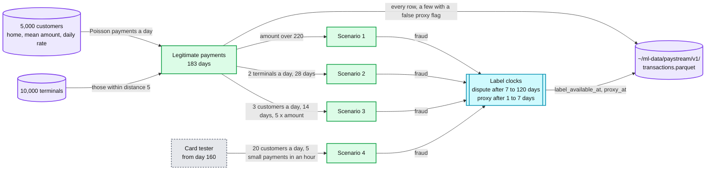

**Second contact.** The Fraud Detection Handbook, chapter 3: [transaction data simulator](https://fraud-detection-handbook.github.io/fraud-detection-handbook/Chapter_3_GettingStarted/SimulatedDataset.html) and [baseline feature transformation](https://fraud-detection-handbook.github.io/fraud-detection-handbook/Chapter_3_GettingStarted/BaselineFeatureTransformation.html). Read them for the design. Never copy their code into the repo.

**Repo.** [`model-lifecycle-shadow-and-labels.md` §1 Where labels come from, and when](../../hld/payments-risk-decisioning/deep-dives/model-lifecycle-shadow-and-labels.md#1-where-labels-come-from-and-when) lists the real label sources this stream imitates: chargebacks for the dispute, and fast reports such as TC40 (the issuer's fraud report to the card network) for the proxy.

### Point-in-time features

**Lab:** [19. Time split and as-of features](labs/19-as-of-features.md). **Thread:** leakage (labs 03, 06, 07, 10, 16, 19, 20, 27, 39), time-based splits (10, 16, 19, 21, 26) and gradient boosting (03, 08, 16, 19, 32, Capstone A).

A training row may only see what existed at its own timestamp. A fraud label exists only from the moment its dispute arrives. A point-in-time (as-of) join enforces both, and the split must respect time too.

- **Prediction time t.** The moment the model scores the payment. A feature is legal only if a live system could have computed it at t. scikit-learn defines leakage as "information that would not be available at prediction time is used when building the model" ([common pitfalls](https://scikit-learn.org/stable/common_pitfalls.html)).
- **Two clocks per row.** Event time is when the payment happened. Label availability time is when its dispute arrived. Features may use events before t, and labels that arrived before t.
- **Velocity windows.** Counts and mean amounts per key over the last 1, 7 and 30 days, over rows strictly before t. In pandas that is `rolling("7D", closed="left")` on a time index per key. At scale it is a stream processor's window ([`concepts/stream-processing.md` §3](../../concepts/stream-processing.md#3-windows)).
- **Label-derived features.** A count of a key's past frauds counts a fraud only once its label has arrived: `label_available_at < t`. The Handbook approximates this with a fixed one-week delay, because "the fraudulent transactions are only discovered after a fraud investigation or a customer complaint". The synthetic paystream gives every fraud its own arrival time instead.
- **Windowed, not cumulative.** An all-time count grows with calendar time, so one value means different things in a training month and a test month. A fixed window keeps the scale steady.
- **Split by time as well.** Rules of ML #33: "If you produce a model based on the data until January 5th, test the model on the data from January 6th and after." A random split puts the same customers, terminals and attack days on both sides of the line, so the test set stops being the future.
- **The leak table.** Lab 19's `--break` prints a 2x3 table of test AUC (area under the ROC, receiver operating characteristic, curve; 0.5 is a coin flip). The rows are three versions of the features and the columns are the time and the random split. Each difference between cells is what one kind of leak fakes. Read it at the debrief.

**Key formula.** For payment i with key k_i (a customer, a card, a terminal or a merchant) at time t_i, and a window W:

```text
count_W(i)        = #{ j : k_j = k_i  and  t_i - W <= t_j < t_i }
mean_amount_W(i)  = mean of amount_j over the same rows j
known_frauds_W(i) = #{ j : k_j = k_i  and  is_fraud_j = 1  and  t_i - W <= t_j < t_i  and  label_available_at_j < t_i }

as-of join        pandas.merge_asof(rows, snapshots, on="time", by="key", allow_exact_matches=False)
                  for each row, the latest snapshot stamped strictly before the row's own time
```

You may put a label-derived window on the event time or on the arrival time, as long as you say which. The rule that never moves is `label_available_at_j < t_i`. Lab 19 grades one fixed choice, stated in its Honest inputs term.

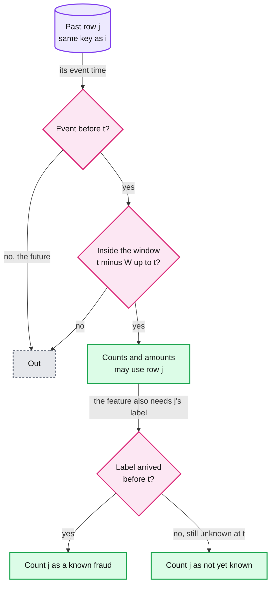

**Published.** Feast says its point-in-time join can "reproduce the state of features at a specific point in the past". It adds a created-timestamp rule "to keep backfilled values from leaking into training data" ([Feast docs](https://docs.feast.dev/getting-started/concepts/point-in-time-joins)).

**Second contact.** [Rules of ML](https://developers.google.com/machine-learning/guides/rules-of-ml) #29, #31 and #33. [Feast point-in-time joins](https://docs.feast.dev/getting-started/concepts/point-in-time-joins). Chip Huyen, *Designing Machine Learning Systems* (O'Reilly, 2022), chapter 5. Fraud Detection Handbook, chapter 3, [baseline feature transformation](https://fraud-detection-handbook.github.io/fraud-detection-handbook/Chapter_3_GettingStarted/BaselineFeatureTransformation.html): spending windows of 1, 7 and 30 days, and risk features that wait out a label delay.

**Repo.** [`model-lifecycle-shadow-and-labels.md` §2 Leakage: the trap in the training data](../../hld/payments-risk-decisioning/deep-dives/model-lifecycle-shadow-and-labels.md#2-leakage-the-trap-in-the-training-data); [`features-and-freshness.md` §6 Point-in-time correctness](../../hld/payments-risk-decisioning/deep-dives/features-and-freshness.md#6-point-in-time-correctness).

### Training-serving skew

**Lab:** [20. Training-serving skew replay](labs/20-training-serving-skew.md). **Thread:** leakage (labs 03, 06, 07, 10, 16, 19, 20, 27, 39).

One feature has one definition and two implementations. A batch job computes it over history for training. A serving path computes it per request in production. When the two drift apart, nothing fails loudly.

- **Why offline cannot see it.** Offline evaluation reads the batch path for both the training and the test rows. The serving path is not in that loop, so a gap between the paths never reaches the offline metric.
- **Measure it row by row.** Replay the same queries through both paths and compare the values. The mismatch rate is the share of rows where they differ. Then read a handful of differing rows side by side. The pattern of the differences points at the cause.
- **Three train-serve combinations.** Batch train with batch serve is what a launch review sees. Batch train with serving serve is what production runs. Serving train with serving serve trains on the values the serving path produced, as logged at prediction time.
- **Remove it by construction.** Log the feature vector the model saw with every decision, and train on that log (Rules of ML #29). Nothing is recomputed, so nothing can differ.
- **What the log does not cover.** A brand-new feature has no logged history. Backfill it once, and compare the backfilled values of an existing feature with its logged values as a skew test.
- **Cheaper steps on the way.** Run one shared library for both paths (Rules of ML #32), in stream mode and in batch mode, with a reconciliation metric between them.

**Key formula.** Over the same n queries q_1 to q_n, with one written definition:

```text
mismatch_rate = (1 / n) * sum over i of [ f_batch(q_i) != f_serve(q_i) ]
```

Lab 20's feature definition is in its Terms. Both paths must implement exactly that definition.

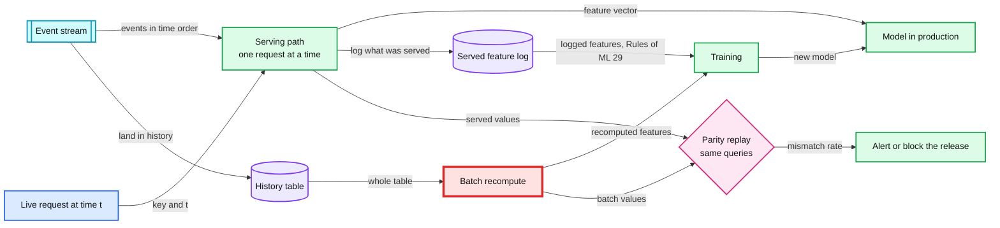

Red is the batch recompute. Training on it means training on a path production never runs. The served log removes it from training.

**Published.** Rules of ML #37: "If you apply a model to an example in the training data and the same example at serving, it should give you exactly the same result." Rule #29 reports that YouTube's home page "switched to logging features at serving time with significant quality improvements". Uber built Michelangelo's feature store so that it "ensur[es] consistency between online and offline versions" ([Uber, 2018](https://www.uber.com/blog/scaling-michelangelo/)).

**Second contact.** [Rules of ML](https://developers.google.com/machine-learning/guides/rules-of-ml) #29 and #37. Chip Huyen, *Designing Machine Learning Systems*, chapter 7.

**Repo.** [`solution.md` §4.3 Learn: features, labels, retraining, safe rollout](../../hld/payments-risk-decisioning/solution.md#43-learn-features-labels-retraining-safe-rollout) (the "What breaks, compressed" ladder); [`hourly-institution-export.md` §2 The hourly pipeline](../../hld/driver-hot-clusters/deep-dives/hourly-institution-export.md#2-the-hourly-pipeline) (one library in both modes, and a reconciliation metric); [`features-and-freshness.md` §6](../../hld/payments-risk-decisioning/deep-dives/features-and-freshness.md#6-point-in-time-correctness) (train on the logged vector, and backfill a new feature as a skew test).

### Delayed labels

**Lab:** [21. Delayed labels](labs/21-delayed-labels.md). **Thread:** time-based splits (labs 10, 16, 19, 21, 26).

A fraud's label is a dispute that arrives days to months after the payment, so "not disputed yet" does not mean "legitimate". Every training set built today chooses between old rows with final labels and new rows with partial ones.

- **Label maturity.** A cohort is the payments of one day or one week. Its observed fraud rate climbs toward its true rate as disputes arrive. The maturity curve is the share of a cohort's eventual frauds that is visible at each age.
- **The observed label.** As of today, a fraud counts only once its dispute has arrived. Before that, the row looks legitimate.
- **Mature-only.** Train only on rows older than the longest delay, so every label is final. The newest training row is at least that old.
- **Naive.** Train on every row, with labels as known today. Every fraud whose dispute has not arrived enters training as a legitimate row.
- **Mature plus proxy.** Take the mature rows, plus newer rows labelled fraud when either the dispute or an early proxy has arrived by today. The proxy is fast and noisy. The synthetic paystream's proxy has precision 0.4, set from Stripe's note that "about 40% of Visa and Mastercard EFWs become fraud disputes" (EFW: early fraud warning).
- **Score on the truth.** The synthetic generator knows every label, so lab 21 scores all three models on true labels. Production cannot do that until the cohort matures.
- **A new attack.** A model learns an attack only from labelled examples, and an attack's first labels arrive no sooner than the shortest delay. Rules and velocity counters react in minutes; the model follows when labels exist ([rules engine §1](../../hld/payments-risk-decisioning/deep-dives/rules-engine-and-attack-response.md#1-rules-and-the-model-do-different-jobs)).

**Key definition.**

```text
observed(i, today)  = is_fraud_i  and  label_available_at_i <= today
maturity(a)         = F(a) = P(delay <= a), the share of a cohort's frauds visible at age a
observed_rate(a)    = true_rate * F(a)

mature set          rows with tx_datetime + max_delay <= today      label = observed, here equal to the truth
naive set           every row before the training cutoff            label = observed
mature plus proxy   the mature set, plus newer rows before the cutoff with
                    label = observed  or  (proxy_flag and proxy_at <= today)
```

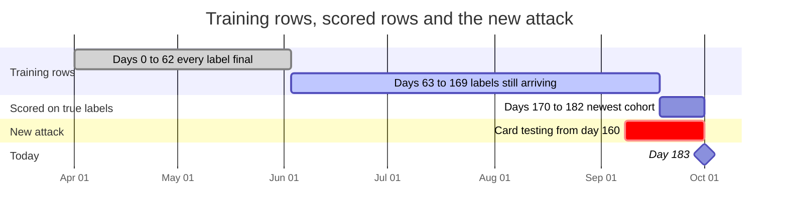

**Published.** Stripe: "Card networks typically allow cardholders to initiate disputes within 120 days of the original payment" ([How disputes work](https://docs.stripe.com/disputes/how-disputes-work)). The repo design puts most fraud chargebacks within 60 to 90 days, and estimates TC40 reports at days to weeks.

**Second contact.** Stripe docs, [How disputes work](https://docs.stripe.com/disputes/how-disputes-work): the 120-day window, and about 40% of Visa and Mastercard early fraud warnings becoming fraud disputes. Chip Huyen, *Designing Machine Learning Systems*, chapter 4 (natural labels and the length of the feedback loop).

**Repo.** [`model-lifecycle-shadow-and-labels.md` §1 Where labels come from, and when](../../hld/payments-risk-decisioning/deep-dives/model-lifecycle-shadow-and-labels.md#1-where-labels-come-from-and-when); [`edge-cases.md`, labels arrive 60 to 90 days late](../../hld/payments-risk-decisioning/edge-cases.md#edge-case-labels-arrive-60-to-90-days-late); [`rules-engine-and-attack-response.md` §1 Rules and the model do different jobs](../../hld/payments-risk-decisioning/deep-dives/rules-engine-and-attack-response.md#1-rules-and-the-model-do-different-jobs).

### Calibration and decline thresholds

**Lab:** [22. Calibration and decline thresholds](labs/22-calibration-and-thresholds.md). At step 4 the lab opens only the prior-correction formula, the first block below. **Thread:** thresholds and calibration (labs 09, 22, 23, 24).

A decline threshold is a point on the model's probability scale. Anything that moves the scale, such as a resampled training set or a new model, changes which payments fall above that threshold. So the threshold must move with the scale.

**Key formula: the prior correction** (Dal Pozzolo et al. 2015).

```text
b    the keep rate of legitimate training rows (every fraud is kept); b = 0.10 keeps 1 in 10
p_s  the model's score, trained on the downsampled rows
p    = b * p_s / (b * p_s - p_s + 1)        the same score on the scale of untouched traffic
```

It follows from the odds. With odds = p / (1 - p), the sampled odds are odds_s = odds / b, because only a share b of the legitimate rows at every x stays in training. Solve for p and you get the line above.

- **Calibrated** means that among payments scored near p, a share near p is fraud. Check it with a reliability table: sort the scores, cut them into 10 quantile bins, and compare each bin's mean score with its observed fraud rate.
- **Brier score.** The mean of (p - y) squared over the payments, lower is better. It rewards a good ranking and an honest scale together.
- **Three ways back to the true scale.** Apply the prior correction above. Or weight each kept legitimate row by 1/b in training (Rules of ML #30: "Importance-weight sampled data, don't arbitrarily drop it!"). Or recalibrate on recent traffic that was never resampled (isotonic regression or Platt scaling, in the scikit-learn guide).
- **A threshold from costs.** Decline when the expected fraud loss beats the expected false-decline cost: p x L(a) > (1 - p) x C_fd(a). So p\*(a) = C_fd(a) / (C_fd(a) + L(a)). With the repo's L(a) = a + $15 and C_fd(a) = 0.13a + $8, p\* is 0.23 at $20, 0.14 at $200 and 0.12 at $2,000.
- **Who owns it.** The cost weights are a policy decision: whose fee, whose lost sale, which network penalty. Risk policy signs them; the model owner does not tune them. Rules of ML #15 keeps that policy layer separate from the model.
- **A threshold ships with its model.** A model version is the model, its calibration, its thresholds and its feature schema. A rollback flips all four together.
- **Radar's score is not a probability.** It is a 0 to 99 risk score with Stripe's own cutoffs ([Stripe and Radar wording](#stripe-and-radar-wording)).

```text
reliability bin k   mean of p over bin k   vs   share of y = 1 in bin k      (10 quantile bins)
Brier               (1 / n) * sum over i of (p_i - y_i)^2
threshold           p*(a) = C_fd(a) / (C_fd(a) + L(a))
```

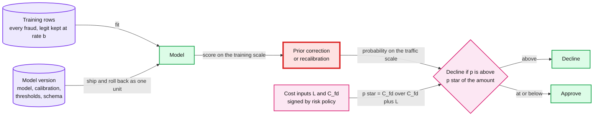

Red is the scale step. A threshold is only as good as the scale it was set on, which is why the registry ships the calibration and the thresholds with the model.

**Published.** Guo et al. 2017 found that modern neural networks "are poorly calibrated" and that temperature scaling is "surprisingly effective" ([arXiv 1706.04599](https://arxiv.org/abs/1706.04599)). Stripe's Radar treats 65 and above as elevated risk and 75 and above as high risk by default, on its 0 to 99 scale ([risk evaluation docs](https://docs.stripe.com/radar/risk-evaluation)).

**Second contact.** Guo, Pleiss, Sun and Weinberger 2017, "On Calibration of Modern Neural Networks" ([arXiv 1706.04599](https://arxiv.org/abs/1706.04599)). The [scikit-learn calibration guide](https://scikit-learn.org/stable/modules/calibration.html). Dal Pozzolo, Caelen, Johnson and Bontempi 2015, "Calibrating Probability with Undersampling for Unbalanced Classification" (IEEE Symposium Series on Computational Intelligence). [Rules of ML](https://developers.google.com/machine-learning/guides/rules-of-ml) #15 and #30. Google ML Crash Course, [Imbalanced datasets](https://developers.google.com/machine-learning/crash-course/overfitting/imbalanced-datasets).

**Repo.** [`model-lifecycle-shadow-and-labels.md` §4 Thresholds from cost, and why the inputs must scale](../../hld/payments-risk-decisioning/deep-dives/model-lifecycle-shadow-and-labels.md#4-thresholds-from-cost-and-why-the-inputs-must-scale); [§6 Rolling a model back](../../hld/payments-risk-decisioning/deep-dives/model-lifecycle-shadow-and-labels.md#6-rolling-a-model-back).

### Selective labels and exploration

**Lab:** [23. Counterfactual evaluation](labs/23-selective-labels-and-exploration.md). **Thread:** thresholds and calibration (labs 09, 22, 23, 24) and feedback loops and selection bias (05, 13, 23, Capstone A).

The champion decides which payments can ever be labelled, because a declined payment never becomes a dispute. Any evaluation or training set built from outcomes inherits that choice.

- **Selective labels.** The decision hides the outcome. Lakkaraju et al. 2017 named this the selective labels problem; their case is bail decisions, ours is declines. On lab 23's synthetic stream there is no model in era A (days 0 to 90), so every payment is approved. In era B (days 91 to 182) the champion declines its top 1% of scores each day, and those rows never get a label.
- **Approved-only evaluation.** Scoring a challenger on the champion's approvals measures it on a population the champion already filtered. The frauds the champion caught are missing from that view.
- **Exploration.** Approve a random share ε of would-be declines, and log each row's propensity π: the probability that the policy let it be labelled. π is 1 for an ordinary approval and ε for an explored would-be decline.
- **IPW (inverse propensity weighting).** Each labelled row stands for 1/π rows like it, so an explored row weighs 1/ε. Each weighted count is unbiased: a row with propensity π is labelled a share π of the time, and the weight 1/π restores its count on average. Recall is a ratio of two weighted counts, so its estimate is consistent but slightly biased in small samples. It is noisy, because a few rows carry large weights.
- **Size the slice by two numbers.** The first is the interval width: fewer explored rows give a wider interval. The second is the cost: every explored row is a payment the champion judged risky and approved anyway, so the slice pays real fraud dollars. The repo caps its approve slice by amount and by a monthly dollar budget.
- **Two reject-inference shortcuts.** (a) Drop the declined rows: the training set then holds no rows from the region the champion declines. (b) Label every declined row as fraud: the label there becomes the champion's opinion, not an outcome.
- **A step-up is not an approval.** A 3DS challenge changes the outcome it is meant to measure. Fraudsters walk away at the challenge, and liability moves to the issuer, so chargebacks collapse.
- **Lab assumption.** Lab 23 treats approved labels as matured, to separate selection from delay. [Delayed labels](#delayed-labels) covers the delay.

**Key formula.**

```text
w_i       = 1 / π_i on labelled rows          π = 1 for an approval, ε for an explored would-be decline
recall    = sum_i w_i * fraud_i * caught_i  /  sum_i w_i * fraud_i      caught_i = 1 when the challenger declines row i
interval  = bootstrap the rows 200 times; the middle 95% of the estimates
```

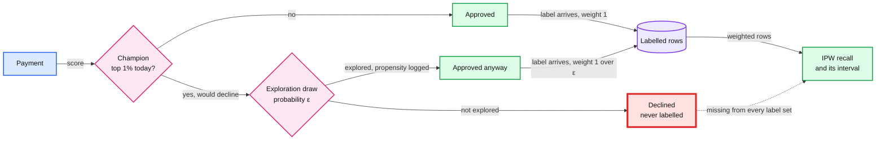

Red is the blind spot: the declined rows. Only the logged exploration slice reaches into it, and only at a price.

**Published.** Stripe's Radar docs: "For a small subset of payments, Stripe modifies the reported risk score so we can measure the performance of our models and obtain data for subsequent model development" ([risk evaluation docs](https://docs.stripe.com/radar/risk-evaluation)).

**Second contact.** Stripe docs, [Radar risk evaluation](https://docs.stripe.com/radar/risk-evaluation). Michael Manapat (Stripe), "Counterfactual evaluation of machine learning models", PyData Seattle 2015. Bottou et al. 2013, "Counterfactual Reasoning and Learning Systems" ([arXiv 1209.2355](https://arxiv.org/abs/1209.2355)). Dudík, Langford and Li 2011, "Doubly Robust Policy Evaluation and Learning" ([arXiv 1103.4601](https://arxiv.org/abs/1103.4601)). Lakkaraju et al. 2017, "The Selective Labels Problem" (KDD).

**Repo.** [`model-lifecycle-shadow-and-labels.md` §3 Two exploration slices, because 3DS biases one](../../hld/payments-risk-decisioning/deep-dives/model-lifecycle-shadow-and-labels.md#3-two-exploration-slices-because-3ds-biases-one); [`solution.md` §5.5 (labels, thresholds, rollout)](../../hld/payments-risk-decisioning/solution.md#55-labels-arrive-60-to-90-days-later-how-do-you-train-and-how-do-you-know-a-new-model-is-better-before-it-declines-real-customers-loss-budget-the-model); [`edge-cases.md`, the exploration slice uses 3DS](../../hld/payments-risk-decisioning/edge-cases.md#edge-case-the-exploration-slice-uses-3ds-which-changes-the-outcome).

### Shadow launches

**Lab:** [24. Shadow challenger](labs/24-shadow-challenger.md), which replays the models lab 22 saves. **Thread:** thresholds and calibration (labs 09, 22, 23, 24), latency budgets (02, 13, 15, 24) and cost per prediction (02, 04, 15, 24).

A shadow model scores live traffic and logs its answer, and nothing acts on that answer. It shows the challenger's decisions, latency and cost before it declines anyone.

- **Compare at the same decline rate, not the same threshold.** A threshold is a point on one model's score scale. The same number on another model's scale is a different operating point. So set the challenger's threshold at the quantile that gives the champion's decline rate.
- **Swap sets.** At a matched rate the two decline sets split three ways. The overlap is declined by both. The swap-in set is declined only by the challenger (new declines). The swap-out set is declined only by the champion (new approvals). Decisions change only in the swap sets, so review effort goes there.
- **Analyst review.** Sample the swap-in set to analysts every day. That yields labels in days, not months: the repo's disagreement set. Lab 24 simulates the review with held-out labels.
- **Where the shadow call runs.** Inline, in the request path, it adds its own time and its own tail to every response. After the response, from the same feature snapshot, the buyer never waits for it (the repo's choice). In a background thread of the same process it shares the CPU and, in Python, the GIL (global interpreter lock). Only one thread runs Python bytecode at a time, though native code, such as a model library's prediction loop, can release the lock while it computes. A bounded queue drops shadow work instead of growing when the shadow falls behind.
- **Cost in cores.** Cores at peak = peak decisions a second x CPU-ms per decision / 1,000. The repo design is sized for 2,000 decisions a second.
- **The repo's shadow gates.** 7 to 14 days on all traffic, p99 (99th-percentile latency) under 6 ms, the score distribution per segment, a would-be decline rate within ±10% of the champion's, and the disagreement set to analysts daily.
- **Shadow, then canary.** A shadow cannot show how customers and fraudsters react to the challenger's decisions, because nothing acts on them. The canary is the first time the challenger acts: 5%, then 25%, then 100% of traffic, with guardrails per segment ([Experiments when labels arrive late](#experiments-when-labels-arrive-late)).

**Key formula.**

```text
matched threshold   τ = quantile(challenger scores, 1 - r)       r = the champion's decline rate; decline when score > τ
swap sets           overlap  = declined by both
                    swap-in  = declined by the challenger only
                    swap-out = declined by the champion only
cores at peak       = decisions per second * CPU-ms per decision / 1,000
```

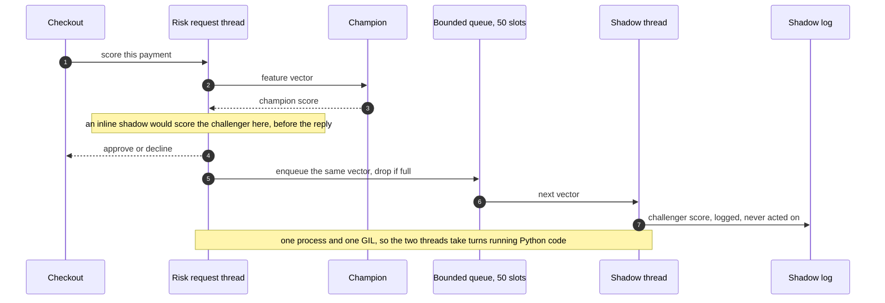

**Published.** AWS deploys a shadow variant "in shadow mode and routes a copy of the inference requests to it in real time". You can "discard or log the responses of the shadow variant for offline comparison" ([SageMaker shadow tests](https://docs.aws.amazon.com/sagemaker/latest/dg/shadow-tests.html)). Google SRE (site reliability engineering): "Canarying is effectively an A/B testing process" ([SRE Workbook, chapter 16](https://sre.google/workbook/canarying-releases/)). Stripe says Radar decides "in less than 100 milliseconds" ([stripe.dev, 2023](https://stripe.dev/blog/how-we-built-it-stripe-radar)): a published figure, not an SLO.

**Second contact.** AWS, [SageMaker shadow tests](https://docs.aws.amazon.com/sagemaker/latest/dg/shadow-tests.html). Google, [SRE Workbook chapter 16, Canarying releases](https://sre.google/workbook/canarying-releases/).

**Repo.** [`latency-budget-and-hot-path.md` §5 What else is in process, and why](../../hld/payments-risk-decisioning/deep-dives/latency-budget-and-hot-path.md#5-what-else-is-in-process-and-why); [`model-lifecycle-shadow-and-labels.md` §5 Proving a model before it declines anyone](../../hld/payments-risk-decisioning/deep-dives/model-lifecycle-shadow-and-labels.md#5-proving-a-model-before-it-declines-anyone).

### Experiments when labels arrive late

**Lab:** [25. A/B power, peeking and label maturity](labs/25-experiments-with-late-labels.md).

An experiment's clock has two parts. Enrollment runs until each arm has enough users. Label maturity runs until the last enrolled payment's label is final. Alpha 0.05 holds for one look at a fixed horizon, and every extra look is another chance for noise to cross the line.

- **Sample size per arm** comes from four numbers fixed before launch: the base rate p1, the smallest relative lift worth detecting, alpha and power. The test is a two-sided pooled two-proportion z-test. The formula is below, the same as in lab 25's section 3.
- **Calendar days = enrollment days + maturity days.** Enrollment days = users per arm / traffic per arm per day, rounded up. The maturity wait starts at the last enrolled payment.
- **Guardrails.** Metrics known at decision time, such as the approval, decline and step-up rates, have no maturity wait. A canary reads them while the fraud outcome is still unknown.
- **Peeking.** A fixed-horizon test looks once. Daily looks with a stop at the first p below 0.05 give noise many chances. Fixes: set the horizon in advance, spend alpha across planned looks, or use a sequential test built for continuous monitoring, such as the always-valid p-values of Johari et al. 2015.
- **Sample-ratio check.** A chi-square test of the assignment counts against the planned split. A tiny p-value means the assignment is broken, and so is every result built on it.
- **Sticky assignment.** A unit must stay in its arm for the whole maturity window. Hash the unit with a per-experiment salt, and check that the hash is sticky and uniform.

**Key formula.**

```text
p2    = p1 * (1 + rel_lift)                     a drop has a negative rel_lift
p_bar = (p1 + p2) / 2
z_a   = NormalDist().inv_cdf(1 - alpha / 2)     NormalDist from the statistics module
z_b   = NormalDist().inv_cdf(power)
n     = ceil((z_a * sqrt(2 * p_bar * (1 - p_bar)) + z_b * sqrt(p1 * (1 - p1) + p2 * (1 - p2)))^2 / (p2 - p1)^2)

calendar days = ceil(n / traffic per arm per day) + maturity days
```

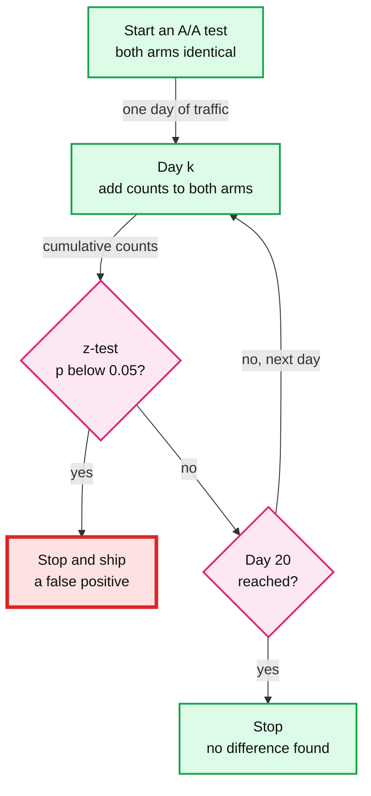

Red is the false launch: a stop that noise alone produced. A fixed horizon or a sequential test removes that exit.

**Second contact.** The statsmodels [`NormalIndPower` docs](https://www.statsmodels.org/stable/generated/statsmodels.stats.power.NormalIndPower.html). Johari, Pekelis and Walsh 2015, "Always Valid Inference: Bringing Sequential Analysis to A/B Testing" ([arXiv 1512.04922](https://arxiv.org/abs/1512.04922)).

**Repo.** [`model-lifecycle-shadow-and-labels.md` §5 Proving a model before it declines anyone](../../hld/payments-risk-decisioning/deep-dives/model-lifecycle-shadow-and-labels.md#5-proving-a-model-before-it-declines-anyone); [`evaluation-and-bucketing.md` §3 Measured: sticky, monotonic, independent, uniform](../../hld/feature-flag-service/deep-dives/evaluation-and-bucketing.md#3-measured-sticky-monotonic-independent-uniform).

### Drift monitoring

**Lab:** [26. Drift](labs/26-drift-monitoring.md). **Thread:** time-based splits (labs 10, 16, 19, 21, 26).

Drift tests compare a feature's distribution in a reference window with its distribution in a current window. A test asks whether the two could be one distribution. A monitor also needs to know how big the change is, and whether it moved the model's error.

- **KS (Kolmogorov-Smirnov) test.** D is the largest gap between the two ECDFs (empirical cumulative distribution functions). At level alpha it flags D above c(alpha) x sqrt((n + m) / (n x m)), for windows of n and m rows. So the bar depends on the window sizes as well as on the shift.
- **PSI (population stability index).** Cut the reference window into 10 quantile bins. Take each bin's share in the reference (e) and in the current window (a), and sum (a - e) x ln(a / e). PSI measures size, not significance. A bin that is empty in either window needs a small floor, or the log is infinite; lab 26 floors each share at 0.0001. The repo design alerts at PSI above 0.2 on its top 30 features, daily. 0.2 is a convention, not a test.
- **Domain classifier.** Label reference rows 0 and current rows 1, train a classifier with cross-validation, and read its AUC. An AUC of 0.5 means the windows look alike, and the feature importances name what moved. Leave out columns that encode the date itself, or the classifier separates the windows by the calendar alone.
- **A no-shift control.** Two random halves of one window have no shift by construction, so every flag on them is a false alarm. Run every detector on a control before you trust it.
- **Tie a shift to error.** A shift that moves neither the model's error nor its score distribution is a note. One that moves them is a retrain or a page. Payments labels arrive late, so the PSI of the model's own scores is the leading indicator.
- **What pages at 3 am.** In the repo design: a null-rate spike on a top feature, and a decline rate in a segment at 2x its baseline.

**Key formula.**

```text
KS          D = max over x of | F_ref(x) - F_cur(x) |
            flag when D > c(alpha) * sqrt((n + m) / (n * m)), with c(0.05) about 1.36
PSI         sum over the 10 reference-quantile bins of (a_i - e_i) * ln(a_i / e_i)
            e_i, a_i = the bin's share of the reference and of the current window
domain AUC  the cross-validated AUC of a classifier that separates reference rows (0) from current rows (1)
            for one normal feature whose mean moved by d standard deviations, the best possible AUC is Phi(d / sqrt(2)),
            with Phi the standard normal CDF (cumulative distribution function)
```

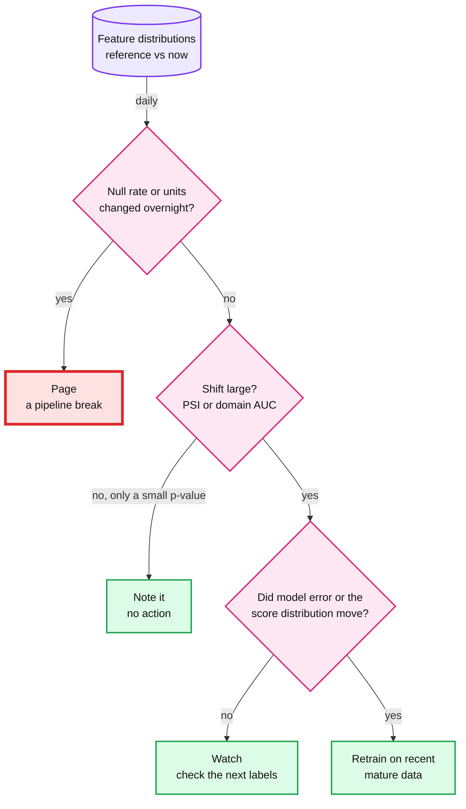

Red is the pipeline break. A feature that turns null or changes units overnight looks like drift, and it is the one case that pages before any statistics.

**Published.** In Rabanser et al.'s study of shift detectors, the best performer was "a two-sample-testing-based approach, using pre-trained classifiers for dimensionality reduction" ([arXiv 1810.11953](https://arxiv.org/abs/1810.11953)).

**Second contact.** Rabanser, Günnemann and Lipton 2018, "Failing Loudly: An Empirical Study of Methods for Detecting Dataset Shift" ([arXiv 1810.11953](https://arxiv.org/abs/1810.11953)). Chip Huyen, *Designing Machine Learning Systems*, chapter 8.

**Repo.** [`model-lifecycle-shadow-and-labels.md` §5](../../hld/payments-risk-decisioning/deep-dives/model-lifecycle-shadow-and-labels.md#5-proving-a-model-before-it-declines-anyone) (PSI above 0.2 on the top 30 features); [`solution.md` §5.5](../../hld/payments-risk-decisioning/solution.md#55-labels-arrive-60-to-90-days-later-how-do-you-train-and-how-do-you-know-a-new-model-is-better-before-it-declines-real-customers-loss-budget-the-model) (leading indicators, because outcomes lag); [`bad-batch-circuit-breaker.md` §3 The rule](../../hld/credit-score-alerts/deep-dives/bad-batch-circuit-breaker.md#3-the-rule) (a robust z-score plus an absolute floor, because with large batches "Power is never the problem"); [`edge-cases.md`, what pages at 3 AM](../../hld/payments-risk-decisioning/edge-cases.md#edge-case-what-pages-at-3-am).

### Reviewing AI-written ML code

**Lab:** [27. Audit an AI-written fraud pipeline](labs/27-audit-an-ai-written-pipeline.md), the last M4 lab, with hints only. **Thread:** leakage (labs 03, 06, 07, 10, 16, 19, 20, 27, 39).

An assistant writes a wrong pipeline as fluently as a right one: tidy names, docstrings, runs that pass. A metric cannot tell a leak from a real gain. So a review reads what each step touched, not what its docstring says.

Ask three questions of every step:

1. **What data did this step see?** For every step that learns from rows (an imputer, a scaler, an encoder, a feature selector, a model), find the exact rows it read. Anything that runs before the split has read the rows the report is scored on.
2. **What was it tuned on?** Every choice made by looking at results (hyperparameters, the features kept, early stopping, which model wins) needs rows the reported metric never sees. Keep train, validation and test apart, and score the test rows once, at the end.
3. **What scale are its numbers on?** A number means something only on the population and in the units it was computed on. Check that before you compare any two numbers.

Then the method:

- **Read the data flow before the docstrings.** Names and docstrings state intent. The code states behavior.
- **Recompute the headline number on rows nothing touched,** such as a later time slice that no step fit or tuned on.
- **Change one thing at a time.** Rerun after each change, and record which number moved and by how much.
- **In lab 27 the AI gives hints only.** It names the file and the function before it ever names a line (`ml-learning/CLAUDE.md`).

**Key definition.** A review card, one row per step of the script:

```text
| Step | Rows it read | Fit or tuned on | Output, and the scale it is on |
|------|--------------|-----------------|--------------------------------|
```

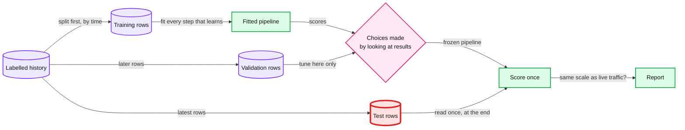

Red is the test slice. Every step that reads it before the end turns the report into a training score.

**Published.** In Anthropic's randomized trial (Shen and Tamkin 2026), 52 engineers learned a new Python library with or without AI help. The AI group averaged 50% on the quiz that followed and the hand-coding group 67%. The blog adds: "The largest gap in scores between the two groups was on debugging questions" ([blog](https://www.anthropic.com/research/AI-assistance-coding-skills); [arXiv 2601.20245](https://arxiv.org/abs/2601.20245)).

**Second contact.** Kaggle Learn, [Intermediate Machine Learning](https://www.kaggle.com/learn/intermediate-machine-learning), lesson 7, Data Leakage. [Rules of ML](https://developers.google.com/machine-learning/guides/rules-of-ml) #30. Dal Pozzolo et al. 2015. Shen and Tamkin 2026 ([arXiv 2601.20245](https://arxiv.org/abs/2601.20245)).

**Repo.** [`model-lifecycle-shadow-and-labels.md` §2 Leakage: the trap in the training data](../../hld/payments-risk-decisioning/deep-dives/model-lifecycle-shadow-and-labels.md#2-leakage-the-trap-in-the-training-data) and [§8 What an interviewer pushes on](../../hld/payments-risk-decisioning/deep-dives/model-lifecycle-shadow-and-labels.md#8-what-an-interviewer-pushes-on) ("Your offline AUC jumped. Celebrate?"); [`edge-cases.md`, the leakage trap in training data](../../hld/payments-risk-decisioning/edge-cases.md#edge-case-the-leakage-trap-in-training-data).
