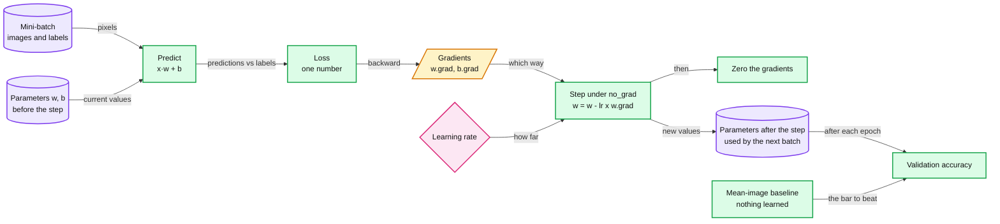
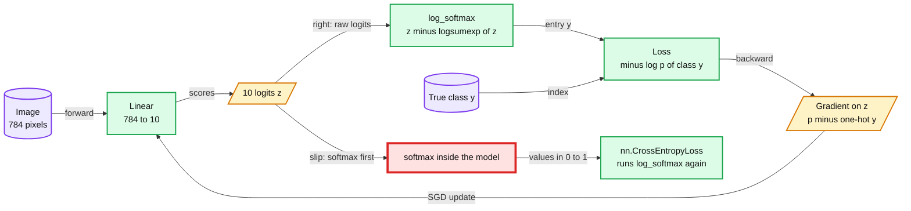
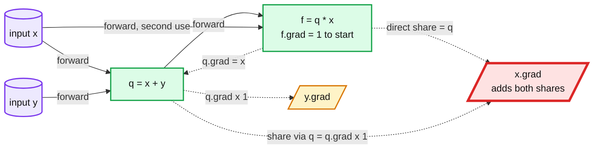
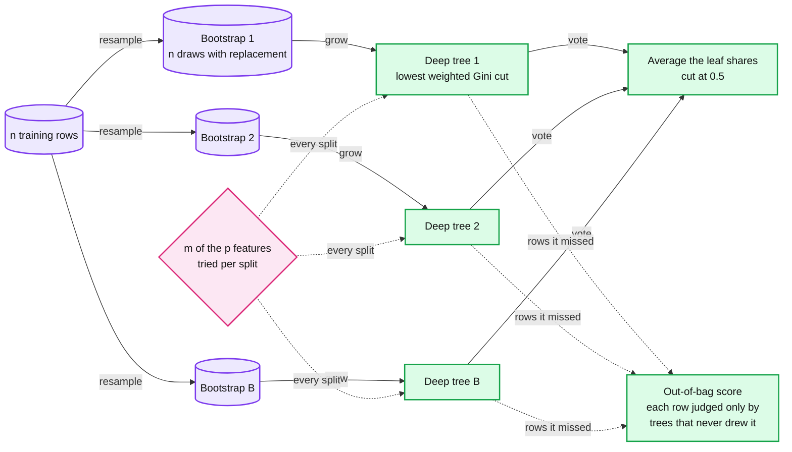
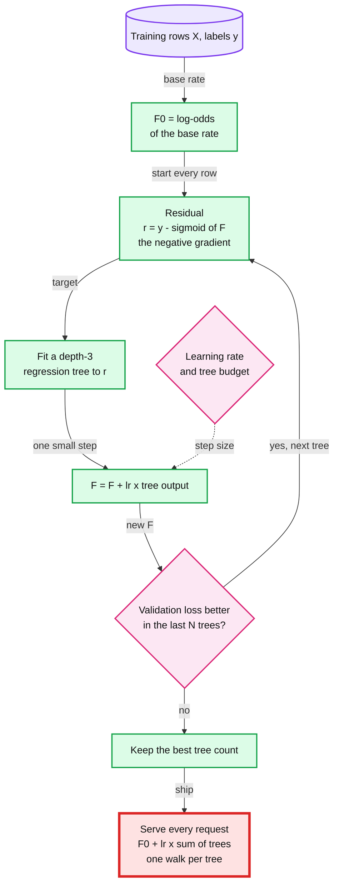
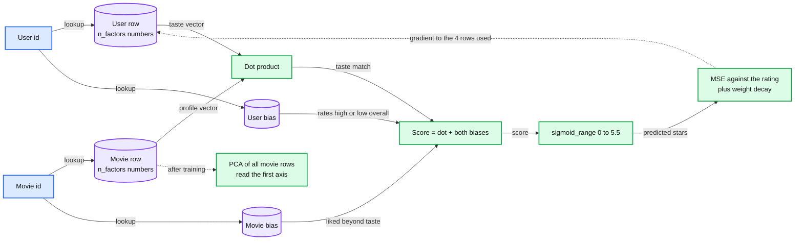

# Under the hood: models from scratch

> Rebuild SGD, cross-entropy, backprop, a random forest, gradient boosting and embeddings, each in under 20 lines.

Six one-hour CPU labs. Each one takes something a library does for you, writes its core by hand, and checks it against the library: SGD (stochastic gradient descent) and cross-entropy in PyTorch, backpropagation in a scalar engine you can read in one sitting, then a random forest, a GBDT (gradient-boosted decision trees) loop and a recommender's embeddings.

## Labs

| Lab | Title | Level | Runs on | Interview question | Status |
|---|---|---|---|---|---|
| 28 | [Pixel baseline, then SGD by hand: loss, gradient and learning rate](labs/28-sgd-by-hand.md) | W | cpu | Your training loss turns to NaN after two epochs: what happened, and what do you change first? | todo |
| 29 | [Softmax and cross-entropy: from 2 digits to 10](labs/29-softmax-and-cross-entropy.md) | C | cpu | What should a classifier's loss be before any training, and what happens if you train a classifier with MSE (mean squared error) instead of cross-entropy? | todo |
| 30 | [micrograd: the chain rule and a gradient check](labs/30-micrograd.md) | C | cpu | How does backprop handle a value used twice, and how do you test a gradient implementation? | todo |
| 31 | [Random forest by hand: one deep tree vs many averaged trees](labs/31-random-forest-by-hand.md) | S | cpu | Why does averaging 100 deep trees beat one deep tree, and when does adding more trees stop helping? | todo |
| 32 | [Gradient boosting by hand: each small tree fits what the others missed](labs/32-gradient-boosting-by-hand.md) | S | cpu | Why does a GBDT need about 1,000 trees, and what does each tree cost per request? | todo |
| 33 | [Embeddings from scratch: DotProductBias and what factors encode](labs/33-embeddings-from-scratch.md) | S | cpu | What does a learned item embedding encode, and how do you serve nearest neighbours for 10 M items in RAM? | todo |

Levels (see [`../CLAUDE.md`](../CLAUDE.md) §7): W, worked: you read the full script and answer its `# Q:` prompts. C, completion: you write the `TODO(human)` block and `--check` grades it. S, spec: you write the concept function from the formula in the lab file, and the AI writes the harness from your prompt. Gradients restart the fading at W, so the module goes W, C, C, S, S, S. All six labs run on the CPU in the light lane.

## Before you start

**Base install.** Follow [`../README.md`](../README.md): Python 3.13.7 in `~/.venvs/ml` with the pinned base packages.

**Extra pip line for this module: none.** Nothing to install beyond the base. These labs use these base pins: torch==2.14.1, torchvision==0.29.1, scikit-learn==1.9.1, lightgbm==4.7.0, numpy==2.5.4, pandas==2.3.3, scipy==1.18.1, matplotlib==3.11.2. To confirm:

```
$ python -c "import torch, torchvision, sklearn, lightgbm; print(torch.__version__, torchvision.__version__, sklearn.__version__, lightgbm.__version__)"
```

**Data, once, the evening before.** Run every command from this folder.

| Lab | Dataset | Download | Lands in | Command |
|---|---|---|---|---|
| 28 | MNIST_SAMPLE, 3s and 7s: 12,396 training and 2,038 validation images, 28x28 | 3.2 MB | `~/ml-data/mnist_sample/` | `python scripts/28_sgd_by_hand.py --download` |
| 29 | MNIST: 60,000 training and 10,000 test digits, 28x28 | 11.6 MB, four .gz files | `~/ml-data/mnist/`, shared with lab 34 | `python scripts/29_softmax_and_cross_entropy.py --download` |
| 30 | None: 20 synthetic expressions, made at run time from seed 42 | 0 MB | nothing | `python scripts/30_micrograd.py --download` (it says there is nothing to fetch) |
| 31 | Adult census income, OpenML 1590: 48,842 rows, 14 features | 0.66 MB | `~/ml-data/openml/`, shared with labs 03, 08 and 32 | `python scripts/31_random_forest_by_hand.py --download` |
| 32 | Adult census income, OpenML 1590, the same file | 0.66 MB, or nothing if lab 03 or 31 fetched it | `~/ml-data/openml/` | `python scripts/32_gradient_boosting_by_hand.py --download` |
| 33 | MovieLens 100K: 100,000 ratings, 943 users, 1,682 movies | 4.92 MB | `~/ml-data/ml-100k/`, shared with lab 05 | `python scripts/33_embeddings_from_scratch.py --download` |

```
$ source ~/.venvs/ml/bin/activate
$ cd ml-learning/m5-under-the-hood
$ python scripts/28_sgd_by_hand.py --download
$ python scripts/29_softmax_and_cross_entropy.py --download
$ python scripts/30_micrograd.py --download
$ python scripts/31_random_forest_by_hand.py --download
$ python scripts/32_gradient_boosting_by_hand.py --download
$ python scripts/33_embeddings_from_scratch.py --download
```

- **Fallbacks are built in.** MNIST: the Hugging Face parquet copy (15.6 MB plus 2.6 MB) if the torchvision mirrors fail. Adult: lab 31 falls back to fastai's ADULT_SAMPLE (0.97 MB, 32,561 rows, so its numbers will not match the reference); lab 32 falls back to OpenML's parquet copy (0.53 MB), then the UCI zip (0.62 MB).
- **Lab 33 also needs lab 05's split.** It reads `~/ml-data/results/lab05.json` (lab 05's validation rows and RMSEs, root mean squared errors), which lab 05 writes at seed 0. If the file is missing, the lab 33 script prints the command and stops: run lab 05's `--baseline` from `../m1-whole-game` (`python scripts/05_recommender_embeddings.py --baseline`), then come back.
- **Lab 30 needs video time, not data.** Write P1 to P3 first, then watch Karpathy's micrograd video (2:25:52) over 2 evenings before the session.
- **Then `--smoke` each lab** before its session. It prints `SMOKE <name> ok` lines and no values. The level C and S starters pass it before you write any code.
- **Licences.** MNIST is listed as MIT on Hugging Face. Adult is OpenML Public (UCI: CC BY 4.0). MovieLens 100K is for research use only, with no redistribution. Data stays in `~/ml-data`, never in the repo.

## Concepts (read after the lab)

Each section belongs to one lab and is its after-lab reading: the lab file's Concept link lands here. The sections explain mechanisms only. Your own numbers live in your lab file and in [`../prediction-log.md`](../prediction-log.md).

Diagram colors follow the repo legend: purple for data and parameters, green for a computation, amber for values recomputed every step, pink for a knob or a decision, blue for ids coming in, red for the place it breaks first.

### Loss, gradient and one SGD step

**Lab:** [28. Pixel baseline, then SGD by hand](labs/28-sgd-by-hand.md).

A model is a function with parameters. The loss scores its predictions as one number. The gradient says which way each parameter should move to lower that number, and the learning rate says how far. SGD repeats that step on small random batches of rows.

- **Baseline first.** Before training anything, a rule with no learned parameters sets the bar. For 3s vs 7s: average the training images of each digit into one mean image, then call a new image whichever digit's mean is closer. L1 distance is the mean absolute pixel difference; L2 is the root mean squared difference. A trained model that cannot beat this is not worth its cost.
- **The loss must be smooth.** Accuracy only changes when a prediction crosses the threshold, so a small change in a weight usually leaves it flat: its gradient is zero almost everywhere. fastbook's `mnist_loss` squashes each output into 0 to 1 with a sigmoid and charges the distance to the target (1 for a 3, 0 for a 7), so every weight gets a signal.
- **The gradient.** For each parameter: how fast the loss rises as that parameter grows. `loss.backward()` fills `.grad` for every tensor created with `requires_grad`. Lab 30 builds that machinery by hand.
- **The step.** `w -= lr * w.grad`, run under `torch.no_grad()` so the update itself is not recorded in the graph the next backward pass walks. Then zero `.grad`, because PyTorch adds every backward pass into it (lab 30 shows why it adds).
- **Mini-batches.** A batch of a few hundred rows gives a noisy but cheap estimate of the full gradient. Many cheap, noisy steps usually make more progress per second than one exact step per pass over the data.
- **The learning rate.** On a bowl-shaped loss with curvature a, each step multiplies the distance to the minimum by (1 - lr x a). Below lr = 1/a the distance shrinks smoothly. Between 1/a and 2/a each step overshoots and flips side, and the distance still shrinks. Above 2/a it grows every step (LeCun, Bottou, Orr and Müller, "Efficient BackProp", 1998). A real loss is not one bowl: its curvature changes from place to place, so the safe rate changes too.
- **A hidden layer.** Without a non-linearity between them, two linear layers multiply out to one linear layer and add nothing. With a ReLU (rectified linear unit, max(z, 0)) in between, one hidden layer can approximate any continuous function given enough units (Leshno, Lin, Pinkus and Schocken, 1993). That theorem says such weights exist. It does not say SGD finds them in 20 epochs, or that a given task needs them.

```
linear model   y_hat = x @ w + b              784 pixel weights and a bias, one output
mnist_loss     p = sigmoid(y_hat);  mean over the batch of (1 - p for a 3, p for a 7)
SGD step       w <- w - lr * dL/dw;   b <- b - lr * dL/db;   then zero both .grad
hidden layer   y_hat = relu(x @ w1 + b1) @ w2 + b2,   relu(z) = max(z, 0)
```



- **Numbers.** MNIST_SAMPLE has 12,396 training and 2,038 validation images of 28x28 = 784 pixels, so the linear model has 785 parameters.
- **Comes back.** Baselines first: labs 03, 05, 09, 12 and 16 before this one. The gradient: lab 30 computes it, lab 32 fits trees to its negative, lab 33 adds weight decay to the step, and lab 35 picks the learning rate with a finder.
- **Second contact (1 to 3 days after the lab).** fast.ai [Lesson 3](https://course.fast.ai/Lessons/lesson3.html) and fastbook ch 4, "Under the Hood: Training a Digit Classifier" ([04_mnist_basics.ipynb](https://github.com/fastai/fastbook/blob/master/04_mnist_basics.ipynb)): "First Try: Pixel Similarity", "Stepping With a Learning Rate", "The MNIST Loss Function" and "Adding a Nonlinearity". The chapter prints its own results, so keep it closed until the lab is done.
- **Repo link.** No repo file covers optimization. The nearest Staff question is what stops a badly trained model from reaching traffic: [`model-lifecycle-shadow-and-labels.md` §5 Proving a model before it declines anyone](../../hld/payments-risk-decisioning/deep-dives/model-lifecycle-shadow-and-labels.md#5-proving-a-model-before-it-declines-anyone).
- **Trade-off.** A small rate is safe and slow. A large rate covers more ground per step, but past some point each step overshoots; where that point sits depends on the curvature, and it moves during training. A bigger batch gives a smoother gradient but fewer steps per epoch. Hand-written SGD also gives up momentum, adaptive rates and schedules; lab 35's learning-rate finder and one-cycle schedule bring part of that back.

### Softmax and cross-entropy

**Lab:** [29. Softmax and cross-entropy: from 2 digits to 10](labs/29-softmax-and-cross-entropy.md).

Softmax turns K raw scores (logits) into K probabilities that sum to 1. Cross-entropy charges minus the log of the probability the model gave the right class. Compute both from the logits, in one numerically stable step.

- **Softmax.** Exponentiate every logit, then divide by the sum. Every output is positive, the row sums to 1, and the largest logit takes an outsized share: softmax exaggerates gaps.
- **Shift freely.** Adding the same number to every logit changes no probability. So subtract the row maximum before `exp`: the largest term becomes exp(0) = 1 and nothing overflows. A naive `exp` overflows above about 88.7 in float32 and above about 709.8 in float64, the natural logs of IEEE 754's largest finite values.
- **Cross-entropy.** For one row with true class y: L = -log p_y = logsumexp(z) - z_y. The log is natural, so the unit is nats. Averaged over a batch it is the negative log-likelihood of the labels, so minimizing it is maximum likelihood.
- **Its gradient is p minus the one-hot target.** The right class is pulled up by 1 - p_y. Each wrong class is pushed down by its own probability. Every entry stays between -1 and 1, and the push is largest when the model is confidently wrong.
- **Before any training.** With weights near zero, every logit is near 0, so softmax spreads the probability evenly over the K classes. The first loss then depends on K alone. Work it out on paper before the first step, and distrust a run that starts far from it (Karpathy, makemore part 3).
- **MSE on one-hot targets.** The gradient that reaches the logits is the error (p - y) times the softmax's own slope, p_k(1[k = j] - p_j), and that slope shrinks toward 0 as a probability nears 0 or 1. Cross-entropy's log cancels the slope, which is why its gradient is the plain p - y. MSE on probabilities is the Brier score (Brier, 1950). Both it and cross-entropy are proper scoring rules (the true probabilities minimize each), so the practical difference is the gradient.
- **The double softmax slip.** `nn.CrossEntropyLoss` and `F.cross_entropy` expect raw logits and run `log_softmax` inside. Apply softmax in the model as well and the loss sees inputs squeezed into 0 to 1. The second softmax can then never become confident, so the loss has a floor above zero that no weights can get under.

```
softmax        p_k = exp(z_k - m) / sum_j exp(z_j - m),    m = max_j z_j
cross-entropy  L = -log p_y = m + log(sum_j exp(z_j - m)) - z_y       one row, true class y
gradient       dL/dz_k = p_k - 1[k = y]
batch loss     the mean of L over the rows
```



- **Numbers.** The overflow points above: `exp` passes the largest finite float32 at about 88.7 and the largest finite float64 at about 709.8. The rebuild's check feeds logits of 1,000 for that reason.
- **Comes back.** Cross-entropy: lab 32 (log-loss is its two-class form, with a sigmoid in place of the softmax), lab 39 (the next-token loss over a vocabulary) and lab 40.
- **Second contact (1 to 3 days after the lab).** fastbook ch 5, section "Cross-Entropy Loss" ([05_pet_breeds.ipynb](https://github.com/fastai/fastbook/blob/master/05_pet_breeds.ipynb)); fast.ai [Lesson 7](https://course.fast.ai/Lessons/lesson7.html); Karpathy, [makemore part 3](https://www.youtube.com/watch?v=P6sfmUTpUmc), the opening part on the loss at initialization.
- **Repo link.** A decline threshold treats the score as a probability: [`model-lifecycle-shadow-and-labels.md` §4 Thresholds from cost](../../hld/payments-risk-decisioning/deep-dives/model-lifecycle-shadow-and-labels.md#4-thresholds-from-cost-and-why-the-inputs-must-scale), the "Calibrate first" bullet. In the design itself, the model's output passes through an isotonic calibration table before the thresholds: [`solution.md` §10.1](../../hld/payments-risk-decisioning/solution.md#101-internals-of-each-chosen-technology).
- **Trade-off.** Cross-entropy has no upper bound: a probability near 0 on the true class costs without limit, so one mislabeled row can dominate a batch. That is the price of a gradient that never fades on a confident mistake. The red node is the slip to catch in review: softmax goes in the loss or at serving time, never in both the model and the loss.

### Backpropagation

**Lab:** [30. micrograd: the chain rule and a gradient check](labs/30-micrograd.md).

Backpropagation is the chain rule run backwards over the graph the forward pass recorded. Each node hands its gradient, times its local derivative, to each of its inputs. A value used twice receives one share per use, and the shares add.

- **Forward.** Every operation makes a new node that keeps its inputs and a `_backward` function that knows the local derivatives.
- **Backward.** Set the output's grad to 1. Sort the nodes so each comes after its inputs (a topological sort), then call `_backward` on each, from the output back to the inputs.
- **Local derivatives.** For a + b, each input gets 1 x out.grad. For a * b, a gets b x out.grad and b gets a x out.grad. For tanh(a), a gets (1 - tanh(a)²) x out.grad.
- **Use twice, add twice.** The chain rule sums over every path from the output to a value, so each `_backward` adds its share with `+=`. Assign with `=` instead and each share overwrites the one before it: the gradient keeps a single path. In the diagram, x reaches f directly and through q, so x.grad must hold both shares.
- **PyTorch does the same.** `backward()` adds into `.grad` too, which is why lab 28's loop zeroes it after every step.
- **Why reverse mode.** One backward pass gives the gradient of one scalar output with respect to every input, for a small constant multiple of the forward pass's cost. Forward mode needs one pass per input (Baydin, Pearlmutter, Radul and Siskind, "Automatic differentiation in machine learning: a survey", JMLR, 2018). One loss and millions of weights is the case reverse mode wins.
- **Gradient check.** Nudge one input both ways: (f(x + h) - f(x - h)) / 2h. Its truncation error shrinks like h², against h for a one-sided difference. Rounding error grows as h shrinks, roughly like the machine precision divided by h (Press et al., Numerical Recipes, §5.7). So even a correct engine leaves a gap that is not zero. Set a test's tolerance above that gap and below the size of a real bug, and check in float64.

```
chain rule      dL/dx = sum over every use u of x:  dL/du * du/dx
add             out = a + b       a.grad += out.grad          b.grad += out.grad
multiply        out = a * b       a.grad += b * out.grad      b.grad += a * out.grad
tanh            out = tanh(a)     a.grad += (1 - out²) * out.grad
gradient check  (f(x + h) - f(x - h)) / (2h)
```



- **Numbers.** micrograd's engine is about 100 lines and its small neural-net library about 50 ([micrograd README](https://github.com/karpathy/micrograd)). This lab's engine is smaller: you write `__mul__` and `backward()`, with `__add__` as the pattern.
- **Comes back.** Every network you train runs this machinery: PyTorch's autograd in labs 28, 29 and 33, module 6 and lab 39; MLX's in lab 40.
- **The borrowed unit comes first here, the one exception in this module.** Karpathy's [micrograd video](https://www.youtube.com/watch?v=VMj-3S1tku0) (2:25:52) is watched before the lab: write P1 to P3 first, then watch it over 2 evenings. The second contact, 1 to 3 days after the lab: fast.ai Part 2 [Lesson 13](https://course.fast.ai/Lessons/lesson13.html).
- **Repo link.** A gradient bug does not crash. Training runs, and the model ships a little worse. The gates that catch a worse model before it acts on real traffic are offline, shadow and canary: [`model-lifecycle-shadow-and-labels.md` §5 Proving a model before it declines anyone](../../hld/payments-risk-decisioning/deep-dives/model-lifecycle-shadow-and-labels.md#5-proving-a-model-before-it-declines-anyone).
- **Trade-off.** Reverse mode keeps every intermediate value from the forward pass until the backward pass uses it, so memory grows with the graph. Activation checkpointing recomputes some of them to save memory (Chen, Xu, Zhang and Guestrin, "Training Deep Nets with Sublinear Memory Cost", 2016). A finite-difference check costs two forward passes per input, so it belongs in a unit test on tiny inputs, never on a real model. The red node is where the `+=` lives: one character there turns a correct engine into a quietly wrong one.

### Decision trees and random forests

**Lab:** [31. Random forest by hand](labs/31-random-forest-by-hand.md).

A decision tree splits the rows wherever Gini impurity drops most. Grown deep, it memorizes its training rows: low bias, high variance. A random forest averages many deep trees, each grown on a bootstrap sample with a random subset of features tried at each split, and scores itself on the rows each tree never saw.

- **Gini impurity.** For a node where a share p_k of the rows is in class k: G = 1 - Σ p_k². With two classes, G = 2p(1 - p): 0 for a pure node, 0.5 for a 50/50 mix. A cut is scored by the size-weighted Gini of its two sides, and the tree takes the lowest (CART, classification and regression trees: Breiman, Friedman, Olshen and Stone, 1984).
- **One feature, one pass.** Sort the rows by the feature. A cumulative sum of the sorted labels counts the positives left of every cut, so every cut scores in one pass after the sort. Only cut between two different values, and put the threshold at their midpoint.
- **Bias and variance.** A deep tree with tiny leaves has low bias: it can carve out almost any boundary. It has high variance: grow it on a slightly different sample and it changes a lot, because it fits the noise in its rows. A shallow tree is the reverse.
- **Bagging.** Bootstrap aggregating (Breiman, 1996): grow each tree on n rows drawn with replacement from the n training rows, then average the trees. One bootstrap sample of n draws leaves a given row out with probability (1 - 1/n)^n, about 1/e, or 36.8%.
- **Why averaging helps, and where it stops.** B trees, each with variance σ² and pairwise correlation ρ, average to a variance of ρσ² + (1 - ρ)σ²/B (Hastie, Tibshirani and Friedman, *The Elements of Statistical Learning*, ESL, 2nd ed., eq. 15.1). More trees shrink only the second term. The first stays, so the gain from more trees flattens out at a level the correlation sets.
- **Random forests lower ρ.** Each split tries only m of the p features, drawn at random (Breiman, 2001). The textbook mechanism: trees that share fewer splits disagree more, which lowers ρ, and the price is that the best feature is sometimes missing from the draw. Neither half is guaranteed on a given table; lab 31's debrief shows what happened on Adult and why.
- **Out-of-bag (OOB) score.** Score each row with only the trees whose bootstrap missed it: a validation estimate that needs no held-out rows (Breiman, 2001). Each row's vote comes from only about 37% of the trees. OOB rows also come from the same period as the training rows, so the OOB score says nothing about next month; that takes a time split (lab 10).

```
Gini, two classes    G = 1 - p² - (1 - p)² = 2p(1 - p)
cut score            (n_L x G_L + n_R x G_R) / n             lower is better
left out per tree    (1 - 1/n)^n -> 1/e, about 36.8% of the rows
average of B trees   variance = ρσ² + (1 - ρ)σ² / B
```



- **Numbers.** scikit-learn 1.9.1's `RandomForestClassifier` defaults to 100 trees, `max_features="sqrt"`, `min_samples_leaf=1` and bootstrap on. Its `"sqrt"` takes int(√p), so 3 of Adult's 14 features; this lab rounds √14, about 3.7, up to 4. ESL §15.2 recommends ⌊√p⌋ and a minimum node size of 1 for classification.
- **Comes back.** Overfitting: labs 05, 32, 37 and 40. Bias and variance: labs 05, 32 and 37.
- **Second contact (1 to 3 days after the lab).** fast.ai [Lesson 6](https://course.fast.ai/Lessons/lesson6.html) and Jeremy Howard's notebook ["How random forests really work"](https://www.kaggle.com/code/jhoward/how-random-forests-really-work); fastbook ch 9 ([09_tabular.ipynb](https://github.com/fastai/fastbook/blob/master/09_tabular.ipynb)), the decision tree, random forest and out-of-bag sections.
- **Repo link.** What each extra tree costs on the request path: [`solution.md` §10.1 Internals of each chosen technology](../../hld/payments-risk-decisioning/solution.md#101-internals-of-each-chosen-technology), the "GBDT inference" bullet. Why a tree ensemble is the inline model family at all: [`solution.md` §7 Trade-offs](../../hld/payments-risk-decisioning/solution.md#7-trade-offs), row "Model family inline".
- **Trade-off.** The gain from more trees flattens, while scoring cost and model size keep growing in a straight line: each tree is one more root-to-leaf walk per request, and a deep tree has many leaves to store. Stop adding trees where the validation curve flattens, and say what each extra tree costs.

### Gradient boosting

**Lab:** [32. Gradient boosting by hand](labs/32-gradient-boosting-by-hand.md).

Boosting starts every row at the log-odds of the base rate, then adds small trees one at a time, each fit to what the model still gets wrong. For log-loss, "what it still gets wrong" is y - sigmoid(F), which is exactly the negative gradient. So boosting is lab 28's gradient step, taken on every row's score instead of on a weight.

- **Scores, not probabilities.** F is a log-odds score, and the probability is sigmoid(F). The start, F0 = log(p / (1 - p)) with p the training base rate, is the best constant under log-loss.
- **The residual is the negative gradient.** Log-loss for one row is -[y log σ(F) + (1 - y) log(1 - σ(F))], and its derivative with respect to F is σ(F) - y. So fitting a regression tree to r = y - σ(F) and adding it moves every row's F downhill (Friedman, "Greedy Function Approximation: A Gradient Boosting Machine", 2001).
- **Small trees, small steps.** Each tree is shallow (depth 3 holds at most 8 leaves) and is scaled by the learning rate, Friedman's shrinkage, before it is added: F = F + lr x tree(X).
- **Rate and count act together.** A smaller rate needs more trees to reach the same training loss, so the two are tuned as a pair (ESL §10.12.1). At a fixed count, a larger rate has traveled further. That helps until the trees start fitting noise, and only a validation curve, not the training loss, tells you which side of that point you are on.
- **Early stopping.** Score the validation rows after every tree, stop when the loss has not improved for N trees (LightGBM's `early_stopping(50)`), and keep the best count. The tree count becomes a measurement instead of a guess.
- **What the libraries add.** LightGBM and XGBoost set each leaf's value from first and second derivatives, a Newton step of -Σg / (Σh + λ): g and h are each row's first and second derivative of the loss, summed over the leaf's rows, and λ is an L2 penalty on leaf values (Chen and Guestrin, "XGBoost: A Scalable Tree Boosting System", 2016). They bin each feature into a histogram before searching for cuts. LightGBM grows leaf-wise: it splits whichever leaf cuts the loss most, up to `num_leaves`, with no depth limit unless `max_depth` is set ([LightGBM docs, Features](https://lightgbm.readthedocs.io/en/latest/Features.html)).
- **Cost per request.** Scoring walks one root-to-leaf path per tree, one comparison per level, so the model's share of a request grows with trees x depth. A per-call overhead (converting the input, the call itself) sits on top and does not shrink with fewer trees.

```
start         F0 = log(p / (1 - p)),    p = mean of y over the training rows
residual      r = y - sigmoid(F)  =  minus the derivative of log-loss with respect to F
one round     fit a depth-3 regression tree h to (X, r);    F <- F + lr * h(X)
score a row   F(x) = F0 + lr * (sum over trees of h_t(x));    p(x) = sigmoid(F(x))
log-loss      L = -[y log p + (1 - y) log(1 - p)]
```



- **Numbers.** lightgbm 4.7.0's `LGBMClassifier` defaults: `learning_rate` 0.1, `n_estimators` 100, `num_leaves` 31, `max_depth` -1 (no limit), `min_child_samples` 20, and no early stopping unless you pass it. The repo's risk design budgets about 1,000 trees of depth 8 over about 300 features, about 8 comparisons per tree and about 2.5 ms on one core, inside a 45 ms model-stage deadline ([`solution.md` §10.1](../../hld/payments-risk-decisioning/solution.md#101-internals-of-each-chosen-technology), [§10.2](../../hld/payments-risk-decisioning/solution.md#102-configuration-knobs-that-matter)).
- **Where GBDT stands.** It is the right first model for tabular payments risk, and the repo design's inline choice at about 3 M payments a day ([`solution.md` §7 Trade-offs](../../hld/payments-risk-decisioning/solution.md#7-trade-offs), row "Model family inline"). It is not the only answer: Stripe moved Radar from an XGBoost plus DNN (deep neural network) ensemble to DNN-only in mid-2022 ([stripe.dev, 2023-03-29](https://stripe.dev/blog/how-we-built-it-stripe-radar)).
- **Comes back.** Gradient boosting: labs 03, 08, 16 and 19, then Capstone A. Cross-entropy: lab 29 (log-loss is its two-class case). Overfitting: labs 05, 31, 37 and 40. Bias and variance: labs 05, 31 and 37.
- **Second contact (1 to 3 days after the lab).** Kaggle Intermediate ML, the [XGBoost lesson](https://www.kaggle.com/code/alexisbcook/xgboost); fastbook ch 9, the Boosting section ([09_tabular.ipynb](https://github.com/fastai/fastbook/blob/master/09_tabular.ipynb)); LightGBM docs, [Parameters Tuning](https://lightgbm.readthedocs.io/en/latest/Parameters-Tuning.html); Friedman 2001 ([doi:10.1214/aos/1013203451](https://doi.org/10.1214/aos/1013203451)).
- **Repo link.** [`solution.md` §10.1](../../hld/payments-risk-decisioning/solution.md#101-internals-of-each-chosen-technology), the "GBDT inference" bullet, and [§10.2 Configuration knobs that matter](../../hld/payments-risk-decisioning/solution.md#102-configuration-knobs-that-matter), the Model row and the stage deadlines. The whole 100 ms budget, line by line: [`latency-budget-and-hot-path.md` §1](../../hld/payments-risk-decisioning/deep-dives/latency-budget-and-hot-path.md#1-the-100-ms-line-by-line).
- **Trade-off.** The red node: every tree you keep is paid for on every request, for as long as the model serves, so each one has to earn its place on the validation curve. Training is sequential (each tree needs the F the last one left), so it parallelizes only inside a tree. Early stopping needs validation rows, which are rows the trees never train on.

### What embeddings encode

**Lab:** [33. Embeddings from scratch](labs/33-embeddings-from-scratch.md).

An embedding is a learned row of numbers for each user and each movie. Their dot product, plus one bias for each, predicts the rating. Nobody labels the numbers: training moves movies that the same users rate alike toward similar rows. A user with no ratings never gets a trained row at all.

- **A lookup is a matrix product.** Picking row i of a table equals multiplying a one-hot vector by the table. The index is just the fast way to do it (fastbook ch 8).
- **DotProductBias.** r_hat = sigmoid_range(u · m + b_u + b_m, 0, 5.5): the sigmoid squashes the score into 0 to 5.5. The top is 5.5, not 5, because a sigmoid never reaches its ends and the model has to be able to predict a 5.
- **Biases carry what is not taste.** b_u is how generously this user rates everything. b_m is how much people like this movie whatever their taste. The dot product carries the match between a user's taste and a movie's profile. Koren, Bell and Volinsky ("Matrix Factorization Techniques for Recommender Systems", 2009) write the same model as μ + b_i + b_u + q_i·p_u.
- **Reading the factors.** Run PCA (principal component analysis) on the movie rows. The first axis is the direction along which the movies spread most. Read the movies at each end and name the axis yourself: its sign is arbitrary, and nothing promises a human meaning. A movie with few ratings has a row that barely moved from its starting values, so fastbook ch 8 runs its PCA on the most-rated movies only.
- **Cold start.** A user with no training ratings has a row that no rating ever updated. The model still returns a number for them, but nothing in it was learned from them. MovieLens 100K hides this: every user has at least 20 ratings (the dataset's README), so a random 80/20 split of ratings almost never leaves a user out of training. The fixes sit outside the table: a fallback that needs no user vector, onboarding questions, or a model on side features.
- **Weight decay as an L2 penalty.** Add (wd / 2) x Σw² to the loss and every gradient gains wd x w. Under plain SGD the step becomes w ← (1 - lr x wd) x w - lr x dL/dw: shrink every weight a little, then step. fastbook ch 8 writes the penalty as wd x Σw² and folds the factor of 2 into wd.
- **L2 vs decoupled weight decay.** Under Adam the two differ. The L2 gradient is divided by Adam's per-weight scale, so weights with large gradients get less decay. Decoupled weight decay shrinks the weights directly, outside that scaling (Loshchilov and Hutter, "Decoupled Weight Decay Regularization", ICLR 2019). In PyTorch, `torch.optim.Adam(weight_decay=...)` is the L2 form and `torch.optim.AdamW` the decoupled one. fastai's `Adam`, which lab 05's `Learner` used by default, is decoupled (`decouple_wd=True` in fastai 2.8.12).
- **Capacity has two knobs.** The factor count sets how many numbers each row holds. Weight decay sets how far they may grow. Which one binds depends on how many ratings each row gets to learn from.

```
prediction    r_hat = 0 + (5.5 - 0) * sigmoid(u_f · m_f + u_b + m_b)        sigmoid_range(score, 0, 5.5)
init          every factor and every bias drawn from a normal with mean 0 and std 0.01
loss          mean over the batch of (r_hat - r)²  +  (wd / 2) * (sum of every w²)
SGD with L2   w <- w - lr * (dL/dw + wd * w)  =  (1 - lr * wd) * w - lr * dL/dw
```



- **Numbers.** MovieLens 100K: 100,000 ratings from 943 users on 1,682 movies, at least 20 per user (GroupLens README). For the interview question: 10 M items x 50 float32 factors is 2 GB, so even an exact, flat index fits in RAM on one machine. HNSW (hierarchical navigable small world graphs) adds about 2 x M x 4 bytes of links per vector, 128 bytes at M = 16, and the repo quotes about 1 ms per query per core at 95% recall on 10 M vectors. Product quantization shrinks vectors 16 to 64 times ([`vector-index.md` §8](../../concepts/vector-index.md#8-numbers-worth-memorizing)).
- **Comes back.** Embeddings: labs 05, 12, 13 and 38.
- **Second contact (1 to 3 days after the lab).** fast.ai [Lesson 7](https://course.fast.ai/Lessons/lesson7.html); fastbook ch 8, "Collaborative Filtering Deep Dive" ([08_collab.ipynb](https://github.com/fastai/fastbook/blob/master/08_collab.ipynb)): "Weight Decay", "Interpreting Embeddings and Biases", "Embedding Distance" and "Bootstrapping a Collaborative Filtering Model". The chapter prints its own results, so keep it closed until the lab is done.
- **Repo link.** Serving nearest neighbors from RAM: [`vector-index.md` §1 Mental model](../../concepts/vector-index.md#1-mental-model) and [§3 Quantization: fitting in RAM](../../concepts/vector-index.md#3-quantization-fitting-in-ram). Cold start in a real ranker: [`ranking-and-cold-start.md` §7 Cold start, and moving to a learned model](../../hld/news-aggregator/deep-dives/ranking-and-cold-start.md#7-cold-start-and-moving-to-a-learned-model).
- **Trade-off.** An id-only model cannot personalize for anyone it has not seen, so the system needs a cold path (fallback, onboarding, side features), and that path serves every new user's first session. For neighbors, a raw dot product favors long vectors while cosine compares direction only, so pick the one that matches what "similar" should mean. Memory is items x factors x 4 bytes, plus the index.
