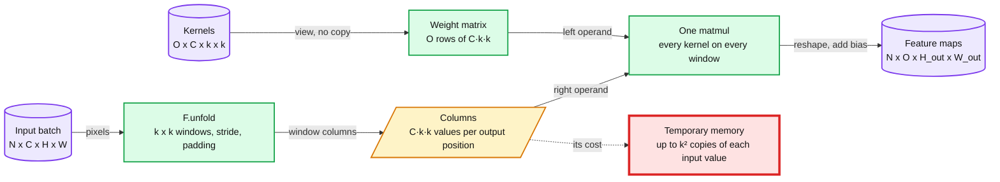
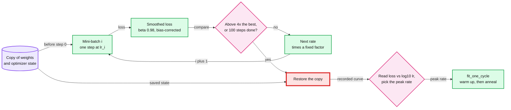
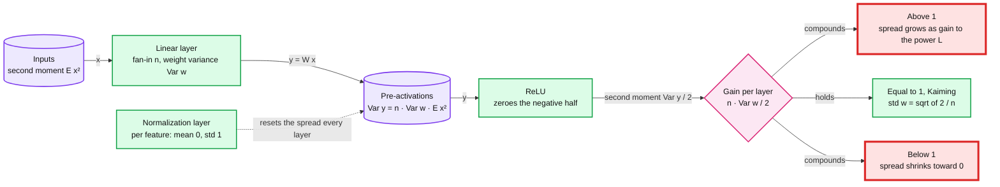
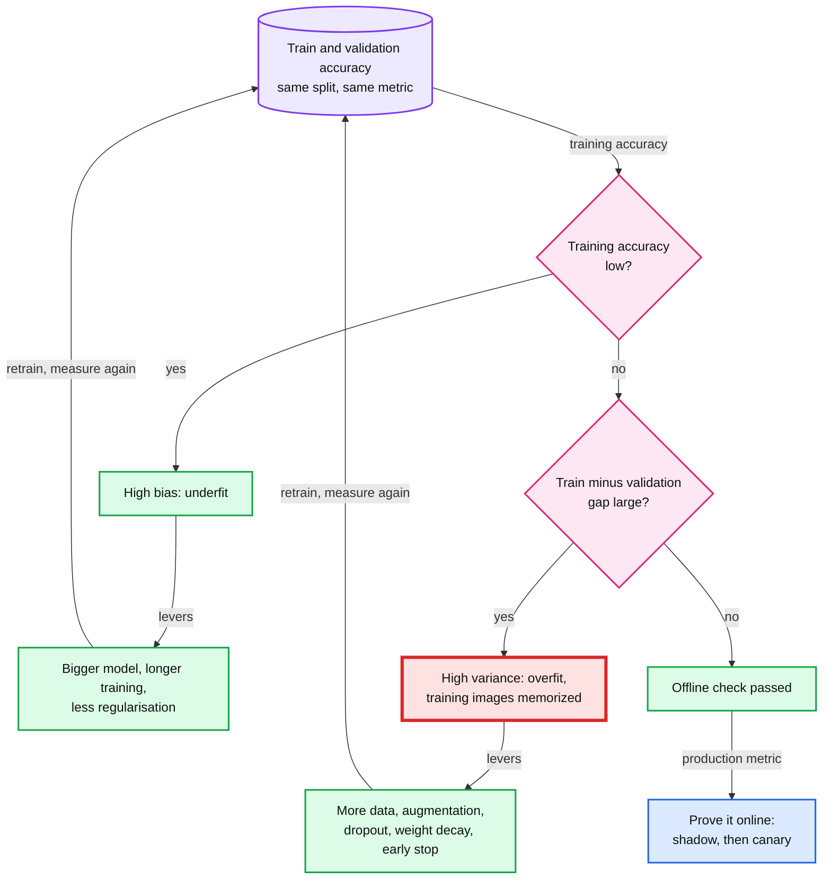
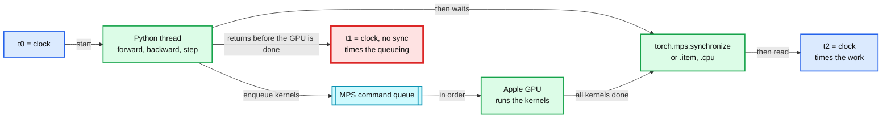

# Deep nets on a Mac: training dynamics

> Convolutions, learning rates, initialization and regularisation, measured on the M4 Pro.

Four 60-minute labs on what makes a deep net train well or badly. Lab 34 puts a CNN (convolutional neural network) against an MLP (multi-layer perceptron) of the same size. Labs 35 to 37 are about training dynamics: the learning rate, the starting weights, and the gap between training and validation accuracy. Labs 34 and 36 run on the CPU. Labs 35 and 37 train on the Apple GPU through MPS (Metal Performance Shaders), PyTorch's backend for it. Convolutions start a new family of ideas, so lab 34 restarts the fading at level W before the module moves to C and S ([`../CLAUDE.md`](../CLAUDE.md#7-code-by-level) §7).

## Labs

| Lab | Title | Level | Runs on | Interview question | Status |
|---|---|---|---|---|---|
| [34](labs/34-convolutions.md) | Convolutions by hand, then a CNN | W | cpu | Why use a CNN for images instead of an MLP with the same parameter count? | todo |
| [35](labs/35-learning-rates-and-one-cycle.md) | Learning-rate finder and one-cycle | C | mps | A 5-day training job diverges on day 3: what do you check, and how do you pick a learning rate without a full sweep? | todo |
| [36](labs/36-initialization.md) | Initialization and activation statistics | C | cpu | Why do deep nets need careful initialization or normalization, and what does an exploding layer look like in activation statistics? | todo |
| [37](labs/37-overfit-then-regularise.md) | Overfit on purpose, then regularise | S | mps | You have 5,000 labelled images and a 30-point train-validation gap: which regularizer do you try first, and how do you know it worked in production? | todo |

At a lab's close, set its Status in three places: the lab file's header, this table and [`../README.md`](../README.md).

**Optional, outside the 40 labs:** [Appendix A: Mac vs Kaggle benchmark](appendix-a-mac-vs-kaggle.md). A protocol you run yourself, with no reference run and no answer file. Its concepts are in [the last section below](#appendix-a-mac-vs-kaggle-benchmark), read after you run it.

## Before you start

**Base install.** Follow [`../README.md`](../README.md): Python 3.13.7 in `~/.venvs/ml` with every pin. One install serves every module.

**Extra packages: none.** This module has no extra pip line. Its labs use `torch==2.14.1`, `torchvision==0.29.1` and `fastai==2.8.12` from the base install.

**Data.** Download each dataset once, from this folder. Files land under `~/ml-data/`, never in the repo. If lab 29 or lab 02 already fetched a file, `--download` lists it and moves on.

| Lab | Dataset | Download | Licence | Command |
|---|---|---|---|---|
| 34 | MNIST: 60,000 train and 10,000 test digits at 28x28. Shared with lab 29 | about 11.6 MB | MIT, per the Hugging Face card | `python scripts/34_convolutions.py --download` |
| 35 | Imagenette 160 px: 10 ImageNet classes, 9,469 train and 3,925 validation images. Shared with lab 02 | 99.0 MB | Apache-2.0 | `python scripts/35_learning_rates_and_one_cycle.py --download` |
| 36 | Fashion-MNIST parquet: 60,000 train and 10,000 test images at 28x28 | 36.11 MB | MIT | `python scripts/36_initialization.py --download` |
| 37 | CIFAR-10 python tar: 50,000 train and 10,000 test images at 32x32 | 170.50 MB | "unknown" in the Hugging Face card's licence field | `python scripts/37_overfit_then_regularise.py --download` |

```
$ source ~/.venvs/ml/bin/activate
$ cd ml-learning/m6-deep-nets-on-a-mac
$ python scripts/34_convolutions.py --download
$ python scripts/35_learning_rates_and_one_cycle.py --download
$ python scripts/36_initialization.py --download
$ python scripts/37_overfit_then_regularise.py --download
```

About 317 MB of downloads in all.

**Smoke.** Before each session, run that lab's `--smoke`. It prints `SMOKE <name> ok` lines and no values.

**GPU labs, 35 and 37.** Close other GPU-heavy apps and run nothing else GPU-heavy beside them. Leave `PYTORCH_ENABLE_MPS_FALLBACK` unset: a silent CPU fallback hides unsupported ops and distorts MPS timings ([`../CLAUDE.md`](../CLAUDE.md#10-running-scripts) §10). A step over 6 minutes is precomputed, and the lab header names it.

## Concepts (read after the lab)

Each section is the second contact for its lab, 1 to 3 days later, together with the borrowed unit it names. The sections hold mechanisms, formulas and published figures. The numbers come from your own runs.

### Convolutions

**Lab:** [34](labs/34-convolutions.md). A convolution slides one small kernel over the image, so the same few weights look for the same pattern at every position.

- **Kernel.** A small grid of weights, 3x3 in lab 34. At one position, multiply it cell by cell with the window under it and add the products: one output number. Every position together gives a feature map.
- **Weight sharing.** One kernel serves every position. An MLP's first layer has a separate weight for every pixel and hidden unit, so it learns each position on its own.
- **Channels.** A layer with C input and O output channels holds O kernels of C x k x k weights, plus O biases. The count does not depend on the image size.
- **Translation.** Shift the input and a conv layer's output map shifts with it, away from the border. That property is called equivariance. Pooling windows and a final linear layer read positions, so how a whole network handles a shift is something to measure, not assume.
- **Stride and padding.** Stride s moves the window s pixels at a time. Padding p adds p border pixels on each side. Together with k they set the output size.
- **Unfold.** `F.unfold` copies every k x k window, across all C channels, into one column. The kernels, viewed as an O x (C·k·k) matrix, then hit every column in one matrix multiply. fastbook ch 13 draws the same idea as a weight matrix whose entries are partly zero and partly tied together.

Key formulas:

```
params = O * C * k * k + O
H_out  = floor((H + 2p - k) / s) + 1                  W_out the same way
cols   = F.unfold(x, k, padding=p, stride=s)          N x (C*k*k) x (H_out*W_out)
y      = (w.view(O, -1) @ cols).view(N, O, H_out, W_out) + b.view(1, O, 1, 1)
```



Published figures:

- Krizhevsky, "One weird trick for parallelizing convolutional neural networks" (2014, [arXiv 1404.5997](https://arxiv.org/abs/1404.5997)): the convolutional layers of a CNN of that era held about 90 to 95% of the computation and about 5% of the parameters. The fully connected layers held about 5 to 10% of the computation and about 95% of the parameters.
- Chetlur et al., cuDNN (2014, [arXiv 1410.0759](https://arxiv.org/abs/1410.0759)): lowering a convolution to a matrix multiply "involves duplicating the input data up to RS times" for an R x S kernel, "which can require a prohibitively large temporary allocation". cuDNN builds the lowered matrix in on-chip memory only.
- Arithmetic, not a measurement: a 3x3 conv from 3 to 64 channels has 64 x 3 x 3 x 3 + 64 = 1,792 parameters at any image size. A dense layer from a 3 x 224 x 224 image to the same 64 x 224 x 224 output would need about 4.8 x 10^11 weights.

Trade-off: weight sharing bets that a pattern means the same thing anywhere in the image. That holds for edges and textures, and less where position is the signal, such as a field on a printed form. The red node is the price of the unfold route: temporary memory up to k² times the input. Libraries pick a different algorithm per layer when that copy does not fit.

**Second contact:** fast.ai [Lesson 8](https://course.fast.ai/Lessons/lesson8.html), "Convolutions (CNNs)". fastbook ch 13 ([13_convolutions.ipynb](https://github.com/fastai/fastbook/blob/master/13_convolutions.ipynb)): "The Magic of Convolutions", "Understanding the Convolution Equations" and "Our First Convolutional Neural Network". Kaggle Learn [Computer Vision](https://www.kaggle.com/learn/computer-vision).

**Repo:** [`hld/streetview-ingestion/deep-dives/privacy-blur-and-takedowns.md`](../../hld/streetview-ingestion/deep-dives/privacy-blur-and-takedowns.md#1-recall-first-because-the-detector-will-miss) §1 "Recall first, because the detector will miss": an image detector in production, run at a low threshold for recall, then a post-filter. Its [§11 "What the interviewer asks next"](../../hld/streetview-ingestion/deep-dives/privacy-blur-and-takedowns.md#11-what-the-interviewer-asks-next), last bullet: recall measured on a weekly hand-counted audit set, and a new detector canaried on 1% of drives first.

### Learning rates and one-cycle

**Lab:** [35](labs/35-learning-rates-and-one-cycle.md). The learning-rate finder spends about 100 mini-batches on a mock run that raises the rate every batch, which shows the usable range in one short run. One-cycle then warms the rate up to a peak and anneals it back down.

- **Step size.** Plain SGD (stochastic gradient descent) moves each weight by the learning rate (lr) times its gradient. Too small and progress is slow. Too large and each step overshoots.
- **Why too large fails.** On a bowl-shaped loss with curvature h, one gradient step multiplies the distance to the bottom by (1 - lr x h). Below lr = 2 / h the distance shrinks. Above it, every step lands farther out. A deep net has many curvatures, and the largest one sets the limit.
- **lr_find.** Leslie Smith's 2015 range test raised the rate linearly over a few epochs. fastai's `lr_find` raises it exponentially from 1e-7 to 10 over 100 mini-batches, tracks a smoothed loss, stops once that passes 4x the best value so far, and reloads the weights and optimizer state it saved before the first step. Plot the loss against log10 of the rate.
- **Reading the curve.** fastbook ch 5 gives two rules: one order of magnitude below the rate at the minimum loss, or the last point where the loss was clearly falling. fastai 2.8's default suggestion, `valley`, picks a point about halfway along the longest falling stretch.
- **One-cycle.** fastai's `fit_one_cycle` raises the rate from peak/25 to the peak over the first 25% of steps, then lowers it to peak/1e5 by the last step, both on cosine curves. Momentum moves the other way: 0.95, down to 0.85, back to 0.95. Smith's original used straight lines.
- **Why each phase.** Warmup keeps the first steps small while the weights are still random. Goyal et al. added a warmup to overcome "optimization challenges early in training". Annealing shrinks the last steps so training can settle into the best part of the region the big steps reached (fastbook ch 13).
- **Constant rate.** The same peak on every step, from the first batch to the last: no warmup and no annealing.
- **Timing on the Apple GPU.** PyTorch queues GPU work and returns at once. A clock read without `torch.mps.synchronize()` can stop before the GPU has finished. `.item()`, `.cpu()` and printing a tensor also wait for it. The house rule is a sync before every clock read, which `labkit.clock(device)` does ([`../labkit.py`](../labkit.py)). The picture is in [Appendix A](#appendix-a-mac-vs-kaggle-benchmark).

Key formulas (the first four lines are the form lab 35's rebuild checks):

```
lr_i      = start_lr * (end_lr / start_lr) ** (i / (n_steps - 1))     i = 0 .. n_steps - 1
avg_i     = beta * avg_(i-1) + (1 - beta) * loss_i                    beta = 0.98, avg_(-1) = 0
smooth_i  = avg_i / (1 - beta ** (i + 1))                             bias correction
stop when smooth_i > 4 * min(smooth_0 .. smooth_i), then restore the saved weights
cos(a to b, f) = a + (b - a) * (1 + cos(pi * (1 - f))) / 2             f runs from 0 to 1
one-cycle: cos(peak/25 to peak) over the first 25% of steps, then cos(peak to peak/1e5)
```



Published figures:

- Imagenette leaderboard ([github.com/fastai/imagenette](https://github.com/fastai/imagenette)): 87.43% at 128 px in 5 epochs, from fastai's `train_imagenette.py` plus MaxBlurPool (an anti-aliased max-pool, Zhang 2019, [arXiv 1904.11486](https://arxiv.org/abs/1904.11486)) and tuned hyperparameters, the mean of 5 runs. Lab 35 quotes it in P1.
- Goyal et al., "Accurate, Large Minibatch SGD: Training ImageNet in 1 Hour" (2017, [arXiv 1706.02677](https://arxiv.org/abs/1706.02677)): ResNet-50 with a minibatch of 8,192 on 256 GPUs in one hour. Two tools made it work: a linear scaling rule (scale the rate with the batch size) and a gradual warmup.
- fastai 2.8.12 defaults, read from its source: `lr_find(start_lr=1e-7, end_lr=10, num_it=100)`, a stop at 4x the best smoothed loss, `fit_one_cycle(div=25.0, div_final=1e5, pct_start=0.25)` and momentum (0.95, 0.85, 0.95).

Trade-off: the finder costs about 100 mini-batches instead of a sweep of full runs. It reads the loss of a model that keeps changing while the rate climbs, so it gives a range, not an optimum. Re-run it when the model, the batch size or the optimizer changes. The red node is the restore: a finder that skips it hands back weights trained at rates up to 10. One-cycle needs the total step count up front, so a job that resumes from a checkpoint must restore its place in the schedule too.

**Second contact:** fastbook ch 5, "The Learning Rate Finder" ([05_pet_breeds.ipynb](https://github.com/fastai/fastbook/blob/master/05_pet_breeds.ipynb)). fastbook ch 7, "Imagenette" and "Normalization" ([07_sizing_and_tta.ipynb](https://github.com/fastai/fastbook/blob/master/07_sizing_and_tta.ipynb)). fast.ai Part 2 [Lesson 18](https://course.fast.ai/Lessons/lesson18.html), "Accelerated SGD & ResNets": momentum, Adam, cosine annealing and 1cycle. Smith 2018, [arXiv 1803.09820](https://arxiv.org/abs/1803.09820). Also fastbook ch 13, "1cycle Training".

**Repo:** a divergence on day 3 can come from a bad resume or a bad batch, not only from the rate. [`databricks/posts/fast-fault-tolerant-pytorch-training-ai-runtime.md`](../../databricks/posts/fast-fault-tolerant-pytorch-training-ai-runtime.md#impact-2-checkpoint-frequency-decides-your-recovery-cost), "Impact 2: Checkpoint frequency decides your recovery cost", and ["Impact 4: Forgetting the data pipeline silently corrupts your model"](../../databricks/posts/fast-fault-tolerant-pytorch-training-ai-runtime.md#impact-4-forgetting-the-data-pipeline-silently-corrupts-your-model): a resumed job must restore the data position and the RNG (random number generator) state, not only the weights.

### Initialization and activation statistics

**Lab:** [36](labs/36-initialization.md). Each layer multiplies the spread of its inputs by a factor set by the weight scale and the fan-in, so the spread compounds over depth. Kaiming init makes that factor 1 for ReLU nets, and normalization layers reset the spread at every layer.

- **One layer.** A linear layer with fan-in n (inputs per unit) and zero-mean weights of variance Var w gives pre-activations with variance n x Var w x E[x²], where E[x²] is the mean square of its inputs (He et al. 2015, §2.2).
- **ReLU** (rectified linear unit) zeroes the negative half. For a pre-activation y symmetric around 0, the output's mean square is Var y / 2.
- **Many layers.** The per-layer factors multiply. A factor above 1 compounds into an explosion, and a factor below 1 into a vanishing signal.
- **Kaiming (He) init** sets n x Var w / 2 = 1: weights drawn from N(0, 2/n), so std = sqrt(2/n). `nn.init.kaiming_normal_` does this with its defaults (a = 0, mode fan_in). He et al. derive the same condition for the backward pass with the fan-out instead (`mode="fan_out"`).
- **Glorot (Xavier) init** uses variance 2 / (n_in + n_out). It was derived for activations that act linearly near 0, such as tanh, so it has no ReLU halving.
- **PyTorch's default is neither.** `nn.Linear` calls `kaiming_uniform_(a=math.sqrt(5))`, the same as U(-1/sqrt(n), 1/sqrt(n)). That is variance 1/(3n), a sixth of Kaiming's 2/n.
- **Normalization.** BatchNorm standardizes each feature over the batch, (x - mean) / sqrt(var + eps), then applies a learned scale and shift (Ioffe and Szegedy 2015). They start at 1 and 0, so the normalized values start at mean 0 and std 1 whatever the weights did. LayerNorm does the same per example, across its features.
- **Log-scale predictions.** A product of L factors is a sum of L logs. A factor 2x off at each of 10 layers is 2^10 = 1,024x off, which is 3 in log10. So lab 36 predicts in log10, and a miss is counted in orders of magnitude.

Key formulas (He et al. 2015, §2.2):

```
Var[y_l] = n_l * Var[w_l] * E[x_l^2]                      one linear layer, zero-mean weights
E[x_l^2] = Var[y_(l-1)] / 2                               after a ReLU, y symmetric around 0
Var[y_L] = Var[y_1] * prod over l = 2 .. L of (n_l * Var[w_l] / 2)
Kaiming:   std(w) = sqrt(2 / fan_in),  biases 0
```



Published figures:

- He et al., "Delving Deep into Rectifiers" (2015, [arXiv 1502.01852](https://arxiv.org/abs/1502.01852)), §2.2 "Initialization of Filter Weights for Rectifiers": a zero-mean Gaussian with std sqrt(2/n_l), and biases at 0.
- Ioffe and Szegedy, "Batch Normalization" (2015, [arXiv 1502.03167](https://arxiv.org/abs/1502.03167)): on an ImageNet model, BatchNorm "achieves the same accuracy with 14 times fewer training steps". An ensemble reached 4.9% top-5 validation error.
- Glorot and Bengio (2010, [PMLR 9](https://proceedings.mlr.press/v9/glorot10a.html), pages 249 to 256): the normalized init above.
- PyTorch 2.14.1 source: `kaiming_normal_` defaults to a = 0, mode `fan_in` and nonlinearity `leaky_relu`, a gain of sqrt(2) at a = 0. `nn.Linear.reset_parameters` calls `kaiming_uniform_(a=math.sqrt(5))`.

Trade-off: init sets the spread at step 0 only. Training then moves the weights. Normalization keeps resetting the spread, at a price. BatchNorm depends on the batch, so small batches give noisy statistics, and at eval it switches to running averages, so train and eval behave differently. LayerNorm has no batch dependence, and GPT-style models use it: nanoGPT's model, which [lab 39](../m7-language-models/labs/39-gpt-from-scratch.md) trains, has a LayerNorm in every block. The two red nodes are the two ways a deep stack fails before training starts.

**Second contact:** fast.ai Part 2 [Lesson 17](https://course.fast.ai/Lessons/lesson17.html), "Initialization/normalization": Glorot, LSUV (layer-sequential unit-variance) init, activation statistics, LayerNorm and BatchNorm. Karpathy, ["Building makemore Part 3: Activations & Gradients, BatchNorm"](https://www.youtube.com/watch?v=P6sfmUTpUmc). He et al. 2015, §2.2. Also fastbook ch 13, "Improving Training Stability" and "Batch Normalization".

**Repo:** the interview question asks what an exploding layer looks like in activation statistics. Production models get the same habit, one level up: watch distributions as leading indicators before any outcome arrives. [`hld/payments-risk-decisioning/deep-dives/model-lifecycle-shadow-and-labels.md`](../../hld/payments-risk-decisioning/deep-dives/model-lifecycle-shadow-and-labels.md#5-proving-a-model-before-it-declines-anyone) §5 "Proving a model before it declines anyone": per-feature null rate and PSI (population stability index) on the top features during the canary.

### Overfitting and regularisation

**Lab:** [37](labs/37-overfit-then-regularise.md). With few images a network can memorize its training set, so training accuracy stops being evidence of learning. The train-validation gap measures that, and regularisers such as augmentation and dropout target it.

- **Bias and variance.** Low accuracy on the model's own training data is underfitting (high bias). Training accuracy far above validation accuracy is overfitting (high variance). The gap, train minus validation accuracy in points, is the variance signal.
- **Learning curve.** Train and validation accuracy for one model and one training budget at several training-set sizes. Two sizes, 500 and 5,000 images in lab 37, already give a slope.
- **Memorization is cheap.** Zhang et al. (ICLR 2017) showed that standard CNNs "easily fit a random labeling of the training data". So 100% training accuracy by itself says nothing about validation accuracy.
- **Augmentation.** A new random version of a training image each time it is drawn, with the label unchanged. Random crop with 4-pixel reflect padding: mirror 4 pixels out on each side (32x32 to 40x40), then cut a random 32x32 window, one of 9 x 9 = 81 offsets. Add a horizontal flip at p = 0.5 and each image has 162 versions. Validation images are scored as they are.
- **Label-preserving is the constraint.** A mirrored truck is still a truck. A mirrored "2" or a mirrored word is not.
- **Dropout.** In training, zero each activation with probability p and scale the survivors by 1 / (1 - p), so every activation keeps its expected value. At eval, do nothing. This "inverted dropout" is what `nn.Dropout` does. AlexNet did it the other way round: no scaling in training, outputs multiplied by 0.5 at test time.
- **Comes back.** Overfitting: first in [lab 05](../m1-whole-game/labs/05-recommender-embeddings.md), then [31](../m5-under-the-hood/labs/31-random-forest-by-hand.md) and [32](../m5-under-the-hood/labs/32-gradient-boosting-by-hand.md), here in 37, and next in [40](../m7-language-models/labs/40-lora-vs-prompting.md). Bias and variance: 05, 31, 32 and 37.

Lab 37 asks you to write two functions from this description:

- `dropout(x, p, training)`: if `training` is false, return `x` unchanged. Otherwise keep each element with probability 1 - p (a mask `torch.rand_like(x) >= p`) and return `x * mask / (1 - p)`. Same shape, dtype and device as `x`.
- `augment(batch, pad=4, flip_p=0.5)`: `batch` is N x C x 32 x 32. Reflect-pad the last two dims by `pad` on every side, `F.pad(batch, (pad, pad, pad, pad), mode="reflect")`, which gives N x C x 40 x 40. For each image, draw its own top-left offset `dy, dx` in 0 to `2 * pad` and keep the window `[dy:dy + 32, dx:dx + 32]`. Then flip that image left to right (the last dim) with probability `flip_p`. Return N x C x 32 x 32, the input's shape.
- The rebuild's `check()`: at p = 0.3 on 200,000 ones the mean stays within 1%, eval mode returns the input, and `augment` keeps the batch shape.

Key formulas:

```
train:  y = x * m / (1 - p),  each m_i is 1 with probability 1 - p, else 0     so E[y] = x
eval:   y = x
gap   = train accuracy - validation accuracy, in points
crop offsets = (2 * pad + 1) ** 2 = 81 at pad 4,  times 2 for the flip = 162 versions
```



Published figures:

- Krizhevsky, Sutskever and Hinton, AlexNet (NeurIPS 2012, [paper](https://papers.nips.cc/paper_files/paper/2012/file/c399862d3b9d6b76c8436e924a68c45b-Paper.pdf)), a network of 60 million parameters: random 224 x 224 crops and their mirror images from 256 x 256 images "increases the size of our training set by a factor of 2048" (32 x 32 offsets, times 2). The crops were cut on the CPU while the GPU trained on the previous batch, "in effect, computationally free". Dropout at 0.5 in the first two fully connected layers "roughly doubles the number of iterations required to converge".
- Srivastava et al., "Dropout: A Simple Way to Prevent Neural Networks from Overfitting" ([JMLR 15](https://jmlr.org/papers/v15/srivastava14a.html), 2014, pages 1929 to 1958): dropout removes units "along with their connections" during training. At test time, one unthinned network "that has smaller weights" stands in for the average of all the thinned ones.
- Zhang et al., "Understanding deep learning requires rethinking generalization" (ICLR 2017, [arXiv 1611.03530](https://arxiv.org/abs/1611.03530)), quoted above.

Trade-off: augmentation costs compute every epoch, and it teaches the wrong invariance if a transform changes the label. Dropout costs convergence time (AlexNet's "roughly doubles"). Judge both on held-out data, never on training accuracy. The red node is the failure this lab provokes on purpose: memorized training images. An offline gap is still not the production metric, so the repo proves models online.

**Second contact:** Kaggle Learn [Intro to Deep Learning](https://www.kaggle.com/learn/intro-to-deep-learning), lessons ["Overfitting and Underfitting"](https://www.kaggle.com/code/ryanholbrook/overfitting-and-underfitting) and ["Dropout and Batch Normalization"](https://www.kaggle.com/code/ryanholbrook/dropout-and-batch-normalization). They use Keras: read them, then port the exercise to PyTorch. fastbook ch 7 ([07_sizing_and_tta.ipynb](https://github.com/fastai/fastbook/blob/master/07_sizing_and_tta.ipynb)), "Test Time Augmentation" and "Mixup".

**Repo:** [`hld/streetview-ingestion/deep-dives/privacy-blur-and-takedowns.md`](../../hld/streetview-ingestion/deep-dives/privacy-blur-and-takedowns.md#1-recall-first-because-the-detector-will-miss) §1 "Recall first, because the detector will miss", and its [§11](../../hld/streetview-ingestion/deep-dives/privacy-blur-and-takedowns.md#11-what-the-interviewer-asks-next), last bullet: a weekly hand-counted audit set and a canary on 1% of drives. [`hld/payments-risk-decisioning/deep-dives/model-lifecycle-shadow-and-labels.md`](../../hld/payments-risk-decisioning/deep-dives/model-lifecycle-shadow-and-labels.md#5-proving-a-model-before-it-declines-anyone) §5 "Proving a model before it declines anyone": an out-of-time offline test, then shadow for 7 to 14 days, then a canary at 5%, 25% and 100%.

### Appendix A: Mac vs Kaggle benchmark

**Protocol:** [`appendix-a-mac-vs-kaggle.md`](appendix-a-mac-vs-kaggle.md). Optional, outside the 40 labs, with no reference run and no answer file. Read this section after you run it. On the M4 Pro the limits are the shared memory pool, GPU synchronization and dtype support. A Kaggle GPU wins once a run is long enough to repay the cloud's start-up time.

- **Unified memory.** The CPU and the GPU share one pool, 24 GB on this Mac, with macOS and every open app. Metal reports a recommended working-set size for the GPU, which `torch.mps.recommended_max_memory()` returns.
- **The allocator's cap.** PyTorch's MPS allocator stops at `PYTORCH_MPS_HIGH_WATERMARK_RATIO` times that size, 1.7 by default. At 1.0 the cap is the recommended size. At 0.0 there is no cap, which the docs warn can cause a system failure. `torch.mps.set_per_process_memory_fraction(f)` sets a cap of f times the recommended size, which is how the appendix holds its allocation test at 0.7.
- **Two counters.** `torch.mps.current_allocated_memory()` counts live tensors. `torch.mps.driver_allocated_memory()` adds the allocator's cached pools and Metal's own allocations. `torch.mps.empty_cache()` hands the cache back.
- **Asynchronous execution.** PyTorch queues GPU kernels and returns at once. Read a clock only after `torch.mps.synchronize()` (on CUDA, `torch.cuda.synchronize()`), or the clock times the queueing.
- **First step vs steady step.** The first step at a new input shape pays one-time costs: preparing GPU kernels for that shape and growing the allocator's pools. The steady step is the median after a warmup. Short jobs, and jobs whose shapes keep changing, pay the first-step cost again and again.
- **Batch size.** Every step carries fixed costs (Python, kernel launches, syncs), so images per second rise with the batch until the GPU's arithmetic or its memory bandwidth is the limit, and then flatten. Past that point a bigger batch buys memory use, not speed, and it changes the optimization: see the linear scaling rule in [Learning rates and one-cycle](#learning-rates-and-one-cycle).
- **float64.** The MPS backend cannot hold float64 at all, because Metal Shading Language has no double type, and the fallback flag does not apply. NumPy arrays default to float64, so a tensor from `torch.from_numpy` needs `.float()` before `.to("mps")`.
- **Break-even.** With S seconds of cloud start-up and setup, and e_mac and e_kaggle seconds per epoch, Kaggle finishes first once a run is longer than N* = S / (e_mac - e_kaggle) epochs, provided e_kaggle is below e_mac. If it is not, the Mac wins at every length.

Key formulas:

```
seconds per epoch  = 50,000 / images per second          a CIFAR-100-sized epoch
Kaggle wins when N > S / (e_mac - e_kaggle)               N epochs, only if e_kaggle < e_mac
break-even run on the Mac = N* x e_mac
```



Published figures:

- Apple ([newsroom, October 2024](https://www.apple.com/newsroom/2024/10/apple-introduces-m4-pro-and-m4-max/)): the M4 Pro has up to a 14-core CPU (10 performance and 4 efficiency cores), up to 20 GPU cores, up to 64 GB of unified memory and 273 GB/s of memory bandwidth. This Mac has the 14-core CPU, the 20-core GPU and 24 GB.
- NVIDIA T4 ([product page](https://www.nvidia.com/en-us/data-center/tesla-t4/)): 16 GB of GDDR6 at 320+ GB/s, 8.1 TFLOPS (trillion floating-point operations per second) in FP32 (32-bit floats), 65 TFLOPS in FP16 with mixed precision, 70 W.
- NVIDIA P100 for PCIe ([datasheet](https://images.nvidia.com/content/tesla/pdf/nvidia-tesla-p100-PCIe-datasheet.pdf)): 9.3 TFLOPS in FP32, 4.7 in FP64, 18.7 in FP16. 16 GB at 732 GB/s, or 12 GB at 549 GB/s. 250 W.
- Kaggle Notebooks ([docs](https://www.kaggle.com/docs/notebooks), as quoted in the [research report §3](../research/practical-machine-learning-curriculum.md#3-the-m4-pro-runs-36-of-37-labs-and-memory-is-the-ceiling)): one P100 or two T4s, 12 hours per GPU session, a 20-minute idle timeout, and a queue at busy times. The base weekly GPU quota is not on that page, so read it on your account.
- mac-ml-speed-test ([PyTorch results](https://github.com/mrdbourke/mac-ml-speed-test/tree/main/results/results_pytorch_cv)): torchvision's ResNet-50 on CIFAR-100 at 32x32, Adam, batch 128, average seconds per epoch: M3 Pro 117.3, M3 Max 125.0, NVIDIA TITAN RTX 11.8. Those runs read images through a DataLoader. The appendix feeds synthetic tensors that already sit on the device, so it times compute only.
- PyTorch docs ([MPS notes](https://github.com/pytorch/pytorch/blob/main/docs/source/notes/mps.md), [MPS environment variables](https://github.com/pytorch/pytorch/blob/main/docs/source/mps_environment_variables.md)): the float64 limit and the watermark defaults above.

Trade-off: the Mac starts in seconds, has no quota and keeps data local. Kaggle adds start-up time, a 12-hour cap, an idle timeout and possible queues, and it brings a bigger GPU with float64. The rule that routes a run is a number you measured, not a feeling. A run that can hit the 12-hour cap must checkpoint. The red node is the timing bug every measurement here must avoid: a clock read with no sync.

**Second contact:** the PyTorch MPS notes and the MPS environment variables page above, and the mac-ml-speed-test README.

**Repo:** the [research report §3](../research/practical-machine-learning-curriculum.md#3-the-m4-pro-runs-36-of-37-labs-and-memory-is-the-ceiling), "The M4 Pro runs 36 of 37 labs, and memory is the ceiling". It predates the lab numbering used here, so its "lab 34" is this appendix. [`hld/streetview-ingestion/deep-dives/processing-pipeline-and-reprocessing.md`](../../hld/streetview-ingestion/deep-dives/processing-pipeline-and-reprocessing.md#7-two-lanes-one-gpu-pool) §7 "Two lanes, one GPU pool": preemptible GPUs serve only backfill, "because a preempted shard is just a retry". A capped Kaggle session is the same bet, so send it work that checkpoints. The Databricks post's ["Impact 2"](../../databricks/posts/fast-fault-tolerant-pytorch-training-ai-runtime.md#impact-2-checkpoint-frequency-decides-your-recovery-cost) sets the checkpoint interval.
