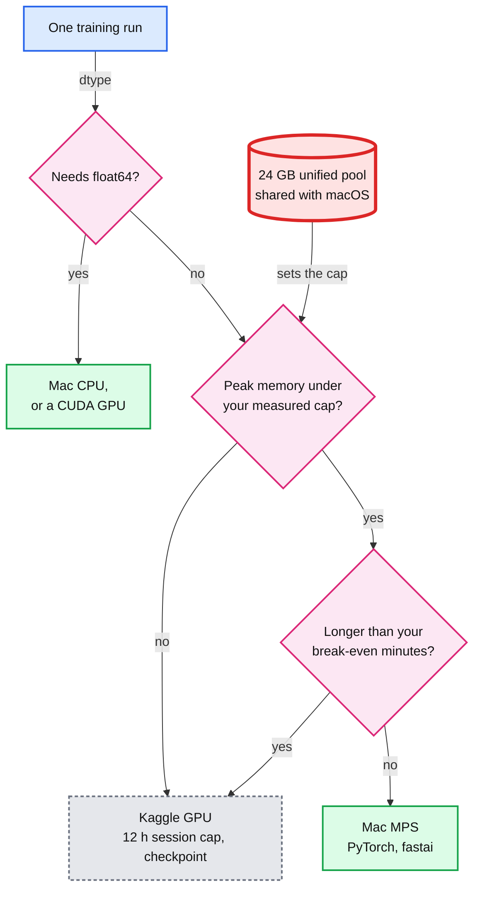

# Appendix A: Mac vs Kaggle benchmark

> Goal: after this I can say, with my own numbers, how fast this Mac trains a ResNet-50 at each batch size, how much GPU memory one process may hold, what float64 does on MPS (Metal Performance Shaders), and how long a run must be before a Kaggle GPU finishes first. Optional, outside the 40 labs. No reference run, no answer file and no results in this repo: every number in this file is one you paste.

**Concept link:** [`README.md#appendix-a-mac-vs-kaggle-benchmark`](README.md#appendix-a-mac-vs-kaggle-benchmark) (read after you run it)
**Runs on:** mps for tests 1 to 3, plus an optional cpu line in test 1. A Kaggle GPU for test 4. **Budget:** one 60-minute session, the Kaggle part included.
**Needs:** base install only on the Mac. Kaggle notebooks come with torch and torchvision.
**Data:** nothing to download. Every input is a synthetic tensor shaped like CIFAR-100: 3 x 32 x 32 images, 100 classes.
**Before:** no lab run in progress on this Mac (labs 35, 37, 39 and 40 use the GPU). Close GPU-heavy apps. On a laptop, plug in and turn Low Power Mode off. Open Activity Monitor on its Memory tab.

## 1. Predict first (optional, 5 min, no AI)

Write each row here before anything runs. The appendix stays out of `../prediction-log.md`, so the calibration rows there cover the 40 labs only.

| Step | Question | Kind | Prediction | 80% range or confidence |
|---|---|---|---|---|
| A1 | torchvision's ResNet-50, CIFAR-100 shape, batch 128, on MPS: seconds per 50,000-image epoch, compute only. The published M3 Pro run took 117.3 s per epoch with a DataLoader | num | | |
| A2 | Of batch 16, 32, 64, 128, 256 and 512: the batch after which images per second grow less than 10% per doubling | pick | | |
| A3 | First-step ms divided by steady-step ms at batch 128, in log10 | num | | |
| A4 | Break-even run length on the Mac, in minutes, after which a Kaggle GPU finishes first | num | | |

## 2. Setup

```
$ source ~/.venvs/ml/bin/activate
$ mkdir -p ~/ml-data/appendix-a
```

Then paste this whole block into the terminal. It writes the benchmark to `~/ml-data/appendix-a/mac_bench.py`, outside the repo, so nothing lands in git. One file, three parts: `throughput`, `alloc` and `float64`. Two optional environment variables: `BENCH_DEVICE` (`mps`, `cuda` or `cpu`; by default CUDA if present, then MPS, then the CPU) and `BENCH_BATCHES` (default `16 32 64 128 256 512`).

```
cat > ~/ml-data/appendix-a/mac_bench.py <<'EOF'
"""Appendix A: Mac vs Kaggle benchmark on synthetic tensors. Parts: throughput, alloc, float64."""
import os
import statistics
import subprocess
import sys
import time

import torch
import torch.nn.functional as F
import torchvision

PART = sys.argv[1] if len(sys.argv) > 1 else "throughput"
DEV = os.environ.get("BENCH_DEVICE") or (
    "cuda" if torch.cuda.is_available() else "mps" if torch.backends.mps.is_available() else "cpu")
GIB = 1024 ** 3


def clock():
    """Wait for every queued GPU kernel, then read the clock."""
    if DEV == "mps":
        torch.mps.synchronize()
    elif DEV == "cuda":
        torch.cuda.synchronize()
    return time.perf_counter()


def chip():
    if DEV == "cuda":
        return torch.cuda.get_device_name(0)
    if sys.platform == "darwin":
        out = subprocess.run(["sysctl", "-n", "machdep.cpu.brand_string"], capture_output=True, text=True)
        return out.stdout.strip()
    return sys.platform


def throughput(steps=50, warmup=10):
    batches = [int(b) for b in os.environ.get("BENCH_BATCHES", "16 32 64 128 256 512").split()]
    torch.manual_seed(0)
    model = torchvision.models.resnet50(num_classes=100).to(DEV).train()
    opt = torch.optim.Adam(model.parameters(), lr=1e-3)
    for b in batches:
        x = torch.randn(b, 3, 32, 32, device=DEV)    # synthetic images, CIFAR-100 shape
        y = torch.randint(0, 100, (b,), device=DEV)  # synthetic labels
        times = []
        for _ in range(steps):
            t0 = clock()
            opt.zero_grad(set_to_none=True)
            F.cross_entropy(model(x), y).backward()
            opt.step()
            times.append(clock() - t0)
        steady = statistics.median(times[warmup:])
        print(f"TIMING device={DEV} batch={b} first_step_ms={times[0] * 1e3:.1f} "
              f"steady_step_ms={steady * 1e3:.1f} images_per_s={b / steady:.0f} "
              f"warmup={warmup} n={steps - warmup} stat=median")


def alloc(fraction=0.7, chunk=512 * 1024 ** 2):
    rec = torch.mps.recommended_max_memory()
    cap = fraction * rec
    torch.mps.set_per_process_memory_fraction(fraction)  # the allocator itself refuses past the cap
    print(f"MEM recommended_gib={rec / GIB:.2f} cap_gib={cap / GIB:.2f} chunk_gib={chunk / GIB:.2f}")
    held = []
    for i in range(int(cap // chunk) + 1):  # never asks for more than one chunk past the cap
        t0 = clock()
        try:
            held.append(torch.ones(chunk // 4, device="mps"))  # float32: 4 bytes each, all written
        except RuntimeError as e:
            print(f"REFUSED chunk={i + 1} {str(e).splitlines()[0]}")
            break
        print(f"ALLOC chunk={i + 1} ms={(clock() - t0) * 1e3:.1f} "
              f"tensors_gib={torch.mps.current_allocated_memory() / GIB:.2f} "
              f"driver_gib={torch.mps.driver_allocated_memory() / GIB:.2f}")
    del held
    torch.mps.empty_cache()
    print(f"FREED driver_gib={torch.mps.driver_allocated_memory() / GIB:.2f}")


def float64():
    import numpy as np
    t = torch.from_numpy(np.linspace(0.0, 1.0, 5))  # NumPy defaults to float64
    print("from numpy:", t.dtype)
    tries = (("create on mps", lambda: torch.zeros(5, dtype=torch.float64, device="mps")),
             ("move to mps", lambda: t.to("mps")))
    for label, make in tries:
        try:
            print(f"{label}: {make().dtype}")
        except Exception as e:
            print(f"{label}: {type(e).__name__}: {str(e).splitlines()[0]}")
    print("cast to float32, then move:", t.float().to("mps").dtype)


if PART in ("alloc", "float64") and DEV != "mps":
    sys.exit(f"{PART} needs the Apple GPU (device is {DEV})")
print(f"HW chip='{chip()}' device={DEV} torch={torch.__version__} torchvision={torchvision.__version__}")
{"throughput": throughput, "alloc": alloc, "float64": float64}[PART]()
EOF
```

## 3. Test 1: images per second by batch size, and first vs steady step (Mac)

Why: one training step of torchvision's ResNet-50 (forward, backward, an Adam step) on a synthetic batch, 50 steps at each batch size. Each step sits between two synchronized clock reads. The first step prints on its own; the steady step is the median of steps 11 to 50.

```
$ python ~/ml-data/appendix-a/mac_bench.py throughput
```

```
(paste your output)
```

Optional, the CPU at batch 128, for the MPS speed-up:

```
$ BENCH_DEVICE=cpu BENCH_BATCHES=128 python ~/ml-data/appendix-a/mac_bench.py throughput
```

```
(paste your output)
```

Convert batch 128 into a CIFAR-100-sized epoch: 50,000 / `images_per_s`. Compare it with your A1 and with the published M3 Pro's 117.3 s, and name the difference in setup: a DataLoader there, tensors already on the device here.

## 4. Test 2: memory, capped at 0.7 x the recommended size (Mac)

Why: the CPU and the GPU share one memory pool. The script asks the allocator for 512 MiB (mebibytes, 2^20 bytes each) of float32, written once, chunk after chunk, until it refuses. Before the first request it sets the process cap to 0.7 x `torch.mps.recommended_max_memory()`, and it never asks for more than one chunk past that cap.

Safety:

- Close heavy apps first. Watch Activity Monitor's Memory Pressure graph. If it turns red, press Ctrl-C.
- Never raise the fraction. When the allocator refuses, its error message suggests `PYTORCH_MPS_HIGH_WATERMARK_RATIO=0.0`. Do not follow it: that removes the cap, and the same message and the PyTorch docs warn it may cause a system failure.

```
$ python ~/ml-data/appendix-a/mac_bench.py alloc
```

```
(paste your output)
```

Read four lines: `MEM` (the recommended size and the cap), the last `ALLOC` (tensor memory against driver memory), `REFUSED` (where and why), and `FREED` (what `empty_cache()` gave back).

## 5. Test 3: float64 on MPS (Mac)

Why: NumPy arrays default to float64, so this is the dtype a tensor from `torch.from_numpy` brings with it. The script tries to create a float64 tensor on MPS, then to move one there, then casts to float32 first.

```
$ python ~/ml-data/appendix-a/mac_bench.py float64
```

```
(paste your output)
```

## 6. Test 4: the run length where a Kaggle GPU wins

Why: the same throughput part on a Kaggle GPU, then one formula. Kaggle wins once a run is long enough to repay its start-up time S.

1. On kaggle.com, create a new notebook. In its settings, set the accelerator to "GPU T4 x2" or "GPU P100". Start a stopwatch when you switch it on (the session restarts), and stop it when cell 1 prints. That is the start-up part of S.
2. Cell 1: `!nvidia-smi --query-gpu=name,memory.total --format=csv`
3. Cell 2: `%%writefile mac_bench.py` as the first line, then the script, that is the lines between the two `EOF` markers in section 2.
4. Cell 3: `!python mac_bench.py throughput`. It picks CUDA by itself. With two T4s it uses one, like any single-process script.
5. Stop the session when you finish. Idle sessions end after 20 minutes, and GPU time counts against your account's weekly quota.

```
(paste your Kaggle output: the nvidia-smi lines, the HW line and the TIMING lines)
```

Worksheet:

| Quantity | How | Yours |
|---|---|---|
| e_mac, seconds per epoch | 50,000 / the Mac's `images_per_s` at batch 128 | |
| e_kaggle, seconds per epoch | 50,000 / Kaggle's `images_per_s` at batch 128 | |
| S, seconds | the stopwatch start-up, plus the setup a real job repeats every session: attaching or uploading data, pip installs | |
| N*, epochs | S / (e_mac - e_kaggle), only if e_kaggle is below e_mac | |
| Break-even run on the Mac, minutes | N* x e_mac / 60 | |

Your rule, in one line: "A run longer than ___ minutes on the Mac goes to Kaggle." Then compare it with the starting rule in the [research report §3](../research/practical-machine-learning-curriculum.md#3-the-m4-pro-runs-36-of-37-labs-and-memory-is-the-ceiling), which the report itself calls a starting rule, not a sourced number.

## 7. Where a run goes

Fill in the two numbers from test 2 and the worksheet, then use the tree for every later run.



- Your cap from test 2, in GiB (gibibytes, 2^30 bytes): ___
- Your break-even from test 4, in minutes: ___

## 8. Record

Paste, do not type. The hardware column is the script's `HW` line, or the `nvidia-smi` line on Kaggle.

| Measurement | Your run | Hardware |
|---|---|---|
| `images_per_s` at batch 16, 32, 64, 128, 256 and 512 (MPS) | | |
| `first_step_ms` and `steady_step_ms` at batch 128 (MPS) | | |
| `images_per_s` at batch 128 (CPU, optional) | | |
| `recommended_gib` and `cap_gib` | | |
| The `REFUSED` chunk, and `tensors_gib` against `driver_gib` on the last `ALLOC` line | | |
| `driver_gib` on the `FREED` line | | |
| float64: what "create on mps" and "move to mps" printed | | |
| Kaggle GPU name, its memory and the torch version | | |
| `images_per_s` at batch 128 (Kaggle) | | |
| S, N* and the break-even minutes | | |

## 9. What I learned

Three sentences: where my runs go now, and the measurement that decided it. Then read the [concept section](README.md#appendix-a-mac-vs-kaggle-benchmark).

Staff follow-up, cost: "Your team trains every model on laptops. When do you move training to a shared GPU pool, and what must a job do before it runs on capacity that can vanish?" Answer in 2 sentences from [`hld/streetview-ingestion/deep-dives/processing-pipeline-and-reprocessing.md`](../../hld/streetview-ingestion/deep-dives/processing-pipeline-and-reprocessing.md#7-two-lanes-one-gpu-pool) §7 "Two lanes, one GPU pool" and the Databricks post's ["Impact 2: Checkpoint frequency decides your recovery cost"](../../databricks/posts/fast-fault-tolerant-pytorch-training-ai-runtime.md#impact-2-checkpoint-frequency-decides-your-recovery-cost).
