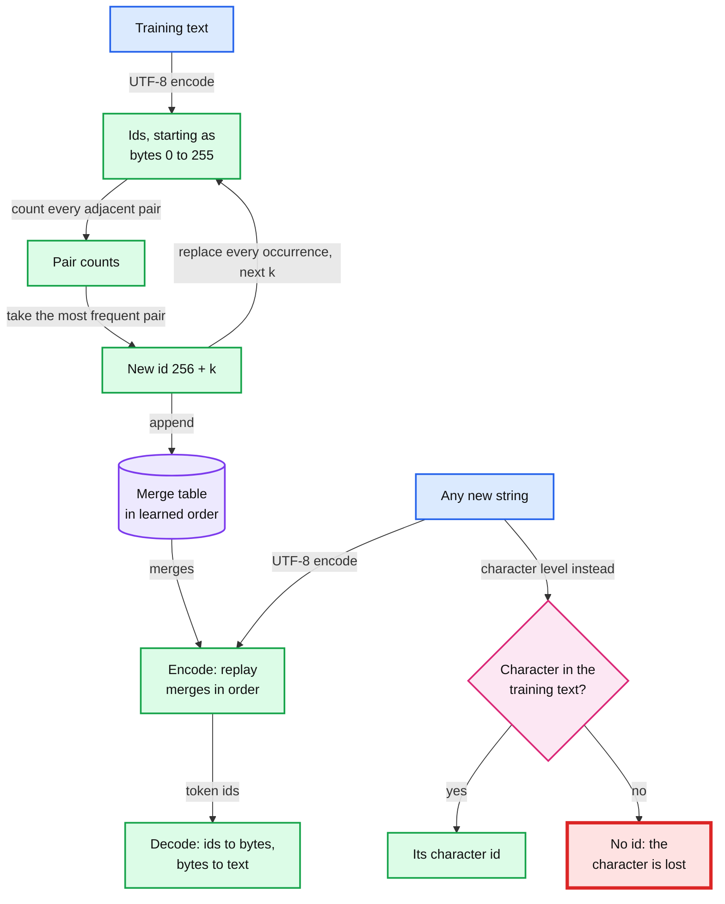
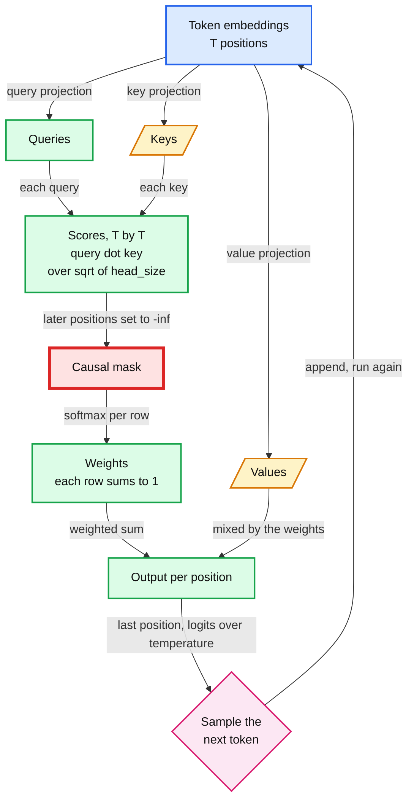
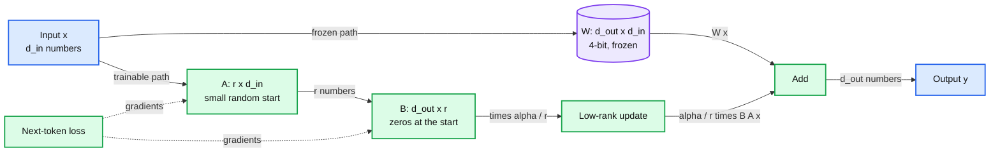

# Language models from scratch

> Tokenize, train a small GPT, then decide between prompting and LoRA with a paired eval.

Three labs on one new schema family, tokens. Lab 38 builds a byte-pair encoding (BPE) tokenizer. Lab 39 trains a 10.7 M-parameter GPT (generative pre-trained transformer) on the Mac's GPU (graphics processing unit). Lab 40 fine-tunes a 4-bit Llama with LoRA (low-rank adaptation) and checks it against a 5-shot prompt (five solved examples ahead of the question), then asks when prompting, RAG (retrieval-augmented generation) or fine-tuning wins. Tokens restart the fading at level W (worked: you read the full script). Lab 40 is level S: you write the eval protocol, the spec, and then the AI (artificial intelligence) tutor writes the harness. Levels, the session clock and the spoiler gate: [`../CLAUDE.md`](../CLAUDE.md).

## Labs

| Lab | Title | Level | Runs on | Interview question | Status |
|---|---|---|---|---|---|
| 38 | [BPE tokenizer: the merge loop, bytes vs characters](labs/38-bpe-tokenizer.md) | W | cpu | Why does the same request cost more tokens in another language or with emoji, and how do token counts set your cost and rate limits? | todo |
| 39 | [A GPT from scratch: attention, the causal mask and sampling](labs/39-gpt-from-scratch.md) | W | mps | Explain attention and the causal mask, and why generation latency grows with output length. | todo |
| 40 | [LoRA on a 4-bit model vs 5-shot prompting: when to fine-tune at all](labs/40-lora-vs-prompting.md) | S | mlx | Prompting, RAG or fine-tuning for this use case: what evidence decides, and what does each cost to run and maintain? | todo |

- **Runs on.** `cpu` is the processor alone. `mps` is the Apple GPU through PyTorch's Metal Performance Shaders backend. `mlx` is Apple's MLX array framework on the same GPU.
- **Labs 38 and 39 reverse the usual order.** Write P1 to P3 (and P1b in lab 39) in the lab file and in `prediction-log.md`. Then watch the lab's video. Both happen before the session. Each video takes about 2 evenings, so put these labs in lighter weeks.

## Before you start

1. **Base install.** The Python 3.13 virtual environment (venv) at `~/.venvs/ml`, from [`../README.md`](../README.md). Labs 38 and 39 need nothing more. Lab 39 uses torch, numpy and requests from it. Skip nanoGPT's own install line: transformers, datasets, tiktoken and wandb are not needed.
2. **Lab 40 extra.** Install it before lab 40's `--download`, because the script imports mlx at start. The mlx 0.32.4 wheel is tagged macOS 26; this Mac runs 26.5.1.

   ```
   $ source ~/.venvs/ml/bin/activate
   $ python -m pip install mlx==0.32.4 mlx-lm==0.32.2
   ```

3. **Data.** Before each session, run that lab's `--download`, then its `--smoke`, from this folder. Everything lands in `~/ml-data/`, never in the repo. `--smoke` runs the same code on a tiny slice and hides every value.

   ```
   $ cd ml-learning/m7-language-models
   $ python scripts/38_bpe_tokenizer.py --download
   $ python scripts/38_bpe_tokenizer.py --smoke
   ```

| Lab | Dataset and files | Size | Lands in | Licence | Download, from this folder |
|---|---|---|---|---|---|
| 38 | TinyShakespeare `input.txt`, a subset of Shakespeare's works, from [karpathy/char-rnn](https://github.com/karpathy/char-rnn) | 1,115,394 B (1.1 MB) | `~/ml-data/nanoGPT/data/shakespeare_char/`, shared with lab 39 | The text is public domain; char-rnn's Readme says MIT, though the repo has no LICENSE file | `python scripts/38_bpe_tokenizer.py --download` |
| 39 | nanoGPT at commit `3adf61e154c3fe3fca428ad6bc3818b27a3b8291`: `train.py`, `model.py`, `sample.py`, `configurator.py`, `config/train_shakespeare_char.py`, `data/shakespeare_char/prepare.py` (40 KB). Then TinyShakespeare, then nanoGPT's `prepare.py` writes `train.bin` and `val.bin` (1,003,854 and 111,540 character ids, 2.2 MB) and `meta.pkl`. Last, a copy of `model.py` with the causal mask removed, for `--break` | 3.4 MB | `~/ml-data/nanoGPT/` and `~/ml-data/nanoGPT-nomask/` | MIT | `python scripts/39_gpt_from_scratch.py --download` |
| 40 | WikiSQL text data from [mlx-examples](https://github.com/ml-explore/mlx-examples/tree/main/lora/data): `train.jsonl` 1,000 rows (272,537 B), `valid.jsonl` 100 rows (28,495 B), `test.jsonl` 100 rows (27,862 B). Models `mlx-community/Llama-3.2-1B-Instruct-4bit` (695.3 MB) and `mlx-community/Llama-3.2-3B-Instruct-4bit` (1,807.5 MB, only for a speed ratio), ungated, no Hugging Face token | 2.5 GB | `~/ml-data/wikisql/` and `~/ml-data/hf/` | MIT (the mlx-examples repo); Llama 3.2 Community License | `python scripts/40_lora_vs_prompting.py --download` |

- **nanoGPT is fetched at run time, never vendored.** Lab 39's `--download` pulls the six files from `raw.githubusercontent.com/karpathy/nanoGPT/<commit>/` into `~/ml-data/nanoGPT/` (MIT licence). No nanoGPT file is copied into this repo. Its README has called the repo deprecated since November 2025, with nanochat as the successor; the commit pin keeps the lab reproducible.
- **Disk.** Lab 40 needs 2.5 GB free for the two models (check with `df -h ~`). Lab 39's checkpoints and lab 40's adapters go to `~/ml-data/results/lab39/` and `~/ml-data/results/lab40/`.

## Concepts (read after the lab)

The second contact, 1 to 3 days after each lab. Mechanisms, definitions and published numbers only. No lab results.

### Tokenization and BPE

**Lab:** [38, BPE tokenizer](labs/38-bpe-tokenizer.md). **Comes back from:** embeddings, [lab 05](../m1-whole-game/labs/05-recommender-embeddings.md). A token id is a row number in the model's embedding table, as a movie id was in lab 05.

- **Models read integers.** A tokenizer maps text to ids and back. Each id picks one row of the embedding table, so vocabulary size is also a parameter count.
- **Bytes first.** UTF-8 (Unicode Transformation Format, 8-bit) writes any string as 1 to 4 bytes per character. Byte-level BPE starts with one token per byte value, 256 in all. So every string has an encoding before the first merge exists.
- **The merge loop.** Count every adjacent pair of ids. Give the most frequent pair the next free id. Replace each occurrence of it. Repeat until the merge budget is spent.
- **Encode replays the merges in learned order.** A later merge can be built from ids that exist only after an earlier one. Decode maps each id to its bytes, joins them and decodes the UTF-8.
- **Characters instead of bytes.** A character vocabulary holds only the characters seen in its training text. An unseen character has no id. The encoder must fail or emit an unknown token, and decode cannot give the original back.
- **What production tokenizers add.** A regular expression (regex) first splits text into words, numbers and punctuation, so no merge crosses those borders (GPT-2, §2.2). Special tokens such as end-of-text sit outside the merges.
- **Tokens are the unit of cost.** Providers bill and rate-limit per token, and each model family has its own tokenizer. Byte sequences that were rare in the tokenizer's training text got few merges. So that text costs more tokens per character, up to one token per UTF-8 byte.

```
vocabulary size             = 256 byte tokens + merges (+ special tokens)
one merge                   : every adjacent pair (a, b) becomes the new id, scanning left to right
tokens per 1,000 characters = 1000 x token count / character count
```

| Character | Code point | UTF-8 bytes |
|---|---|---|
| `a` | U+0061 | 1 |
| `ñ` | U+00F1 | 2 |
| `中` | U+4E2D | 3 |
| grinning-face emoji | U+1F600 | 4 |
| waving-hand emoji with a medium skin tone | U+1F44B U+1F3FD | 8 |

RFC (Request for Comments) 3629, the UTF-8 standard, §3: U+0000 to U+007F take 1 byte, U+0080 to U+07FF take 2, U+0800 to U+FFFF take 3, U+10000 to U+10FFFF take 4. One visible emoji can be several code points.



Published numbers:

- **GPT-2** ([Radford et al. 2019](https://cdn.openai.com/better-language-models/language_models_are_unsupervised_multitask_learners.pdf), §2.2 and §2.3). A BPE over Unicode code points would start from over 130,000 base symbols; byte-level BPE needs 256. The vocabulary is 50,257: 256 bytes, 50,000 merges and one end-of-text token, id 50,256 in [tiktoken](https://github.com/openai/tiktoken/blob/main/tiktoken_ext/openai_public.py).
- **Llama 3** ([The Llama 3 Herd of Models](https://arxiv.org/abs/2407.21783), §3.2). 128K tokens: 100K from tiktoken plus 28K added to better support non-English languages. In lab 40's Llama 3.2 1B (its `config.json`: vocabulary 128,256, width 2,048, input and output embeddings tied), the embedding table is 128,256 x 2,048 = 262.7 M parameters, 21% of the model's 1.24 B.
- **Languages** ([Petrov et al. 2023](https://arxiv.org/abs/2305.15425), NeurIPS). The same text translated into different languages can differ in token count by up to 15 times.

**Borrowed unit.** Before the lab, after you write P1 to P3: Karpathy, [Let's build the GPT Tokenizer](https://www.youtube.com/watch?v=zduSFxRajkE) (2:13:34). Second contact, after the lab: Raschka, *Build a Large Language Model (From Scratch)*, chapter 2, "Working with Text Data" ([code](https://github.com/rasbt/LLMs-from-scratch/tree/main/ch02)).

**Repo links:**

- [`hld/ai-gateway/deep-dives/token-budgets-and-rate-limiting.md`, §2 Estimation](../../hld/ai-gateway/deep-dives/token-budgets-and-rate-limiting.md#2-estimation). The gateway estimates input tokens as body bytes times a ratio `r`, calibrated per tenant and model from provider-reported counts. It caps `max_tokens`, because output tokens are known only at stream end.
- [`hld/ai-gateway/solution.md`, §5.3](../../hld/ai-gateway/solution.md#53-streams-last-10-minutes-and-must-be-billed-exactly-streaming-correctness), "Push back on the textbook answers". Tokenizers differ per model and some are not public, so the provider's reported usage is the billing truth.
- [`hld/ai-gateway/deep-dives/routing-and-fallback.md`, §6 Fallback policy per alias](../../hld/ai-gateway/deep-dives/routing-and-fallback.md#6-fallback-policy-per-alias). Falling back to another provider changes the tokenizer, so estimates and budgets shift.

### Attention and the causal mask

**Lab:** [39, A GPT from scratch](labs/39-gpt-from-scratch.md). nanoGPT's `model.py` is the worked example. **Comes back from:** leakage, [lab 03](../m1-whole-game/labs/03-tabular-in-ten-minutes.md) (a feature may only use what was known at prediction time), and cross-entropy, [lab 29](../m5-under-the-hood/labs/29-softmax-and-cross-entropy.md).

- **Next-token prediction.** A GPT reads a window of T tokens and predicts, at every position, the token that comes next. In lab 39 a token is one character. One window is T training examples at once.
- **Queries, keys and values.** Each position turns its input into three vectors, with three learned linear layers. The query is what the position looks for. The key is what it offers. The value is what it passes on.
- **Scores to output.** The score from position t to position s is query t dot key s. A softmax turns each row of scores into weights that sum to 1. The output at t is the weighted sum of the values.
- **Why divide by the square root of head_size.** If query and key components have mean 0 and variance 1, their dot product has variance head_size. Unscaled, the scores grow with the head size and push the softmax into regions with tiny gradients (Vaswani et al. 2017, §3.2.1 and its footnote 4).
- **The causal mask.** Before the softmax, every score from position t to a later position becomes minus infinity, so its weight is exactly 0. The output at t then depends on tokens 0 to t only. Vaswani et al. (§3.2.3) mask to "prevent leftward information flow" and keep the model auto-regressive. It is lab 03's rule inside the model: when predicting token t + 1, only tokens 0 to t are known.
- **Heads and blocks.** Several heads run side by side on slices of the width, and a projection mixes their outputs. nanoGPT's Shakespeare config stacks 6 blocks of 6 heads in a 384-wide model. Each block is an attention layer plus an MLP (multilayer perceptron), both with residual connections.
- **Loss at step 0 is a free test.** Before any update, the model has learned nothing yet. So you can work out on paper what the first eval should print. If it prints something far off, find the bug before you spend a 6-minute run. Karpathy's ["A Recipe for Training Neural Networks"](http://karpathy.github.io/2019/04/25/recipe/) (2019) lists this check as "verify loss @ init".
- **Temperature.** Sampling divides the logits by the temperature τ before the softmax. The order of the logits never changes, so greedy decoding (always take the top token) gives the same text at every τ. τ below 1 stretches the gaps and sharpens the distribution; as τ goes to 0, sampling becomes greedy. τ above 1 shrinks the gaps and flattens it; as τ grows, sampling approaches uniform over the vocabulary. τ changes how you draw from a trained model, not what it learned.

```
scores  = Q K^T / sqrt(head_size)          T x T, one row per query position t
mask    : scores[t, s] = -inf for s > t    weight exactly 0 after the softmax
weights = softmax(scores), row by row      each row sums to 1
output  = weights V
sample  : p_i = exp(z_i / τ) / sum over j of exp(z_j / τ)    z: the logits at the last position

              key position s
               0  1  2  3
query t = 0    w  .  .  .
query t = 1    w  w  .  .         w: the weight can be non-zero
query t = 2    w  w  w  .         .: score set to -inf, weight 0
query t = 3    w  w  w  w
```



**Why generation latency grows with output length** (the interview question):

- **One forward pass per new token.** Token t + 1 depends on the sampled token t, so the tokens of one answer come out one at a time. The prompt is different: all its positions run in one parallel pass (prefill), as in training. End-to-end time is about time to first token + output tokens / output speed.
- **The key-value (KV) cache.** The mask means appending a token never changes the keys and values of earlier positions. Servers keep them in the KV cache and compute a query, key and value for the new token only. Each step still attends over the whole cache, so the work per token grows with the context.
- **Cache size.** Per token: 2 (keys and values) x layers x KV heads x head size x bytes per number. Lab 40's Llama 3.2 1B has 16 layers and 8 KV heads of size 64. At 16 bits: 2 x 16 x 8 x 64 x 2 B = 32 KiB per token, 4 GiB at its 131,072-token maximum context. Its 32 query heads share those 8 KV heads (grouped-query attention), which cuts the cache 4x.
- **nanoGPT keeps no cache.** Its `generate()` reruns the full forward pass on the last `block_size` tokens for every new token.

Published numbers:

- **The Transformer** ([Vaswani et al. 2017](https://arxiv.org/abs/1706.03762), §3.2.2). The base model runs 8 heads with d_k = d_v = 64 in a 512-wide model.
- **The repo's assistant** ([latency-cost §1](../../hld/financial-ai-assistant/deep-dives/latency-cost-and-context.md#1-where-the-time-goes)). It plans for about 100 output tokens per second, so its 150-token answer is about 1.5 s of decode on the critical path. Prefill is the small term.

**Borrowed unit.** Before the lab, after you write P1, P1b, P2 and P3: Karpathy, [Let's build GPT: from scratch, in code, spelled out](https://www.youtube.com/watch?v=kCc8FmEb1nY) (1:56:20), with [nanoGPT at the pinned commit](https://github.com/karpathy/nanoGPT/tree/3adf61e154c3fe3fca428ad6bc3818b27a3b8291) as its code. Second contact, after the lab: nanoGPT's README, then Raschka, chapters 3 "Coding Attention Mechanisms", 4 "Implementing a GPT Model from Scratch" and 5 "Pretraining on Unlabeled Data" (code: [ch03](https://github.com/rasbt/LLMs-from-scratch/tree/main/ch03), [ch04](https://github.com/rasbt/LLMs-from-scratch/tree/main/ch04), [ch05](https://github.com/rasbt/LLMs-from-scratch/tree/main/ch05)).

**Repo links:**

- [`hld/financial-ai-assistant/deep-dives/latency-cost-and-context.md`, §1 Where the time goes](../../hld/financial-ai-assistant/deep-dives/latency-cost-and-context.md#1-where-the-time-goes). Three sequential model calls; latency is mostly output tokens divided by output speed.
- [Same file, §2 Why the answer is capped at 150 tokens](../../hld/financial-ai-assistant/deep-dives/latency-cost-and-context.md#2-why-the-answer-is-capped-at-150-tokens-the-sensitivity). The output cap is the biggest latency lever.
- [`hld/ai-gateway/deep-dives/routing-and-fallback.md`, §4 Affinity with bounded load](../../hld/ai-gateway/deep-dives/routing-and-fallback.md#4-affinity-with-bounded-load). A self-hosted request goes to the replica that holds its prompt prefix in the KV cache.

### Prompting vs LoRA

**Lab:** [40, LoRA on a 4-bit model vs 5-shot prompting](labs/40-lora-vs-prompting.md). **Comes back from:** overfitting, [lab 05](../m1-whole-game/labs/05-recommender-embeddings.md), and cross-entropy, [lab 29](../m5-under-the-hood/labs/29-softmax-and-cross-entropy.md). LoRA training minimizes the same next-token loss.

- **Three ways to adapt a model.** A prompt changes only the input. RAG adds retrieved documents to the input. Fine-tuning changes weights. The cost table below prices each one.
- **LoRA.** Freeze each pretrained weight W, of shape d_out x d_in. Learn a low-rank update beside it: B (d_out x r) times A (r x d_in), with r far below d_in and d_out.
- **B starts at zero.** So at step 0 the adapted model is exactly the base model. The first gradient step moves only B, because A's gradient passes through B.
- **Merge or keep apart.** W + (alpha / r) B A has W's shape, so a merged adapter adds no inference latency. Kept apart, one base model can serve many adapters. `mlx_lm.fuse` merges. On a 4-bit base it dequantizes W, adds the update and quantizes again, so the merged update is rounded to 4 bits too.
- **A 4-bit base.** QLoRA (quantized LoRA) freezes a 4-bit base and trains the adapters in higher precision. Gradients flow through the frozen weights to A and B only. mlx-lm trains this way whenever the model is quantized ([LORA.md](https://github.com/ml-explore/mlx-lm/blob/main/mlx_lm/LORA.md)).
- **mlx-lm's `scale` is alpha / r.** The paper multiplies the update by alpha / r. mlx-lm's adapter config stores that multiplier directly, as `scale`, and has no `alpha`.
- **Paired eval.** Both methods answer the same items. Items both get right, or both get wrong, say nothing about which method is better. Only flips do.
- **A tiny training set.** Training loss measures fit to rows the adapter sees again and again. Only validation loss, on rows it never trains on, can tell learning the task from memorizing the rows. Its lowest point is the early-stopping point, known only to the resolution of the validation interval.

```
y = W x + (alpha / r) * B (A x)
W: d_out x d_in, frozen (4-bit in lab 40)
A: r x d_in, small random values          B: d_out x r, zeros at the start
trainable numbers per layer: r * (d_in + d_out), instead of d_out * d_in
example: d_in = d_out = 4,096 and r = 8 give 65,536 instead of 16,777,216, which is 0.39%

MLX 4-bit, group size 64: 64 four-bit integers + one 16-bit scale + one 16-bit offset
bits per weight = 4 + 32 / 64 = 4.5
Llama 3.2 1B: 1,235,814,400 weights x 4.5 bits / 8 = about 695 MB, the 695.3 MB download
```



| Per item | LoRA right | LoRA wrong |
|---|---|---|
| 5-shot right | no evidence | flip to wrong |
| 5-shot wrong | flip to right | no evidence |

- **Sign test.** With no real difference, each flip is a fair coin. The exact two-sided binomial test of the flips to right, out of all flips, at p = 0.5, is McNemar's exact test (`scipy.stats.binomtest`).
- **Why pair.** One accuracy on n items has a 95% interval of about ±1.96 x sqrt(p (1 - p) / n). It is widest at p = 0.5: ±9.8 points at n = 100. Pairing cancels the item difficulty both methods share, and the flips carry what is left.

| Option | What changes | Cost on every call | Cost to keep it | Evidence to adopt it |
|---|---|---|---|---|
| Few-shot prompt | The input | The examples' tokens, in money and prefill time | Edit a string, rerun the eval | None: it is the baseline the others must beat |
| RAG | The input, plus retrieved text | Retrieved tokens and a retrieval hop | An index to keep fresh; re-embed everything when the embedding model changes | Retrieval recall and answer quality on a golden set |
| LoRA | Weights | Nothing extra once merged; two small matrix products per adapted layer if kept apart | Training data, a retraining run per base-model upgrade, an adapter to version | A paired win on the same held-out items, worth its upkeep |

Published numbers:

- **LoRA** ([Hu et al. 2021](https://arxiv.org/abs/2106.09685)). Against GPT-3 175B fine-tuned with Adam: 10,000 times fewer trainable parameters and 3 times less GPU memory, with no added inference latency.
- **QLoRA** ([Dettmers et al. 2023](https://arxiv.org/abs/2305.14314)). Fine-tunes a 65B model on one 48 GB GPU while preserving full 16-bit fine-tuning task performance, with 4-bit NormalFloat (NF4), double quantization and paged optimizers. MLX's default 4-bit format is a simpler affine one; the idea is the same.
- **The repo's power check** ([offline-evals §3](../../hld/financial-ai-assistant/deep-dives/offline-evals-and-rollout.md#3-the-statistics-what-the-suite-can-and-cannot-see)). With 100 paired cases, a 5-point drop is caught about half the time (57%).

**Borrowed unit.** Second contact, after the lab: [mlx-lm LORA.md](https://github.com/ml-explore/mlx-lm/blob/main/mlx_lm/LORA.md); [Hu et al. 2021, LoRA (arXiv 2106.09685)](https://arxiv.org/abs/2106.09685); Raschka, appendix E, "Parameter-efficient Finetuning with LoRA" ([code](https://github.com/rasbt/LLMs-from-scratch/tree/main/appendix-E)); Huyen, *AI Engineering* (O'Reilly, 2024), chapter 7, "Finetuning".

**Repo links:**

- [`hld/financial-ai-assistant/deep-dives/offline-evals-and-rollout.md`, §1 The pipeline](../../hld/financial-ai-assistant/deep-dives/offline-evals-and-rollout.md#1-the-pipeline). A prompt, model or tool change ships as a release through the same paired gate, then shadow, then canary.
- [Same file, §3 The statistics: what the suite can and cannot see](../../hld/financial-ai-assistant/deep-dives/offline-evals-and-rollout.md#3-the-statistics-what-the-suite-can-and-cannot-see). The paired sign test, and what 100 cases can and cannot see.
- [`concepts/rag-and-react.md`, §9 Trade-offs](../../concepts/rag-and-react.md#9-trade-offs). What the repo refused to build includes fine-tuning to inject knowledge that changes weekly.
- [`hld/financial-ai-assistant/solution.md`, §10.7 Alternatives rejected](../../hld/financial-ai-assistant/solution.md#107-alternatives-rejected). A fine-tuned in-house model stays one more catalog entry, evaluated like any other.
