# ML capability map and practice datasets (as of 17 Oct 2026)

Scope: problem types for a Staff engineer new to ML, the datasets to practise each type in one-hour labs, and what an Apple M4 Pro laptop can train. Built from primary sources fetched in this session. Downloads stayed in the scratch folder.

## 0. Reading guide

- Tags: [verified] checked in a primary file, page or API response. [secondary] from a search snippet or a paper that cites the fact. [unverified] could not check; a lead only. [analysis] my teaching note or reasoning. [estimate] my timing guess for an M4 Pro, not measured.
- STALE means the last update is before 2024. The date may be an OpenML upload, a Hugging Face lastModified, a UCI last_updated, or a paper date.
- MB is 10^6 bytes. Sizes come from HTTP Content-Length, Hugging Face file metadata, or page text.
- Method: 18 web searches and about 25 curl fetch batches. Live metadata was fetched 16 Oct 2026 (UTC). Scripts ran with python3 -I.
- The Mermaid diagram is not render-checked (mermaid-cli is not installed here).

## 1. Bottom line

- Start from the problem type, then pick a dataset. Each lab should answer one question with one metric.
- Under 10 minutes on the M4 Pro with CPU [estimate]: every tabular set here, MovieLens 100K and 1M, NAB, Online Retail, MNIST and Fashion-MNIST with small models, IMDB and AG News with TF-IDF, SciFact embeddings with a small model. The one documented laptop-class timing is nanoGPT on TinyShakespeare, about 3 minutes on CPU, machine not named [verified: https://github.com/karpathy/nanoGPT].
- Borderline, 10 to 30 minutes [estimate]: Imagenette 160 px or Oxford Pets with a frozen backbone, a small CIFAR-10 CNN, one TinyStories validation pass.
- Needs a GPU, so use Colab or Kaggle: CIFAR-10 at speed (the 3.29 s run is on an A100 [verified: https://arxiv.org/abs/2404.00498]), full Imagenette 320 px, full TinyStories (2.23 GB of text [verified: https://huggingface.co/api/datasets/roneneldan/TinyStories?blobs=true]), IEEE-CIS sweeps, MS MARCO rerankers, diffusion models. Free GPUs are not guaranteed; Colab does not publish its limits [verified: https://research.google.com/colaboratory/faq.html].
- On Apple silicon, PyTorch MPS is the laptop GPU path. nanoGPT reports a 2-3x speed-up with MPS, baseline not stated [verified: https://github.com/karpathy/nanoGPT]. It is not CUDA.
- Shared concepts and the best dataset for each: section 4. Staff mapping: section 7. Traps: section 8.
- Python 3.14 works for the labs except CatBoost, which has no macOS arm64 wheel in its latest PyPI release [verified: section 2].

## 2. Environment (PyPI metadata fetched 16 Oct 2026, UTC)

| Package | Latest release | Upload | Python 3.14 on macOS arm64 |
|---|---|---|---|
| torch | 2.14.1 | 2026-09-30 | cp314 wheels present (2) |
| torchvision | 0.29.1 | 2026-09-30 | cp314 wheels present (2) |
| mlx | 0.32.4 | 2026-10-14 | cp314 wheels present (6) |
| scikit-learn | 1.9.1 | 2026-09-10 | cp314 wheels present (2) |
| xgboost | 3.4.1 | 2026-08-15 | py3-none arm64 wheel, installs on 3.14 |
| lightgbm | 4.7.0 | 2026-07-18 | py3-none arm64 wheel, installs on 3.14 |
| catboost | 1.2.10 | 2026-02-18 | no arm64 wheel, sdist only (build risk) |
| faiss-cpu | 1.15.1 | 2026-09-16 | abi3 arm64 wheel |
| tabpfn | 9.2.0 | 2026-10-12 | pure Python; README lists Python 3.14 |
| transformers | 5.20.1 | 2026-10-16 | pure Python |
| datasets | 5.1.0 | 2026-10-05 | pure Python |
| peft | 0.21.2 | 2026-10-01 | pure Python |
| diffusers | 0.41.0 | 2026-10-06 | pure Python |
| sentence-transformers | 6.1.0 | 2026-09-18 | pure Python |
| gymnasium | 1.4.0 | 2026-10-05 | pure Python |

- Source for each row: https://pypi.org/pypi/PACKAGE/json (the file list gives the wheel tags). Local interpreter: Python 3.14.3, Homebrew [verified: python3 --version].
- PyTorch docs are at version 2.14 [verified: https://docs.pytorch.org/docs/2.14/notes/mps.html].
- MLX runs natively on Apple silicon and has Python 3.14 wheels (6 in mlx 0.32.4), an alternative to MPS [verified: https://pypi.org/pypi/mlx/json].
- TabPFN families: TabPFN-3.5 is the default; TabPFN-3, 2.5 and 2 also appear in the README [verified: https://github.com/PriorLabs/TabPFN].
- [analysis] If CatBoost is needed on this laptop, use a Python 3.13 virtual environment or wait for a macOS arm64 wheel. Check before the lab.

## 3. Problem-type map

```mermaid
%% Taxonomy of ML problem types: what each family predicts or does
flowchart TD
    ROOT["ML problem types"]
    SUP["Supervised learning"]
    UNS["Unsupervised learning"]
    GEN["Generative models"]
    SEQ["Sequential decisions"]
    ANO["Rare-event detection"]
    TAB["Tabular regression and classification"]
    IMG["Image classification and detection"]
    TXT["Text classification and embeddings"]
    RNK["Ranking and recommendation"]
    TS["Time-series forecasting"]
    CLU["Clustering and dimensionality reduction"]
    LLM["Language and diffusion models"]
    ADP["LLM adaptation via prompt, RAG or LoRA"]
    RL["Reinforcement learning"]
    ROOT -->|"labelled data"| SUP
    ROOT -->|"no labels"| UNS
    ROOT -->|"new samples"| GEN
    ROOT -->|"reward signal"| SEQ
    ROOT -->|"rare events"| ANO
    SUP -->|"rows and columns"| TAB
    SUP -->|"pixels to label"| IMG
    SUP -->|"text to label"| TXT
    SUP -->|"clicks and orders"| RNK
    SUP -->|"past to future"| TS
    UNS -->|"groups and compression"| CLU
    GEN -->|"next token or denoising"| LLM
    GEN -->|"adapt a pretrained model"| ADP
    SEQ -->|"policy learning"| RL
    classDef client fill:#dbeafe,stroke:#2563eb,stroke-width:2px,color:#111
    classDef service fill:#dcfce7,stroke:#16a34a,stroke-width:2px,color:#111
    classDef decision fill:#fce7f3,stroke:#db2777,stroke-width:2px,color:#111
    class ROOT client
    class SUP,UNS,GEN,SEQ,ANO,TAB,IMG,TXT,RNK,TS,CLU,LLM,RL service
    class ADP decision
```

### 3.1 Tabular regression and classification
- Definition: predict one column from the other columns of a table.
- Product example: Uber's DeepETA neural ETA model became Uber's production ETA model. The team tested 7 architectures and says ETAs must come back "within a few milliseconds at most" [verified: archived Uber Blog, post dated 10 Feb 2022: https://web.archive.org/web/2024id_/https://www.uber.com/blog/deepeta-how-uber-predicts-arrival-times/]. At Airbnb, a gradient-boosted tree drove early search gains, then the gains plateaued [verified: https://arxiv.org/abs/1810.09591, 22 Oct 2018].
- Concepts and datasets: split and leakage, loss and metric, baselines, categorical encoding, trees vs neural nets (section 5). Datasets: Titanic, House Prices, California, Adult, Credit Card, Bike Sharing.

### 3.2 Image classification and transfer learning
- Definition: give one label to an image, reusing a network trained on other images.
- Product example: Pinterest's Shop The Look lets users "find and buy products within an image" with visual search [verified: https://arxiv.org/abs/2006.10866, 18 Jun 2020]. Research anchor: weakly supervised pretraining on billions of social media images reported 85.4% ImageNet top-1 [verified: https://arxiv.org/abs/1805.00932, 2 May 2018].
- Concepts and datasets: pretraining vs fine-tuning; first-layer features are general across tasks [verified: https://arxiv.org/abs/1411.1792]; whether better ImageNet models transfer better is tested directly [verified: https://arxiv.org/abs/1805.08974]. Datasets: MNIST, Fashion-MNIST, CIFAR-10, Oxford Pets, Imagenette.

### 3.3 Object detection and segmentation (brief)
- Definition: find objects as boxes (detection) or pixel masks (segmentation).
- Product example: Shop The Look needs product regions inside a photo [analysis of the abstract above]. Research anchor: Mask R-CNN adds a mask branch to Faster R-CNN and runs at 5 fps [verified: https://arxiv.org/abs/1703.06870, 20 Mar 2017].
- Concepts: IoU, mask vs box labels, small objects. Not a first-lab topic. No segmentation dataset was verified here [unverified].

### 3.4 Text classification and embeddings
- Definition: label a text, or map text to vectors so similar meanings sit close together.
- Product example: Amazon's Shopping Queries (ESCI) labels query-product pairs as Exact, Substitute, Complement or Irrelevant, with a multi-class task [verified: https://github.com/amazon-science/esci-data]. Sentence-BERT: finding the most similar pair among 10,000 sentences needs about 50 million BERT inference passes, which is why bi-encoders exist [verified: https://arxiv.org/abs/1908.10084, 27 Aug 2019].
- Concepts and datasets: TF-IDF baseline, tokenisation, cosine similarity, domain shift. Datasets: IMDB, AG News, SST-2, SciFact, MS MARCO, ESCI.

### 3.5 Recommendation and learning to rank
- Definition: guess what a user will engage with (recommendation), or order results by relevance (ranking).
- Product example: YouTube's production top-K recommender uses REINFORCE with off-policy correction for logged feedback [verified: https://arxiv.org/abs/1812.02353, 6 Dec 2018]. Pinterest's PinSage embeddings were "deployed at Pinterest" [verified: https://arxiv.org/abs/1806.01973, 6 Jun 2018].
- Concepts and datasets: implicit feedback, position bias [analysis], NDCG, sampled metrics, leakage, tuned baselines. Datasets: MovieLens, Amazon Reviews 2023, LETOR MQ2007, ESCI.

### 3.6 Time-series forecasting
- Definition: predict future values from past values and calendar information.
- Product example: DoorDash's ETA work pairs a probabilistic base layer with a decision layer and a multi-task model for several ETA types [verified: archived DoorDash Engineering post dated 12 Mar 2024: https://web.archive.org/web/2024id_/https://doordash.engineering/2024/03/12/improving-etas-with-multi-task-models-deep-learning-and-probabilistic-forecasts/; the live page was blocked by a bot check]. DeepAR motivates probabilistic forecasting with retail demand [verified: https://arxiv.org/abs/1704.04110, 13 Apr 2017].
- Concepts and datasets: time-based split, seasonality, seasonal-naive baseline, prediction intervals, future leakage. Datasets: Monash (Tourism, NN5, Electricity), NYC TLC, Bike Sharing, Rossmann, M5.

### 3.7 Anomaly and fraud detection
- Definition: flag rare or unusual events. Fraud adds an adversary who adapts.
- Product example: Uber's fraud post models rider and driver collusion with relational graph convolutional networks [verified: archived Uber Blog, https://web.archive.org/web/2024id_/https://eng.uber.com/fraud-detection/; the archive does not show the post date]. Uber's probabilistic forecasting work covers "real-time anomaly detection across millions of metrics" [verified: https://arxiv.org/abs/1709.01907, 6 Sep 2017].
- Concepts and datasets: class imbalance, precision and recall, PR-AUC, label delay, streaming windows, adversarial drift [analysis]. Datasets: Credit Card, IEEE-CIS, NAB, SMD.

### 3.8 Clustering and dimensionality reduction
- Definition: group rows without labels (clustering), or shrink many columns into a few (dimensionality reduction).
- Product example: the FAISS library trains its coarse quantizer with k-means [verified: https://arxiv.org/abs/1702.08734, 28 Feb 2017]. Its experiments reduce ResNet features to 128 dimensions with PCA [verified: same paper, PDF text]. UMAP is "competitive with t-SNE" for visualisation [verified: https://arxiv.org/abs/1802.03426, 9 Feb 2018].
- Concepts and datasets: scale before distance, choosing k, cluster stability, DR for plots vs preprocessing. Datasets: Online Retail, Iris, MNIST for PCA or UMAP.

### 3.9 Generative models: language models and diffusion
- Definition: a language model predicts the next token. A diffusion model learns to remove noise step by step, which generates images.
- Product example: the Codex model "powers GitHub Copilot" [verified: https://arxiv.org/abs/2107.03374, 7 Jul 2021]. Stable Diffusion "builds upon" latent diffusion models [verified: https://github.com/CompVis/stable-diffusion README; paper https://arxiv.org/abs/2112.10752, 20 Dec 2021]. Base diffusion paper: https://arxiv.org/abs/2006.11239, 19 Jun 2020 [verified].
- Concepts and datasets: next-token loss, perplexity, sampling, noise schedules, compute cost. Datasets: TinyShakespeare, TinyStories, MNIST, CIFAR-10.

### 3.10 Reinforcement learning (brief)
- Definition: an agent learns a policy from rewards by acting in an environment.
- Product example: YouTube's REINFORCE recommender (above). Research anchor: AlphaZero learns chess and shogi by self-play [verified: https://arxiv.org/abs/1712.01815, 5 Dec 2017].
- Belongs in a first curriculum? [analysis] No, not as a core topic. Start with supervised learning and bandits. The YouTube paper needed off-policy correction for logged feedback, which is a hard topic on its own. Environment: CartPole-v1 in Gymnasium 1.4.0 [verified: https://gymnasium.farama.org/environments/classic_control/cart_pole/].

### 3.11 LLM adaptation: prompting vs RAG vs fine-tuning (LoRA)
- Definition: change model behaviour by prompting, by retrieving documents at query time (RAG), or by changing weights (LoRA).
- Product example: LinkedIn's customer-service assistant answers from a knowledge graph built on past tickets. It ran in production for about six months, cut median per-issue resolution time by 28.6%, and raised MRR by 77.6% over the baseline [verified: https://arxiv.org/abs/2404.17723, 26 Apr 2024].
- Evidence per path: LoRA cuts trainable parameters by 10,000x and GPU memory by 3x versus full fine-tuning of GPT-3 175B [verified: https://arxiv.org/abs/2106.09685, 17 Jun 2021]. Examples that add new facts are learned significantly slower than familiar ones, and the paper studies whether this raises hallucination [verified: https://arxiv.org/abs/2405.05904, 9 May 2024]. Performance can degrade significantly on long inputs [verified: https://arxiv.org/abs/2307.03172, 6 Jul 2023, abstract].
- Rule of thumb [analysis]: prompt first; RAG when facts change or citations are needed; LoRA when style, format or a narrow skill must change. Datasets: SciFact and MS MARCO for retrieval, Bitext for synthetic instruction tuning, TinyStories for a small LM.

## 4. Shared core concepts and the best dataset here for each

| Concept | What the learner must see | Best dataset here | Evidence |
|---|---|---|---|
| Train, validation, test split | Never tune on the test set | SST-2 via GLUE: test labels are private, so use validation locally | [verified: https://arxiv.org/abs/1804.07461] |
| Loss function | MSE and MAE punish errors differently | California housing (median value, 20,640 rows) | [verified: https://scikit-learn.org/stable/datasets/real_world.html] |
| Gradient descent | Learning rate and iterations drive the fit | MNIST: LeNet-5 test error 0.95% | [verified: http://yann.lecun.com/exdb/publis/pdf/lecun-98.pdf] |
| Overfitting and regularisation | Many columns, few rows | House Prices: 1,460 rows, 81 columns | [verified: https://www.openml.org/api/v1/json/data/qualities/42165] |
| Metric choice | Accuracy can hide the whole problem | Credit Card: majority class 99.827% | [verified: https://www.openml.org/api/v1/json/data/qualities/1597] |
| Baselines | Simple methods often win | SciFact BM25 0.665 vs DPR 0.318 (nDCG@10); tuned MF on MovieLens 10M | [verified: https://arxiv.org/abs/2104.08663; https://arxiv.org/abs/1905.01395] |
| Data leakage | Information from the answer or the future | Bike Sharing: casual plus registered equals cnt; MovieLens random splits | [verified: https://archive.ics.uci.edu/dataset/275/bike+sharing+dataset; https://arxiv.org/abs/2010.11060] |
| Embeddings | Vectors that capture similarity | SciFact, 5,183 documents | [verified: https://huggingface.co/datasets/BeIR/scifact] |
| Transfer learning | Reuse features, then adapt | Oxford Pets: 59.21% flat accuracy on 37 breeds | [verified: https://www.robots.ox.ac.uk/~vgg/publications/2012/parkhi12a/parkhi12a.pdf] |
| Class imbalance | Rare positives need PR-AUC and thresholds | Credit Card: 492 of 284,807 rows (0.1727%) | [verified: https://www.openml.org/api/v1/json/data/qualities/1597] |
| Time-based split | Test data must come after train data | Bike Sharing, NYC TLC, Monash series | [verified: https://arxiv.org/abs/2010.11060 (global timeline)] |
| Cold start | New users or items have no history | MovieLens 100K: every user has 20+ ratings, so you must simulate cold users | [verified: https://files.grouplens.org/datasets/movielens/ml-100k-README.txt] |
| Distribution shift | Train and test come from different worlds | SciFact is zero-shot; Fashion-MNIST is a drop-in MNIST replacement | [verified: https://arxiv.org/abs/2104.08663; https://arxiv.org/abs/1708.07747] |
| Next-token loss | Perplexity and validation loss | TinyShakespeare: validation loss 1.4697 on one A100 | [verified: https://github.com/karpathy/nanoGPT] |
| Anomaly windows | Score by windows, not single points | NAB, 58 labelled files | [verified: https://github.com/numenta/NAB] |
| Clustering choices | k, scaling and outliers | Online Retail, 541,909 rows | [verified: https://archive.ics.uci.edu/api/dataset?id=352] |

## 5. Tabular: gradient-boosted trees vs neural nets

- Grinsztajn et al. 2022: 45 datasets. Tree models "remain state-of-the-art on medium-sized data (~10K samples)". Neural nets must be robust to uninformative features, preserve data orientation, and learn irregular functions [verified: https://arxiv.org/abs/2207.08815, 18 Jul 2022].
- Hollmann et al. 2025 (TabPFN): published in Nature on 8 Jan 2025. It "outperforms all previous methods on datasets with up to 10,000 samples"; "In 2.8 s" it beats an ensemble tuned for 4 h. 76% of OpenML datasets have fewer than 10,000 rows [verified: https://www.nature.com/articles/s41586-024-08328-6]. The extracted text does not state the hardware for the 2.8 s figure.
- Scrutiny: Zhang et al. 2025 quote the Nature claim and examine it in "TabPFN: One Model to Rule Them All?" [verified: https://arxiv.org/abs/2505.20003, 26 May 2025]. Their full conclusions were not read.
- TabPFN-2.5 (11 Nov 2025; v2 5 Feb 2026): up to 50,000 rows and 2,000 features; a 100% win rate against default XGBoost on classification sets up to 10,000 rows and 500 features [verified: https://arxiv.org/abs/2511.08667].
- TabPFN-3 (13 May 2026, 1M training rows) [verified: https://arxiv.org/abs/2605.13986]. TabPFN-3.5 (15 Sep 2026) is the default in the code [verified: https://arxiv.org/abs/2609.17895; https://github.com/PriorLabs/TabPFN].
- TabArena (20 Jun 2025; v4 3 Nov 2025) is a living benchmark because static benchmarks go stale [verified: https://arxiv.org/abs/2506.16791]. Its GBDT vs neural findings come from a search summary only [unverified].
- Other deep tabular work: TabM [verified: https://arxiv.org/abs/2410.24210, 31 Oct 2024], TabR [verified: https://arxiv.org/abs/2307.14338, 26 Jul 2023], and Shwartz-Ziv and Armon 2021 [verified: https://arxiv.org/abs/2106.03253, 6 Jun 2021].
- Licence: TabPFN code is Apache 2.0. TabPFN-2.5, 2.6, 3 and 3.5 weights are non-commercial. TabPFN-2 weights use the Prior Labs licence, Apache 2.0 with attribution [verified: https://github.com/PriorLabs/TabPFN].
- [analysis] Lab practice: train LightGBM first as the baseline. Add an MLP or TabPFN only for small data, and check the licence before any product use.

## 6. Dataset catalogue for one-hour labs

Sizes are rows or images, then MB. "Laptop" is an [estimate] unless marked [verified].

### 6.A Tabular

| Dataset | Size | Task | Licence | Download and date | Baseline (metric, source) | Laptop | Lesson or trap |
|---|---|---|---|---|---|---|---|
| Titanic (OpenML 40945) | 1,309 rows, 14 features, 3,855 missing [verified: https://www.openml.org/api/v1/json/data/qualities/40945] | Binary: survived | OpenML "Public" [verified: https://www.openml.org/api/v1/json/data/40945]; Kaggle terms [unverified] | OpenML upload 2017-10-16 (STALE). Kaggle `titanic` page unreachable | Kaggle "all women survive" rule 0.76555 [unverified; third-party reports only] | seconds | The OpenML description lists boat, a lifeboat field that is set for survivors [analysis]; Kaggle train file has 891 rows [unverified, memory] |
| House Prices (Kaggle `house-prices-advanced-regression-techniques`; OpenML 42165) | 1,460 rows, 81 columns [verified: https://www.openml.org/api/v1/json/data/qualities/42165] | Regression: SalePrice | OpenML "NA"; Kaggle terms [unverified] | OpenML upload 2019-10-04 (STALE). Kaggle page unreachable | Kaggle metric RMSLE [unverified] | seconds | Small n, many columns. The Kaggle data is derived from the Ames data [analysis]; Ames has 2,930 homes and 80 variables [verified: https://ww2.amstat.org/publications/jse/v19n3/decock.pdf, 2011] |
| California Housing (sklearn; OpenML 43939) | 20,640 rows [verified: https://scikit-learn.org/stable/datasets/real_world.html]; features include MedInc and HouseAge | Regression: median house value | OpenML "public" [verified: https://www.openml.org/api/v1/json/data/43939] | sklearn docs; OpenML upload 2022-06-06 | none verified [gap] | seconds | Neighbouring districts leak across random folds [analysis] |
| Adult / Census Income (UCI 2; OpenML 1590) | 48,842 rows, 14 features [verified: https://archive.ics.uci.edu/api/dataset?id=2]; 6,465 missing [verified: OpenML 1590 qualities]; 4.10 MB mirror [verified: HF blobs] | Binary: income over 50K (23.9% positive) [verified: OpenML 1590 qualities] | CC BY 4.0 [verified: https://archive.ics.uci.edu/dataset/2/adult]; HF mirror says cc0-1.0 (conflict) | UCI last updated 24 Sep 2024; OpenML upload 2015-06-09 | Kohavi 1996 NBTree: accuracy cell not extracted from the PDF layout [gap: https://www.aaai.org/Papers/KDD/1996/KDD96-033.pdf] | seconds | Missing values are "?" in the raw file [analysis]; sex and race are demographic fields [verified: UCI API] |
| Credit Card Fraud (ULB; OpenML 1597; Kaggle `mlg-ulb/creditcardfraud`) | 284,807 rows, 31 columns, 492 positives (0.1727%) [verified: https://www.openml.org/api/v1/json/data/qualities/1597] | Binary: fraud | OpenML "Public"; Kaggle licence [unverified] | OpenML upload 2015-06-25 (STALE); Kaggle page returned a title-only shell | Dal Pozzolo et al. 2015 cited by OpenML; numbers not extracted [gap] | under 1 min [estimate] | Accuracy trap: majority class 99.827%. V1 to V28 are PCA; only Time and Amount are raw [verified: OpenML 1597 description] |
| IEEE-CIS Fraud (Kaggle `ieee-fraud-detection`, 2019 [memory]) | 590,540 transactions, 3.5% fraud, 394 features [secondary: unidentified arXiv paper in search results] | Binary: isFraud | Kaggle rules [unverified] | Kaggle page unreachable; reader proxy returned a cookie banner | none verified [gap] | LightGBM fits; RAM is the limit [estimate] | Time split on TransactionDT; identity table has gaps [secondary] |

### 6.B Regression, demand and ETA

| Dataset | Size | Task | Licence | Download and date | Baseline (metric, source) | Laptop | Lesson or trap |
|---|---|---|---|---|---|---|---|
| Bike Sharing (UCI 275) | 17,389 instances, 13 features [verified: https://archive.ics.uci.edu/dataset/275/bike+sharing+dataset] | Regression: cnt | CC BY 4.0 [verified: same page] | UCI last updated 10 Mar 2024 [verified: UCI API]; year 2013 | none verified [gap] | seconds | casual and registered sum to cnt, so they leak the target [verified: UCI variable list] |
| Rossmann Store Sales (Kaggle, 2015 [memory]) | 1,115 stores; about 1,017,209 rows after merge [secondary: https://github.com/lfaferreira/predict-rossmann-store-sales] | Regression: daily sales | Kaggle rules [unverified] | Kaggle page unreachable | RMSPE [memory, unverified] | minutes | Closed stores and promotions; use a time split [analysis] |
| NYC TLC trip records (monthly parquet) | Yellow 2024-01: 49.96 MB; yellow 2025-01: 59.16 MB [verified: HTTP HEAD on https://d37ci6vzurychx.cloudfront.net/trip-data/] | Trip time (ETA) or zone-hour demand | nyc.gov Terms of use [verified: https://www.nyc.gov/home/terms-of-use.page]; no dataset licence found | TLC page: https://www.nyc.gov/site/tlc/about/tlc-trip-record-data.page; high-volume FHV trips are a separate dataset since 2019 [verified] | none verified [gap] | one month: minutes | Bad timestamps and outliers [analysis] |
| Monash archive: Tourism, NN5, Electricity | Tourism 1,311 monthly series (length 11 to 333); NN5 111 daily series (length 791); Electricity 321 hourly series (length 26,304) [verified: https://arxiv.org/abs/2105.06643] | Forecasting | Zenodo licence [unverified] | arXiv 14 May 2021 (STALE); Zenodo record not checked | paper tables not extracted [gap] | NN5 and Tourism: seconds to minutes [estimate] | Time split and seasonal-naive baseline [analysis] |
| M5 (Kaggle `m5-forecasting-accuracy`, 2020 [memory]) | Hierarchical Walmart sales for CA, TX and WI [verified: https://mofc.unic.ac.cy/m5-competition/]; series count [unverified] | Unit sales forecast | Kaggle rules [unverified] | Organiser page above; Kaggle page unreachable | none verified | too large for one hour; sample by store [estimate] | Intermittent demand [analysis] |

### 6.C Vision

| Dataset | Size | Task | Licence | Download and date | Baseline (metric, source) | Laptop | Lesson or trap |
|---|---|---|---|---|---|---|---|
| MNIST (LeCun; HF `ylecun/mnist`; OpenML 554) | 60,000 train, 10,000 test [verified: https://huggingface.co/datasets/ylecun/mnist/raw/main/README.md]; 18.17 MB parquet [verified: HF blobs] | 10 digits | HF tag MIT [verified: HF API]; LeCun site terms not stated [unverified] | http://yann.lecun.com/exdb/mnist/ (directory listing); HF lastModified 2024-08-08; OpenML upload 2014-09-29 (STALE) | LeNet-5 test error 0.95% [verified: LeCun 1998 PDF] | minutes per epoch with a small CNN [estimate] | Saturated benchmark; good for checking gradient descent [analysis] |
| Fashion-MNIST (Zalando; HF `zalando-datasets/fashion_mnist`; OpenML 40996) | 60,000 train, 10,000 test, 28x28 greyscale [verified: https://arxiv.org/abs/1708.07747]; 36.12 MB [verified: HF blobs] | 10 apparel classes | MIT [verified: https://github.com/zalandoresearch/fashion-mnist] | https://github.com/zalandoresearch/fashion-mnist; HF lastModified 2024-08-08; OpenML upload 2017-12-20 (STALE) | SVC (RBF) 0.897 test accuracy [verified: arXiv 1708.07747 PDF table]; README community CNN 0.947, untested by the maintainers [verified] | minutes [estimate] | Same shape as MNIST but harder; start with a linear baseline [analysis] |
| CIFAR-10 (Krizhevsky 2009; HF `uoft-cs/cifar10`; OpenML 40927) | 60,000 colour images at 32x32; 50,000 train, 10,000 test [verified: https://www.cs.toronto.edu/~kriz/cifar.html]; 162 to 175 MB download variants [verified: same page]; 143.65 MB parquet [verified: HF blobs] | 10 object classes | Not stated on HF [gap] | Toronto page (2009, undated); HF lastModified 2024-01-04 | 94% in 3.29 s on one A100 [verified: https://arxiv.org/abs/2404.00498, 30 Mar 2024] | none documented [gap]; small CNN 10 to 30 min [estimate] | Time-to-accuracy accounting; GPU economics [analysis] |
| Oxford-IIIT Pet (VGG Oxford) | 37 breeds, about 200 images each, about 800 MB [verified: https://www.robots.ox.ac.uk/~vgg/data/pets/] | 37-class breed | CC BY-SA 4.0 [verified: same page] | Page undated [gap] | 59.21% flat accuracy on 37 breeds [verified: Parkhi et al. 2012 PDF table, row 9: https://www.robots.ox.ac.uk/~vgg/publications/2012/parkhi12a/parkhi12a.pdf] | none documented [gap]; frozen backbone fits [estimate] | Frozen vs fine-tuned transfer [analysis] |
| Imagenette (fast.ai) | 10 easy ImageNet classes [verified: https://github.com/fastai/imagenette README]; 160 px 99.0 MB, 320 px 341.7 MB, full 1.56 GB [verified: S3 HEAD on https://s3.amazonaws.com/fast-ai-imageclas/] | 10-class images | Apache 2.0 [verified: HF README and tag] | GitHub README (undated); HF `frgfm/imagenette` lastModified 2022-12-11 (STALE) | 87.43% at 128 px, 5 epochs [verified: fast.ai leaderboard in the README] | no time column in README [gap]; 160 px frozen backbone 10 to 30 min [estimate] | Noisy-label variants at 1%, 5%, 25% and 50% [verified README]; leaderboards by epoch budget [analysis] |

### 6.D Text

| Dataset | Size | Task | Licence | Download and date | Baseline (metric, source) | Laptop | Lesson or trap |
|---|---|---|---|---|---|---|---|
| IMDB (Maas et al. 2011; HF `stanfordnlp/imdb`) | 25,000 train, 25,000 test, 50,000 unlabelled [verified: HF README]; 83.46 MB [verified: HF blobs] | Binary sentiment | HF tag "other"; README licence blank [unverified] | https://aclanthology.org/P11-1015.pdf (2011); HF lastModified 2024-01-04 | 88.89% for the full model with unlabelled data and bag of words [verified: Maas 2011 Table 2, "Our Dataset" column] | TF-IDF with logistic regression, under 1 min [estimate] | Movies are disjoint across splits, at most 30 reviews per movie [verified: Maas 2011 PDF text] |
| AG News (Zhang et al. 2015; HF `fancyzhx/ag_news`) | 120,000 train, 7,600 test [verified: HF README]; 19.83 MB [verified: HF blobs] | 4 news topics | HF licence blank ("unknown") [gap] | https://arxiv.org/abs/1509.01626, 4 Sep 2015; HF lastModified 2024-03-07 | Table values not extracted from the PDF [gap] | TF-IDF under 1 min [estimate] | Start with TF-IDF; a transformer is an upgrade [analysis] |
| SST-2 via GLUE (Socher 2013; GLUE 2018; HF `nyu-mll/glue`, config sst2) | 67k training phrases in the GLUE task table [verified: https://arxiv.org/abs/1804.07461]; GLUE HF repo 4.0 GB, all configs [verified: HF blobs] | Binary sentiment | HF tag "other" [verified: HF API]; GLUE uses private test labels [verified: GLUE paper] | GLUE 20 Apr 2018; HF lastModified 2024-01-30 | GLUE Table 4 test: BiLSTM+ELMo 90.2 (single task) [verified]; Socher 2013 RNTN 85.4 binary at the root [verified: https://aclanthology.org/D13-1170.pdf] | minutes [estimate] | Use the validation split locally; the test labels are private [verified] |
| TinyShakespeare (Karpathy char-rnn; mirror HF `Trelis/tiny-shakespeare`) | 1,115,394 bytes, about 1.1 MB [verified: HTTP HEAD on https://raw.githubusercontent.com/karpathy/char-rnn/master/data/tinyshakespeare/input.txt] | Next-character LM | Not stated [gap] | Char-rnn repo (undated); HF mirror 2023-09-06 (STALE) | nanoGPT README: validation loss 1.4697 in about 3 min on one A100 [verified: https://github.com/karpathy/nanoGPT] | about 3 min on CPU, validation loss 1.88 [verified: nanoGPT README; machine not named]; MPS 2-3x speed-up, baseline not stated [verified] | Overfitting and loss curves in a char model [analysis] |
| TinyStories (Eldan and Li 2023; HF `roneneldan/TinyStories`) | Train files up to 2.23 GB; validation 22.50 MB (V2-GPT4) and 19.45 MB [verified: HF blobs]; repo total about 7.6 GB [verified] | Next-token LM on synthetic children's stories | CDLA-Sharing-1.0 [verified: HF tag] | https://arxiv.org/abs/2305.07759, 12 May 2023; HF lastModified 2024-08-12 | Paper asks whether models near 125M parameters can write coherent English [verified abstract]; no numeric baseline extracted [gap] | validation set and a tiny model: minutes [estimate]; full train: not in one hour [estimate] | Data design vs model size [analysis] |
| Bitext customer support (HF `bitext/Bitext-customer-support-llm-chatbot-training-dataset`) | 27K responses in a 19.20 MB CSV [verified: HF blobs] | Intent and category tags | CDLA-Sharing-1.0 [verified: HF tag] | HF lastModified 2024-07-18 | none | seconds [estimate] | Labelled as synthetic by its own README, so not real tickets [verified: HF README] |

### 6.E Search and retrieval

| Dataset | Size | Task | Licence | Download and date | Baseline (metric, source) | Laptop | Lesson or trap |
|---|---|---|---|---|---|---|---|
| BEIR SciFact (HF `BeIR/scifact`) | 5,183 documents [verified: HF README]; 1,109 queries in total, 300 in test [verified: BEIR table]; 4.55 MB [verified: HF blobs] | Zero-shot retrieval for scientific claims | HF cc-by-sa-4.0; BEIR paper appendix says CC BY-NC 2.0 (conflict) [verified both] | https://arxiv.org/abs/2104.08663, 17 Apr 2021; HF lastModified 2026-04-09 | nDCG@10: BM25 0.665, DPR 0.318 [verified: BEIR table] | embedding 5,183 documents with a small model: minutes [estimate] | A dense model trained elsewhere can lose to BM25 [verified] |
| MS MARCO passages (HF `BeIR/msmarco`) | 1,010,916 queries, 8,841,823 passages [verified: https://arxiv.org/abs/1611.09268, 28 Nov 2016]; 2.73 GB repo [verified: HF API] | Passage ranking | HF cc-by-sa-4.0 [verified]; original terms [unverified] | HF lastModified 2026-04-09 | none extracted [gap] | subsets only [estimate] | Queries came from Bing logs [verified abstract]; sparse labels [analysis] |
| Amazon ESCI Shopping Queries | Reduced: 48,300 queries, 1,118,011 judgements; large: 130,652 queries, 2,621,738 judgements [verified: https://github.com/amazon-science/esci-data] | Query-product relevance (E, S, C, I); ranking and classification | Apache 2.0 [verified: repo LICENSE] | arXiv 14 Jun 2022: https://arxiv.org/abs/2206.06588 | none extracted [gap] | reduced version: minutes [estimate] | Graded labels and multilingual queries [verified README] |
| Amazon Reviews 2023 (HF `McAuley-Lab/Amazon-Reviews-2023`) | 570M reviews, 48M items [verified: https://arxiv.org/abs/2403.03952, v2 20 Apr 2026]; 1.49 TB repo [verified: HF API]; configs from 1,137 to 1.6 million rows [verified README] | Recommendation, search, LLM encoders | None on the HF card [gap] | HF lastModified 2024-12-08 | BLaIR tables not extracted [gap] | one category only [estimate] | Pick one category; use a time split; cold items [analysis] |

### 6.F Recommendation and ranking

| Dataset | Size | Task | Licence | Download and date | Baseline (metric, source) | Laptop | Lesson or trap |
|---|---|---|---|---|---|---|---|
| MovieLens 100K (GroupLens) | 100,000 ratings, 943 users, 1,682 movies, collected 1997 to 1998 [verified: ml-100k README]; zip 4.92 MB [verified: HTTP HEAD] | Rating prediction; top-N | Research only, no redistribution, no commercial use [verified: ml-1m README terms; 100K README similar] | https://files.grouplens.org/datasets/movielens/ml-100k.zip; https://grouplens.org/datasets/movielens/ | Rendle 2019: tuned MF beats published baselines on ML-10M [verified: https://arxiv.org/abs/1905.01395] | seconds for MF [estimate] | Random splits leak future interactions [verified: https://arxiv.org/abs/2010.11060]; each user has 20+ ratings, so no cold users [verified] |
| MovieLens 1M | 1,000,209 ratings, 6,040 users, about 3,900 movies [verified: ml-1m README]; zip 5.92 MB | Same as 100K | Same as 100K | files.grouplens.org ml-1m.zip; release date not in README [gap] | NCF uses ML-1M; numbers not extracted [gap: https://arxiv.org/abs/1708.05031] | under 1 min [estimate] | Same leakage trap as 100K |
| MovieLens latest-small and 32M | Small: 100,836 ratings, 610 users, 9,742 movies, generated 26 Sep 2018 (STALE). 32M: 32,000,204 ratings, 200,948 users, 87,585 movies, generated 13 Oct 2023 (STALE) [verified: both READMEs] | Same | Same | zip 0.98 MB and 238.95 MB [verified: HTTP HEAD] | none | small: seconds; 32M: minutes with sparse methods [estimate] | Scale changes the algorithm choice [analysis] |
| LETOR 4.0 MQ2007 (Microsoft) | About 1,700 queries with labelled documents [verified: https://arxiv.org/abs/1306.2597, 9 Jun 2013] | Learning to rank | Microsoft terms [unverified] | Microsoft LETOR page not fetched [gap] | not extracted [gap] | minutes [estimate] | Split by query, not by row [analysis] |

### 6.G Anomaly and fraud

| Dataset | Size | Task | Licence | Download and date | Baseline (metric, source) | Laptop | Lesson or trap |
|---|---|---|---|---|---|---|---|
| NAB (Numenta Anomaly Benchmark) | 58 time-series files [verified: https://github.com/numenta/NAB README] | Streaming anomaly detection with labelled windows | Repo LICENSE is MIT-style, copyright 2014 to 2024 [verified]; data-file terms [unverified] | arXiv 12 Oct 2015: https://arxiv.org/abs/1510.03336 | README scores, for example Skyline 58.2 [verified; column meaning to confirm] | under 1 min for z-scores [estimate] | Reward and penalty windows; early vs late detection [analysis] |
| SMD (OmniAnomaly) | 28 machines, 38 dimensions; train 708,405 and test 708,420 rows; anomaly ratio 4.16% [verified: https://github.com/NetManAIOps/OmniAnomaly README] | Multivariate anomaly detection | MIT [verified: repo LICENSE, 2021] | Repo as above; five weeks from an internet company [verified] | paper numbers not extracted [gap] | per-machine models: minutes to hours [estimate] | Per-machine models; labels per dimension [verified README] |

### 6.H Clustering

| Dataset | Size | Task | Licence | Download and date | Baseline (metric, source) | Laptop | Lesson or trap |
|---|---|---|---|---|---|---|---|
| Online Retail (UCI 352) | 541,909 rows, 6 features [verified: https://archive.ics.uci.edu/api/dataset?id=352] | Customer segmentation; listed tasks: classification, clustering | UCI page licence not checked [unverified] | UCI last updated 21 Oct 2024 [verified] | none [gap] | under 1 min [estimate] | Cancellations and outliers in price and quantity [analysis] |
| Iris (UCI 53) | 150 rows, 4 features [verified: https://archive.ics.uci.edu/api/dataset?id=53] | Toy classification and clustering | UCI page licence not checked [unverified] | UCI last updated 12 Sep 2023 (STALE) | none | seconds | Sanity check for k-means and PCA [analysis] |

### 6.I Reinforcement learning

| Dataset | Size | Task | Licence | Download and date | Baseline (metric, source) | Laptop | Lesson or trap |
|---|---|---|---|---|---|---|---|
| CartPole-v1 (Gymnasium) | Environment, no dataset | Balance a pole by moving the cart left or right | Not checked [unverified] | Gymnasium 1.4.0, PyPI upload 2026-10-05 [verified]; docs: https://gymnasium.farama.org/environments/classic_control/cart_pole/ | none | seconds to minutes [estimate] | Reward design and exploration [analysis] |

## 7. Staff engineer mapping

| Work problem | Dataset to practise | Why it matches | Product source |
|---|---|---|---|
| Fraud and risk | Credit Card (OpenML 1597); IEEE-CIS (secondary numbers) | Rare positives, time splits, PR-AUC | Uber fraud post, archived [verified] |
| Search ranking | LETOR MQ2007; ESCI | Query-level splits; graded labels | Airbnb search, arXiv 1810.09591 [verified] |
| Recommendations | MovieLens 100K and 1M; Amazon Reviews 2023 | Leakage, cold start, tuned baselines | YouTube REINFORCE, arXiv 1812.02353; PinSage, arXiv 1806.01973 |
| ETA or demand forecasting | NYC TLC monthly parquet; Monash Tourism and NN5 | Time splits, heavy tails, probabilistic output | DeepETA (archived Uber Blog); DoorDash ETA (archived); DeepAR |
| Support-ticket text | CFPB complaints (download link verified: https://files.consumerfinance.gov/ccdb/complaints.csv.zip); Bitext (synthetic) | Imbalance, label noise, retrieval | LinkedIn customer-service RAG, arXiv 2404.17723 [verified] |
| Anomaly on service metrics | NAB (58 files); SMD (28 machines, 4.16%) | Windows, false alarms, multivariate | Uber metric anomalies, arXiv 1709.01907 [verified] |
| LLM product features | SST-2 (GLUE); SciFact; TinyStories | Evaluation, retrieval, small LM | Codex in Copilot, arXiv 2107.03374 [verified] |

## 8. Known traps

- Titanic: the boat field is set for survivors, so it is post-outcome information [analysis]. If you encode ticket or cabin, fit the encoder inside each CV fold, not before the split [analysis].
- Credit Card: 99.827% accuracy is the majority-class score [verified]. V1 to V28 are PCA, so you cannot engineer them back [verified: OpenML 1597 description].
- MovieLens: random splits let the model see future ratings. Ji et al. show every tested model recommends future items under this leak [verified: https://arxiv.org/abs/2010.11060].
- Baselines: of 18 recent recommendation algorithms, only 7 could be reproduced, and 6 of those 7 lost to simple heuristics [verified: https://arxiv.org/abs/1907.06902].
- Bike Sharing: casual and registered sum to cnt, so they leak the target [verified: https://archive.ics.uci.edu/dataset/275/bike+sharing+dataset].
- Splits and licences: SST-2 test labels are private, so tune on validation only [verified: https://arxiv.org/abs/1804.07461]. IMDB splits are disjoint by movie, with at most 30 reviews per movie [verified: https://aclanthology.org/P11-1015.pdf]. Adult: missing values are "?" [analysis].
- SciFact: out-of-domain dense retrieval lost to BM25, 0.318 vs 0.665 nDCG@10 [verified: https://arxiv.org/abs/2104.08663].
- Data provenance: Bitext is synthetic, not real tickets [verified: HF README]. CFPB is real complaint data [verified: download link]. Fashion-MNIST community benchmarks are untested by the maintainers [verified: README].
- Speed records: CIFAR-10 at 94% in 3.29 s is on an A100, not a laptop [verified: https://arxiv.org/abs/2404.00498].
- TabPFN: the Nature claims cover datasets up to 10,000 samples and 500 features, and critics ask for more evidence [verified: Nature text; https://arxiv.org/abs/2505.20003].
- CatBoost on Python 3.14 with Apple silicon: no macOS arm64 wheel in its latest release [verified: https://pypi.org/pypi/catboost/json].
- Amazon Reviews 2023: the repo is 1.49 TB, so use one category [verified: HF API].
- DeepETA: serving budget is "a few milliseconds at most" [verified: archived Uber Blog]. Model choice is a latency decision, not only an accuracy decision.

## 9. Sources

| URL(s) | What it supports | Date or version |
|---|---|---|
| https://arxiv.org/abs/2207.08815 | Grinsztajn 2022: 45 datasets; trees on about 10K rows; neural-net challenges | 18 Jul 2022 |
| https://www.nature.com/articles/s41586-024-08328-6 | TabPFN (Nature): 10,000 samples, 2.8 s vs 4 h tuning, 76% of OpenML sets | Published 8 Jan 2025 |
| https://arxiv.org/abs/2207.01848 ; https://arxiv.org/abs/2505.20003 | TabPFN v1; critique "One Model to Rule Them All?" | 5 Jul 2022; 26 May 2025 (v2 27 Nov 2025) |
| https://arxiv.org/abs/2511.08667 ; https://arxiv.org/abs/2605.13986 ; https://arxiv.org/abs/2609.17895 | TabPFN-2.5 (50,000 rows, 2,000 features); TabPFN-3 (1M rows); TabPFN-3.5 | 11 Nov 2025 (v2 5 Feb 2026); 13 May 2026; 15 Sep 2026 |
| https://github.com/PriorLabs/TabPFN | Licences (code Apache 2.0; weights non-commercial from 2.5); Python 3.14; default model | README fetched 16 Oct 2026 |
| https://arxiv.org/abs/2506.16791 ; https://arxiv.org/abs/2410.24210 ; https://arxiv.org/abs/2307.14338 ; https://arxiv.org/abs/2106.03253 | TabArena; TabM; TabR; Shwartz-Ziv and Armon 2021 | 20 Jun 2025 (v4 3 Nov 2025); 31 Oct 2024; 26 Jul 2023; 6 Jun 2021 |
| https://arxiv.org/abs/2010.11060 ; https://arxiv.org/abs/1907.06902 ; https://arxiv.org/abs/1905.01395 ; https://arxiv.org/abs/1708.05031 | Leakage (Ji 2020); reproducibility (Dacrema 2019); tuned baselines (Rendle 2019); NCF (MovieLens 1M use) | 21 Oct 2020 (v4 30 Oct 2022); 16 Jul 2019; 4 May 2019; 16 Aug 2017 |
| https://arxiv.org/abs/1810.09591 ; https://arxiv.org/abs/1812.02353 ; https://arxiv.org/abs/1806.01973 | Airbnb search (GBDT plateau); YouTube REINFORCE recommender; PinSage | 22 Oct 2018; 6 Dec 2018 (v3 15 Dec 2021); 6 Jun 2018 |
| https://arxiv.org/abs/1306.2597 | LETOR 4.0 (MQ2007 about 1,700 queries) | 9 Jun 2013 |
| https://arxiv.org/abs/2206.06588 ; https://github.com/amazon-science/esci-data | ESCI benchmark; sizes, tasks, Apache 2.0 | 14 Jun 2022; repo fetched 16 Oct 2026 |
| https://arxiv.org/abs/2403.03952 | Amazon Reviews 2023 (570M reviews, 48M items) | 6 Mar 2024 (v2 20 Apr 2026) |
| https://arxiv.org/abs/2104.08663 ; https://arxiv.org/abs/1908.10084 ; https://arxiv.org/abs/1611.09268 | BEIR (SciFact BM25 vs DPR); Sentence-BERT; MS MARCO | 17 Apr 2021 (v4 21 Oct 2021); 27 Aug 2019; 28 Nov 2016 |
| https://arxiv.org/abs/2006.10866 ; https://arxiv.org/abs/1805.00932 ; https://arxiv.org/abs/1703.06870 | Shop The Look; weakly supervised pretraining (85.4%); Mask R-CNN | 18 Jun 2020; 2 May 2018; 20 Mar 2017 |
| https://arxiv.org/abs/1411.1792 ; https://arxiv.org/abs/1805.08974 | Transferable features (Yosinski); ImageNet models transfer (Kornblith) | 6 Nov 2014; 23 May 2018 (v3 17 Jun 2019) |
| https://arxiv.org/abs/2107.03374 ; https://github.com/CompVis/stable-diffusion ; https://arxiv.org/abs/2112.10752 ; https://arxiv.org/abs/2006.11239 | Codex powers Copilot; Stable Diffusion builds on LDM; LDM; DDPM | 7 Jul 2021; README fetched 16 Oct 2026; 20 Dec 2021; 19 Jun 2020 |
| https://arxiv.org/abs/1712.01815 | AlphaZero self-play | 5 Dec 2017 |
| https://arxiv.org/abs/1704.04110 ; https://arxiv.org/abs/1709.01907 ; https://arxiv.org/abs/2206.02127 | DeepAR; Uber time-series uncertainty and metric anomalies; Uber DeeprETA | 13 Apr 2017; 6 Sep 2017; 5 Jun 2022 |
| https://arxiv.org/abs/2105.06643 | Monash archive (Tourism, NN5, Electricity) | 14 May 2021 (STALE) |
| https://arxiv.org/abs/1510.03336 ; https://github.com/numenta/NAB ; https://github.com/NetManAIOps/OmniAnomaly | NAB (58 files; MIT-style repo LICENSE); SMD (28 machines; MIT) | 12 Oct 2015; repos fetched 16 Oct 2026 |
| https://arxiv.org/abs/1702.08734 ; https://arxiv.org/abs/1802.03426 | FAISS (k-means, PCA); UMAP vs t-SNE | 28 Feb 2017; 9 Feb 2018 |
| https://arxiv.org/abs/2404.17723 ; https://arxiv.org/abs/2106.09685 ; https://arxiv.org/abs/2305.14314 | LinkedIn RAG (28.6%, 77.6%); LoRA (10,000x, 3x); QLoRA (65B on one 48 GB GPU) | 26 Apr 2024; 17 Jun 2021; 23 May 2023 |
| https://arxiv.org/abs/2005.11401 ; https://arxiv.org/abs/2307.03172 ; https://arxiv.org/abs/2405.05904 | RAG; Lost in the Middle; fine-tuning on new knowledge | 22 May 2020; 6 Jul 2023; 9 May 2024 |
| https://web.archive.org/web/2024id_/https://www.uber.com/blog/deepeta-how-uber-predicts-arrival-times/ | Uber DeepETA blog (archived copy) | Post dated 10 Feb 2022; archived 2024 |
| https://web.archive.org/web/2024id_/https://eng.uber.com/fraud-detection/ | Uber collusion fraud post (archived copy) | Archived 2024; post date not shown |
| https://web.archive.org/web/2024id_/https://doordash.engineering/2024/03/12/improving-etas-with-multi-task-models-deep-learning-and-probabilistic-forecasts/ | DoorDash ETA post (archived copy) | Post dated 12 Mar 2024 |
| https://www.aaai.org/Papers/KDD/1996/KDD96-033.pdf | Kohavi 1996 NBTree; Adult cleaned split 30,162 / 15,060 | KDD 1996 |
| https://ww2.amstat.org/publications/jse/v19n3/decock.pdf | Ames housing: 2,930 homes, 80 variables | JSE 2011 |
| https://aclanthology.org/P11-1015.pdf ; https://aclanthology.org/D13-1170.pdf ; https://arxiv.org/abs/1804.07461 ; https://arxiv.org/abs/1509.01626 | IMDB 88.89% and disjoint movies; SST RNTN 85.4; GLUE (private test labels, SST-2 baselines); char-CNN for AG News | 2011; 2013; 20 Apr 2018; 4 Sep 2015 |
| http://yann.lecun.com/exdb/publis/pdf/lecun-98.pdf ; http://yann.lecun.com/exdb/mnist/ | LeNet-5 0.95%; MNIST file listing | 1998; undated |
| https://arxiv.org/abs/1708.07747 ; https://github.com/zalandoresearch/fashion-mnist | Fashion-MNIST sizes and SVC 0.897; README MIT licence and community results | 25 Aug 2017; README fetched 16 Oct 2026 |
| https://www.cs.toronto.edu/~kriz/cifar.html ; https://arxiv.org/abs/2404.00498 ; https://github.com/KellerJordan/cifar10-airbench | CIFAR-10 sizes and split; 94% in 3.29 s on one A100; airbench README | 2009 (page undated); 30 Mar 2024 (v2 5 Apr 2024); repo fetched 16 Oct 2026 |
| https://www.robots.ox.ac.uk/~vgg/data/pets/ ; https://www.robots.ox.ac.uk/~vgg/publications/2012/parkhi12a/parkhi12a.pdf | Oxford Pets (37 breeds, about 800 MB, CC BY-SA 4.0); Parkhi 2012 (59.21%) | Undated; 2012 |
| https://github.com/fastai/imagenette ; https://s3.amazonaws.com/fast-ai-imageclas/imagenette2-320.tgz | Imagenette leaderboard, noisy labels, classes; archive sizes (HEAD) | Repo fetched 16 Oct 2026; HEAD 16 Oct 2026 |
| https://github.com/karpathy/nanoGPT ; https://raw.githubusercontent.com/karpathy/char-rnn/master/data/tinyshakespeare/input.txt | TinyShakespeare timings and validation loss; file size (HEAD) | Repo fetched 16 Oct 2026; HEAD 16 Oct 2026 |
| https://arxiv.org/abs/2305.07759 | TinyStories | 12 May 2023 |
| https://huggingface.co/api/datasets/ID ; https://huggingface.co/api/datasets/ID?blobs=true | Hugging Face licence, lastModified, file sizes for 14 dataset IDs used above | Fetched 16 Oct 2026 |
| https://pypi.org/pypi/PACKAGE/json | Library versions, upload dates, wheel tags | Fetched 16 Oct 2026 |
| https://docs.pytorch.org/docs/2.14/notes/mps.html ; https://research.google.com/colaboratory/faq.html | PyTorch MPS docs (2.14); Colab limits vary and are not published | Docs 2.14; fetched 16 Oct 2026 |
| https://scikit-learn.org/stable/common_pitfalls.html ; https://scikit-learn.org/stable/datasets/real_world.html ; https://scikit-learn.org/stable/modules/outlier_detection.html ; https://scikit-learn.org/stable/modules/clustering.html | Leakage guidance; California 20,640 rows; Isolation Forest and LOF; K-means, DBSCAN | Stable docs, fetched 16 Oct 2026 |
| https://gymnasium.farama.org/environments/classic_control/cart_pole/ | CartPole-v1 | Fetched 16 Oct 2026 |
| https://www.openml.org/api/v1/json/data/ID ; https://www.openml.org/api/v1/json/data/qualities/ID | OpenML descriptions and qualities for 1590, 1597, 40945, 43939, 42165, 554, 40996, 40927 | Upload dates as listed |
| https://archive.ics.uci.edu/api/dataset?id=ID ; https://archive.ics.uci.edu/dataset/2/adult ; https://archive.ics.uci.edu/dataset/275/bike+sharing+dataset | UCI metadata for 2, 275, 352, 53; Adult CC BY 4.0; Bike CC BY 4.0 and variables | last_updated as listed; fetched 16 Oct 2026 |
| https://files.grouplens.org/datasets/movielens/ (ml-100k, ml-1m, ml-latest-small and ml-32m READMEs and zips) ; https://grouplens.org/datasets/movielens/ | MovieLens statistics, terms and zip sizes | README dates as listed (2018 small; 2023 for 32M) |
| https://www.nyc.gov/site/tlc/about/tlc-trip-record-data.page ; https://www.nyc.gov/home/terms-of-use.page ; https://d37ci6vzurychx.cloudfront.net/trip-data/yellow_tripdata_2024-01.parquet | TLC page (HVFHV separate); nyc.gov terms; TLC file size | Fetched 16 Oct 2026 |
| https://mofc.unic.ac.cy/m5-competition/ ; https://www.consumerfinance.gov/data-research/consumer-complaints/ ; https://files.consumerfinance.gov/ccdb/complaints.csv.zip | M5 organiser page; CFPB download and API | Fetched 16 Oct 2026 |
| https://www.kaggle.com/competitions/titanic (and other Kaggle pages: ieee-fraud-detection, rossmann-store-sales, m5-forecasting-accuracy, house-prices, datasets/mlg-ulb/creditcardfraud) | Attempted; empty JavaScript shells, so Kaggle facts are unverified | Unreachable 16 Oct 2026 |

## 10. Conflicts and open questions

- Adult licence: UCI says CC BY 4.0, while the Hugging Face mirror says cc0-1.0. Use the UCI page as the authority [verified: both sources above].
- SciFact licence: the BEIR paper appendix says CC BY-NC 2.0; the Hugging Face card says cc-by-sa-4.0. Treat it as non-commercial until checked [verified: both].
- Bike Sharing count: UCI lists 17,389 instances; my memory says hour.csv has 17,379 rows [unverified]. Check the file when you download it.
- Kaggle facts are unverified: Titanic 891 and 418 rows and the 0.76555 score, House Prices RMSLE, IEEE-CIS 590,540 rows and 3.5% fraud, Rossmann 1,115 stores and RMSPE, and the M5 series count. Kaggle pages returned empty shells, and the reader proxy returned a cookie banner.
- Two baselines were not extracted from the paper layouts: Kohavi 1996 Adult accuracy, and Zhang 2015 AG News error rates. Read those tables by hand or with a table-aware tool.
- TabPFN vs trees: the Nature claim (2025), the critique (2025), TabArena (2025) and TabPFN-2.5 (2025 to 2026) test different scopes. The Nature text does not say what hardware gave the 2.8 s figure.
- TabArena findings on ensembles and small data come from a search summary, not the full paper [unverified].
- TabPFN licence: code is Apache 2.0, but the weights for 2.5 and later are non-commercial [verified: https://github.com/PriorLabs/TabPFN].
- Some product posts are read from archived copies. The live DoorDash page was blocked by a bot check, and the live Uber pages returned errors. The Uber fraud post date is not in the archive text.
- Laptop timings: only nanoGPT (CPU about 3 min, machine not named; MPS 2-3x, baseline not stated) and airbench (A100) are documented. Everything else is [estimate].
- Not verified: Monash Zenodo record and licence; LETOR download and licence; MS MARCO and Amazon Reviews 2023 licences; NAB data-file licence; Online Retail licence; CFPB schema and file size.
- Stale sources (last update before 2024): HF adult mirror (2022-06-20), HF Imagenette (2022-12-11), HF TinyShakespeare mirror (2023-09-06), UCI Iris (2023-09-12), MovieLens latest-small (2018) and 32M (2023), Monash archive (2021), and OpenML uploads from 2014 to 2019.
- Next steps: get Kaggle access through the Kaggle API to confirm the Kaggle facts; read the Kohavi and Zhang tables; read the TabArena results table.

## 11. Lab ideas from this topic

| # | Concept | Dataset | Measurable outcome |
|---|---|---|---|
| 1 | Leakage | Titanic (OpenML 40945) | 5-fold CV accuracy with and without the boat column; explain the gap |
| 2 | Imbalance and metrics | Credit Card (OpenML 1597) | Majority-class accuracy 99.827% vs logistic regression PR-AUC; precision and recall at three thresholds |
| 3 | Time split | Bike Sharing (UCI 275) | RMSE on a random split vs a last-30-days split; drop casual and registered and show the change |
| 4 | Trees vs neural nets | California housing (sklearn) | LightGBM vs a small MLP: RMSE and wall-clock time on 20,640 rows |
| 5 | Transfer learning | Oxford Pets (37 breeds) | Frozen-backbone probe vs full fine-tune; compare with the 59.21% Parkhi 2012 figure; minutes per epoch on MPS |
| 6 | Embeddings vs lexical baseline | BEIR SciFact | BM25 vs one sentence-embedding model on nDCG@10; reproduce BM25 near 0.665 |
| 7 | Recsys leakage | MovieLens 100K | Recall@10 on random vs leave-last-out-by-time splits; check whether the method ranking changes |
| 8 | Anomaly windows | NAB (one file) | Z-score vs Isolation Forest: detections inside labelled windows and false alarms per day |
| 9 | Clustering hygiene | Online Retail (UCI 352) | k-means before and after removing cancellations and extreme prices; cluster sizes and silhouette score |
| 10 | Language model basics | TinyShakespeare | Validation loss after about 3 min on CPU (nanoGPT config: 1.88) and on MPS; plot the learning curve |
